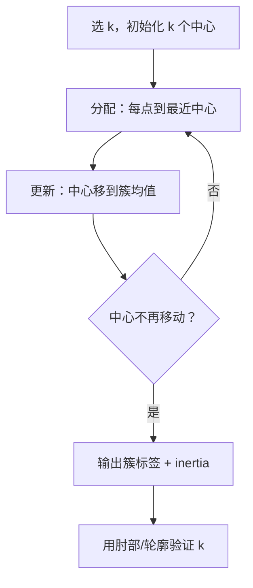

# ML-034 K-Means 聚类

## 1. 本节学习目标

1. 写出 K-Means 的目标函数（簇内平方和），说清"分配—更新"两步迭代。
2. 会用**肘部法**与**轮廓系数**选 $k$，并知道两者可能不一致。
3. 理解 K-Means 的四个硬假设（球形、等大、$k$ 已知、对初值敏感）。
4. 会用 `n_init` 缓解局部最优。

## 2. 为什么需要这个知识

因为 K-Means 是**最常用的聚类算法**：快、简单、容易解释。

但它也是**被误用最多**的算法：在非球形、大小差异大、有异常值的数据上硬套，会得到看起来很整齐、实际毫无意义的簇。理解它的假设，才能判断它适不适合眼前的数据。

## 3. 直观解释

K-Means 的迭代就像**分座位**：

1. 先随便定 $k$ 个"中心"。
2. 每个人坐到最近的中心旁。
3. 每个中心移到"自己人"的中间位置。
4. 重复 2–3，直到不再变动。

**目标**：让每个簇内部尽量紧凑。

**形式化**：最小化"每个点到其簇中心的距离平方和"（inertia）。

## 4. 正式定义

**目标函数**

$$
J = \sum_{k=1}^{K}\sum_{\mathbf{x}\in C_k}\|\mathbf{x}-\boldsymbol\mu_k\|^2
$$

**两步迭代**

1. **分配**：$\mathbf{x}$ 归到最近的 $\boldsymbol\mu_k$
2. **更新**：$\boldsymbol\mu_k = \frac{1}{|C_k|}\sum_{\mathbf{x}\in C_k}\mathbf{x}$

**收敛**：$J$ 单调不增，迭代必然收敛（可能收敛到局部最优）。

**复杂度**：$O(nKd)$ 每轮。

**关键超参**

| 参数 | 作用 |
|---|---|
| `n_clusters` | 簇数 $k$（必须给） |
| `n_init` | 不同初始化的运行次数，取最好（默认 10） |
| `init="k-means++"` | 初始中心尽量分散（默认） |
| `max_iter` | 单次迭代上限 |

## 5. 核心原理

**四个隐含假设**（违反会出问题）：

| 假设 | 违反的后果 |
|---|---|
| 簇是**球形** | 长条形/环形数据被切错 |
| 簇**大小相近** | 大簇被拆、小簇被并 |
| $k$ **已知** | 只能靠外部指标/业务猜 |
| 对**初值敏感** | 换种子结果不同 |

**为什么 $J$ 一定下降**：分配步固定中心时，就近分配必然使 $J$ 不增；更新步固定分配时，均值是 $J$ 的最优解。两步都不增 ⇒ 收敛。

**为什么需要 `n_init`**：K-Means 只保证局部最优，多跑几次取 $J$ 最小的，能显著降低"坏初始化"的概率。

## 6. 数学表达式

**本课实验**（`make_blobs`，400 样本，4 个真实中心）

| $k$ | inertia | 轮廓系数 |
|---|---|---|
| 2 | 12331.3 | 0.5885 |
| 3 | 3484.1 | 0.7641 |
| **4** | **750.3** | **0.8099** |
| 5 | 676.3 | 0.6875 |
| 6 | 602.8 | 0.5794 |

**肘部法读法**：inertia 从 12331 → 3484 → 750（$k=2\to3\to4$ 陡降），从 750 → 676 → 603（$k=4\to5\to6$ 明显变平）。**拐点在 $k=4$**。

**轮廓系数读法**：$k=4$ 时 **0.8099** 最高，与肘部法一致。

**两个指标一致是好事**；不一致时以轮廓/业务为准（见"常见错误"）。

## 7. 数学库链接

| 用到的数学 | 对应篇目 | 用在哪 |
|---|---|---|
| 欧氏距离 | [[MATH-201 向量与空间基础]] | 分配到最近中心 |
| 均值最小化平方和 | [[MATH-306 期望、方差与协方差]] | 更新步的均值解 |

## 8. 算法执行流程



## 9. 可视化解释

```text
肘部法
inertia
 12k ┤●
     │ ╲
  3k ┤   ●
 750 ┤     ●───●───●   ← 拐点在 k=4
     └──┬──┬──┬──┬──┬──► k
        2  3  4  5  6
```

## 10. Python 实现

```powershell
python ml034_kmeans.py
```

```python
import numpy as np
from sklearn.cluster import KMeans
from sklearn.datasets import make_blobs
from sklearn.metrics import silhouette_score

X, y = make_blobs(n_samples=400, centers=4, cluster_std=1.0, random_state=7)

for k in (2, 3, 4, 5, 6):
    km = KMeans(n_clusters=k, n_init=10, random_state=42).fit(X)
    print(f"k={k}: inertia={km.inertia_:8.1f}  轮廓={silhouette_score(X, km.labels_):.4f}")

best = KMeans(n_clusters=4, n_init=10, random_state=42).fit(X)
print("前 2 个样本到各中心距离:", best.transform(X[:2]).round(2).tolist())
print("簇大小:", np.bincount(best.labels_).tolist())
print("簇中心:\n", best.cluster_centers_.round(2))
```

**实际运行结果**

```
k=2: inertia= 12331.3  轮廓=0.5885
k=3: inertia=  3484.1  轮廓=0.7641
k=4: inertia=   750.3  轮廓=0.8099
k=5: inertia=   676.3  轮廓=0.6875
k=6: inertia=   602.8  轮廓=0.5794
前 2 个样本到各中心距离: [[14.45, 1.52, 13.7, 18.13], [1.57, 13.94, 10.72, 8.57]]
簇大小: [100, 100, 100, 100]
簇中心:
 [[ 4.47 -8.6 ]
 [-0.65  9.47]
 [-2.57  2.63]
 [-8.55 -6.93]]
```

## 11. 代码逐行解释

| 代码 | 作用 |
|---|---|
| `KMeans(n_clusters=k, n_init=10)` | `n_init` 跑 10 次初值取最好 |
| `km.inertia_` | 簇内平方和，越小越紧 |
| `silhouette_score(X, labels)` | 内部指标，越大越好 |
| `best.transform(X[:2])` | 返回样本到**每个**中心的距离 |
| `np.bincount(labels)` | 各簇样本数 |

**`transform` 的用途**：除了诊断，还能当**特征**用（"到各簇中心的距离"可以作为监督模型的新特征，即"聚类特征"）。

## 12. 实际运行结果

见第 10 节。三点：

1. inertia 从 12331 陡降到 750（$k=2\to4$），之后变平 ⇒ **肘部在 $k=4$**。
2. 轮廓系数在 $k=4$ 达到最高 **0.8099**，与肘部一致。
3. 簇大小 100/100/100/100，完美还原生成时的均匀分布。

## 13. 适用场景

| 场景 | 说明 |
|---|---|
| 用户分群 | 最常见 |
| 图像颜色量化 | 把像素聚成 $k$ 种色 |
| 文档聚类 | 需先向量化 |
| 特征构造 | 用"到中心距离"作为新特征 |
| 非球形/大小差异大 | **不适用**（用 DBSCAN/层次） |

## 14. 优点与缺点

| 优点 | 缺点 |
|---|---|
| 快（$O(nKd)$）、可扩展 | 需预设 $k$ |
| 简单、易解释 | 只适合球形、等大簇 |
| 收敛有保证 | 对初值和异常值敏感 |
| 可输出"到中心距离"做特征 | 硬分配（无概率） |

## 15. 常见错误

| 错误 | 表现 | 纠正 |
|---|---|---|
| 不标准化 | 大尺度特征主导距离 | 先 `StandardScaler` |
| 不设 `n_init` | 结果随种子抖动 | `n_init=10` 或更大 |
| 用 inertia 单调下降选 $k$ | 永远选最大 $k$ | 看**肘部**或轮廓 |
| 非球形数据硬用 | 环形数据被切半 | 用 DBSCAN |
| 认为簇号有含义 | 簇 0 ≠ 真实类 0 | 用 ARI 对齐或人工命名 |
| 用测试集"验证"聚类 | 无标签，无从验证 | 内部指标 + 业务 |

## 16. 本节总结

- K-Means = **分配 + 更新**迭代，最小化簇内平方和。
- 选 $k$：肘部法（inertia 拐点）+ 轮廓系数；本课两者都指向 $k=4$。
- 四个假设：球形、等大、$k$ 已知、初值敏感 ⇒ 用前先检查数据形状。

## 17. 前置与后续

- 前置：[[ML-033 无监督学习基本概念]]
- 后续：[[ML-035 层次聚类]]、`ML-036 DBSCAN`（待建）、`ML-037 距离度量与聚类评价`（待建）
- 相关数学：[[MATH-201 向量与空间基础]]、[[MATH-306 期望、方差与协方差]]

## 18. 练习与参考答案

**基础 1**：写出 K-Means 的目标函数与两步迭代。

**基础 2**：本课 inertia 与轮廓系数在 $k=4$ 时各是多少？为什么说"拐点在 4"？

**进阶 1**：为什么 `n_init` 越大越可靠？代价是什么？

**综合 1**：若数据是环形（内圈+外圈两个簇），K-Means 会怎样？为什么？

> [!success]- 参考答案

> **基础 1**
> $$J=\sum_{k}\sum_{\mathbf{x}\in C_k}\|\mathbf{x}-\boldsymbol\mu_k\|^2$$
> ① 分配：每个点归到最近的中心；② 更新：中心移到该簇样本的均值。重复直到中心不动。

> **基础 2**
> $k=4$：inertia **750.3**、轮廓 **0.8099**。
> 拐点判据：inertia 从 $k=2$ 到 $k=4$ 下降 12331→750（降 94%），而从 $k=4$ 到 $k=6$ 只降 750→603（降 20%）——**边际收益骤减**，拐点在 4。轮廓系数独立地也在此处取最大。

> **进阶 1**
> K-Means 只保证局部最优，不同的初始化可能落到不同的局部解；`n_init` 跑多次取 inertia 最小者，能降低"坏初始化"概率。
> 代价：训练时间线性增长（`n_init=10` 即 10 倍），大数据上需权衡（或用 `init="k-means++"` + 较小 `n_init`）。

> **综合 1**
> 会**切成两半**而不是内圈/外圈。
> 原因：K-Means 用"到中心的欧氏距离"，它只能产生**凸的、球形**的划分。环形数据的两簇在空间上是同心圆，任何一条直线（Voronoi 边界）都无法把它们分开。
> 正确选择：DBSCAN（基于密度）或谱聚类。

---

## 🔗 Notion 同步信息

> 以下内容由 Notion「AI Knowledge System · 知识点」数据库按知识 ID 合并而来（导出于 2026-11-09）。

| 属性 | 值 |
|---|---|
| 学科 | 机器学习 |
| 学习状态 | 未开始 |
| 难度 | L2 应用 |
| 知识类型 | Algorithm |

- **所属模块**：[M-ML-05 无监督学习](../%E8%AF%BE%E7%A8%8B%E6%A8%A1%E5%9D%97/M-ML-05%20%E6%97%A0%E7%9B%91%E7%9D%A3%E5%AD%A6%E4%B9%A0.md)
- **前置知识**：[ML-033 无监督学习基本概念](ML-033%20%E6%97%A0%E7%9B%91%E7%9D%A3%E5%AD%A6%E4%B9%A0%E5%9F%BA%E6%9C%AC%E6%A6%82%E5%BF%B5.md)
- **后继知识**：[ML-035 层次聚类](ML-035%20%E5%B1%82%E6%AC%A1%E8%81%9A%E7%B1%BB.md)
- **关联Python**：[PY-066 矩阵运算](../../01_Python%E5%9F%BA%E7%A1%80/08%20NumPy/PY-066%20%E7%9F%A9%E9%98%B5%E8%BF%90%E7%AE%97.md)
- **关联数学**：[MATH-201 向量与空间基础](../../06_%E6%95%B0%E5%AD%A6%E5%9F%BA%E7%A1%80/02%20%E7%BA%BF%E6%80%A7%E4%BB%A3%E6%95%B0/MATH-201%20%E5%90%91%E9%87%8F%E4%B8%8E%E7%A9%BA%E9%97%B4%E5%9F%BA%E7%A1%80.md) · [MATH-306 期望、方差与协方差](../../06_%E6%95%B0%E5%AD%A6%E5%9F%BA%E7%A1%80/03%20%E6%A6%82%E7%8E%87%E8%AE%BA/MATH-306%20%E6%9C%9F%E6%9C%9B%E3%80%81%E6%96%B9%E5%B7%AE%E4%B8%8E%E5%8D%8F%E6%96%B9%E5%B7%AE.md)
