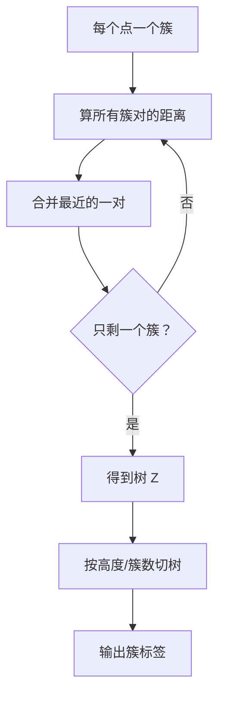

# ML-035 层次聚类

## 1. 本节学习目标

1. 说清**凝聚式**（自底向上）与**分裂式**（自顶向下）的区别。
2. 理解四种 `linkage`（ward/complete/average/single）如何定义"簇间距离"。
3. 会读树状图（dendrogram）并用**距离阈值**切出簇数。
4. 知道层次聚类**不需要预设 $k$**，但**不能回头改**。

## 2. 为什么需要这个知识

因为 K-Means 必须预设 $k$，而现实中你常常不知道分几群。

层次聚类一次性给出**完整的层级结构**（树），你可以事后在任意高度切一刀，得到不同的簇数。它还给出"谁和谁先合并"的关系，对探索性分析很有价值。

代价：时间 $O(n^3)$、内存 $O(n^2)$，大数据跑不动。

## 3. 直观解释

**凝聚式（自底向上）**：一开始每个点是一个簇，反复把"最近的两个簇"合并，直到只剩一个。

**分裂式**：反过来，从一个大簇开始不断拆分（少用）。

**树状图**：横轴是样本，纵轴是"合并时的距离"。在某个高度横切一刀，就把树切成若干簇。

```text
距离
 10 ┤      ┌───┐
  8 ┤   ┌──┘   └──┐
  5 ┤ ┌─┘         └─┐
  2 ┤─┤             ├─
    └──────────────────► 样本
      切在这里（高度 5）⇒ 2 个簇
```

## 4. 正式定义

**簇间距离（linkage）**

| 方式 | 定义 | 特点 |
|---|---|---|
| `single` | 两簇**最近**两点的距离 | 能发现长条/非球形，但易"链式"粘连 |
| `complete` | 两簇**最远**两点的距离 | 倾向紧凑等大簇 |
| `average` | 所有点对的平均距离 | 折中 |
| `ward` | 合并后**簇内方差增加量**最小 | 默认，倾向球形等大 |

**Ward 的合并代价**

$$
\Delta = \frac{|A||B|}{|A|+|B|}\|\boldsymbol\mu_A-\boldsymbol\mu_B\|^2
$$

**复杂度**：$O(n^3)$（朴素）/ $O(n^2\log n)$（优化版），内存 $O(n^2)$。

**切树方式**

- 指定簇数：`n_clusters=k`。
- 指定距离阈值：`fcluster(Z, t=..., criterion="distance")`。

## 5. 核心原理

**为什么不需要预设 $k$**：一次构建完整树，事后切任意高度。

**为什么"不能回头"**：每一步合并都是**贪心且不可逆**——一旦两个簇合并，就再也不能分开。早期错误会传播下去。

**linkage 怎么选**：

- 数据近似球形、大小相近 ⇒ **ward**（默认，最常用）。
- 有长条/不规则形状 ⇒ `single`（但小心链式效应）。
- 想要紧凑簇 ⇒ `complete`。

**本课的诚实结果**：在良分离的 `make_blobs`（3 簇，`cluster_std=0.7`）上，**四种 linkage 全部 ARI=1.0000、轮廓=0.8185**——完全一样。

说明：**在简单数据上，linkage 的选择无关紧要**；差异只在复杂/边界模糊的数据上才显现。不能拿这个结果说"四种方法等价"。

## 6. 数学表达式

**本课实验**（150 样本，3 个真实簇）

| linkage | ARI | 轮廓 |
|---|---|---|
| ward | 1.0000 | 0.8185 |
| complete | 1.0000 | 0.8185 |
| average | 1.0000 | 0.8185 |
| single | 1.0000 | 0.8185 |

**按距离阈值切树**（ward 联结矩阵 $Z$，形状 $(149,4)$）

| 阈值 $t$ | 得到的簇数 |
|---|---|
| 1 | 36 |
| 3 | 11 |
| 10 | **3** |

**读法**：$Z$ 有 149 行 = $n-1$ 次合并（150 个点合并成 1 个簇需要 149 次）。阈值越大，允许合并的距离越大 ⇒ 簇数越少。

## 7. 数学库链接

| 用到的数学 | 对应篇目 | 用在哪 |
|---|---|---|
| 欧氏距离 | [[MATH-201 向量与空间基础]] | 点间距离 |
| 方差与均值 | [[MATH-306 期望、方差与协方差]] | ward 的方差增量 |

## 8. 算法执行流程



## 9. 可视化解释

```text
ward 树状图（简化）
      ┌────────────┐        ← 最后一次合并
   ┌──┘            └──┐
 ┌─┘                  └─┐
─┤                      ├─
 └─┬─┐                ┌─┬─┘
   └─┘                └─┘
 簇1 簇2             簇3
   在"高度 10"横切 ⇒ 3 个簇
```

## 10. Python 实现

```powershell
python ml035_hierarchical.py
```

```python
import numpy as np
from scipy.cluster.hierarchy import fcluster, linkage
from sklearn.cluster import AgglomerativeClustering
from sklearn.datasets import make_blobs
from sklearn.metrics import adjusted_rand_score, silhouette_score

X, y = make_blobs(n_samples=150, centers=3, cluster_std=0.7, random_state=3)

for link in ("ward", "complete", "average", "single"):
    model = AgglomerativeClustering(n_clusters=3, linkage=link).fit(X)
    print(f"{link:<9} ARI={adjusted_rand_score(y, model.labels_):.4f}"
          f" 轮廓={silhouette_score(X, model.labels_):.4f}")

Z = linkage(X, method="ward")
print("联结矩阵形状:", Z.shape)
for t in (1, 3, 10):
    labels = fcluster(Z, t=t, criterion="distance")
    print(f"距离阈值 t={t}: 簇数={len(np.unique(labels))}")
```

**实际运行结果**

```
ward      ARI=1.0000 轮廓=0.8185
complete  ARI=1.0000 轮廓=0.8185
average   ARI=1.0000 轮廓=0.8185
single    ARI=1.0000 轮廓=0.8185
联结矩阵形状: (149, 4)
距离阈值 t=1: 簇数=36
距离阈值 t=3: 簇数=11
距离阈值 t=10: 簇数=3
```

## 11. 代码逐行解释

| 代码 | 作用 |
|---|---|
| `AgglomerativeClustering(n_clusters=3, linkage=...)` | sklearn 版，直接给簇数 |
| `linkage(X, method="ward")` | scipy 版，返回**联结矩阵** |
| `Z.shape == (149, 4)` | $n-1$ 次合并，每行 4 列（簇1、簇2、距离、样本数） |
| `fcluster(Z, t=10, criterion="distance")` | 按**距离阈值**切树 |
| `criterion="maxclust"` | 按**目标簇数**切 |

**两种切法**：`criterion="distance"` 用高度切（需试阈值），`criterion="maxclust"` 直接说"我要 3 个簇"。本课用的是距离切法，所以能看到 $t$ 与簇数的对应关系。

## 12. 实际运行结果

见第 10 节。三点：

1. 四种 linkage 在这份数据上**完全一致**（ARI 1.0、轮廓 0.8185）——因为簇分得很开。
2. 联结矩阵 149 行 = $150-1$ 次合并。
3. 阈值 $t$ 从 1 增到 10，簇数从 36 降到 3，呈单调关系。

## 13. 适用场景

| 场景 | 说明 |
|---|---|
| 探索性分析 | 想看层级结构 |
| 不知道分几类 | 一次建树、多次切 |
| 小数据（<1 万） | 复杂度可接受 |
| 需要"合并顺序" | 树状图直接给 |
| 大数据 | **不适用**（$O(n^3)$） |

## 14. 优点与缺点

| 优点 | 缺点 |
|---|---|
| 不需预设簇数 | 时间 $O(n^3)$、内存 $O(n^2)$ |
| 给出完整层级（树状图） | 合并不可逆（贪心） |
| 可换 linkage 适配形状 | 对噪声与离群点敏感 |
| 结果可解释 | 大数据不适用 |

## 15. 常见错误

| 错误 | 表现 | 纠正 |
|---|---|---|
| 不标准化 | 大尺度特征主导 | 先标准化 |
| 大数据硬用 | 内存/时间爆炸 | 换 K-Means/DBSCAN |
| 只用 `single` | 链式效应把远点串成一条 | 试 ward/complete |
| 认为 linkage 无关紧要 | 简单数据上才一致 | 复杂数据要试 |
| 切树后不复核 | 簇数不是业务要的 | 结合轮廓/业务 |
| 用 ARI 调参 | 用了真标签 | 只用内部指标 |

## 16. 本节总结

- 层次聚类 = **自底向上反复合并最近簇**，一次得到整棵树。
- 不需要预设 $k$，但合并不可逆；linkage 决定"簇间距离"。
- 本课四种 linkage 在良分离数据上结果相同 —— 差异只在复杂数据上显现。

## 17. 前置与后续

- 前置：[[ML-034 K-Means 聚类]]
- 后续：`ML-036 DBSCAN`（待建）、`ML-037 距离度量与聚类评价`（待建）
- 相关数学：[[MATH-201 向量与空间基础]]、[[MATH-306 期望、方差与协方差]]

## 18. 练习与参考答案

**基础 1**：层次聚类与 K-Means 最大的区别是什么？

**基础 2**：本课四种 linkage 的 ARI 与轮廓各是多少？这说明什么？

**进阶 1**：`single` linkage 的"链式效应"是什么？为什么它既是优点也是缺点？

**综合 1**：150 个样本的 ward 联结矩阵为什么是 149 行？$t=10$ 时为什么得到 3 个簇？

> [!success]- 参考答案

> **基础 1**
> 层次聚类**不需要预设簇数**，一次构建完整树后可在任意高度切；K-Means 必须给 $k$。
> 代价：层次聚类 $O(n^3)$ 慢且合并不可逆；K-Means 快且可迭代优化。

> **基础 2**
> 四种全部 **ARI=1.0000、轮廓=0.8185**。
> 说明：这份数据（`cluster_std=0.7`，3 个良分离簇）太容易，任何 linkage 都能完美分开。
> **不能**由此得出"四种 linkage 等价"——在形状不规则、簇间有重叠的数据上，它们会明显分叉。

> **进阶 1**
> `single` 用"两簇最近点的距离"合并，因此只要有一条点链把两个远簇连起来，它们就会被合并成一个长条簇——这就是链式效应。
> 优点：能发现**非球形、长条形**的簇（如月牙形）。
> 缺点：一个噪声点桥接就可能把两个本应分开的簇粘在一起，对噪声极敏感。

> **综合 1**
> **149 行**：凝聚式从 150 个单点簇开始，每次合并减少一个簇，合并到只剩 1 个簇共需 $150-1=149$ 次，每次一行。
> **$t=10$ 得 3 簇**：阈值 10 表示"只在距离 ≤10 时允许合并"。数据里簇内距离都小于 10、簇间距离大于 10，所以合并到 3 个簇就停了。实跑中 $t=3$ 得 11 簇、$t=1$ 得 36 簇，说明阈值与簇数单调对应。

---

## 🔗 Notion 同步信息

> 以下内容由 Notion「AI Knowledge System · 知识点」数据库按知识 ID 合并而来（导出于 2026-11-09）。

| 属性 | 值 |
|---|---|
| 学科 | 机器学习 |
| 学习状态 | 未开始 |
| 难度 | L2 应用 |
| 知识类型 | Algorithm |

- **所属模块**：[M-ML-05 无监督学习](../%E8%AF%BE%E7%A8%8B%E6%A8%A1%E5%9D%97/M-ML-05%20%E6%97%A0%E7%9B%91%E7%9D%A3%E5%AD%A6%E4%B9%A0.md)
- **前置知识**：[ML-034 K-Means 聚类](ML-034%20K-Means%20%E8%81%9A%E7%B1%BB.md)
- **后继知识**：[ML-036 DBSCAN](ML-036%20DBSCAN.md)
- **关联Python**：[PY-066 矩阵运算](../../01_Python%E5%9F%BA%E7%A1%80/08%20NumPy/PY-066%20%E7%9F%A9%E9%98%B5%E8%BF%90%E7%AE%97.md)
- **关联数学**：[MATH-201 向量与空间基础](../../06_%E6%95%B0%E5%AD%A6%E5%9F%BA%E7%A1%80/02%20%E7%BA%BF%E6%80%A7%E4%BB%A3%E6%95%B0/MATH-201%20%E5%90%91%E9%87%8F%E4%B8%8E%E7%A9%BA%E9%97%B4%E5%9F%BA%E7%A1%80.md)
