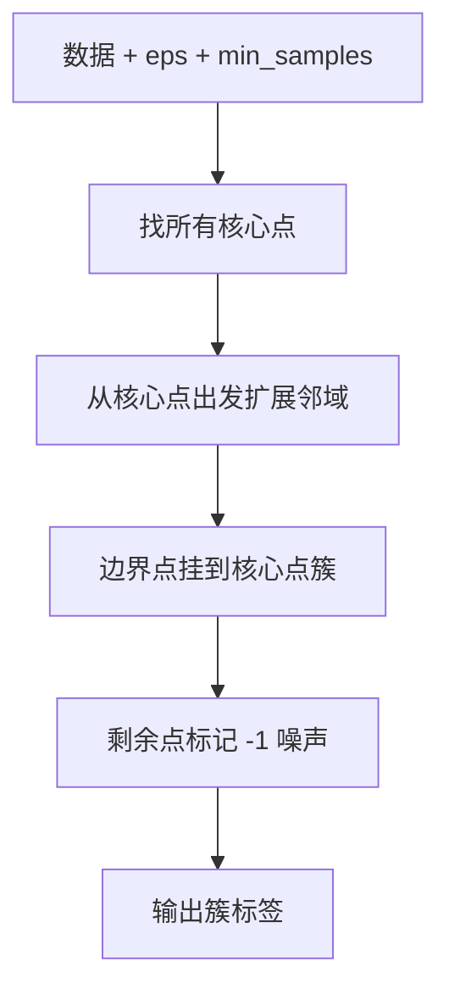

# ML-036 DBSCAN

## 1. 本节学习目标

1. 说清 DBSCAN 的**密度定义**：核心点、边界点、噪声点。
2. 理解 `eps` 与 `min_samples` 如何决定"稠密"。
3. 知道 DBSCAN 能发现**任意形状**的簇、且**自带噪声标记**（`-1`）。
4. **理解轮廓系数在非凸簇上会误判**（本课 0.3298 但 ARI=1.0）。

## 2. 为什么需要这个知识

因为 K-Means 与层次聚类都基于**距离/方差**，只能切出"凸的、球形的"簇。环形、月牙形、S 形数据会被切错。

DBSCAN 换了一个视角：**只要密度连成片，就是同一个簇**。这让它能处理任意形状，并把低密度区域自动标成噪声——这是 K-Means 做不到的。

## 3. 直观解释

DBSCAN 用两个参数定义"稠密"：

- `eps`（ε）：半径。以某点为中心、半径 ε 的圆。
- `min_samples`：圆内至少要有多少个点。

三类点：

| 类型 | 定义 |
|---|---|
| **核心点** | 半径 ε 内至少有 `min_samples` 个点（含自己） |
| **边界点** | 自己不够密，但在某个核心点的 ε 内 |
| **噪声点** | 既不是核心也不是边界 ⇒ 标签 `-1` |

**聚类规则**：核心点与其 ε 邻域内的点连成一簇，边界点挂到最近的核心点簇上。

## 4. 正式定义

**ε-邻域**

$$
N_\varepsilon(\mathbf{x}) = \{\mathbf{x}' : d(\mathbf{x},\mathbf{x}')\le\varepsilon\}
$$

**核心点**

$$
|N_\varepsilon(\mathbf{x})| \ge \text{min\_samples}
$$

**密度可达**：从核心点出发，经过一串核心点可达。

**簇**：密度可达关系下的极大连通分量。

**噪声**：不属于任何簇 ⇒ `labels_ == -1`。

**参数经验**：`min_samples` 常取 $2d$（$d$ 为维数）或更大；`eps` 用 k-距离图（k-distance plot）找拐点。

## 5. 核心原理

**为什么能处理任意形状**：簇由"密度连通"定义，而不是"到中心的距离"。

**为什么自带噪声**：密度不够的点被显式标成 `-1`，不必强行归簇。

**为什么轮廓系数会误判**：轮廓系数基于"到本簇中心的平均距离 vs 到最近他簇的平均距离"，它**偏好凸的、紧的簇**。月牙形簇虽然内部连通，但"平均距离"很大 ⇒ 轮廓分数低。

**本课的硬证据**：

| 指标 | 数值 | 含义 |
|---|---|---|
| ARI（对照真标签） | **1.0000** | 划分完美 |
| 轮廓系数 | **0.3298** | 看起来"很差" |

**同一个聚类结果，两个指标给出相反判断。** 这说明内部指标不能盲信，要结合数据形状。

## 6. 数学表达式

**本课实验 1**（`make_moons`，300 样本，噪声 0.06）

| `eps` | 簇数 | 噪声点 | ARI |
|---|---|---|---|
| 0.1 | 15 | 26 | 0.1511 |
| **0.2** | **2** | **0** | **1.0000** |
| 0.3 | 2 | 0 | 1.0000 |

**$eps=0.1$ 时碎片化**：半径太小，连不成片 ⇒ 15 个碎片 + 26 个噪声。

**本课实验 2**（环形数据 `make_circles`，factor=0.4）

| 算法 | ARI |
|---|---|
| DBSCAN | **1.0000** |
| K-Means | **−0.0033** |

K-Means 的 ARI ≈ 0 意味着"与随机划分相当"——它把内圈外圈各切一半。

## 7. 数学库链接

| 用到的数学 | 对应篇目 | 用在哪 |
|---|---|---|
| 邻域与距离 | [[MATH-201 向量与空间基础]] | $\varepsilon$-邻域 |
| 连通性 | [[MATH-505 图论与树基础]] | 密度可达 = 图上的连通分量 |

## 8. 算法执行流程



## 9. 可视化解释

```text
月牙形数据
  ●●●●        DBSCAN 沿密度连成两弯
 ●●  ●●       K-Means 用直线切 ⇒ 每弯被劈开
●●●   ●●●
```

## 10. Python 实现

```powershell
python ml036_dbscan.py
```

```python
import numpy as np
from sklearn.cluster import DBSCAN, KMeans
from sklearn.datasets import make_circles, make_moons
from sklearn.metrics import adjusted_rand_score, silhouette_score

X, y = make_moons(n_samples=300, noise=0.06, random_state=42)

for eps in (0.1, 0.2, 0.3):
    db = DBSCAN(eps=eps, min_samples=5).fit(X)
    n_clusters = len(set(db.labels_)) - (1 if -1 in db.labels_ else 0)
    print(f"eps={eps}: 簇数={n_clusters} 噪声={int((db.labels_ == -1).sum())}"
          f" ARI={adjusted_rand_score(y, db.labels_):.4f}")

best = DBSCAN(eps=0.2, min_samples=5).fit(X)
mask = best.labels_ != -1
print("轮廓(排除噪声):", round(silhouette_score(X[mask], best.labels_[mask]), 4))
print("KMeans 对比 ARI:", round(adjusted_rand_score(
    y, KMeans(n_clusters=2, n_init=10, random_state=42).fit(X).labels_), 4))

Xc, yc = make_circles(n_samples=300, noise=0.05, factor=0.4, random_state=42)
db_c = DBSCAN(eps=0.2, min_samples=5).fit(Xc)
km_c = KMeans(n_clusters=2, n_init=10, random_state=42).fit(Xc)
print("环形数据 → DBSCAN ARI:", round(adjusted_rand_score(yc, db_c.labels_), 4),
      " KMeans ARI:", round(adjusted_rand_score(yc, km_c.labels_), 4))
```

**实际运行结果**

```
eps=0.1: 簇数=15 噪声=26 ARI=0.1511
eps=0.2: 簇数=2 噪声=0 ARI=1.0000
eps=0.3: 簇数=2 噪声=0 ARI=1.0000
轮廓(排除噪声): 0.3298
KMeans 对比 ARI: 0.2475
环形数据 → DBSCAN ARI: 1.0  KMeans ARI: -0.0033
```

## 11. 代码逐行解释

| 代码 | 作用 |
|---|---|
| `DBSCAN(eps=..., min_samples=5)` | 两个核心参数 |
| `set(labels) - {-1}` | 统计簇数时**排除噪声标签** |
| `(labels == -1).sum()` | 噪声点数量 |
| `X[mask]` | 算轮廓时排除噪声（轮廓不接受 `-1`） |
| `KMeans(n_clusters=2)` | 对照基线 |

**`eps` 的敏感性**：0.1 → 15 个碎片；0.2 → 完美 2 簇。**同一份数据，参数差一倍，结果天差地别**。这是 DBSCAN 最大的实践难点。

## 12. 实际运行结果

见第 10 节。三点：

1. `eps=0.2` 时 ARI **1.0**（完美），而 K-Means 只有 **0.2475**。
2. 环形数据上 DBSCAN **1.0** vs K-Means **−0.0033**（等于随机）。
3. **轮廓只有 0.3298**，但 ARI 是 1.0 —— 轮廓在这里"误判"了。

## 13. 适用场景

| 场景 | 说明 |
|---|---|
| 任意形状簇 | **DBSCAN 强项** |
| 需要标出异常点 | 自带 `-1` |
| 簇数未知 | 不用预设 $k$ |
| 密度差异大的多簇 | 需调 `eps`，或用 HDBSCAN |
| 高维数据 | 密度估计失效（维度灾难） |
| 数据量极大 | $O(n\log n)$ 尚可，但内存高 |

## 14. 优点与缺点

| 优点 | 缺点 |
|---|---|
| 任意形状簇 | 对 `eps` 极敏感 |
| 自动识别噪声 | 密度差异大时难兼顾 |
| 不需预设簇数 | 高维效果差 |
| 对离群点鲁棒 | 参数无解析最优解 |

## 15. 常见错误

| 错误 | 表现 | 纠正 |
|---|---|---|
| 不标准化 | 距离被大尺度特征主导 | 标准化 |
| `eps` 靠猜 | 0.1 碎成 15 块 | 用 k-距离图找拐点 |
| 簇数统计含噪声 | 多算一类 | 排除 `-1` |
| 用轮廓评价非凸簇 | 明明对却打分低 | 结合 ARI/可视化 |
| 密度差异大仍用单一 `eps` | 有的簇被当噪声 | 分层 DBSCAN/HDBSCAN |
| 高维硬用 | 所有点都成噪声 | 先 PCA 降维 |

## 16. 本节总结

- DBSCAN 靠**密度连通**定义簇，能处理任意形状并标出噪声。
- `eps` 极其敏感：本课 0.1 → ARI 0.15，0.2 → ARI 1.0。
- **轮廓系数偏好凸簇**：本课轮廓 0.3298 但 ARI=1.0，说明内部指标不能盲信。

## 17. 前置与后续

- 前置：[[ML-035 层次聚类]]、[[ML-034 K-Means 聚类]]
- 后续：[[ML-037 距离度量与聚类评价]]、[[ML-039 异常检测]]
- 相关数学：[[MATH-201 向量与空间基础]]、[[MATH-505 图论与树基础]]

## 18. 练习与参考答案

**基础 1**：核心点、边界点、噪声点分别怎么定义？

**基础 2**：本课 `eps=0.1/0.2/0.3` 的 ARI 各是多少？

**进阶 1**：为什么轮廓系数在月牙形数据上会给出低分？

**综合 1**：环形数据上 K-Means 的 ARI 是 −0.0033，这意味着什么？

> [!success]- 参考答案

> **基础 1**
> - 核心点：半径 `eps` 内至少 `min_samples` 个点（含自身）。
> - 边界点：自身邻域不够密，但落在某个核心点的 `eps` 内。
> - 噪声点：既非核心也非边界 ⇒ 标签 `-1`。

> **基础 2**
> `eps=0.1` → **0.1511**（碎成 15 块）；`eps=0.2` → **1.0000**；`eps=0.3` → **1.0000**。
> 说明 `eps` 有一个"够用区间"，低于它就会碎片化。

> **进阶 1**
> 轮廓系数 = $(b-a)/\max(a,b)$，其中 $a$ 是到本簇其他点的**平均距离**。
> 月牙形簇很长，两端点之间的距离很大 ⇒ $a$ 被拉大 ⇒ $s$ 变小，即使这个簇在密度上完全连通。
> 轮廓隐含"簇应该是紧致的球团"，与 DBSCAN 的形状假设冲突。

> **综合 1**
> ARI ≈ 0 表示"与随机划分相当"（ARI 已扣除随机一致性的期望）。
> 具体地：K-Means 用直线把内圈外圈各切一半，得到的划分与真实"内/外圈"标签几乎无关。
> **负值**（−0.0033）说明比随机还略差一点，属正常波动。

---

## 🔗 Notion 同步信息

> 以下内容由 Notion「AI Knowledge System · 知识点」数据库按知识 ID 合并而来（导出于 2026-11-09）。

| 属性 | 值 |
|---|---|
| 学科 | 机器学习 |
| 学习状态 | 未开始 |
| 难度 | L2 应用 |
| 知识类型 | Algorithm |

- **所属模块**：[M-ML-05 无监督学习](../%E8%AF%BE%E7%A8%8B%E6%A8%A1%E5%9D%97/M-ML-05%20%E6%97%A0%E7%9B%91%E7%9D%A3%E5%AD%A6%E4%B9%A0.md)
- **前置知识**：[ML-035 层次聚类](ML-035%20%E5%B1%82%E6%AC%A1%E8%81%9A%E7%B1%BB.md)
- **后继知识**：[ML-037 距离度量与聚类评价](ML-037%20%E8%B7%9D%E7%A6%BB%E5%BA%A6%E9%87%8F%E4%B8%8E%E8%81%9A%E7%B1%BB%E8%AF%84%E4%BB%B7.md)
- **关联Python**：[PY-066 矩阵运算](../../01_Python%E5%9F%BA%E7%A1%80/08%20NumPy/PY-066%20%E7%9F%A9%E9%98%B5%E8%BF%90%E7%AE%97.md)
- **关联数学**：[MATH-201 向量与空间基础](../../06_%E6%95%B0%E5%AD%A6%E5%9F%BA%E7%A1%80/02%20%E7%BA%BF%E6%80%A7%E4%BB%A3%E6%95%B0/MATH-201%20%E5%90%91%E9%87%8F%E4%B8%8E%E7%A9%BA%E9%97%B4%E5%9F%BA%E7%A1%80.md)
