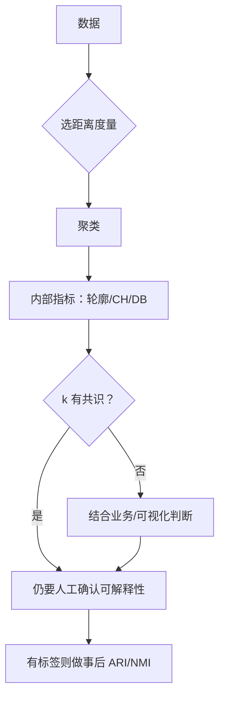

# ML-037 距离度量与聚类评价

## 1. 本节学习目标

1. 会算欧氏、曼哈顿、余弦三种距离，并知道各自适合什么数据。
2. 会用三个内部指标：轮廓、Calinski-Harabasz、Davies-Bouldin，并知道它们**不总一致**。
3. **理解"内部指标可能选出错误的 $k$"**（本课：轮廓选 $k=3$，真值是 4）。
4. 会用 ARI/NMI 做事后对照，并明白它们不能用于调参。

## 2. 为什么需要这个知识

因为聚类有两件事都容易被做错：

- **距离选错**：文本用欧氏距离几乎没意义（长度主导），该用余弦。
- **评价选错**：本课数据真的有 4 个簇，但轮廓系数在 $k=3$ 时最高（0.7588 > 0.5211）——**照着指标选就会选错**。

理解"指标在什么情况下会骗你"，比记住公式重要。

## 3. 直观解释

**距离怎么选**（看数据性质）：

| 数据类型 | 推荐距离 | 理由 |
|---|---|---|
| 连续、同量纲 | 欧氏 | 直观 |
| 高维稀疏、文本 | **余弦** | 只看方向，忽略长度 |
| 有异常值、网格路径 | 曼哈顿 | 抗极值 |
| 集合 | Jaccard | 交集/并集 |

**三个内部指标**（都不需要标签）：

| 指标 | 越大越好？ | 衡量 |
|---|---|---|
| 轮廓 | ✅ | 簇内紧 + 簇间远 |
| CH | ✅ | 簇间/簇内方差比 |
| DB | ❌（**越小越好**） | 簇内/簇间距离比 |

## 4. 正式定义

**三种距离**

$$
d_2 = \sqrt{\textstyle\sum_j (x_j-x'_j)^2}\quad\text{(欧氏)}
$$

$$
d_1 = \sum_j |x_j-x'_j|\quad\text{(曼哈顿)}
$$

$$
d_{\cos} = 1-\frac{\mathbf{x}^\top\mathbf{x}'}{\|\mathbf{x}\|\|\mathbf{x}'\|}\quad\text{(余弦距离)}
$$

**轮廓系数**（单样本）

$$
s(i)=\frac{b(i)-a(i)}{\max(a(i),b(i))}
$$

**Calinski-Harabasz**

$$
\text{CH}=\frac{\text{tr}(B_K)/(K-1)}{\text{tr}(W_K)/(n-K)}
$$

**Davies-Bouldin**

$$
\text{DB}=\frac1K\sum_{k}\max_{j\ne k}\frac{\sigma_k+\sigma_j}{d(\boldsymbol\mu_k,\boldsymbol\mu_j)}
$$

**外部指标（需真标签）**

$$
\text{ARI},\qquad \text{NMI}
$$

## 5. 核心原理

**为什么余弦适合文本**：文本向量关注"哪些词出现"，长度（文档长短）是噪声。余弦只看夹角，天然去掉长度影响。

**为什么内部指标会选错 $k$**：它们都在衡量"紧 vs 分离"的某种几何权衡，而**真实簇数不一定对应几何最优**。本课：

- 真值 4 个簇。
- 轮廓：$k=3$ 时 0.7588 最高，$k=4$ 只有 0.5211。
- CH：同样在 $k=3$ 时最高（3027.1）。

**两个指标一致地"选错"**——这是因为数据里 4 个簇中有一对距离较近，合并成 3 个反而让几何指标更好看。

**这课的核心结论**：内部指标是**参考**，不是答案。最终要以业务可解释性 + 外部验证（若有标签）为准。

## 6. 数学表达式

**本课实验 1**（5 个随机三维向量）

| 距离 | $d(0,1)$ | 最大距离 |
|---|---|---|
| 欧氏 | 1.200 | 1.293 |
| 曼哈顿 | 2.036 | 2.036 |
| 余弦 | 0.684 | 0.684 |

**本课实验 2**（`make_blobs`，**真实 $k=4$**，`cluster_std=0.9`）

| $k$ | 轮廓 ↑ | CH ↑ | DB ↓ |
|---|---|---|---|
| 2 | 0.7348 | 1465.7 | 0.3917 |
| **3** | **0.7588** | **3027.1** | 0.3556 |
| 4 | 0.5211 | 2459.0 | 0.8005 |
| 5 | 0.5403 | 2177.6 | 0.6748 |

**注意**：DB 在 $k=3$ 时最小（0.3556）⇒ 三个指标**一致指向 3**，而真值是 4。

**事后对照（$k=4$）**：ARI **0.7139**、NMI **0.7783**——即使 $k$ 对了，划分也不完美（簇间有重叠）。

## 7. 数学库链接

| 用到的数学 | 对应篇目 | 用在哪 |
|---|---|---|
| 范数与内积 | [[MATH-201 向量与空间基础]] | 三种距离 |
| 方差与迹 | [[MATH-306 期望、方差与协方差]] | CH 的 $B_K/W_K$ |
| 熵与互信息 | [[MATH-506 信息量与熵]] | NMI 的定义 |

## 8. 算法执行流程



## 9. 可视化解释

```text
同一份数据（真 k=4），三个指标都给 k=3 打最高分
轮廓  k=2 ▁▁ k=3 ███ k=4 ▂▂ k=5 ▂▂▂   ← 指标选 3
CH    k=2 ▂▂ k=3 ███ k=4 ▃▃ k=5 ▂▂    ← 指标选 3
真值  ──────────── k=4 ────────────    ← 实际是 4

⇒ 指标与真值冲突时，指标不是裁判
```

## 10. Python 实现

```powershell
python ml037_distance_metrics.py
```

```python
import numpy as np
from sklearn.cluster import KMeans
from sklearn.datasets import make_blobs
from sklearn.metrics import (adjusted_rand_score, calinski_harabasz_score,
                             davies_bouldin_score, normalized_mutual_info_score,
                             silhouette_score)
from sklearn.metrics import pairwise_distances

rng = np.random.default_rng(0)
A = rng.random((5, 3))
for metric in ("euclidean", "manhattan", "cosine"):
    D = pairwise_distances(A, metric=metric)
    print(f"{metric}: d(0,1)={D[0, 1]:.3f} 最大={D.max():.3f}")

X, y = make_blobs(n_samples=300, centers=4, cluster_std=0.9, random_state=5)
print("真实簇数:", len(np.unique(y)))
for k in (2, 3, 4, 5):
    labels = KMeans(k, n_init=10, random_state=42).fit_predict(X)
    print(f"k={k}: 轮廓={silhouette_score(X, labels):.4f}"
          f" CH={calinski_harabasz_score(X, labels):.1f}"
          f" DB={davies_bouldin_score(X, labels):.4f}")

labels4 = KMeans(4, n_init=10, random_state=42).fit_predict(X)
print("ARI vs 真值:", round(adjusted_rand_score(y, labels4), 4),
      " NMI:", round(normalized_mutual_info_score(y, labels4), 4))
```

**实际运行结果**

```
euclidean: d(0,1)=1.200 最大=1.293
manhattan: d(0,1)=2.036 最大=2.036
cosine: d(0,1)=0.684 最大=0.684
真实簇数: 4
k=2: 轮廓=0.7348 CH=1465.7 DB=0.3917
k=3: 轮廓=0.7588 CH=3027.1 DB=0.3556
k=4: 轮廓=0.5211 CH=2459.0 DB=0.8005
k=5: 轮廓=0.5403 CH=2177.6 DB=0.6748
ARI vs 真值: 0.7139  NMI: 0.7783
```

## 11. 代码逐行解释

| 代码 | 作用 |
|---|---|
| `pairwise_distances(A, metric=...)` | 批量算距离矩阵 |
| `silhouette_score` | 轮廓，$[-1,1]$，越大越好 |
| `calinski_harabasz_score` | CH，越大越好 |
| `davies_bouldin_score` | DB，**越小越好**（容易看反） |
| `adjusted_rand_score` | ARI，对置换不敏感 |
| `normalized_mutual_info_score` | NMI，$[0,1]$ |

**三个指标的读法**：轮廓与 CH 越大越好，DB **越小**越好。本课 DB 在 $k=3$ 最小（0.3556），所以三者一致选 3。

## 12. 实际运行结果

见第 10 节。三点（**本课最重要的一节**）：

1. 真实簇数是 **4**，但三个内部指标**一致选择 $k=3$**。
2. 即使强制 $k=4$，ARI 也只有 0.7139——说明簇间有重叠，划分本身不完美。
3. 三种距离的数值关系：曼哈顿 ≥ 欧氏（本课 2.036 > 1.200），余弦完全不同的量纲（0.684）。

## 13. 适用场景

| 需求 | 指标 |
|---|---|
| 选 $k$（近似凸簇） | 轮廓 / CH |
| 簇形状不规则 | 慎用内部指标（见 ML-036） |
| 有真标签的事后验证 | ARI / NMI |
| 文本/高维稀疏 | 余弦距离 |
| 含异常值 | 曼哈顿或 DBSCAN 的噪声标记 |

## 14. 优点与缺点

| 指标 | 优点 | 缺点 |
|---|---|---|
| 轮廓 | 有界、直观 | 偏好凸簇、$O(n^2)$ 慢 |
| CH | 快、有界趋势 | 偏好凸簇 |
| DB | 快 | 越小越好，易看反 |
| ARI | 扣除随机、对置换不敏感 | **需要真标签** |
| NMI | 有界、可解释 | 偏向簇数多 |

## 15. 常见错误

| 错误 | 表现 | 纠正 |
|---|---|---|
| DB 当越大越好 | 选错 $k$ | 它是**越小越好** |
| 盲信内部指标 | 本课三个指标都选错 | 结合业务与可视化 |
| 用 ARI 调参 | 作弊 | 只用内部指标 |
| 文本用欧氏距离 | 长度主导 | 用余弦 |
| 不标准化就聚类 | 量纲主导 | 先标准化 |
| 认为 $k$ 对了结果就好 | ARI 只有 0.71 | 看簇间重叠 |

## 16. 本节总结

- 距离要匹配数据类型：连续用欧氏、文本用余弦、有极值用曼哈顿。
- 三个内部指标可以互相印证，但**可能一致地选错 $k$**（本课真值 4，指标选 3）。
- ARI/NMI 只能事后对照，不能用于调参。

## 17. 前置与后续

- 前置：[[ML-036 DBSCAN]]、[[ML-033 无监督学习基本概念]]
- 后续：[[ML-038 PCA 降维]]、[[ML-039 异常检测]]
- 相关数学：[[MATH-201 向量与空间基础]]、[[MATH-306 期望、方差与协方差]]、[[MATH-506 信息量与熵]]

## 18. 练习与参考答案

**基础 1**：欧氏、曼哈顿、余弦距离各适合什么数据？

**基础 2**：本课三个内部指标在哪个 $k$ 时最优？真实簇数是多少？

**进阶 1**：为什么内部指标会"一致地选错"？

**综合 1**：有真标签时，ARI 与轮廓系数该用哪个？为什么不能互相替代？

> [!success]- 参考答案

> **基础 1**
> - 欧氏：连续、同量纲、低维。
> - 曼哈顿：有异常值、或"沿网格移动"的距离（如街区距离）。
> - 余弦：高维稀疏、文本（只看方向，忽略长度）。

> **基础 2**
> 三个指标（轮廓 0.7588、CH 3027.1、DB 0.3556）都指向 **$k=3$**；真实簇数是 **4**。
> 也就是说：**指标选错了**。

> **进阶 1**
> 因为内部指标衡量的是"几何上的紧与分离"，而不是"是否对应真实类别"。
> 本课 4 个簇中有一对距离较近，把它们合并成 3 个会让"平均簇内距离"下降、簇间距离上升 ⇒ 几何指标变好，但语义上丢了一个类。
> 这提醒：**几类"更好看"不等于"更正确"**。

> **综合 1**
> - 有真标签时用 **ARI/NMI**：它们直接衡量"与真实划分的一致性"，是最可靠的验证。
> - 轮廓系数不需要标签，用于**没有真标签**时估 $k$。
> 二者不能互相替代：ARI 需要标签（调参就是作弊），轮廓不需要但只是几何近似。正确用法是——**调参用内部指标，最终验证用外部指标（且只做一次）**。

---

## 🔗 Notion 同步信息

> 以下内容由 Notion「AI Knowledge System · 知识点」数据库按知识 ID 合并而来（导出于 2026-11-09）。

| 属性 | 值 |
|---|---|
| 学科 | 机器学习 |
| 学习状态 | 未开始 |
| 难度 | L2 应用 |
| 知识类型 | Technique |

- **所属模块**：[M-ML-05 无监督学习](../%E8%AF%BE%E7%A8%8B%E6%A8%A1%E5%9D%97/M-ML-05%20%E6%97%A0%E7%9B%91%E7%9D%A3%E5%AD%A6%E4%B9%A0.md)
- **前置知识**：[ML-036 DBSCAN](ML-036%20DBSCAN.md)
- **后继知识**：[ML-038 PCA 降维](ML-038%20PCA%20%E9%99%8D%E7%BB%B4.md)
- **关联Python**：[PY-066 矩阵运算](../../01_Python%E5%9F%BA%E7%A1%80/08%20NumPy/PY-066%20%E7%9F%A9%E9%98%B5%E8%BF%90%E7%AE%97.md)
- **关联数学**：[MATH-201 向量与空间基础](../../06_%E6%95%B0%E5%AD%A6%E5%9F%BA%E7%A1%80/02%20%E7%BA%BF%E6%80%A7%E4%BB%A3%E6%95%B0/MATH-201%20%E5%90%91%E9%87%8F%E4%B8%8E%E7%A9%BA%E9%97%B4%E5%9F%BA%E7%A1%80.md)
