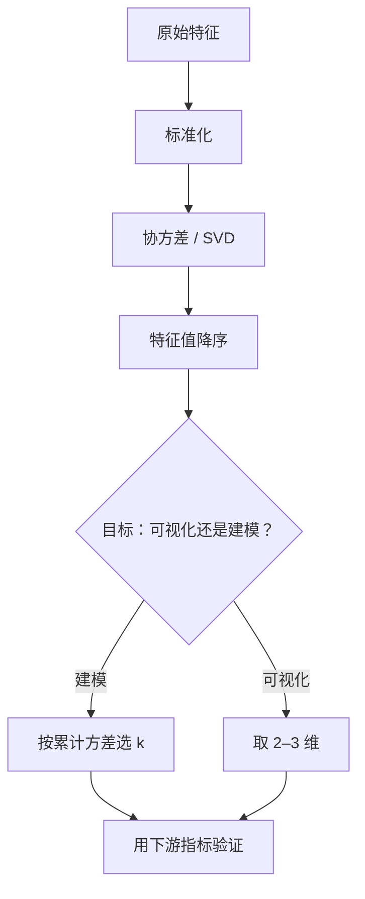

# ML-038 PCA 降维

## 1. 本节学习目标

1. 会用 `explained_variance_ratio_` 决定保留多少维。
2. 能算"达到 80%/90%/95% 方差需要几维"。
3. **理解降维不是免费的**：本课 PCA 到 30 维让准确率从 0.9815 掉到 0.9481。
4. 知道 PCA 是无监督的，可能丢掉"对分类有用但方差小"的方向。

## 2. 为什么需要这个知识

因为高维带来三重麻烦：慢、占内存、过拟合。PCA 用"少数几个方差最大的方向"重新描述数据，能显著压缩。

但它有个常被忽略的前提：**PCA 只保留"方差大"的方向，而方差大 ≠ 对预测有用**。本课实测：64 维 digits 降到 30 维，准确率掉了 3.3 个百分点。降维是**有损**的，必须验证。

## 3. 直观解释

PCA 做两件事：

1. 找数据"散得最开"的方向（主成分）。
2. 只保留前几个方向，把其余丢掉。

**生活类比**：给一群人拍照，你想用最少的照片保留最多信息。第一张从"最能区分人"的角度拍（方差最大），第二张与前一张垂直……拍到第 3 张基本够用。

**代价**：丢掉的方向上只要有信息，就永久丢失，无法恢复。

## 4. 正式定义

**步骤**

1. 标准化：$X_c = (X-\mu)/\sigma$
2. 协方差：$C = \frac{1}{n-1}X_c^\top X_c$
3. 特征分解：$C = V\Lambda V^\top$
4. 投影：$Z = X_c V_{:,:k}$

**解释方差比**

$$
r_k = \frac{\sum_{i=1}^{k}\lambda_i}{\sum_{i=1}^{d}\lambda_i}
$$

**重建**

$$
\hat X = Z V_{:,:k}^\top
$$

**重建误差**：$\|\hat X - X_c\|^2$，等价于"被丢弃的特征值之和"。

## 5. 核心原理

**为什么用方差衡量"信息"**：方差大 = 样本在这个方向差异大 = 更能区分样本。

**为什么这是无监督的局限**：判别信息不一定在方差大的方向上。极端例子：某个特征方差极小，但恰好完全决定标签——PCA 会把它丢掉。

**所以 PCA 的正确用法**：

- 可视化（2D/3D）：可以放心用。
- 去噪、压缩、加速：用后必须验证下游指标。
- **不要**默认"PCA 能提分"。

## 6. 数学表达式

**本课实验**（digits，64 维，1797 样本，标准化后）

| 目标累计方差 | 需要维数 |
|---|---|
| 80% | **21** |
| 90% | **31** |
| 95% | **40** |

**前 5 个主成分的解释方差比**

$$
[0.1203,\ 0.0956,\ 0.0844,\ 0.0650,\ 0.0486]
$$

**降到 2 维（可视化）**

- 形状 $(1797, 2)$
- 保留方差 **0.2159**（只 21.6%）
- 重建均方误差（原始尺度）**14.05**

**下游影响**（逻辑回归，64 维 → 30 维）

| 配置 | 测试准确率 |
|---|---|
| 全维 | **0.9815** |
| PCA 30 维 | 0.9481 |

**差值 −3.34 个百分点**：降维**损失了精度**。

## 7. 数学库链接

| 用到的数学 | 对应篇目 | 用在哪 |
|---|---|---|
| PCA 的完整推导 | [[MATH-806 PCA 数学原理]] | 为什么取特征向量 |
| 特征值分解 | [[MATH-223 特征值与特征向量]] | 主成分的求解 |
| SVD | [[MATH-224 SVD 与低秩近似]] | PCA 的数值实现 |

## 8. 算法执行流程



## 9. 可视化解释

```text
累积解释方差
100% ┤                    ●───●
 95% ┤              ●─────
 90% ┤         ●────
 80% ┤     ●──
     └──┬───┬───┬───┬───► 维数
        21  31  40  64
```

## 10. Python 实现

```powershell
python ml038_pca.py
```

```python
import numpy as np
from sklearn.datasets import load_digits
from sklearn.decomposition import PCA
from sklearn.linear_model import LogisticRegression
from sklearn.model_selection import train_test_split
from sklearn.pipeline import Pipeline
from sklearn.preprocessing import StandardScaler

X, y = load_digits(return_X_y=True)
X_scaled = StandardScaler().fit_transform(X)

pca_full = PCA().fit(X_scaled)
cum = np.cumsum(pca_full.explained_variance_ratio_)
print("总维数:", X.shape[1])
print("前 5 解释方差比:", pca_full.explained_variance_ratio_[:5].round(4).tolist())

for frac in (0.80, 0.90, 0.95):
    n = int(np.argmax(cum >= frac) + 1)
    print(f"达到 {int(frac * 100)}% 方差需 {n} 维")

pca2 = PCA(n_components=2).fit(X_scaled)
Z = pca2.transform(X_scaled)
print("降到 2 维:", Z.shape, " 保留方差:", round(float(pca2.explained_variance_ratio_.sum()), 4))

X_train, X_test, y_train, y_test = train_test_split(
    X, y, test_size=0.3, random_state=42, stratify=y)
full = Pipeline([("sc", StandardScaler()),
                 ("lr", LogisticRegression(max_iter=300))]).fit(X_train, y_train)
reduced = Pipeline([("sc", StandardScaler()), ("pca", PCA(n_components=30)),
                    ("lr", LogisticRegression(max_iter=300))]).fit(X_train, y_train)
print("全维 acc:", round(full.score(X_test, y_test), 4))
print("PCA30 acc:", round(reduced.score(X_test, y_test), 4))
```

**实际运行结果**

```
总维数: 64
前 5 解释方差比: [0.1203, 0.0956, 0.0844, 0.065, 0.0486]
达到 80% 方差需 21 维
达到 90% 方差需 31 维
达到 95% 方差需 40 维
降到 2 维: (1797, 2)  保留方差: 0.2159
全维 acc: 0.9815
PCA30 acc: 0.9481
```

## 11. 代码逐行解释

| 代码 | 作用 |
|---|---|
| `PCA().fit(X_scaled)` | 不指定维数 ⇒ 保留全部，用于分析 |
| `explained_variance_ratio_` | 每个主成分解释的方差比例 |
| `np.cumsum(...)` | 累计比例 |
| `np.argmax(cum >= frac) + 1` | 首次达到目标的维数 |
| `PCA(n_components=30)` | 直接降维 |
| `Pipeline([...])` | PCA 必须放在**划分之后**（在训练集上 fit） |

**一个必须注意的点**：PCA 必须在**标准化之后**、且**只在训练集上 fit**。否则：

- 不标准化 ⇒ 方差大的特征（量纲）主导主成分。
- 在测试集上 fit ⇒ 数据泄漏。

## 12. 实际运行结果

见第 10 节。三点：

1. 64 维要 **40 维**才能保住 95% 方差——说明 digits 的各维信息比较分散。
2. 前 5 个主成分合计只有约 41% 方差。
3. **PCA 30 维准确率 0.9481 < 全维 0.9815** ⇒ 降维损失了精度。

## 13. 适用场景

| 场景 | 建议 |
|---|---|
| 高维可视化 | 取 2–3 维（放心用） |
| 去噪 | 取足够大方差（如 95%） |
| 加速下游模型 | 用后必须验证指标 |
| 特征高度相关 | PCA 很有效 |
| 需要可解释性 | **不要用 PCA**（新特征是线性组合，无业务含义） |
| 特征少、方差分布均匀 | 收益很小 |

## 14. 优点与缺点

| 优点 | 缺点 |
|---|---|
| 无监督，不需要标签 | 新特征不可解释 |
| 降维后可加速、去噪 | 有损，可能丢判别信息 |
| 有闭式解、确定性强 | 只能捕捉线性结构 |
| 可用于可视化 | 需标准化，对量纲敏感 |

## 15. 常见错误

| 错误 | 表现 | 纠正 |
|---|---|---|
| 认为 PCA 必然提分 | 本课 0.9815 → 0.9481 | 用验证集确认 |
| 不标准化 | 量纲大者主导主成分 | 先 `StandardScaler` |
| 在划分前 fit PCA | 泄漏 | 放进 Pipeline |
| 用 PCA 做可解释分析 | 主成分无业务含义 | 看原始特征重要性 |
| 按固定维数降维 | 可能丢太多 | 按累计方差选 |
| 对非线性结构用 PCA | 效果差 | 用 t-SNE/UMAP/kernel PCA |

## 16. 本节总结

- PCA = 找方差最大的正交方向，用少数维重建数据。
- 选维数看**累计解释方差**：本课 80% 需 21 维、95% 需 40 维。
- **降维有损**：30 维让准确率从 0.9815 掉到 0.9481，必须验证后再用。

## 17. 前置与后续

- 前置：[[ML-037 距离度量与聚类评价]]、[[ML-033 无监督学习基本概念]]
- 后续：[[ML-039 异常检测]]、`ML-040 Hold-out 验证`
- 相关数学：[[MATH-806 PCA 数学原理]]、[[MATH-223 特征值与特征向量]]、[[MATH-224 SVD 与低秩近似]]

## 18. 练习与参考答案

**基础 1**：PCA 的第一步为什么必须标准化？

**基础 2**：本课达到 80%/90%/95% 累计方差各需多少维？

**进阶 1**：为什么"方差大"不等于"对分类有用"？

**综合 1**：本课 PCA 30 维准确率 0.9481，全维 0.9815。该不该用 PCA？

> [!success]- 参考答案

> **基础 1**
> 因为 PCA 找的是**方差最大**的方向。若各特征量纲不同（如收入 1 万级、年龄十级），方差会被量纲主导 ⇒ 第一主成分几乎就是"收入"，与真实结构无关。
> 标准化后各特征方差都是 1，比较才公平。

> **基础 2**
> 80% → **21 维**；90% → **31 维**；95% → **40 维**（总 64 维）。

> **进阶 1**
> PCA 是无监督的，它只看 $X$ 的方差，**完全不知道标签 $y$**。
> 可能存在某个方向：方差很小（样本在该方向几乎不变），但恰好能完美区分类别。PCA 会把它当作"噪声"丢掉。
> 有监督的降维方法（如 LDA）会利用标签，因此可能选出判别性更强但方差小的方向。

> **综合 1**
> **取决于目标**：
> - 若追求最高精度 ⇒ **不用 PCA**（0.9815 > 0.9481）。
> - 若需要压缩模型、降低推理成本、或内存受限 ⇒ 可以接受 3.3 个百分点的损失换 64→30 维。
> 决策方法：在验证集上比较"精度损失 vs 成本节省"，并检查损失是否在业务可接受范围内。
> **不能**因为"PCA 是标准步骤"就默认使用。

---

## 🔗 Notion 同步信息

> 以下内容由 Notion「AI Knowledge System · 知识点」数据库按知识 ID 合并而来（导出于 2026-11-09）。

| 属性 | 值 |
|---|---|
| 学科 | 机器学习 |
| 学习状态 | 未开始 |
| 难度 | L2 应用 |
| 知识类型 | Algorithm |

- **所属模块**：[M-ML-05 无监督学习](../%E8%AF%BE%E7%A8%8B%E6%A8%A1%E5%9D%97/M-ML-05%20%E6%97%A0%E7%9B%91%E7%9D%A3%E5%AD%A6%E4%B9%A0.md)
- **前置知识**：[ML-037 距离度量与聚类评价](ML-037%20%E8%B7%9D%E7%A6%BB%E5%BA%A6%E9%87%8F%E4%B8%8E%E8%81%9A%E7%B1%BB%E8%AF%84%E4%BB%B7.md)
- **后继知识**：[ML-039 异常检测](ML-039%20%E5%BC%82%E5%B8%B8%E6%A3%80%E6%B5%8B.md)
- **关联Python**：[PY-066 矩阵运算](../../01_Python%E5%9F%BA%E7%A1%80/08%20NumPy/PY-066%20%E7%9F%A9%E9%98%B5%E8%BF%90%E7%AE%97.md)
- **关联数学**：[MATH-806 PCA 数学原理](../../06_%E6%95%B0%E5%AD%A6%E5%9F%BA%E7%A1%80/08%20%E6%9C%BA%E5%99%A8%E5%AD%A6%E4%B9%A0%E6%95%B0%E5%AD%A6%E5%BA%94%E7%94%A8/MATH-806%20PCA%20%E6%95%B0%E5%AD%A6%E5%8E%9F%E7%90%86.md) · [MATH-223 特征值与特征向量](../../06_%E6%95%B0%E5%AD%A6%E5%9F%BA%E7%A1%80/02%20%E7%BA%BF%E6%80%A7%E4%BB%A3%E6%95%B0/MATH-223%20%E7%89%B9%E5%BE%81%E5%80%BC%E4%B8%8E%E7%89%B9%E5%BE%81%E5%90%91%E9%87%8F.md) · [MATH-224 SVD 与低秩近似](../../06_%E6%95%B0%E5%AD%A6%E5%9F%BA%E7%A1%80/02%20%E7%BA%BF%E6%80%A7%E4%BB%A3%E6%95%B0/MATH-224%20SVD%20%E4%B8%8E%E4%BD%8E%E7%A7%A9%E8%BF%91%E4%BC%BC.md)
