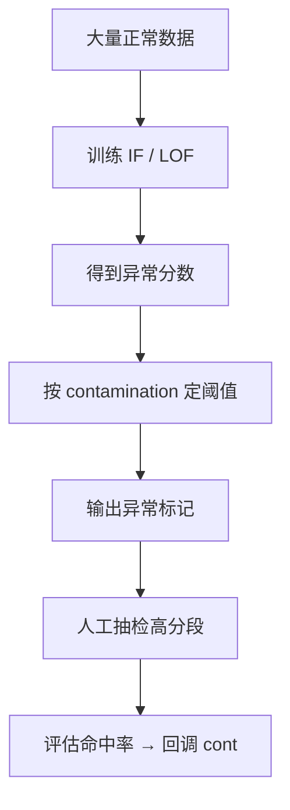

# ML-039 异常检测

## 1. 本节学习目标

1. 区分**异常检测**与**不平衡分类**（前者几乎无正样本，后者有少量）。
2. 会用 `IsolationForest` 与 `LocalOutlierFactor`，并理解 `contamination` 的作用。
3. 知道 `contamination` 是**先验假设**，不是模型学出来的。
4. 理解异常检测的评估困境：没有标签时只能靠人工抽检。

## 2. 为什么需要这个知识

因为欺诈、故障、入侵都是**极少数但代价极高**的事件，而且往往**标签极少甚至没有**（历史欺诈样本不够训练分类器）。

异常检测换思路：**学"正常"长什么样，偏离正常的就是异常**。它不需要正样本标签，只需要大量正常数据。

代价：`contamination`（异常比例）必须你给，给错就全错。

## 3. 直观解释

两种主流思路：

| 方法 | 原理 | 类比 |
|---|---|---|
| **IsolationForest** | 随机切分，异常点更容易被"孤立"（切几次就单独一区） | 找出"不合群"的点 |
| **LOF**（局部离群因子） | 比较某点邻域的密度与邻居的密度 | 找出"周围很空"的点 |

**`contamination` 是什么**：你**先验认为**数据里大约有多少比例是异常。模型按这个比例给你划阈值。

- 设 0.01 ⇒ 只挑最像异常的 1%。
- 设 0.1 ⇒ 挑出 10%。

**它不是学出来的**，是你告诉模型的。

## 4. 正式定义

**IsolationForest 的直觉**

异常点少且不同 ⇒ 随机选特征、随机选阈值切分时，异常点**平均路径长度更短**。

$$
s(\mathbf{x}, n) = 2^{-\frac{\mathbb{E}[h(\mathbf{x})]}{c(n)}}
$$

$h$ 是路径长度，$c(n)$ 是归一化常数。$s$ 接近 1 ⇒ 异常。

**LOF**

$$
\text{LOF}_k(\mathbf{x}) = \frac{\frac{1}{|N_k(\mathbf{x})|}\sum_{o\in N_k(\mathbf{x})}\text{lrd}_k(o)}{\text{lrd}_k(\mathbf{x})}
$$

$\text{lrd}$ 是局部可达密度。LOF > 1 ⇒ 比邻居稀疏 ⇒ 异常。

**决策规则**

$$
\hat y = \mathbb{1}[\text{score}(\mathbf{x}) > \tau],\qquad \tau \text{ 由 contamination 定}
$$

## 5. 核心原理

**为什么不需要正样本**：模型只学"正常数据的分布/密度"，异常是"偏离"。

**`contamination` 的两难**：

- 设太小 ⇒ 漏掉真正的异常（召回低）。
- 设太大 ⇒ 大量正常点被误报（人工复核成本爆炸）。

**实务做法**：先按"能承受的复核量"定 `contamination`（如每天只能查 50 条，就设 50/n），再看抓到的异常里真异常比例。

**本课的诚实结果**：20 个真异常中，

| 配置 | 判异常总数 | 真异常被抓 |
|---|---|---|
| IF, cont=0.01 | 6 | **6/20** |
| IF, cont=0.04 | 21 | **16/20** |
| IF, cont=0.1 | 52 | **17/20** |
| LOF, cont=0.04 | 21 | 15/20 |

**`cont=0.01` 只抓 6 个**（30%），因为真异常比例是 $20/520\approx3.8\%$，设 1% 必然漏。**`cont` 必须接近真实比例**。

## 6. 数学表达式

**本课设定**：500 个正常点（$N(0,1)$ 二维）+ 20 个异常点（$U(-6,6)$ 二维）⇒ 真异常比例 $20/520 \approx 0.0385$

**IF 的异常分数**（`score_samples`，越小越异常）

| 样本 | 分数 |
|---|---|
| 正常点前 3 个 | −0.389, −0.380, −0.393 |
| 异常点前 3 个 | **−0.693, −0.680, −0.688** |

异常点分数明显更低（约 −0.69 vs −0.39）——**分离度良好**。

**为什么 cont=0.01 抓不全**：阈值被设在最极端的 1%（约 5 个点），而真异常有 20 个且部分不够"极端"。

## 7. 数学库链接

| 用到的数学 | 对应篇目 | 用在哪 |
|---|---|---|
| 期望与方差 | [[MATH-306 期望、方差与协方差]] | 正常分布假设 |
| 密度与邻域 | [[MATH-201 向量与空间基础]] | LOF 的局部密度 |
| 分位数 | [[MATH-306 期望、方差与协方差]] | contamination 决定阈值分位 |

## 8. 算法执行流程



## 9. 可视化解释

```text
正常点密集在中心，异常点散在四周

        ×              ×
     ···●···
    ·●●●●●●·      ×
     ···●···   ×
   ×      ···
                  ×

IF：切几刀就把 × 单独隔到小格里
```

## 10. Python 实现

```powershell
python ml039_anomaly.py
```

```python
import numpy as np
from sklearn.ensemble import IsolationForest
from sklearn.neighbors import LocalOutlierFactor

rng = np.random.default_rng(0)
normal = rng.normal(0, 1, (500, 2))
outliers = rng.uniform(-6, 6, (20, 2))
X = np.vstack([normal, outliers])
print("总样本:", len(X), " 真异常: 20  比例:", round(20 / len(X), 4))

for cont in (0.01, 0.04, 0.1):
    iso = IsolationForest(contamination=cont, random_state=42).fit(X)
    pred = iso.predict(X)
    print(f"IF cont={cont}: 判异常={int((pred == -1).sum())}"
          f" 真异常被抓={int((pred == -1)[500:].sum())}/20")

lof = LocalOutlierFactor(n_neighbors=20, contamination=0.04).fit_predict(X)
print("LOF 判异常:", int((lof == -1).sum()),
      " 真异常被抓:", int((lof == -1)[500:].sum()))

iso = IsolationForest(contamination=0.04, random_state=42).fit(X)
print("正常点分数:", iso.score_samples(X[:3]).round(3).tolist())
print("异常点分数:", iso.score_samples(X[500:503]).round(3).tolist())
```

**实际运行结果**

```
总样本: 520  真异常: 20  比例: 0.0385
IF cont=0.01: 判异常=6 真异常被抓=6/20
IF cont=0.04: 判异常=21 真异常被抓=16/20
IF cont=0.1: 判异常=52 真异常被抓=17/20
LOF 判异常: 21  真异常被抓: 15
前 3 个正常点分数: [-0.389, -0.38, -0.393]
前 3 个异常点分数: [-0.693, -0.68, -0.688]
```

## 11. 代码逐行解释

| 代码 | 作用 |
|---|---|
| `IsolationForest(contamination=cont)` | 显式指定异常比例先验 |
| `iso.predict(X)` | 返回 1（正常）/ −1（异常） |
| `(pred == -1)[500:]` | 只统计**真异常那 20 个**是否被抓到 |
| `score_samples` | 连续分数，越小越异常（便于排序） |
| `LocalOutlierFactor(...).fit_predict` | LOF 没有单独的 `predict`，用 `fit_predict` |

**`cont` 对结果的影响是决定性的**：

- 0.01 ⇒ 只判 6 个，抓 6/20（召回 30%）
- 0.04 ⇒ 判 21 个，抓 16/20（召回 80%）
- 0.1 ⇒ 判 52 个，抓 17/20（召回 85%，但误报 35 个）

## 12. 实际运行结果

见第 10 节。三点：

1. **`cont` 必须接近真实比例**：真比例 0.0385，设 0.04 最合适（抓 16/20，只误报 5 个）。
2. 设 0.01 时召回只有 30%——**参数错了，模型再好也救不回来**。
3. IF 与 LOF 在 cont=0.04 时表现接近（16 vs 15 / 20）。

## 13. 适用场景

| 场景 | 方法 |
|---|---|
| 高维、样本多、要快 | IsolationForest |
| 局部密度差异大 | LOF |
| 数据近似正态 | 马氏距离 / EllipticEnvelope |
| 时序 | 滑动窗口 + 残差阈值 |
| 时间序列突变点 | 变点检测（专门方法） |

## 14. 优点与缺点

| 方法 | 优点 | 缺点 |
|---|---|---|
| IsolationForest | 快、$O(n\log n)$、高维可用 | 需给 `contamination`；对局部异常不敏感 |
| LOF | 能发现局部异常 | 慢、对 `n_neighbors` 敏感 |
| 统计阈值（3σ） | 极简 | 假设正态、被异常值掩蔽（见 ML-012） |

## 15. 常见错误

| 错误 | 表现 | 纠正 |
|---|---|---|
| `contamination` 拍脑袋 | 本课 0.01 只抓 30% | 按业务复核量 + 抽检回调 |
| 用准确率评价 | 99.9% 全判正常 | 看召回/命中率 |
| 把异常当错误数据删掉 | 可能删掉最有价值的信号 | 先人工确认 |
| 不标准化 | 距离类方法失效 | 标准化 |
| 训练集混入异常 | 模型把异常当正常 | 先清洗再训练 |
| 在测试集上"调 cont" | 泄漏 | 用验证/业务规则 |

## 16. 本节总结

- 异常检测 = **学正常、标偏离**，不需要正样本标签。
- `contamination` 是**先验假设**，必须接近真实比例：本课 0.01→召回 30%，0.04→80%。
- 评估靠人工抽检命中率，不能只看准确率。

## 17. 前置与后续

- 前置：[[ML-038 PCA 降维]]、[[ML-033 无监督学习基本概念]]
- 后续：`ML-040 Hold-out 验证`（开启 M-ML-06）
- 相关数学：[[MATH-306 期望、方差与协方差]]、[[MATH-201 向量与空间基础]]

## 18. 练习与参考答案

**基础 1**：异常检测与不平衡分类的核心区别是什么？

**基础 2**：本课 `contamination=0.01/0.04/0.1` 时真异常被抓到几个？

**进阶 1**：为什么 `contamination=0.01` 时召回这么低？

**综合 1**：业务每天只能人工复核 50 条，数据每天 1 万条，`contamination` 该设多少？

> [!success]- 参考答案

> **基础 1**
> - **不平衡分类**：有少量正样本标签，模型学"正 vs 负"的判别边界。
> - **异常检测**：几乎（或完全）没有正样本标签，模型学"正常数据的分布"，把偏离者标为异常。
> 关键差别是**有没有正样本标签**，以及目标（分类 vs 发现未知异常）。

> **基础 2**
> `0.01` → **6/20**；`0.04` → **16/20**；`0.1` → **17/20**（但误报 35 个）。

> **进阶 1**
> 因为真异常比例是 $20/520\approx3.85\%$，而 `contamination=0.01` 告诉模型"只有 1% 是异常"⇒ 阈值被设在最极端的 1%（约 5 个点）。
> 那 20 个真异常里有一部分"不够极端"，排在 1% 之外，于是漏掉。
> **参数错，模型再好也救不回来。**

> **综合 1**
> 按复核能力定：
> $$\text{contamination} \approx \frac{50}{10000} = 0.005$$
> 即每天只挑"最异常的 0.5%"（约 50 条）送人工。
> 随后**统计命中率**（50 条里真异常多少条），若命中率过低说明 `cont` 太大或特征不够好；若命中率很高但仍有明显漏检，可在复核能力范围内适当上调。
> 关键：**cont 由业务约束反推，不是由模型决定**。

---

## 🔗 Notion 同步信息

> 以下内容由 Notion「AI Knowledge System · 知识点」数据库按知识 ID 合并而来（导出于 2026-11-09）。

| 属性 | 值 |
|---|---|
| 学科 | 机器学习 |
| 学习状态 | 未开始 |
| 难度 | L3 推导 |
| 知识类型 | Algorithm |

- **所属模块**：[M-ML-05 无监督学习](../%E8%AF%BE%E7%A8%8B%E6%A8%A1%E5%9D%97/M-ML-05%20%E6%97%A0%E7%9B%91%E7%9D%A3%E5%AD%A6%E4%B9%A0.md)
- **前置知识**：[ML-038 PCA 降维](ML-038%20PCA%20%E9%99%8D%E7%BB%B4.md)
- **后继知识**：[ML-040 Hold-out 验证](../04%20%E6%A8%A1%E5%9E%8B%E8%AF%84%E4%BC%B0/ML-040%20Hold-out%20%E9%AA%8C%E8%AF%81.md)
- **关联Python**：[PY-067 聚合与统计](../../01_Python%E5%9F%BA%E7%A1%80/08%20NumPy/PY-067%20%E8%81%9A%E5%90%88%E4%B8%8E%E7%BB%9F%E8%AE%A1.md)
- **关联数学**：[MATH-306 期望、方差与协方差](../../06_%E6%95%B0%E5%AD%A6%E5%9F%BA%E7%A1%80/03%20%E6%A6%82%E7%8E%87%E8%AE%BA/MATH-306%20%E6%9C%9F%E6%9C%9B%E3%80%81%E6%96%B9%E5%B7%AE%E4%B8%8E%E5%8D%8F%E6%96%B9%E5%B7%AE.md)
