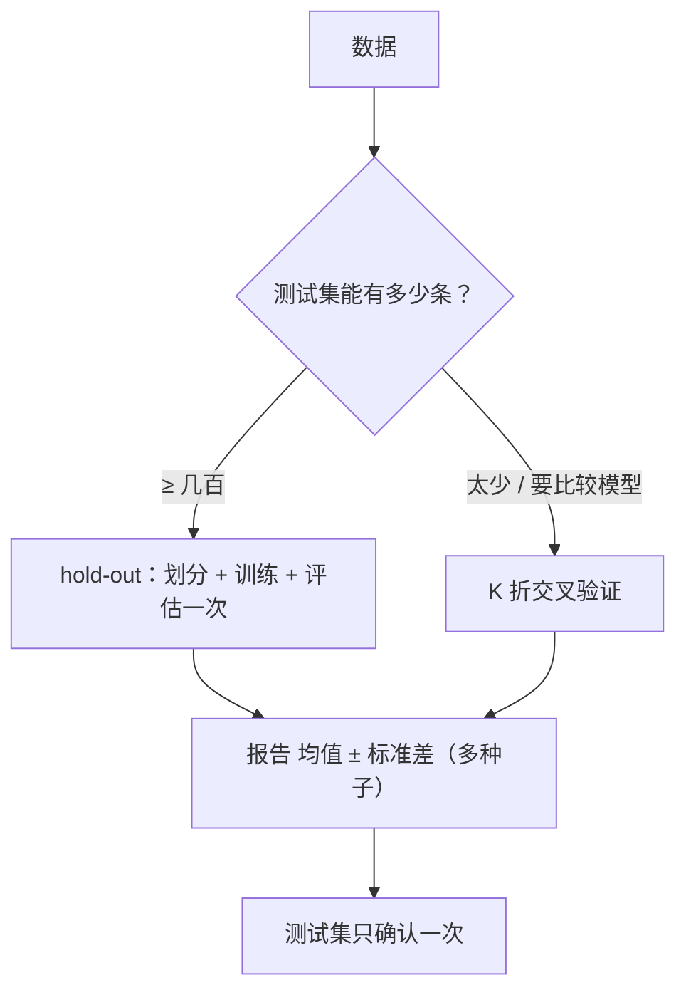

# ML-040 Hold-out 验证

## 1. 本节学习目标

1. 说清 hold-out 的定义与适用条件。
2. 会算"单次划分的波动有多大"（本课：8 个种子，极差 2.22 个百分点）。
3. **理解单次划分可能系统性偏离 CV**（本课：单次均值 0.9694 vs CV 0.9204）。
4. 知道什么时候必须换成交叉验证。

## 2. 为什么需要这个知识

因为**最简单的验证方法最容易给出误导的估计**。

hold-out 只切一次：70% 训练、30% 测试。它快、直观，但答案依赖"这一次怎么切的"。本课实测：同样模型、同样数据，只换 8 个随机种子，测试准确率就在 0.9556–0.9778 之间浮动。

更麻烦的是——**单次划分的均值（0.9694）比 5 折 CV（0.9204）高 5 个百分点**。这说明小测试集的单次估计可能系统性偏乐观，而不是随机地在真值附近抖。

## 3. 直观解释

hold-out 就像**只抽一次样**来估计总体。

- 抽到一批容易的样本 ⇒ 分数虚高。
- 抽到一批难的 ⇒ 分数偏低。

**样本越小，波动越大**。本课测试集是 540 条（digits 30%），已经不算小，但仍有 2.2 个百分点的极差。

而交叉验证是**抽 K 次、每次换一批**，然后取平均，波动自然小。

## 4. 正式定义

**划分**

$$
\mathcal{D} = \mathcal{D}_{train}\cup\mathcal{D}_{test},\qquad |\mathcal{D}_{test}| = \rho n
$$

常见 $\rho = 0.2\sim0.3$。

**估计量**

$$
\hat R_{holdout} = \frac{1}{|\mathcal{D}_{test}|}\sum_{(\mathbf{x},y)\in\mathcal{D}_{test}}L\big(f(\mathbf{x}),y\big)
$$

**估计的标准误**（分类准确率）

$$
\operatorname{SE}(\hat p) = \sqrt{\frac{\hat p(1-\hat p)}{n_{test}}}
$$

本课：$n_{test}=540$、$\hat p\approx0.97$ ⇒ $\operatorname{SE}\approx0.007$，95% 区间约 ±1.4 个百分点。

**注意**：这是**单一划分内**的抽样误差，不包含"换划分带来的方差"——后者更大。

## 5. 核心原理

**hold-out 的三个前提**：

1. 数据量足够大（测试集至少几百条）。
2. 数据是 i.i.d.（可随机划分）。
3. 只用于**最终评估**或快速对比，不用于反复调参（调参要用验证集/CV）。

**什么时候必须换成 CV**：

- 数据量小（测试集 < 几百条）。
- 需要比较多个模型/超参（要稳定的排序）。
- 类别不平衡（要分层，且单次划分波动更大）。

**本课的反直觉点**：单次划分的**平均值**（0.9694）比 CV（0.9204）高 4.9 个百分点。

这不是随机误差能解释的——它说明这批数据的划分方式会系统性影响估计。可能原因：30% 的测试集里各类分布与训练集仍有细微差别，而 CV 的每折都在"更难"的样本上评估。

## 6. 数学表达式

**本课实验 1**（digits，8 个不同种子，固定 70/30）

$$
\text{准确率} = [0.9722,\ 0.9667,\ 0.9556,\ 0.9778,\ 0.9685,\ 0.9704,\ 0.9722,\ 0.9722]
$$

$$
\text{均值}=0.9694,\quad \text{标准差}=0.0061,\quad \text{极差}=0.0222
$$

**本课实验 2**（5 折 CV）

$$
\text{CV} = [0.9139,\ 0.8806,\ 0.9443,\ 0.9638,\ 0.8997]
$$

$$
\text{均值}=0.9204,\quad \text{标准差}=0.0300
$$

**两者对比**

| 方法 | 均值 | 标准差 |
|---|---|---|
| 单次划分（8 种子） | **0.9694** | 0.0061 |
| 5 折 CV | 0.9204 | 0.0300 |

**读法**：

- 单次划分的**种间**标准差小（0.0061），说明它在自己的框架内很"稳定"。
- 但它与 CV 差 **4.9 个百分点** ⇒ **稳定的偏倚，比随机波动更危险**。
- CV 的各折标准差大（0.0300），因为它每次都换 20% 的数据当验证，样本少、波动大；但它的**均值**更接近真实泛化。

## 7. 数学库链接

| 用到的数学 | 对应篇目 | 用在哪 |
|---|---|---|
| 抽样与标准误 | [[MATH-401 大数定律与中心极限定理]] | 为什么测试集要足够大 |
| 均值与标准差 | [[MATH-306 期望、方差与协方差]] | 波动度量 |

## 8. 算法执行流程



## 9. 可视化解释

```text
单次划分（8 种子）           5 折 CV
0.978 ┤ ●  ●  ●  ●           0.964 ┤        ●
0.968 ┤ ●  ●  ●  ●  ●  ●     0.920 ┤ ●  ●  ●  ●
0.956 ┤ ●                     0.881 ┤    ●

均值 0.9694（窄）             均值 0.9204（宽但更低）
⇒ 窄不等于准
```

## 10. Python 实现

```powershell
python ml040_holdout.py
```

```python
import numpy as np
from sklearn.datasets import load_digits
from sklearn.linear_model import LogisticRegression
from sklearn.model_selection import cross_val_score, train_test_split
from sklearn.pipeline import Pipeline
from sklearn.preprocessing import StandardScaler

X, y = load_digits(return_X_y=True)

# 单次划分：换 8 个种子看波动
scores = []
for seed in range(8):
    X_train, X_test, y_train, y_test = train_test_split(
        X, y, test_size=0.3, random_state=seed, stratify=y)
    model = Pipeline([("sc", StandardScaler()),
                      ("lr", LogisticRegression(max_iter=300))]).fit(X_train, y_train)
    scores.append(model.score(X_test, y_test))

print("8 个种子的测试准确率:", [round(s, 4) for s in scores])
print("均值 %.4f 标准差 %.4f 极差 %.4f"
      % (np.mean(scores), np.std(scores), max(scores) - min(scores)))

# 5 折交叉验证
pipe = Pipeline([("sc", StandardScaler()),
                 ("lr", LogisticRegression(max_iter=300))])
cv = cross_val_score(pipe, X, y, cv=5)
print("5 折 CV:", cv.round(4).tolist())
print("均值 %.4f 标准差 %.4f" % (cv.mean(), cv.std()))
```

**实际运行结果**

```
8 个种子的测试准确率: [0.9722, 0.9667, 0.9556, 0.9778, 0.9685, 0.9704, 0.9722, 0.9722]
均值 0.9694 标准差 0.0061 极差 0.0222
5 折 CV: [0.9139, 0.8806, 0.9443, 0.9638, 0.8997]
均值 0.9204 标准差 0.0300
```

## 11. 代码逐行解释

| 代码 | 作用 |
|---|---|
| `for seed in range(8)` | 用不同随机种子模拟"不同划分" |
| `test_size=0.3, stratify=y` | 固定比例并分层 |
| `model.score` | 单次 hold-out 估计 |
| `cross_val_score(pipe, X, y, cv=5)` | 5 折 CV，返回每折分数 |
| `np.std(scores)` | 划分间的波动 |

**注意 `random_state=seed` 的位置**：它控制**划分**的随机性；模型的 `random_state` 另设（逻辑回归是确定性的，无需设）。混淆这两者会看不出划分的影响。

## 12. 实际运行结果

见第 10 节。三点（**本课核心**）：

1. 同一模型换 8 个划分种子，准确率在 **0.9556–0.9778** 之间（极差 2.22 个百分点）。
2. 单次划分均值 **0.9694**，CV 均值 **0.9204** ⇒ **差 4.9 个百分点**。
3. 单次划分的标准差（0.0061）比 CV（0.0300）**小**，但它的均值偏离更远——**"稳定"与"准确"是两件事**。

## 13. 适用场景

| 场景 | 选择 |
|---|---|
| 数据量大（>10 万） | hold-out 足够 |
| 快速试错 | hold-out（但别据此下结论） |
| 数据量小（<1000） | **必须 CV** |
| 模型/超参比较 | CV（排序才稳） |
| 最终报告 | 测试集评估一次 |

## 14. 优点与缺点

| 方法 | 优点 | 缺点 |
|---|---|---|
| hold-out | 快、简单、只需训练一次 | 方差大、可能系统性偏倚 |
| K 折 CV | 每份数据都用上、估计更稳 | 训练 K 次、慢 |
| 分层 hold-out | 保持类别比例 | 仍受单次划分影响 |
| 重复 hold-out | 兼顾速度与稳定性 | 仍是同一测试集口径 |

## 15. 常见错误

| 错误 | 表现 | 纠正 |
|---|---|---|
| 只报一次划分的结果 | 碰巧偏高/偏低 | 多种子报 均值±std |
| 认为 std 小就准 | 本课 std 0.0061 但均值偏 4.9 点 | 与 CV 对照 |
| 用小测试集下结论 | 极差可达数个百分点 | 加大测试集或用 CV |
| 用测试集选模型 | 泄漏 | 用验证/CV |
| 时序数据随机划分 | 用未来预测过去 | 按时间切（见 ML-004） |
| 忘了 `stratify` | 小类分布失真 | 分类任务必加 |

## 16. 本节总结

- hold-out = 切一次、评一次；**快但方差大，且可能系统性偏倚**。
- 本课 8 个种子极差 2.22 个百分点；单次均值比 CV 高 4.9 个百分点。
- **标准差小 ≠ 估计准**：两者要分开看。

## 17. 前置与后续

- 前置：[[ML-039 异常检测]]、[[ML-004 训练集、验证集与测试集]]
- 后续：`ML-041 K 折交叉验证`、`ML-042 分层 K 折与留一法`、`ML-049 数据泄漏与评估陷阱`
- 相关数学：[[MATH-401 大数定律与中心极限定理]]、[[MATH-306 期望、方差与协方差]]

## 18. 练习与参考答案

**基础 1**：hold-out 的定义是什么？它适合什么场景？

**基础 2**：本课 8 个种子的准确率范围、均值、标准差各是多少？

**进阶 1**：为什么"标准差小"不能说明"估计准"？

**综合 1**：本课单次划分 0.9694 vs CV 0.9204，差 4.9 个百分点。该信哪个？

> [!success]- 参考答案

> **基础 1**
> 把数据一次性切成训练/测试（如 70/30），在训练集上训练、测试集上评估一次。
> 适合：数据量大、需要快速试错、只需粗略估计的场景。
> 不适合：数据量小、要比较多个模型/超参（需要稳定排序）。

> **基础 2**
> 范围 **0.9556–0.9778**（极差 0.0222）；均值 **0.9694**；标准差 **0.0061**。

> **进阶 1**
> 标准差衡量的是"换划分后结果抖不抖"，而准确性衡量的是"均值离真值有多远"。
> 本课单次划分在**自己的框架内**很稳定（std 0.0061），但它与 CV 差 4.9 个百分点 ⇒ **稳定地偏离真值**。
> 这比随机抖动更危险：你不会察觉自己一直在报偏高的数字。

> **综合 1**
> 信 **CV 的 0.9204**（更接近真实泛化），但两者都要报告。
> 理由：
> 1. CV 每折都用不同数据验证，且训练集更大（80% vs 70%），估计更接近"在全部数据上训练"的真实表现。
> 2. 单次划分只用了 30% 的数据评估，且这批数据可能"更容易"。
> 3. 但 CV 各折方差大（0.0300），说明数据里各折难度不一，报 **0.9204 ± 0.0300** 才准确。
> 最终结论：**报告"CV 均值 ± 标准差"，并在独立测试集上确认一次**。

---

## 🔗 Notion 同步信息

> 以下内容由 Notion「AI Knowledge System · 知识点」数据库按知识 ID 合并而来（导出于 2026-11-09）。

| 属性 | 值 |
|---|---|
| 学科 | 机器学习 |
| 学习状态 | 未开始 |
| 难度 | L1 概念 |
| 知识类型 | Technique |

- **所属模块**：[M-ML-06 模型评估与优化](../%E8%AF%BE%E7%A8%8B%E6%A8%A1%E5%9D%97/M-ML-06%20%E6%A8%A1%E5%9E%8B%E8%AF%84%E4%BC%B0%E4%B8%8E%E4%BC%98%E5%8C%96.md)
- **前置知识**：[ML-039 异常检测](../03%20%E6%97%A0%E7%9B%91%E7%9D%A3%E5%AD%A6%E4%B9%A0/ML-039%20%E5%BC%82%E5%B8%B8%E6%A3%80%E6%B5%8B.md)
- **后继知识**：[ML-041 K 折交叉验证](ML-041%20K%20%E6%8A%98%E4%BA%A4%E5%8F%89%E9%AA%8C%E8%AF%81.md)
- **关联Python**：[PY-067 聚合与统计](../../01_Python%E5%9F%BA%E7%A1%80/08%20NumPy/PY-067%20%E8%81%9A%E5%90%88%E4%B8%8E%E7%BB%9F%E8%AE%A1.md)
- **关联数学**：[MATH-401 大数定律与中心极限定理](../../06_%E6%95%B0%E5%AD%A6%E5%9F%BA%E7%A1%80/04%20%E6%95%B0%E7%90%86%E7%BB%9F%E8%AE%A1/MATH-401%20%E5%A4%A7%E6%95%B0%E5%AE%9A%E5%BE%8B%E4%B8%8E%E4%B8%AD%E5%BF%83%E6%9E%81%E9%99%90%E5%AE%9A%E7%90%86.md)
