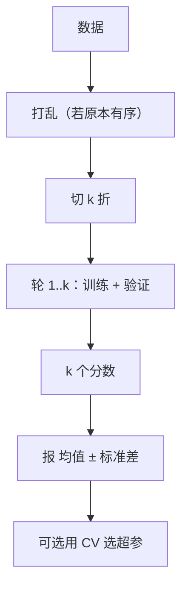

# ML-041 K 折交叉验证

## 1. 本节学习目标

1. 说清 K 折 CV 的流程，以及它为什么比单次 hold-out 稳。
2. 会用 `cross_val_score` / `cross_validate`，并报"均值 ± 标准差"。
3. **理解"不打乱"会毁掉 CV**（本课：0.9204 vs 0.9711）。
4. 知道 $k$ 的取舍：$k$ 大偏差小但方差/耗时大。

## 2. 为什么需要这个知识

因为 hold-out 只切一次，答案依赖"这次怎么切的"。K 折 CV 让**每份数据都当过验证集**，估计更稳。

它也是调参的基础：`GridSearchCV` 内部就是 K 折 CV。不懂 CV 的方差来源，就会把"折间波动"误当"模型差异"。

## 3. 直观解释

把数据切成 $k$ 份，轮流拿 1 份当验证、其余 $k-1$ 份训练，跑 $k$ 次，取平均。

```text
k=5：
轮1  [验证][训练][训练][训练][训练]
轮2  [训练][验证][训练][训练][训练]
轮3  [训练][训练][验证][训练][训练]
轮4  [训练][训练][训练][验证][训练]
轮5  [训练][训练][训练][训练][验证]
```

**为什么更稳**：每个样本都恰好被验证一次，评估覆盖了全部数据。

## 4. 正式定义

**CV 估计**

$$
\hat R_{CV} = \frac{1}{k}\sum_{j=1}^{k}\hat R\big(f^{(-j)}\big)
$$

$f^{(-j)}$ 是在"去掉第 $j$ 折"的数据上训练的模型。

**标准差**

$$
s = \sqrt{\frac{1}{k-1}\sum_j\big(\hat R_j-\hat R_{CV}\big)^2}
$$

**报告格式**：`0.9204 ± 0.0300`。

**$k$ 的取舍**

| $k$ | 训练集比例 | 偏差 | 方差 | 耗时 |
|---|---|---|---|---|
| 3 | 67% | 较大 | 小 | 3× |
| 5 | 80% | 中 | 中 | 5× |
| 10 | 90% | 小 | 较大 | 10× |
| $n$（LOO） | $n-1$ | 最小 | 最大 | $n$× |

## 5. 核心原理

**为什么 $k$ 大偏差小**：训练集更大（$1-1/k$），更接近"用全部数据训练"的真实模型。

**为什么 $k$ 大方差大**：$k$ 个模型训练集高度重叠（都用了 90% 数据），它们的误差**高度相关**，平均后降方差的效果变差。

**为什么必须 shuffle**：本课 digits 数据**按标签排序**（前 180 条全是 0，然后 1……）。不打乱直接切 5 折，某些折里只有少数几个类别。

**本课的硬证据**：

| 配置 | 每折分数 | 均值 |
|---|---|---|
| `shuffle=False` | 0.9139, 0.8806, 0.9443, 0.9638, 0.8997 | **0.9204** |
| `shuffle=True` | 0.9694, 0.9667, 0.9777, 0.9721, 0.9694 | **0.9711** |

**差 5 个百分点**——纯粹因为"打不打乱"。不打乱时，模型在"只见过部分类别"的训练集上学，验证集里却有没见过的类。

## 6. 数学表达式

**本课实验**（digits，逻辑回归 + 标准化）

| $k$ | 均值 | 标准差 | 耗时 |
|---|---|---|---|
| 3 | 0.9293 | 0.0064 | 0.06 s |
| **5** | **0.9204** | **0.0300** | 0.09 s |
| 10 | 0.9332 | 0.0307 | 0.19 s |

**注意**：$k=3$ 的标准差最小（0.0064），但它的**偏差最大**（训练集只有 67%）。不能只看标准差选 $k$。

**训练 vs 测试（`cross_validate` 带 `return_train_score=True`）**

$$
\text{train acc}=0.9990,\qquad \text{test acc}=0.9204
$$

差距 7.9 个百分点 ⇒ 模型在训练折上几乎完美，但泛化差。这是"逻辑回归在 64 维 digits 上仍会过拟合"的信号。

## 7. 数学库链接

| 用到的数学 | 对应篇目 | 用在哪 |
|---|---|---|
| 均值与标准差 | [[MATH-306 期望、方差与协方差]] | CV 的均值 ± std |
| 抽样与标准误 | [[MATH-401 大数定律与中心极限定理]] | 折间波动来源 |

## 8. 算法执行流程



## 9. 可视化解释

```text
不打乱（数据按类别排序）
折1 [0,0,0,…,1] 折2 [1,1,…] … ⇒ 训练集缺类 ⇒ 验证分数低

打乱后
每折都含各类 ⇒ 训练/验证分布一致 ⇒ 分数高且稳
```

## 10. Python 实现

```powershell
python ml041_kfold.py
```

```python
import time

import numpy as np
from sklearn.datasets import load_digits
from sklearn.linear_model import LogisticRegression
from sklearn.model_selection import StratifiedKFold, cross_val_score, cross_validate
from sklearn.pipeline import Pipeline
from sklearn.preprocessing import StandardScaler

X, y = load_digits(return_X_y=True)
pipe = Pipeline([("sc", StandardScaler()),
                 ("lr", LogisticRegression(max_iter=300))])

for k in (3, 5, 10):
    start = time.time()
    scores = cross_val_score(pipe, X, y, cv=k)
    print(f"k={k}: 均值={scores.mean():.4f} 标准差={scores.std():.4f}"
          f" 耗时={time.time() - start:.2f}s")

no_shuffle = cross_val_score(pipe, X, y, cv=StratifiedKFold(n_splits=5, shuffle=False))
shuffled = cross_val_score(pipe, X, y,
                           cv=StratifiedKFold(n_splits=5, shuffle=True, random_state=42))
print("shuffle=False:", no_shuffle.round(4).tolist(), "均值", round(no_shuffle.mean(), 4))
print("shuffle=True :", shuffled.round(4).tolist(), "均值", round(shuffled.mean(), 4))

res = cross_validate(pipe, X, y, cv=5, scoring=["accuracy", "f1_macro"],
                     return_train_score=True)
print("train acc 均值:", round(res["train_accuracy"].mean(), 4))
print("test  acc 均值:", round(res["test_accuracy"].mean(), 4))
print("test  f1_macro:", round(res["test_f1_macro"].mean(), 4))
```

**实际运行结果**

```
k=3: 均值=0.9293 标准差=0.0064 耗时=0.06s
k=5: 均值=0.9204 标准差=0.0300 耗时=0.09s
k=10: 均值=0.9332 标准差=0.0307 耗时=0.19s
shuffle=False: [0.9139, 0.8806, 0.9443, 0.9638, 0.8997] 均值 0.9204
shuffle=True : [0.9694, 0.9667, 0.9777, 0.9721, 0.9694] 均值 0.9711
train acc 均值: 0.9990
test  acc 均值: 0.9204
test  f1_macro: 0.9204
```

## 11. 代码逐行解释

| 代码 | 作用 |
|---|---|
| `cross_val_score(pipe, X, y, cv=k)` | 直接返回 $k$ 个分数 |
| `cv=StratifiedKFold(..., shuffle=False)` | **显式不打乱**，用来暴露问题 |
| `shuffle=True, random_state=42` | 打乱 + 固定种子 ⇒ 可复现 |
| `cross_validate(..., scoring=[...], return_train_score=True)` | 一次拿到多个指标 + 训练分数 |
| `.mean()` / `.std()` | 必须两个都报 |

**`cross_validate` 的价值**：它同时给训练分数和测试分数。本课 `train 0.9990` vs `test 0.9204` 的差距，只用 `cross_val_score` 是看不到的。

## 12. 实际运行结果

见第 10 节。三点：

1. **shuffle 的影响巨大**：0.9204 → 0.9711（+5.07 个百分点）。
2. $k=3$ 的标准差最小（0.0064）但偏差最大（训练集只 67%）。
3. **train 0.9990 vs test 0.9204**：差距说明存在过拟合。

## 13. 适用场景

| 场景 | 建议 |
|---|---|
| 数据量 < 1 万 | $k=5$ 或 10 |
| 数据量很大 | $k=3$ 或单次 hold-out |
| 类别不平衡 | 用 `StratifiedKFold`（见 ML-042） |
| 时序数据 | 用 `TimeSeriesSplit`（不能随机打乱） |
| 分组数据 | 用 `GroupKFold`（见 ML-042） |
| 需要稳定排序（调参） | 重复 CV（`RepeatedStratifiedKFold`） |

## 14. 优点与缺点

| 优点 | 缺点 |
|---|---|
| 每份数据都参与训练与验证 | 训练 $k$ 次，慢 |
| 估计比单次划分稳 | 折间不独立（训练集重叠） |
| 可直接用于调参与模型比较 | $k$ 的选择有偏倚-方差权衡 |
| 报告 std 能反映数据难度差异 | 时序/分组数据不能直接用 |

## 15. 常见错误

| 错误 | 表现 | 纠正 |
|---|---|---|
| 不打乱就 CV | 本课 0.9204 vs 0.9711 | `shuffle=True` + 固定种子 |
| 只报均值不报 std | 无法判断稳定性 | 报 `均值 ± std` |
| 认为 std 小就一定好 | $k=3$ std 最小但偏差大 | 同时看 $k$ 与均值 |
| 在 CV 外做预处理 | 泄漏 | 用 Pipeline |
| 用 CV 分数当最终结果 | 略偏乐观 | 留独立测试集确认 |
| 时序数据随机 CV | 用未来预测过去 | 用 `TimeSeriesSplit` |

## 16. 本节总结

- K 折 CV = **轮流验证、取平均**，比单次划分稳。
- **必须打乱**（本课差 5 个百分点）；打乱后要固定 `random_state`。
- 报"均值 ± 标准差"；$k$ 大偏差小但方差/耗时大。

## 17. 前置与后续

- 前置：[[ML-040 Hold-out 验证]]
- 后续：[[ML-042 分层 K 折与留一法]]、`ML-048 超参数搜索 GridSearchCV`
- 相关数学：[[MATH-306 期望、方差与协方差]]、[[MATH-401 大数定律与中心极限定理]]

## 18. 练习与参考答案

**基础 1**：K 折 CV 相比单次 hold-out 的核心优势是什么？

**基础 2**：本课 `shuffle=False` 与 `shuffle=True` 的均值各是多少？为什么差这么多？

**进阶 1**：为什么 $k$ 越大，CV 的方差可能反而越大？

**综合 1**：本课 `train acc 0.9990`、`test acc 0.9204`，说明什么？该怎么办？

> [!success]- 参考答案

> **基础 1**
> 每份数据都当过一次验证集，评估覆盖全部样本，估计**方差更小、更接近真实泛化**；单次 hold-out 只用了 20–30% 的数据评估，结果依赖"这一次怎么切"。

> **基础 2**
> `shuffle=False` → **0.9204**；`shuffle=True` → **0.9711**。
> digits 数据**按标签排序**（前 180 条全是 0），不打乱直接切 5 折时，某些折的训练集只含少数类别，验证集却含没见过的类 ⇒ 分数被压低。打乱后每折类别分布一致，分数才反映真实水平。

> **进阶 1**
> 因为 $k$ 个模型的训练集**高度重叠**（$k=10$ 时每个训练集都是 90% 的数据，彼此共享大部分样本）。它们的误差高度正相关，平均起来降方差的效果有限；同时单折验证集更小（$n/k$），单折估计本身方差更大。
> 极端情况 LOO（$k=n$）：每个训练集几乎相同，但单折验证集只有 1 条 ⇒ 单折方差极大。

> **综合 1**
> 说明模型**过拟合**：在训练折上近乎完美（0.9990），但泛化只有 0.9204。
> 办法：
> 1. 加强正则（逻辑回归调大 `C` 的倒数，即减小 `C`）；
> 2. 降维（PCA，见 ML-038）或特征选择；
> 3. 增加数据（digits 只有 1797 条且 64 维）；
> 4. 换更强正则的模型或加早停（若可用）。

---

## 🔗 Notion 同步信息

> 以下内容由 Notion「AI Knowledge System · 知识点」数据库按知识 ID 合并而来（导出于 2026-11-09）。

| 属性 | 值 |
|---|---|
| 学科 | 机器学习 |
| 学习状态 | 未开始 |
| 难度 | L2 应用 |
| 知识类型 | Technique |

- **所属模块**：[M-ML-06 模型评估与优化](../%E8%AF%BE%E7%A8%8B%E6%A8%A1%E5%9D%97/M-ML-06%20%E6%A8%A1%E5%9E%8B%E8%AF%84%E4%BC%B0%E4%B8%8E%E4%BC%98%E5%8C%96.md)
- **前置知识**：[ML-040 Hold-out 验证](ML-040%20Hold-out%20%E9%AA%8C%E8%AF%81.md)
- **后继知识**：[ML-042 分层 K 折与留一法](ML-042%20%E5%88%86%E5%B1%82%20K%20%E6%8A%98%E4%B8%8E%E7%95%99%E4%B8%80%E6%B3%95.md)
- **关联Python**：[PY-067 聚合与统计](../../01_Python%E5%9F%BA%E7%A1%80/08%20NumPy/PY-067%20%E8%81%9A%E5%90%88%E4%B8%8E%E7%BB%9F%E8%AE%A1.md)
- **关联数学**：[MATH-401 大数定律与中心极限定理](../../06_%E6%95%B0%E5%AD%A6%E5%9F%BA%E7%A1%80/04%20%E6%95%B0%E7%90%86%E7%BB%9F%E8%AE%A1/MATH-401%20%E5%A4%A7%E6%95%B0%E5%AE%9A%E5%BE%8B%E4%B8%8E%E4%B8%AD%E5%BF%83%E6%9E%81%E9%99%90%E5%AE%9A%E7%90%86.md)
