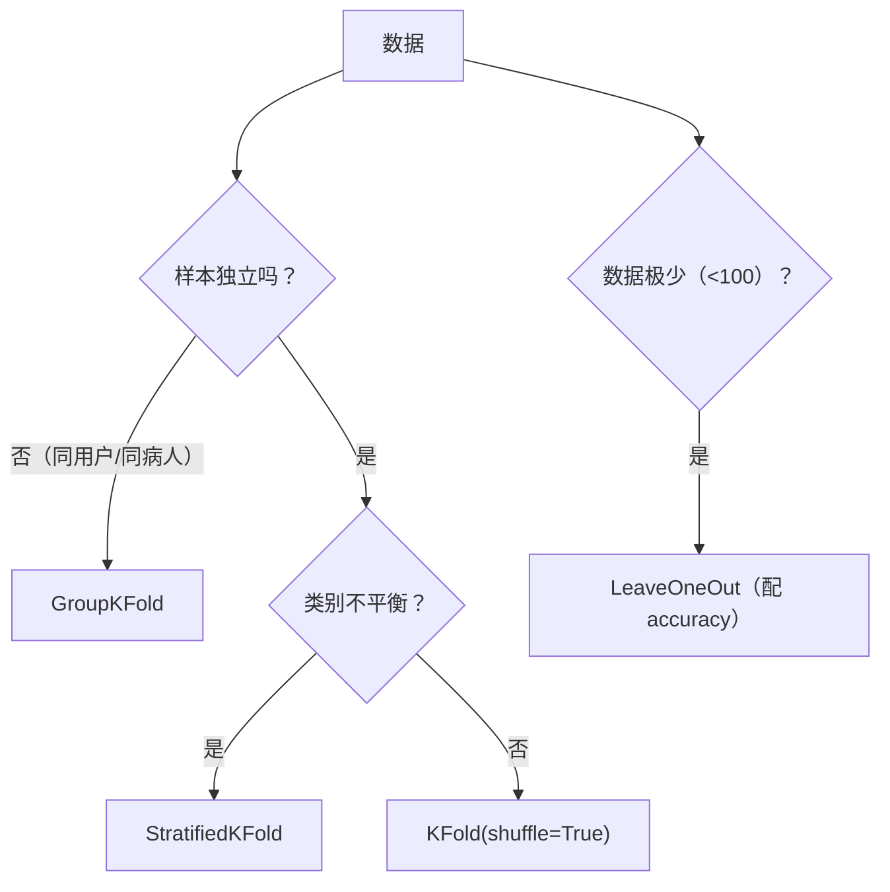

# ML-042 分层 K 折与留一法

## 1. 本节学习目标

1. 说清分层 K 折的作用，并用"各折正类比例"验证分层是否生效。
2. 会用 `LeaveOneOut`，并**理解它在小数据 + F1 上会失效**（本课 0.0333）。
3. 会用 `GroupKFold` 处理"同一实体多条记录"。
4. 知道三种变体各自的适用条件。

## 2. 为什么需要这个知识

因为普通 K 折有两个隐藏假设，现实中常被打破：

1. **类别比例要稳定**：不平衡数据随机切，可能出现"某折几乎没有正类"。
2. **样本要独立**：同一用户/同一设备的多条记录若跨折，模型就"见过"它 ⇒ 泄漏。

分层解决第 1 个，GroupKFold 解决第 2 个。留一法则在极小数据上常用，但它有自己的坑。

## 3. 直观解释

**分层（Stratified）**：切每一折时**保持类别比例**。正类占 7.5%，则每折验证集也约 7.5%。

**留一（LOO）**：每次只留 1 条做验证，其余全部训练。$n$ 条数据就训练 $n$ 次。

**分组（Group）**：按"实体"划分，同一实体的所有记录要么全在训练、要么全在验证。

| 变体 | 解决什么 |
|---|---|
| `StratifiedKFold` | 类别比例失衡 |
| `LeaveOneOut` | 数据极少（用尽每一条） |
| `GroupKFold` | 样本间不独立（同用户/同病人） |

## 4. 正式定义

**分层 K 折**：第 $j$ 折中每类 $c$ 的数量

$$
n_{j,c} \approx \frac{n_c}{k}
$$

**留一法**（$k=n$）

$$
\hat R_{LOO} = \frac{1}{n}\sum_{i=1}^{n}L\big(f^{(-i)}(\mathbf{x}_i), y_i\big)
$$

**Group K 折**：按组 $g$ 划分，$g$ 不跨折

$$
\mathcal{D}_{val}^{(j)}\cap \mathcal{D}_{train}^{(j)} = \varnothing\ \text{（按组）}
$$

**本课不平衡数据**：$[554,\ 46]$，正类占 **7.67%**。

## 5. 核心原理

**为什么分层能降方差**：它消除了"折间类别比例波动"这个方差来源。

**本课证据**（5 折，验证集正类比例）：

| 方式 | 各折正类比例 | F1 |
|---|---|---|
| 普通 KFold | 0.1, 0.0667, **0.0417**, 0.0917, 0.0833 | 0.7111 ± **0.1551** |
| 分层 | 0.075, 0.075, 0.075, 0.075, 0.0833 | 0.7184 ± **0.0871** |

**标准差从 0.1551 降到 0.0871（减半）**，而均值几乎不变（0.7111 → 0.7184）。

**结论**：分层的收益不是"提分"，而是**让评估更可信**。

**为什么 LOO + F1 会失效**：LOO 每次验证集只有 1 条样本。F1 需要 TP/FP/FN 的统计，单样本时：

- 若这条是负类且判负 ⇒ TP=0, FP=0, FN=0 ⇒ F1 定义为 0（或未定义）。
- 本课 LOO F1 只有 **0.0333**，完全无意义。

**这不是"模型差"，而是"指标在单样本上失效"**。LOO 应配 accuracy 这类可单样本计算的指标。

## 6. 数学表达式

**本课 LOO 结果**

$$
\text{F1}_{LOO} = 0.0333 \pm 0.1795
$$

标准差 0.1795 远大于均值 ⇒ **几乎全是 0，偶尔非 0**。这是"指标失效"的典型形态。

**GroupKFold 结果**（60 条，6 组，每组 10 条）

$$
\text{每折验证集组数} = [1,1,1,1,1,1]
$$

即每折恰好留出 1 整组（10 条），**组内不跨折**。

## 7. 数学库链接

| 用到的数学 | 对应篇目 | 用在哪 |
|---|---|---|
| 比例与期望 | [[MATH-306 期望、方差与协方差]] | 分层保持比例 |
| 方差分解 | [[MATH-401 大数定律与中心极限定理]] | 折间波动 |

## 8. 算法执行流程



## 9. 可视化解释

```text
普通 KFold（正类 7.7%，5 折）
折1 正类 10.0%  ●
折2 正类  6.7%  ●
折3 正类  4.2%  ● ← 偏少
折4 正类  9.2%  ●
折5 正类  8.3%  ●
      波动大 ⇒ F1 标准差 0.1551

分层
每折都 7.5%~8.3% ⇒ F1 标准差 0.0871（减半）
```

## 10. Python 实现

```powershell
python ml042_stratified_loo.py
```

```python
import numpy as np
import time
from sklearn.datasets import make_classification
from sklearn.linear_model import LogisticRegression
from sklearn.model_selection import (GroupKFold, KFold, LeaveOneOut,
                                     StratifiedKFold, cross_val_score)
from sklearn.pipeline import Pipeline
from sklearn.preprocessing import StandardScaler

X, y = make_classification(n_samples=600, weights=[0.93, 0.07],
                           n_features=10, random_state=42)
print("类别分布:", np.bincount(y).tolist(), " 正类比例:", round(float(y.mean()), 4))

pipe = Pipeline([("sc", StandardScaler()),
                 ("lr", LogisticRegression(max_iter=1000))])

kf = KFold(n_splits=5, shuffle=True, random_state=42)
skf = StratifiedKFold(n_splits=5, shuffle=True, random_state=42)
print("KFold 各折正类比例:", [round(float(y[va].mean()), 4) for _, va in kf.split(X, y)])
print("分层 各折正类比例:", [round(float(y[va].mean()), 4) for _, va in skf.split(X, y)])

f1_kf = cross_val_score(pipe, X, y, cv=kf, scoring="f1")
f1_skf = cross_val_score(pipe, X, y, cv=skf, scoring="f1")
print("KFold F1: %.4f±%.4f" % (f1_kf.mean(), f1_kf.std()))
print("分层  F1: %.4f±%.4f" % (f1_skf.mean(), f1_skf.std()))

# 留一法：极小数据
X_small, y_small = X[:60], y[:60]
start = time.time()
loo_scores = cross_val_score(pipe, X_small, y_small, cv=LeaveOneOut(), scoring="f1")
print("LOO(60条) F1: %.4f±%.4f 耗时 %.2fs"
      % (loo_scores.mean(), loo_scores.std(), time.time() - start))

# 分组：同一实体多条记录
groups = np.repeat(np.arange(6), 10)
gkf = GroupKFold(n_splits=6)
print("GroupKFold 各折组数:",
      [len(np.unique(groups[va])) for _, va in gkf.split(X_small, y_small, groups)])
```

**实际运行结果**

```
类别分布: [554, 46]  正类比例: 0.0767
KFold 各折正类比例: [0.1, 0.0667, 0.0417, 0.0917, 0.0833]
分层 各折正类比例: [0.075, 0.075, 0.075, 0.075, 0.0833]
KFold F1: 0.7111±0.1551
分层  F1: 0.7184±0.0871
LOO(60条) F1: 0.0333±0.1795 耗时 0.23s
GroupKFold 各折组数: [1, 1, 1, 1, 1, 1]
```

## 11. 代码逐行解释

| 代码 | 作用 |
|---|---|
| `y[va].mean()` | 验证折的正类比例，**验证分层是否生效** |
| `KFold(shuffle=True)` | 普通 K 折（打乱） |
| `StratifiedKFold` | 分层 K 折 |
| `LeaveOneOut()` | 每次留 1 条 |
| `GroupKFold.split(X, y, groups)` | 按组划分，groups 长度须等于样本数 |
| `np.repeat(np.arange(6), 10)` | 生成 6 组 × 10 条 |

**为什么 LOO 用 accuracy 更好**：accuracy 是单样本可算的（对/错），而 F1 需要 TP/FP/FN 的聚合统计，单样本时几乎恒为 0。

## 12. 实际运行结果

见第 10 节。三点：

1. 分层让验证集正类比例**从 0.0417–0.1 收敛到 0.075**，F1 标准差**减半**（0.1551 → 0.0871）。
2. LOO 的 F1 = **0.0333**（无意义），标准差 0.1795 大于均值。
3. GroupKFold 每折恰好 1 组，**组内不跨折**。

## 13. 适用场景

| 场景 | 选择 |
|---|---|
| 类别不平衡 | `StratifiedKFold`（默认就用它） |
| 数据极少（<100） | `LeaveOneOut`（配 accuracy） |
| 同一用户多条记录 | `GroupKFold` |
| 时序 | `TimeSeriesSplit` |
| 类别不平衡 + 分组 | `StratifiedGroupKFold` |

## 14. 优点与缺点

| 变体 | 优点 | 缺点 |
|---|---|---|
| 分层 | 折间比例稳定、方差小 | 回归任务无类别可分层 |
| LOO | 用尽每条数据、几乎无偏差 | $n$ 次训练、单样本指标失效 |
| Group | 防"同实体泄漏" | 组数与大小可能不均衡 |

## 15. 常见错误

| 错误 | 表现 | 纠正 |
|---|---|---|
| 不平衡仍用普通 KFold | 某折正类过少 | 用 `StratifiedKFold` |
| LOO 用 F1 | 本课 0.0333 | 换 accuracy 或增大数据 |
| 同用户数据跨折 | 指标虚高（泄漏） | `GroupKFold` |
| `groups` 长度不对 | `ValueError` | 与样本数一致 |
| 以为分层能提分 | 本课均值 0.7111→0.7184 | 分层是为"稳"，不是"高" |
| 大数据用 LOO | $n$ 次训练跑不完 | 用 K=5/10 |

## 16. 本节总结

- **分层**：让每折类别比例一致，收益是**方差减半**而非提分。
- **LOO**：极小数据可用，但**单样本指标（F1）会失效**。
- **GroupKFold**：同一实体的记录不能跨折，否则泄漏。

## 17. 前置与后续

- 前置：[[ML-041 K 折交叉验证]]
- 后续：[[ML-043 混淆矩阵与分类指标]]、`ML-049 数据泄漏与评估陷阱`
- 相关数学：[[MATH-306 期望、方差与协方差]]、[[MATH-401 大数定律与中心极限定理]]

## 18. 练习与参考答案

**基础 1**：分层 K 折解决什么问题？本课用什么证据证明它生效了？

**基础 2**：本课 LOO 的 F1 是多少？为什么这么低？

**进阶 1**：什么时候必须用 `GroupKFold`？

**综合 1**：分层让 F1 均值从 0.7111 变到 0.7184（几乎不变），但标准差从 0.1551 降到 0.0871。这个收益有什么实际意义？

> [!success]- 参考答案

> **基础 1**
> 解决"随机划分导致各折类别比例波动"的问题（不平衡数据时某折可能几乎没有正类）。
> 证据：验证集正类比例从 `[0.1, 0.0667, 0.0417, 0.0917, 0.0833]` 收敛到 `[0.075, 0.075, 0.075, 0.075, 0.0833]`，F1 标准差从 0.1551 降到 0.0871。

> **基础 2**
> **0.0333 ± 0.1795**。
> 因为 LOO 每次验证集只有 1 条样本，而 F1 需要 TP/FP/FN 的聚合统计：单条负类被判对时 TP=FP=FN=0，F1 定义为 0。所以绝大多数折得 0，偶尔某条正类被抓到才非 0。
> 这是**指标失效**，不是模型差。

> **进阶 1**
> 当**样本之间不独立**时。典型：
> - 同一用户的多次行为记录（推荐、风控）；
> - 同一病人的多次检查（医疗）；
> - 同一设备的多个传感器读数。
> 若随机划分让同一实体的记录同时出现在训练和验证集，模型会"记住"该实体 ⇒ 指标虚高、上线崩。

> **综合 1**
> 实际意义是**结论更可信**：
> - 若两个模型的 CV 分数差 0.02，而 std 是 0.1551，你**无法判断差异是否真实**；std 降到 0.0871 后，判断力明显提升。
> - 选超参时，方差大意味着"选中的配置可能只是运气好"，方差小则选择更可靠。
> 所以分层的收益是**提高评估的分辨率**，不是提高分数。

---

## 🔗 Notion 同步信息

> 以下内容由 Notion「AI Knowledge System · 知识点」数据库按知识 ID 合并而来（导出于 2026-11-09）。

| 属性 | 值 |
|---|---|
| 学科 | 机器学习 |
| 学习状态 | 未开始 |
| 难度 | L2 应用 |
| 知识类型 | Technique |

- **所属模块**：[M-ML-06 模型评估与优化](../%E8%AF%BE%E7%A8%8B%E6%A8%A1%E5%9D%97/M-ML-06%20%E6%A8%A1%E5%9E%8B%E8%AF%84%E4%BC%B0%E4%B8%8E%E4%BC%98%E5%8C%96.md)
- **前置知识**：[ML-041 K 折交叉验证](ML-041%20K%20%E6%8A%98%E4%BA%A4%E5%8F%89%E9%AA%8C%E8%AF%81.md)
- **后继知识**：[ML-043 混淆矩阵与分类指标](ML-043%20%E6%B7%B7%E6%B7%86%E7%9F%A9%E9%98%B5%E4%B8%8E%E5%88%86%E7%B1%BB%E6%8C%87%E6%A0%87.md)
- **关联Python**：[PY-067 聚合与统计](../../01_Python%E5%9F%BA%E7%A1%80/08%20NumPy/PY-067%20%E8%81%9A%E5%90%88%E4%B8%8E%E7%BB%9F%E8%AE%A1.md)
- **关联数学**：[MATH-401 大数定律与中心极限定理](../../06_%E6%95%B0%E5%AD%A6%E5%9F%BA%E7%A1%80/04%20%E6%95%B0%E7%90%86%E7%BB%9F%E8%AE%A1/MATH-401%20%E5%A4%A7%E6%95%B0%E5%AE%9A%E5%BE%8B%E4%B8%8E%E4%B8%AD%E5%BF%83%E6%9E%81%E9%99%90%E5%AE%9A%E7%90%86.md)
