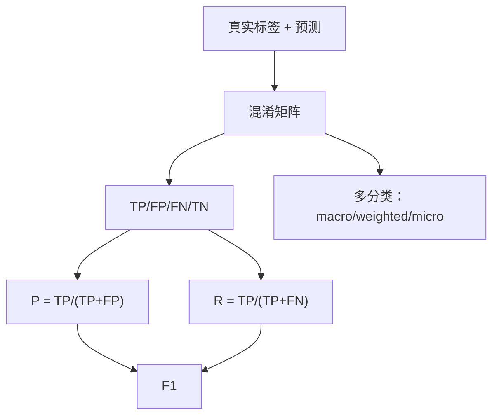

# ML-043 混淆矩阵与分类指标

## 1. 本节学习目标

1. 会画混淆矩阵，并从四个格子读出 TP/FP/FN/TN。
2. 会算 Precision / Recall / F1，并说清三者关系。
3. 理解 macro / weighted / micro 三种平均，知道何时用哪个。
4. 能解释"为什么准确率 0.9860 时 P/R/F1 也都是 0.9860"（本课巧合）。

## 2. 为什么需要这个知识

因为**准确率把两类错误混在一起平均**，而它们的代价常常天差地别。

漏诊（FN）可能致命，误报（FP）只是多做一次检查。混淆矩阵把这两类错误**分开计数**，是所有分类指标的基础。

不懂它，你会在"准确率 0.95"的报告里，对"漏了一半病人"这件事毫无察觉。

## 3. 直观解释

混淆矩阵（二分类）：

|  | 预测负 | 预测正 |
|---|---|---|
| **实际负** | TN | FP（误报） |
| **实际正** | FN（漏报） | TP |

四个指标：

| 指标 | 公式 | 回答 |
|---|---|---|
| Accuracy | $(TP+TN)/N$ | 总共对多少 |
| **Precision** | $TP/(TP+FP)$ | 判为正的里，多少是真的 |
| **Recall** | $TP/(TP+FN)$ | 真的正类里，抓到多少 |
| F1 | $2PR/(P+R)$ | 两者的调和平均 |

**记忆**：Precision 的分母在**预测**里（FP），Recall 的分母在**真实**里（FN）。

## 4. 正式定义

**二分类**

$$
P=\frac{TP}{TP+FP},\qquad R=\frac{TP}{TP+FN},\qquad F_1=\frac{2PR}{P+R}
$$

**多分类的三种平均**

| 平均 | 做法 | 用途 |
|---|---|---|
| **macro** | 每类算 P/R/F1，**直接平均** | 每类同等重要（小类也重要） |
| **weighted** | 按**该类样本数**加权平均 | 关心总体表现 |
| **micro** | 汇总所有 TP/FP/FN 再算 | 等价于多分类准确率 |

**关键**：micro-F1 ≡ 准确率（单标签多分类时）。

**$F_\beta$**（可调权重）

$$
F_\beta = (1+\beta^2)\frac{PR}{\beta^2 P+R}
$$

$\beta>1$ 偏重召回，$\beta<1$ 偏重精确。

## 5. 核心原理

**为什么 P 与 R 此消彼长**：阈值降低 ⇒ 更多样本判正 ⇒ TP↑（召回↑），但 FP↑（精确↓）。

**macro 与 weighted 的差异来源**：当各类样本量差很多时，macro 会被小类"拉低"（小类表现差就直接平摊），weighted 则偏向大类。

**本课的巧合**：breast cancer 二分类，`acc = P = R = F1 = 0.9889`。这是**对称混淆矩阵**导致的：

$$
\begin{bmatrix}52 & 1\\ 1 & 89\end{bmatrix}
$$

$TN=52$、$FP=1$、$FN=1$、$TP=89$。因为 $FP=FN=1$，所以

$$
P=\frac{89}{90}=0.9889,\qquad R=\frac{89}{90}=0.9889
$$

**P 与 R 相等只是数据对称的巧合**，不能推广。换一份数据它们就会分叉。

## 6. 数学表达式

**本课实验 1**（breast cancer，二分类）

$$
\text{CM} = \begin{bmatrix}52 & 1\\ 1 & 89\end{bmatrix}
$$

| 指标 | 值 |
|---|---|
| Accuracy | **0.9860** |
| Precision | **0.9889** |
| Recall | **0.9889** |
| F1 | **0.9889** |

**分类报告**（`classification_report`）

| 类 | precision | recall | f1 | support |
|---|---|---|---|---|
| 0 | 0.981 | 0.981 | 0.981 | 53 |
| 1 | 0.989 | 0.989 | 0.989 | 90 |
| macro avg | 0.985 | 0.985 | 0.985 | 143 |
| weighted avg | 0.986 | 0.986 | 0.986 | 143 |

**本课实验 2**（digits，10 类）

| 平均 | P | R | F1 |
|---|---|---|---|
| macro | 0.9816 | 0.9814 | **0.9814** |
| weighted | 0.9818 | 0.9815 | 0.9816 |
| micro | — | — | **0.9815** |

三者几乎相同，因为 digits 各类样本量接近（每类约 180 条）。

## 7. 数学库链接

| 用到的数学 | 对应篇目 | 用在哪 |
|---|---|---|
| 集合划分 | [[MATH-501 集合与集合运算]] | TP/FP/FN/TN 是四个集合 |
| 条件概率 | [[MATH-301 概率基础与条件概率]] | P/R 是条件概率的估计 |

## 8. 算法执行流程



## 9. 可视化解释

```text
              预测
            负      正
实际 负  [ 52  ] [  1  ]   ← FP = 1（误报）
     正  [  1  ] [ 89  ]   ← FN = 1（漏报）
              ↑
          FP 与 FN 相等 ⇒ P = R
```

## 10. Python 实现

```powershell
python ml043_confusion_metrics.py
```

```python
from sklearn.datasets import load_breast_cancer, load_digits
from sklearn.linear_model import LogisticRegression
from sklearn.metrics import (accuracy_score, classification_report,
                             confusion_matrix, f1_score, precision_score,
                             recall_score)
from sklearn.model_selection import train_test_split
from sklearn.pipeline import Pipeline
from sklearn.preprocessing import StandardScaler

# 二分类
X, y = load_breast_cancer(return_X_y=True)
X_train, X_test, y_train, y_test = train_test_split(
    X, y, test_size=0.25, random_state=42, stratify=y)
model = Pipeline([("sc", StandardScaler()),
                  ("lr", LogisticRegression(max_iter=2000))]).fit(X_train, y_train)
pred = model.predict(X_test)

print("混淆矩阵:\n", confusion_matrix(y_test, pred))
print("acc=%.4f P=%.4f R=%.4f F1=%.4f" % (
    accuracy_score(y_test, pred), precision_score(y_test, pred),
    recall_score(y_test, pred), f1_score(y_test, pred)))
print(classification_report(y_test, pred, digits=3))

# 多分类：三种平均
X_d, y_d = load_digits(return_X_y=True)
Xd_train, Xd_test, yd_train, yd_test = train_test_split(
    X_d, y_d, test_size=0.3, random_state=42, stratify=y_d)
md = Pipeline([("sc", StandardScaler()),
               ("lr", LogisticRegression(max_iter=300))]).fit(Xd_train, yd_train)
pd_ = md.predict(Xd_test)
for avg in ("macro", "weighted"):
    print(f"{avg}: P={precision_score(yd_test, pd_, average=avg):.4f}"
          f" R={recall_score(yd_test, pd_, average=avg):.4f}"
          f" F1={f1_score(yd_test, pd_, average=avg):.4f}")
print("micro F1:", round(f1_score(yd_test, pd_, average="micro"), 4))
```

**实际运行结果**

```
混淆矩阵:
 [[52  1]
 [ 1 89]]
acc=0.9860 P=0.9889 R=0.9889 F1=0.9889
              precision    recall  f1-score   support

           0      0.981     0.981     0.981        53
           1      0.989     0.989     0.989        90

    accuracy                          0.986       143
   macro avg      0.985     0.985     0.985       143
weighted avg      0.986     0.986     0.986       143

macro: P=0.9816 R=0.9814 F1=0.9814
weighted: P=0.9818 R=0.9815 F1=0.9816
micro F1: 0.9815
```

## 11. 代码逐行解释

| 代码 | 作用 |
|---|---|
| `confusion_matrix(y_true, y_pred)` | 返回 $2\times2$（或 $K\times K$）计数矩阵 |
| `precision_score(...)` 默认 `average="binary"` | 二分类专用 |
| `average="macro"` | 每类算完直接平均 |
| `average="weighted"` | 按 support 加权 |
| `average="micro"` | 汇总后算，≡ 准确率 |
| `classification_report` | 一次给出每类 P/R/F1 + 三种平均 |

**读混淆矩阵的顺序**：行是**真实**、列是**预测**。所以 `cm[1][0]` 是"真实为 1 却预测 0"= FN。

## 12. 实际运行结果

见第 10 节。三点：

1. 混淆矩阵 `[[52,1],[1,89]]`：只错 2 条（1 误报 + 1 漏报）。
2. **P = R = F1 = 0.9889 是巧合**（因为 FP = FN = 1）。
3. 多分类三种平均几乎相同（0.9814/0.9816/0.9815），因为各类样本量均衡。

## 13. 适用场景

| 场景 | 指标 |
|---|---|
| 各类同等重要 | **macro** F1 |
| 关心总体、大类主导 | weighted F1 |
| 多标签 | micro / sample |
| 不平衡 + 关心小类 | **macro** 或每类单独看 |
| 单一数字汇报 | 慎用 accuracy |

## 14. 优点与缺点

| 指标 | 优点 | 缺点 |
|---|---|---|
| Accuracy | 直观 | 不平衡时失效 |
| Precision | 直接对应"误报成本" | 忽略漏报 |
| Recall | 直接对应"漏报成本" | 忽略误报 |
| F1 | 平衡两者 | 隐含 P、R 同等重要 |
| Macro F1 | 小类不被忽视 | 小类样本少时方差大 |

## 15. 常见错误

| 错误 | 表现 | 纠正 |
|---|---|---|
| 混淆矩阵行列读反 | 把 FP 当 FN | 行=真实、列=预测 |
| 不平衡用 accuracy | 全判多数类也高分 | 看 P/R/F1 |
| 多分类忘 `average` | 报错或只算第一类 | 显式指定 |
| 认为 P=R 是常态 | 本课只是巧合 | 看混淆矩阵 |
| micro 当 macro 用 | 两者在小类差时差很多 | 明确用途 |
| 只看总体 F1 | 掩盖某类崩掉 | 看 per-class 报告 |

## 16. 本节总结

- 混淆矩阵把错误分成 **FP（误报）** 与 **FN（漏报）**，是所有指标的基础。
- Precision 分母在预测侧、Recall 分母在真实侧；F1 是调和平均。
- 多分类要选 average：macro（每类平等）/ weighted（按样本量）/ micro（≡准确率）。

## 17. 前置与后续

- 前置：[[ML-042 分层 K 折与留一法]]、[[ML-030 决策边界与分类阈值]]
- 后续：[[ML-044 ROC 曲线与 AUC]]、[[ML-045 PR 曲线与阈值选择]]
- 相关数学：[[MATH-501 集合与集合运算]]、[[MATH-301 概率基础与条件概率]]

## 18. 练习与参考答案

**基础 1**：写出 Precision 与 Recall 的公式，并说明分母各是什么。

**基础 2**：本课混淆矩阵 `[[52,1],[1,89]]` 的四个数分别对应 TP/FP/FN/TN 的哪一个？

**进阶 1**：为什么本课的 P、R、F1 完全相等？

**综合 1**：10 类数据，其中一类只有 5 个样本且全判错。macro F1 与 weighted F1 哪个受影响更大？

> [!success]- 参考答案

> **基础 1**
> $$P=\frac{TP}{TP+FP}\ (\text{分母在预测为正的样本里}),\qquad R=\frac{TP}{TP+FN}\ (\text{分母在真实为正的样本里})$$
> Precision 回答"判为正的有多准"，Recall 回答"真的正类抓到多少"。

> **基础 2**
> 行=真实、列=预测，所以：
> - `[0][0]=52` → **TN**（真实负、预测负）
> - `[0][1]=1` → **FP**（真实负、预测正，误报）
> - `[1][0]=1` → **FN**（真实正、预测负，漏报）
> - `[1][1]=89` → **TP**

> **进阶 1**
> 因为 $FP=FN=1$，直接代入：
> $$P=\frac{89}{89+1}=0.9889,\qquad R=\frac{89}{89+1}=0.9889$$
> 两者相等 ⇒ F1 也等于它。这是**混淆矩阵对称**造成的巧合，不是普遍规律。

> **综合 1**
> **macro 受影响更大**。
> - macro 直接对 10 个类的 F1 求平均：那一类 F1=0 会把均值拉低约 $1/10$（约 0.1）。
> - weighted 按样本量加权：该类只有 5 条，权重约 $5/n$，影响极小。
> 所以"小类很重要"时要用 macro，否则它会被大类淹没。

---

## 🔗 Notion 同步信息

> 以下内容由 Notion「AI Knowledge System · 知识点」数据库按知识 ID 合并而来（导出于 2026-11-09）。

| 属性 | 值 |
|---|---|
| 学科 | 机器学习 |
| 学习状态 | 未开始 |
| 难度 | L2 应用 |
| 知识类型 | Technique |

- **所属模块**：[M-ML-06 模型评估与优化](../%E8%AF%BE%E7%A8%8B%E6%A8%A1%E5%9D%97/M-ML-06%20%E6%A8%A1%E5%9E%8B%E8%AF%84%E4%BC%B0%E4%B8%8E%E4%BC%98%E5%8C%96.md)
- **前置知识**：[ML-042 分层 K 折与留一法](ML-042%20%E5%88%86%E5%B1%82%20K%20%E6%8A%98%E4%B8%8E%E7%95%99%E4%B8%80%E6%B3%95.md)
- **后继知识**：[ML-044 ROC 曲线与 AUC](ML-044%20ROC%20%E6%9B%B2%E7%BA%BF%E4%B8%8E%20AUC.md)
- **关联Python**：[PY-067 聚合与统计](../../01_Python%E5%9F%BA%E7%A1%80/08%20NumPy/PY-067%20%E8%81%9A%E5%90%88%E4%B8%8E%E7%BB%9F%E8%AE%A1.md)
- **关联数学**：[MATH-501 集合与集合运算](../../06_%E6%95%B0%E5%AD%A6%E5%9F%BA%E7%A1%80/05%20%E7%A6%BB%E6%95%A3%E6%95%B0%E5%AD%A6/MATH-501%20%E9%9B%86%E5%90%88%E4%B8%8E%E9%9B%86%E5%90%88%E8%BF%90%E7%AE%97.md)
