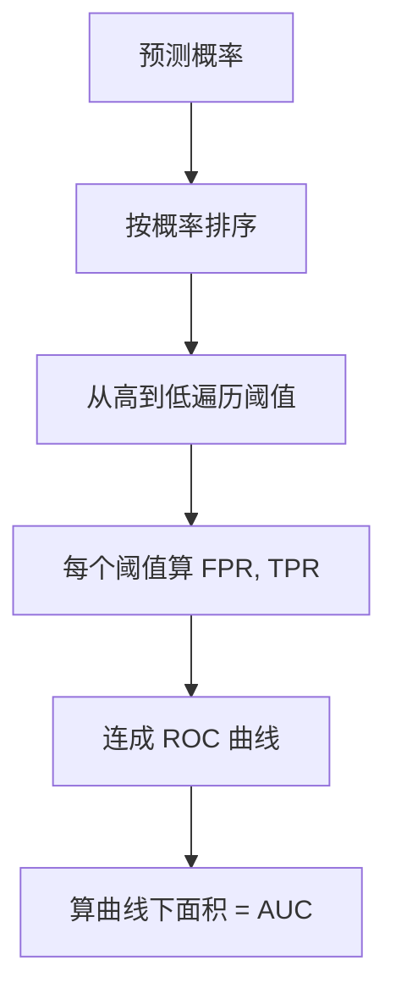

# ML-044 ROC 曲线与 AUC

## 1. 本节学习目标

1. 说清 TPR 与 FPR 的定义，理解 ROC 曲线怎么画出来。
2. 理解 AUC 的概率含义：**随机抽一正一负，正类分数更高的概率**。
3. 知道 AUC 与准确率可以不一致（本课：AUC 0.8705 vs 准确率 0.9244）。
4. 会算多分类 ROC-AUC（OvR macro）。

## 2. 为什么需要这个知识

因为准确率**依赖阈值**，而 AUC **不依赖阈值**——它衡量的是"排序能力"。

当你的业务要"按风险排序、人工复核 Top-N"时，阈值还没定，AUC 才是关键指标。它也是不平衡数据上比准确率可靠得多的单一数字。

## 3. 直观解释

ROC 曲线横轴 FPR、纵轴 TPR，把**所有阈值**下的表现画成一条线。

| 概念 | 含义 | 公式 |
|---|---|---|
| **TPR（召回）** | 真的正类里抓到多少 | $TP/(TP+FN)$ |
| **FPR（误报率）** | 真的负类里误判多少 | $FP/(FP+TN)$ |

**AUC 的含义**：随机取一个正样本、一个负样本，模型给正样本打分更高的概率。

- AUC = 1.0：完美排序。
- AUC = 0.5：等于随机猜。
- AUC < 0.5：比随机还差（通常意味着标签或分数方向搞反了）。

## 4. 正式定义

**ROC 曲线**

$$
\big\{(\text{FPR}(\tau),\ \text{TPR}(\tau)) : \tau\in\mathbb{R}\big\}
$$

遍历所有阈值，得到一条从 $(0,0)$ 到 $(1,1)$ 的曲线。

**AUC**

$$
\text{AUC} = \int_0^1 \text{TPR}\ d(\text{FPR})
$$

**概率解释（等价定义）**

$$
\text{AUC} = P\big(s(\mathbf{x}^+) > s(\mathbf{x}^-)\big)
$$

**多分类（OvR）**

$$
\text{AUC}_{macro} = \frac{1}{K}\sum_{k=1}^{K}\text{AUC}(\text{类 }k\ \text{vs 其余})
$$

## 5. 核心原理

**为什么 AUC 与阈值无关**：它把所有阈值下的 (FPR, TPR) 都算进来，积出一条曲线下的面积。

**为什么 AUC 不能替代准确率**：

- AUC 只看**排序**，不看**校准**。一个把所有分数都压缩到 $[0.4,0.6]$ 的模型可以有很高的 AUC，但用 0.5 阈值时准确率很差。
- 反过来，本课 **AUC 0.8705 < 准确率 0.9244**——因为准确率在"已经选好的阈值"下测得，而 AUC 是全局平均。

**本课的诚实对照**：

| 指标 | 值 |
|---|---|
| 准确率（τ=0.5） | **0.9244** |
| ROC-AUC | **0.8705** |
| PR-AP（见 ML-045） | **0.6472** |

三个数字差异很大，**没有一个能单独代表"模型好不好"**。

**为什么不平衡时 AUC 仍然偏乐观**：FPR 的分母是 $FP+TN$，而 TN 在负类极多时非常大，所以即使 FP 很多，FPR 仍然很小 ⇒ 曲线看起来很好。

## 6. 数学表达式

**本课实验 1**（1500 样本，10% 正类，逻辑回归）

$$
\text{AUC} = 0.8705,\qquad \text{曲线点数}=48
$$

**曲线起点附近**（前 5 个点）

| FPR | TPR |
|---|---|
| 0.000 | 0.000 |
| 0.000 | 0.022 |
| 0.000 | 0.348 |
| 0.010 | 0.348 |
| 0.010 | 0.370 |

读法：FPR 还接近 0 时，TPR 已经升到 0.348 ⇒ 模型能在很少误报的情况下抓到 35% 的正类。这是"排序不错"的信号。

**本课实验 2**（digits，10 类）

$$
\text{AUC}_{OvR,macro} = 0.9991
$$

几乎完美——但注意这是**简单数据集 + 类别可分**的结果，不代表真实场景。

## 7. 数学库链接

| 用到的数学 | 对应篇目 | 用在哪 |
|---|---|---|
| 条件概率 | [[MATH-301 概率基础与条件概率]] | TPR/FPR 都是条件概率 |
| 积分（面积） | [[MATH-124 不定积分]] | AUC 是面积 |
| 期望 | [[MATH-306 期望、方差与协方差]] | AUC 的概率含义 |

## 8. 算法执行流程



## 9. 可视化解释

```text
TPR
1.0 ┤        ╭────── 完美(AUC=1)
    │     ╱
0.8 ┤   ╱   ← 本课曲线(AUC=0.87)
    │ ╱
0.5 ┤╱
    │      ╱ 随机(AUC=0.5)
0.0 └────╱────────► FPR
    0.0        1.0
```

## 10. Python 实现

```powershell
python ml044_roc_auc.py
```

```python
from sklearn.datasets import load_digits, make_classification
from sklearn.linear_model import LogisticRegression
from sklearn.metrics import accuracy_score, roc_auc_score, roc_curve
from sklearn.model_selection import train_test_split
from sklearn.pipeline import Pipeline
from sklearn.preprocessing import StandardScaler

# 不平衡二分类
X, y = make_classification(n_samples=1500, weights=[0.9, 0.1],
                           n_features=8, n_informative=4, random_state=7)
X_train, X_test, y_train, y_test = train_test_split(
    X, y, test_size=0.3, random_state=42, stratify=y)

model = Pipeline([("sc", StandardScaler()),
                  ("lr", LogisticRegression(max_iter=1000))]).fit(X_train, y_train)
proba = model.predict_proba(X_test)[:, 1]

fpr, tpr, thresholds = roc_curve(y_test, proba)
auc = roc_auc_score(y_test, proba)
print("AUC:", round(auc, 4), " 曲线点数:", len(fpr))
print("FPR 前 5:", fpr[:5].round(3).tolist())
print("TPR 前 5:", tpr[:5].round(3).tolist())
print("准确率:", round(accuracy_score(y_test, model.predict(X_test)), 4))
print("正类比例:", round(float(y_test.mean()), 4))

# 多分类 ROC-AUC
X_d, y_d = load_digits(return_X_y=True)
Xd_train, Xd_test, yd_train, yd_test = train_test_split(
    X_d, y_d, test_size=0.3, random_state=42, stratify=y_d)
md = Pipeline([("sc", StandardScaler()),
               ("lr", LogisticRegression(max_iter=300))]).fit(Xd_train, yd_train)
proba_d = md.predict_proba(Xd_test)
print("digits AUC(ovr macro):", round(
    roc_auc_score(yd_test, proba_d, multi_class="ovr", average="macro"), 4))
```

**实际运行结果**

```
AUC: 0.8705  曲线点数: 48
FPR 前 5: [0.0, 0.0, 0.0, 0.01, 0.01]
TPR 前 5: [0.0, 0.022, 0.348, 0.348, 0.37]
准确率: 0.9244
正类比例: 0.1022
digits AUC(ovr macro): 0.9991
```

## 11. 代码逐行解释

| 代码 | 作用 |
|---|---|
| `predict_proba(X)[:, 1]` | 取正类概率（ROC 需要连续分数） |
| `roc_curve(y, proba)` | 返回 `(fpr, tpr, thresholds)` 三个数组 |
| `roc_auc_score(y, proba)` | 直接给 AUC |
| `multi_class="ovr", average="macro"` | 多分类按"每类 vs 其余"平均 |
| `len(fpr) == 48` | 曲线上的点数 = 不同阈值的个数 |

**为什么必须用 `predict_proba`**：`predict` 只给 0/1，ROC 曲线会被压成一个点（FPR/TPR 只有一种组合）。

## 12. 实际运行结果

见第 10 节。三点：

1. **AUC 0.8705 低于准确率 0.9244**——两者量的不是同一件事。
2. 曲线早期（FPR≈0）TPR 就升到 0.348，说明**排序能力不错**。
3. digits 的 AUC 0.9991 极高，但这是简单数据的结果。

## 13. 适用场景

| 场景 | 指标 |
|---|---|
| 需要排序、阈值未定 | **AUC** |
| 阈值已定、要报业务指标 | 准确率/P/R/F1 |
| 类别不平衡 | AUC 比准确率好，但 **PR-AP 更好** |
| 多分类 | OvR macro AUC |
| 极度不平衡（1:1000） | **不要只看 AUC**（见 ML-045） |

## 14. 优点与缺点

| 优点 | 缺点 |
|---|---|
| 与阈值无关 | 不反映概率校准 |
| 单一数字、可比 | 不平衡极端时偏乐观 |
| 有明确概率解释 | 多分类需要选 average |
| 计算简单 | 不告诉你怎么选阈值 |

## 15. 常见错误

| 错误 | 表现 | 纠正 |
|---|---|---|
| 用 `predict` 画 ROC | 只有一个点 | 用 `predict_proba` |
| 认为 AUC 高就准确率高 | 本课 AUC 0.87 < acc 0.92 | 两者分开看 |
| 极度不平衡只看 AUC | 看起来很好但小类全错 | 用 PR-AP |
| 多分类忘 `multi_class` | 报错 | 显式指定 `ovr`/`ovo` |
| 忽略正类比例 | 基线 PR 是 0.1 而非 0.5 | 报 AP 与基线对比 |
| AUC<0.5 就以为模型坏 | 可能分数方向反了 | 检查标签编码 |

## 16. 本节总结

- ROC 横轴 FPR、纵轴 TPR；AUC 是曲线下面积，**与阈值无关**。
- AUC = "随机正样本得分高于随机负样本"的概率。
- **AUC 与准确率可以不一致**（本课 0.8705 vs 0.9244）。

## 17. 前置与后续

- 前置：[[ML-043 混淆矩阵与分类指标]]
- 后续：[[ML-045 PR 曲线与阈值选择]]、`ML-047 偏差-方差权衡与学习曲线`
- 相关数学：[[MATH-301 概率基础与条件概率]]、[[MATH-124 不定积分]]

## 18. 练习与参考答案

**基础 1**：TPR 与 FPR 的公式各是什么？分母分别是什么？

**基础 2**：本课的 AUC 与准确率各是多少？哪个更高？

**进阶 1**：为什么 AUC 高不代表在某个具体阈值下表现好？

**综合 1**：数据正类只占 0.1%，AUC = 0.95。这个模型一定好吗？

> [!success]- 参考答案

> **基础 1**
> $$\text{TPR}=\frac{TP}{TP+FN}\ (\text{分母 = 真实正类数}),\qquad \text{FPR}=\frac{FP}{FP+TN}\ (\text{分母 = 真实负类数})$$
> TPR 等价于召回率。

> **基础 2**
> AUC **0.8705**，准确率 **0.9244**。**准确率更高**。
> 这说明两者度量不同：准确率是"某个阈值下的对错比例"，AUC 是"全阈值下的排序能力"。

> **进阶 1**
> 因为 AUC 是**全局积分**，它把所有阈值的表现平均了。一个模型可能整体排序不错（AUC 高），但在某个特定阈值上表现平庸；也可能在关键阈值（如 τ=0.5）恰好很差。
> 所以：**选模型看 AUC，定业务看特定阈值下的 P/R**。

> **综合 1**
> **不一定。**
> 正类 0.1% 时，负类有 999 个、正类 1 个，FPR 的分母极大 ⇒ 即使 FP 很多，FPR 仍然很小 ⇒ ROC 曲线看起来很漂亮（AUC 虚高）。
> 更该看 **PR 曲线与 AP**：本课同类数据上 AUC 0.8705 而 AP 只有 0.6472（基线 0.1022）——PR 更能暴露小类的问题。
> 结论：极度不平衡时，**PR-AP 比 AUC 更诚实**。

---

## 🔗 Notion 同步信息

> 以下内容由 Notion「AI Knowledge System · 知识点」数据库按知识 ID 合并而来（导出于 2026-11-09）。

| 属性 | 值 |
|---|---|
| 学科 | 机器学习 |
| 学习状态 | 未开始 |
| 难度 | L3 推导 |
| 知识类型 | Technique |

- **所属模块**：[M-ML-06 模型评估与优化](../%E8%AF%BE%E7%A8%8B%E6%A8%A1%E5%9D%97/M-ML-06%20%E6%A8%A1%E5%9E%8B%E8%AF%84%E4%BC%B0%E4%B8%8E%E4%BC%98%E5%8C%96.md)
- **前置知识**：[ML-043 混淆矩阵与分类指标](ML-043%20%E6%B7%B7%E6%B7%86%E7%9F%A9%E9%98%B5%E4%B8%8E%E5%88%86%E7%B1%BB%E6%8C%87%E6%A0%87.md)
- **后继知识**：[ML-045 PR 曲线与阈值选择](ML-045%20PR%20%E6%9B%B2%E7%BA%BF%E4%B8%8E%E9%98%88%E5%80%BC%E9%80%89%E6%8B%A9.md)
- **关联Python**：[PY-067 聚合与统计](../../01_Python%E5%9F%BA%E7%A1%80/08%20NumPy/PY-067%20%E8%81%9A%E5%90%88%E4%B8%8E%E7%BB%9F%E8%AE%A1.md)
- **关联数学**：[MATH-306 期望、方差与协方差](../../06_%E6%95%B0%E5%AD%A6%E5%9F%BA%E7%A1%80/03%20%E6%A6%82%E7%8E%87%E8%AE%BA/MATH-306%20%E6%9C%9F%E6%9C%9B%E3%80%81%E6%96%B9%E5%B7%AE%E4%B8%8E%E5%8D%8F%E6%96%B9%E5%B7%AE.md)
