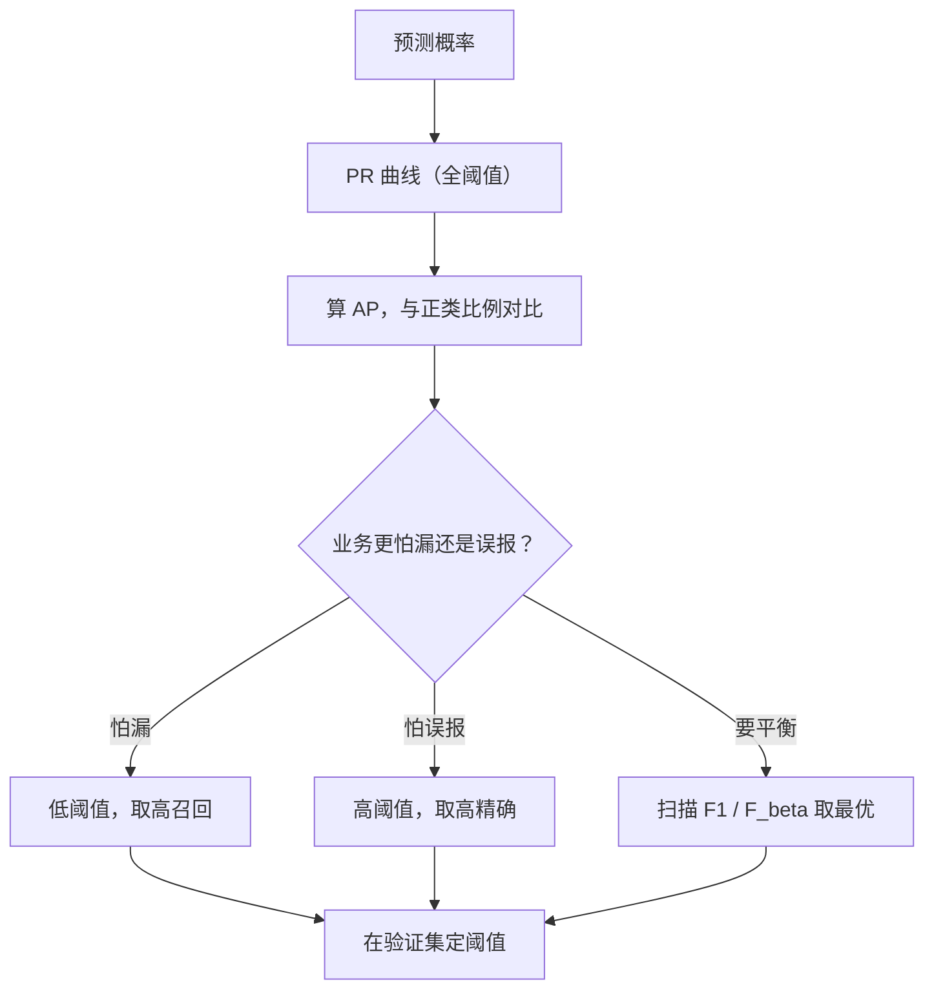

# ML-045 PR 曲线与阈值选择

## 1. 本节学习目标

1. 会说清 PR 曲线与 ROC 的区别，以及**极度不平衡时为什么 PR 更诚实**。
2. 会算 AP（average precision），并与"正类比例基线"对比。
3. 会**用 F1 扫描自动选阈值**（本课最优 τ=0.3619）。
4. 理解阈值选择是**业务决策**，不是模型优化的终点。

## 2. 为什么需要这个知识

因为 AUC 在极度不平衡时会"虚高"（FPR 分母太大），而 PR 曲线直接盯着**精确率与召回率**——这正是业务真正感受到的两个数字。

而且 PR 曲线自带"基线"：随机猜的 AP 等于正类比例。本课基线 **0.1022**、模型 AP **0.6472**，一眼就能看出"比随机好多少"。ROC 的基线恒为 0.5，反而看不出数据难度。

## 3. 直观解释

PR 曲线横轴 Recall、纵轴 Precision，遍历所有阈值。

| 概念 | 含义 |
|---|---|
| **AP**（average precision） | PR 曲线下面积，等价于"加权平均的精确率" |
| **基线 AP** | 随机猜的 AP = 正类比例（本课 0.1022） |
| **阈值 τ** | 决定"多容易判正" |

**关键对比**：

| | ROC | PR |
|---|---|---|
| 横轴 | FPR | Recall |
| 随机基线 | 0.5（恒） | **正类比例**（随数据变） |
| 不平衡敏感度 | 迟钝（FPR 分母大） | **敏感** |
| 适用 | 类别较均衡 | **极度不平衡** |

## 4. 正式定义

**PR 曲线**

$$
\big\{(\text{Recall}(\tau),\ \text{Precision}(\tau)):\tau\in\mathbb{R}\big\}
$$

**AP（积分形式）**

$$
\text{AP} = \int_0^1 P(R)\,dR
$$

**sklearn 的离散实现**（阶梯近似）

$$
\text{AP} = \sum_n (R_n - R_{n-1})\,P_n
$$

**阈值选择（按 F1）**

$$
\tau^* = \arg\max_\tau\ F_1\big(P(\tau),R(\tau)\big)
$$

## 5. 核心原理

**为什么 PR 对不平衡敏感**：精确率的分母是 $TP+FP$，只看"判为正的样本"。负类再多也不会稀释精度——负类只在被**误判为正**时才进入分母。

而 FPR 的分母是 $FP+TN$，负类越多，TN 越大，同样的 FP 数量让 FPR 显得越小 ⇒ ROC 曲线被"抬高"。

**本课的对照**：

| 指标 | 值 | 说明 |
|---|---|---|
| 正类比例（基线 AP） | **0.1022** | 随机猜的水平 |
| 模型 AP | **0.6472** | 比基线高 6.3 倍 |
| ROC-AUC | 0.8705 | 看起来"不错" |
| 准确率 | 0.9244 | 看起来"很好" |

**同一模型，四个数字从 0.10 到 0.92**——选哪个报，取决于你想让谁看见什么。**诚实做法是全报**。

**F1 扫描的结果**：最优阈值 **0.3619**（F1 = 0.6353），而不是默认的 0.5（F1 = 0.541）。

## 6. 数学表达式

**本课实验**（1500 样本，正类 10.22%）

**阈值扫描**

| $\tau$ | Precision | Recall | F1 |
|---|---|---|---|
| 0.1 | 0.371 | **0.717** | 0.489 |
| 0.3 | 0.609 | 0.609 | 0.609 |
| **0.3619**（最优） | — | — | **0.6353** |
| 0.5 | 0.714 | 0.435 | 0.541 |
| 0.7 | **1.000** | 0.239 | 0.386 |

**AP 与基线**

$$
\text{AP}=0.6472,\qquad \text{baseline}=0.1022
$$

**曲线点数**：451（不同阈值的个数）。

## 7. 数学库链接

| 用到的数学 | 对应篇目 | 用在哪 |
|---|---|---|
| 条件概率 | [[MATH-301 概率基础与条件概率]] | P/R 都是条件概率 |
| 积分与面积 | [[MATH-124 不定积分]] | AP 是面积 |
| 期望与加权 | [[MATH-306 期望、方差与协方差]] | AP 是加权平均精度 |

## 8. 算法执行流程



## 9. 可视化解释

```text
Precision
1.0 ┤●
    │ ╲
0.7 ┤  ●──●
    │      ╲
0.4 ┤       ●──●
    │            ╲
0.1 ┤─────────────●──  ← 基线 0.1022（随机）
    └──┬───┬───┬───┬──► Recall
      0.2 0.4 0.6 0.8
```

## 10. Python 实现

```powershell
python ml045_pr_threshold.py
```

```python
from sklearn.datasets import make_classification
from sklearn.linear_model import LogisticRegression
from sklearn.metrics import (average_precision_score, f1_score,
                             precision_recall_curve, precision_score,
                             recall_score, roc_auc_score)
from sklearn.model_selection import train_test_split
from sklearn.pipeline import Pipeline
from sklearn.preprocessing import StandardScaler

X, y = make_classification(n_samples=1500, weights=[0.9, 0.1],
                           n_features=8, n_informative=4, random_state=7)
X_train, X_test, y_train, y_test = train_test_split(
    X, y, test_size=0.3, random_state=42, stratify=y)

model = Pipeline([("sc", StandardScaler()),
                  ("lr", LogisticRegression(max_iter=1000))]).fit(X_train, y_train)
proba = model.predict_proba(X_test)[:, 1]

precision, recall, thresholds = precision_recall_curve(y_test, proba)
ap = average_precision_score(y_test, proba)
print("AP:", round(ap, 4), " 曲线点数:", len(precision))
print("正类比例（基线 AP）:", round(float(y_test.mean()), 4))

best_f1, best_tau = 0.0, None
for p, r, t in zip(precision[:-1], recall[:-1], thresholds):
    if p + r > 0:
        f1 = 2 * p * r / (p + r)
        if f1 > best_f1:
            best_f1, best_tau = f1, t
print("最佳 F1=%.4f @ 阈值=%.4f" % (best_f1, best_tau))

for tau in (0.1, 0.3, 0.5, 0.7):
    pred = (proba >= tau).astype(int)
    print(f"tau={tau}: P={precision_score(y_test, pred, zero_division=0):.3f}"
          f" R={recall_score(y_test, pred, zero_division=0):.3f}"
          f" F1={f1_score(y_test, pred, zero_division=0):.3f}")

print("ROC-AUC:", round(roc_auc_score(y_test, proba), 4), " PR-AP:", round(ap, 4))
```

**实际运行结果**

```
AP: 0.6472  曲线点数: 451
正类比例（基线 AP）: 0.1022
最佳 F1=0.6353 @ 阈值=0.3619
tau=0.1: P=0.371 R=0.717 F1=0.489
tau=0.3: P=0.609 R=0.609 F1=0.609
tau=0.5: P=0.714 R=0.435 F1=0.541
tau=0.7: P=1.000 R=0.239 F1=0.386
ROC-AUC: 0.8705  PR-AP: 0.6472
```

## 11. 代码逐行解释

| 代码 | 作用 |
|---|---|
| `precision_recall_curve(y, proba)` | 返回 `(precision, recall, thresholds)` |
| `precision[:-1]` / `recall[:-1]` | **末尾多一个点**（recall=0, precision=1），要与 thresholds 对齐 |
| `average_precision_score` | 直接算 AP |
| `y_test.mean()` | 正类比例 = 随机基线 |
| `(proba >= tau).astype(int)` | 手动阈值切分 |

**最容易出错的地方**：`precision` 与 `recall` 的长度是 `len(thresholds) + 1`。直接 `zip(thresholds, precision)` 会错位一格，导致选出的阈值偏差一位。

## 12. 实际运行结果

见第 10 节。三点：

1. **AP 0.6472 vs 基线 0.1022**：模型比随机好 6.3 倍。
2. **最优阈值 0.3619（F1 0.6353）**，而默认 0.5 只有 0.541。
3. **ROC-AUC 0.8705 明显高于 AP 0.6472**——又一次印证"不平衡时 AUC 偏乐观"。

## 13. 适用场景

| 场景 | 做法 |
|---|---|
| 极度不平衡（<5%） | **PR + AP** |
| 需要定业务阈值 | F1 / $F_\beta$ 扫描 |
| 人工复核 Top-N | 只取分数最高的一批，不设固定阈值 |
| 类别较均衡 | ROC-AUC 够用 |
| 多分类不平衡 | 每类单独看 PR |

## 14. 优点与缺点

| 优点 | 缺点 |
|---|---|
| 不平衡时更诚实 | 没有单一"面积"直觉（AP 稍抽象） |
| 自带基线（正类比例） | 曲线受类别比例影响，跨数据集不好比 |
| 直接对应业务指标 | 仍需选阈值 |
| 能暴露"小类全错" | 曲线锯齿多，视觉上不光滑 |

## 15. 常见错误

| 错误 | 表现 | 纠正 |
|---|---|---|
| 用 ROC-AUC 报不平衡结果 | 虚高（本课 0.87 vs AP 0.65） | 报 AP |
| `precision[:-1]` 忘了切片 | 阈值错位一格 | 对齐长度 |
| 不报基线 | 不知道 0.65 算好还是差 | 与正类比例对比 |
| 用测试集选阈值 | 泄漏 | 用验证集选，测试集确认 |
| 追求 F1 最大 | 业务代价可能不对称 | 用 $F_\beta$ 或代价矩阵 |
| 只报 AP 不报阈值 | 无法落地 | 同时给出选定阈值 |

## 16. 本节总结

- PR 曲线横轴 Recall、纵轴 Precision；**AP 是曲线下面积**。
- **AP 的基线是正类比例**（本课 0.1022），不是 0.5。
- 本课最优阈值 0.3619（F1 0.6353）≠ 默认 0.5（0.541）——**阈值必须选**。

## 17. 前置与后续

- 前置：[[ML-044 ROC 曲线与 AUC]]
- 后续：`ML-046 过拟合与欠拟合`、`ML-047 偏差-方差权衡与学习曲线`、`ML-048 超参数搜索 GridSearchCV`
- 相关数学：[[MATH-301 概率基础与条件概率]]、[[MATH-124 不定积分]]

## 18. 练习与参考答案

**基础 1**：PR 曲线与 ROC 曲线的横轴各是什么？随机基线各是多少？

**基础 2**：本课的 AP、基线 AP、最优阈值各是多少？

**进阶 1**：为什么极度不平衡时 PR 比 ROC 更诚实？

**综合 1**：业务"每天只能人工复核 50 条"，你会怎么用 AP 和阈值？

> [!success]- 参考答案

> **基础 1**
> - PR：横轴 **Recall**，纵轴 Precision；随机基线 AP = **正类比例**（本课 0.1022）。
> - ROC：横轴 **FPR**，纵轴 TPR；随机基线 AUC = **0.5**（与数据无关）。

> **基础 2**
> AP **0.6472**；基线 AP **0.1022**；最优阈值 **0.3619**（对应 F1 **0.6353**）。

> **进阶 1**
> 因为 FPR 的分母是 $FP+TN$，负类越多 TN 越大 ⇒ 同样的 FP 数量让 FPR 显得很小 ⇒ ROC 曲线被"抬高"、AUC 虚高。
> PR 的分母是 $TP+FP$，只包含"被判为正"的样本，负类再多也不稀释 ⇒ 误报会直接压低精确率，暴露问题。
> 本课证据：ROC-AUC 0.8705 而 AP 只有 0.6472。

> **综合 1**
> 分三步：
> 1. **用 AP 判断模型是否值得上线**（与基线 0.1022 比，0.6472 明显更好）。
> 2. **按复核量定阈值**：取概率最高的 50 条 ⇒ 阈值 ≈ 第 50 名的分数（而不是固定 0.36）。
> 3. **验证命中率**：统计 50 条里真异常多少，据此决定是否调整 Top-N 或重训模型。
> 关键：**业务约束（50 条）决定阈值，而不是 F1 最优点**——F1 最优可能挑出 200 条，复核不过来。

---

## 🔗 Notion 同步信息

> 以下内容由 Notion「AI Knowledge System · 知识点」数据库按知识 ID 合并而来（导出于 2026-11-09）。

| 属性 | 值 |
|---|---|
| 学科 | 机器学习 |
| 学习状态 | 未开始 |
| 难度 | L3 推导 |
| 知识类型 | Technique |

- **所属模块**：[M-ML-06 模型评估与优化](../%E8%AF%BE%E7%A8%8B%E6%A8%A1%E5%9D%97/M-ML-06%20%E6%A8%A1%E5%9E%8B%E8%AF%84%E4%BC%B0%E4%B8%8E%E4%BC%98%E5%8C%96.md)
- **前置知识**：[ML-044 ROC 曲线与 AUC](ML-044%20ROC%20%E6%9B%B2%E7%BA%BF%E4%B8%8E%20AUC.md)
- **后继知识**：[ML-046 过拟合与欠拟合](ML-046%20%E8%BF%87%E6%8B%9F%E5%90%88%E4%B8%8E%E6%AC%A0%E6%8B%9F%E5%90%88.md)
- **关联Python**：[PY-067 聚合与统计](../../01_Python%E5%9F%BA%E7%A1%80/08%20NumPy/PY-067%20%E8%81%9A%E5%90%88%E4%B8%8E%E7%BB%9F%E8%AE%A1.md)
- **关联数学**：[MATH-306 期望、方差与协方差](../../06_%E6%95%B0%E5%AD%A6%E5%9F%BA%E7%A1%80/03%20%E6%A6%82%E7%8E%87%E8%AE%BA/MATH-306%20%E6%9C%9F%E6%9C%9B%E3%80%81%E6%96%B9%E5%B7%AE%E4%B8%8E%E5%8D%8F%E6%96%B9%E5%B7%AE.md)
