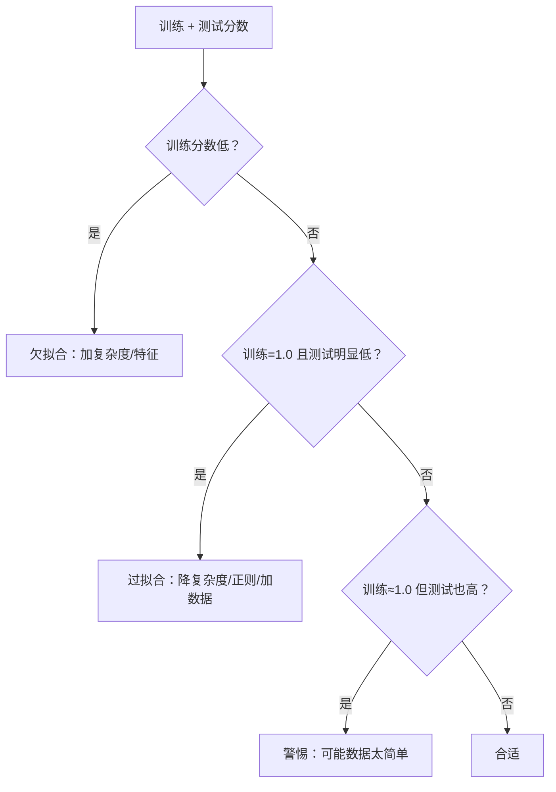

# ML-046 过拟合与欠拟合

## 1. 本节学习目标

1. 用"训练/测试分数 + 差距"三件套诊断模型状态。
2. 理解"训练分数 1.0 但测试不变"说明什么（本课真实现象）。
3. 会用 `max_depth`、`min_samples_leaf` 控制复杂度。
4. 知道**正则化过度也会导致欠拟合**（本课 leaf=20 掉到 0.8667）。

## 2. 为什么需要这个知识

因为"训练集表现好"是最常见的错觉。一个完全生长的决策树能让训练准确率到 1.0，但它可能只是在背答案。

诊断过拟合/欠拟合只需要三个数：**训练分数、测试分数、两者差距**。但**读这三个数有陷阱**——本课就会看到一个反例。

## 3. 直观解释

| 状态 | 训练 | 测试 | 差距 | 处方 |
|---|---|---|---|---|
| **欠拟合** | 低 | 低 | 小 | 加复杂度/加特征 |
| **合适** | 高 | 高 | 小 | 保持 |
| **过拟合** | 很高 | 低 | 大 | 降复杂度/加数据/正则 |

**本课的关键反例**：深度 3 到不限深度，**测试分数完全一样（0.9556）**，但训练分数从 0.9925 涨到 1.0000。

**这说明**：数据集太小、任务太简单，"过拟合"没有体现在测试分上。**此时该用"训练是否到 1.0"作为复杂度的第二信号**，而不是只看 gap。

## 4. 正式定义

**过拟合**

$$
\hat R_{train} \ll R_{true}
$$

模型把训练集的噪声也学进去了。

**欠拟合**

$$
\hat R_{train} \approx R_{true} \gg 0
$$

模型太简单，连训练集都学不好。

**复杂度控制手段**

| 手段 | 作用方向 |
|---|---|
| `max_depth` ↓ | 降复杂度 |
| `min_samples_leaf` ↑ | 降复杂度 |
| `min_samples_split` ↑ | 降复杂度 |
| 正则强度 ↑ | 降复杂度 |
| 特征数 ↓ | 降复杂度 |

## 5. 核心原理

**为什么树最容易过拟合**：完全生长的树有 $O(n)$ 个叶子，能把每个训练样本单独分到一个叶子 ⇒ 训练误差 0。

**为什么正则化过度会欠拟合**：`min_samples_leaf=20` 意味着每个叶子至少 20 个样本，树被迫在很粗的粒度上切分 ⇒ 表达力不足。

**本课的完整曲线**（wine，178×13，75/25 划分）

| `max_depth` | 训练 | 测试 | gap |
|---|---|---|---|
| 1 | 0.6617 | 0.6000 | 0.0617 |
| 2 | 0.9398 | 0.8667 | 0.0732 |
| 3 | 0.9925 | **0.9556** | 0.0369 |
| 5 | 1.0000 | 0.9556 | 0.0444 |
| 10 | 1.0000 | 0.9556 | 0.0444 |
| None | 1.0000 | 0.9556 | 0.0444 |

**读法**：

- 深度 1–2：欠拟合（训练都上不去）。
- 深度 3：训练 0.9925、测试 0.9556 ⇒ 好。
- 深度 ≥5：训练 1.0 但测试不动 ⇒ **已经开始背了，只是这份数据没惩罚它**。

## 6. 数学表达式

**本课 `min_samples_leaf` 扫描**

| `min_samples_leaf` | 训练 | 测试 |
|---|---|---|
| 1（默认） | 1.0000 | 0.9556 |
| 5 | 0.9699 | 0.9556 |
| **20** | 0.9323 | **0.8667** |

**结论**：`leaf=5` 保持了测试分还把训练从 1.0 降到 0.9699（更健康）；`leaf=20` 则**欠拟合**（训练和测试都掉）。

**这就是"正则化有最优区间"的实证**：太弱不约束，太强伤表达力。

## 7. 数学库链接

| 用到的数学 | 对应篇目 | 用在哪 |
|---|---|---|
| 期望与方差 | [[MATH-306 期望、方差与协方差]] | 训练/测试分数的波动 |
| 偏差-方差 | [[MATH-306 期望、方差与协方差]] | 见 ML-047 |

## 8. 算法执行流程



## 9. 可视化解释

```text
准确率
1.0 ┤●━━━●━━━●━━━●  train（很快到 1.0）
    │
0.95┤      ●━━━●━━━●  test（到 0.9556 就停）
0.87┤  ●
0.60┤●
    └──┬───┬───┬───┬──► max_depth
       1   3   5   10
       欠拟合    过拟合区（但本课 test 未跌）
```

## 10. Python 实现

```powershell
python ml046_over_underfit.py
```

```python
from sklearn.datasets import load_wine
from sklearn.model_selection import train_test_split
from sklearn.tree import DecisionTreeClassifier

X, y = load_wine(return_X_y=True)
X_train, X_test, y_train, y_test = train_test_split(
    X, y, test_size=0.25, random_state=42, stratify=y)

print("max_depth 扫描：")
for depth in (1, 2, 3, 5, 10, None):
    model = DecisionTreeClassifier(max_depth=depth, random_state=42).fit(X_train, y_train)
    tr, te = model.score(X_train, y_train), model.score(X_test, y_test)
    print(f"depth={str(depth):>4}: train={tr:.4f} test={te:.4f} gap={tr - te:.4f}")

print("min_samples_leaf 正则化：")
for leaf in (1, 5, 20):
    model = DecisionTreeClassifier(min_samples_leaf=leaf, random_state=42).fit(X_train, y_train)
    print(f"leaf={leaf:>2}: train={model.score(X_train, y_train):.4f}"
          f" test={model.score(X_test, y_test):.4f}")
```

**实际运行结果**

```
max_depth 扫描：
depth=   1: train=0.6617 test=0.6000 gap=0.0617
depth=   2: train=0.9398 test=0.8667 gap=0.0732
depth=   3: train=0.9925 test=0.9556 gap=0.0369
depth=   5: train=1.0000 test=0.9556 gap=0.0444
depth=  10: train=1.0000 test=0.9556 gap=0.0444
depth=None: train=1.0000 test=0.9556 gap=0.0444
min_samples_leaf 正则化：
leaf= 1: train=1.0000 test=0.9556
leaf= 5: train=0.9699 test=0.9556
leaf=20: train=0.9323 test=0.8667
```

## 11. 代码逐行解释

| 代码 | 作用 |
|---|---|
| `DecisionTreeClassifier(max_depth=d)` | 控制树深度 |
| `model.score(X_train, y_train)` | 训练分数（经验风险） |
| `model.score(X_test, y_test)` | 测试分数（泛化估计） |
| `gap = tr - te` | 过拟合程度 |
| `min_samples_leaf=leaf` | 每叶至少 leaf 个样本 |

**`gap` 的陷阱**：本课深度 3 的 gap（0.0369）比深度 2（0.0732）**更小**，但深度 3 明显更好。gap 只是信号之一，**必须结合绝对分数**。

## 12. 实际运行结果

见第 10 节。三点：

1. 深度 ≥5 后训练恒为 1.0000，测试恒为 0.9556 ⇒ **过拟合存在但未被数据惩罚**（数据太简单）。
2. `leaf=5` 是对的正则化方向：训练降到 0.9699，测试保持 0.9556。
3. `leaf=20` 明显欠拟合：训练 0.9323、测试 0.8667。

## 13. 适用场景

| 现象 | 处理 |
|---|---|
| 训练高、测试低 | 降复杂度、正则、加数据 |
| 训练低 | 加复杂度、加特征、检查标签 |
| 训练=1.0 但测试也高 | 数据可能太简单，考虑换更难的数据验证 |
| 调正则后两者都降 | 正则过强，回调 |

## 14. 优点与缺点

| 手段 | 优点 | 缺点 |
|---|---|---|
| 降深度 | 简单有效 | 可能欠拟合 |
| `min_samples_leaf` | 平滑、抗噪 | 过大伤表达 |
| 加数据 | 最根本 | 成本高 |
| 正则化（L1/L2） | 连续可调 | 需标准化 |

## 15. 常见错误

| 错误 | 表现 | 纠正 |
|---|---|---|
| 只看训练分数 | 越复杂越好 | 看测试 |
| 只看 gap | 本课 depth 3 gap 更小但更好 | 结合绝对分数 |
| 认为训练 1.0 一定坏 | 本课测试也不错 | 看数据难度 |
| 正则化过量 | leaf=20 掉到 0.8667 | 用 CV 选强度 |
| 用测试集调超参 | 泄漏 | 用验证集/CV |
| 忘了数据量因素 | 小数据更容易过拟合 | 看学习曲线 |

## 16. 本节总结

- 诊断三件套：**训练分数、测试分数、gap**。
- 但 gap 小不等于好（本课 depth 3 的 gap 更小却更好）——要看绝对分数。
- **正则化有最优区间**：太弱不约束、太强会欠拟合。

## 17. 前置与后续

- 前置：[[ML-045 PR 曲线与阈值选择]]、[[ML-007 经验风险与泛化能力]]
- 后续：[[ML-047 偏差-方差权衡与学习曲线]]、[[ML-048 超参数搜索 GridSearchCV]]、`ML-049 数据泄漏与评估陷阱`
- 相关数学：[[MATH-306 期望、方差与协方差]]

## 18. 练习与参考答案

**基础 1**：如何用训练/测试分数判断过拟合与欠拟合？

**基础 2**：本课 `max_depth=3` 与 `None` 的训练/测试分数各是多少？

**进阶 1**：为什么深度 ≥5 后测试分数不再变化，训练却到了 1.0？

**综合 1**：`min_samples_leaf` 从 1 增到 5 再到 20，效果如何变化？

> [!success]- 参考答案

> **基础 1**
> - 训练低、测试低 ⇒ **欠拟合**。
> - 训练很高、测试明显低（gap 大）⇒ **过拟合**。
> - 训练高、测试高、gap 小 ⇒ 合适。
> 注意 gap 要结合绝对分数看（见进阶 1）。

> **基础 2**
> `depth=3`：train **0.9925**、test **0.9556**。
> `depth=None`：train **1.0000**、test **0.9556**。

> **进阶 1**
> 因为 wine 数据只有 178 条、13 个特征，且三类分得比较开。树在深度 3 时已经把主要结构学完，再加深只是把训练集的**个别难样本/噪声**单独切开 ⇒ 训练到 1.0，但那些切分对新数据没有帮助，所以测试分不动。
> 这说明：**训练到 1.0 是过拟合的信号，但"测试分下降"不是必然出现的**——数据越简单，越看不出代价。

> **综合 1**
> | leaf | train | test |
> |---|---|---|
> | 1 | 1.0000 | 0.9556 |
> | 5 | 0.9699 | 0.9556 |
> | 20 | 0.9323 | **0.8667** |
>
> - `leaf=1→5`：训练降了，测试不变 ⇒ **更健康的模型**（同样的泛化、更低的复杂度）。
> - `leaf=5→20`：两者都降 ⇒ **过度正则化，开始欠拟合**。
> 结论：正则化强度要用 CV 选，不能"越大越保守越好"。

---

## 🔗 Notion 同步信息

> 以下内容由 Notion「AI Knowledge System · 知识点」数据库按知识 ID 合并而来（导出于 2026-11-09）。

| 属性 | 值 |
|---|---|
| 学科 | 机器学习 |
| 学习状态 | 未开始 |
| 难度 | L2 应用 |
| 知识类型 | Concept |

- **所属模块**：[M-ML-06 模型评估与优化](../%E8%AF%BE%E7%A8%8B%E6%A8%A1%E5%9D%97/M-ML-06%20%E6%A8%A1%E5%9E%8B%E8%AF%84%E4%BC%B0%E4%B8%8E%E4%BC%98%E5%8C%96.md)
- **前置知识**：[ML-045 PR 曲线与阈值选择](ML-045%20PR%20%E6%9B%B2%E7%BA%BF%E4%B8%8E%E9%98%88%E5%80%BC%E9%80%89%E6%8B%A9.md)
- **后继知识**：[ML-047 偏差-方差权衡与学习曲线](ML-047%20%E5%81%8F%E5%B7%AE-%E6%96%B9%E5%B7%AE%E6%9D%83%E8%A1%A1%E4%B8%8E%E5%AD%A6%E4%B9%A0%E6%9B%B2%E7%BA%BF.md)
- **关联Python**：[PY-067 聚合与统计](../../01_Python%E5%9F%BA%E7%A1%80/08%20NumPy/PY-067%20%E8%81%9A%E5%90%88%E4%B8%8E%E7%BB%9F%E8%AE%A1.md)
- **关联数学**：[MATH-306 期望、方差与协方差](../../06_%E6%95%B0%E5%AD%A6%E5%9F%BA%E7%A1%80/03%20%E6%A6%82%E7%8E%87%E8%AE%BA/MATH-306%20%E6%9C%9F%E6%9C%9B%E3%80%81%E6%96%B9%E5%B7%AE%E4%B8%8E%E5%8D%8F%E6%96%B9%E5%B7%AE.md)
