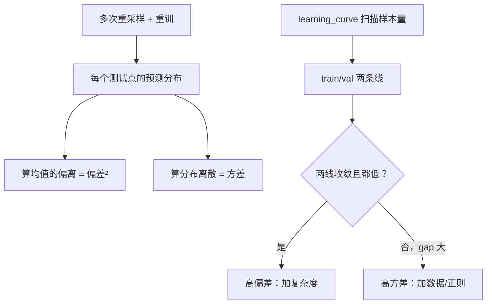

# ML-047 偏差-方差权衡与学习曲线

## 1. 本节学习目标

1. 写出偏差-方差分解，并**用数值实验把它算出来**（本课：degree 15 方差 9.386）。
2. 会用 `learning_curve` 判断"该加数据还是该加模型"。
3. 能区分"高偏差"与"高方差"的信号。
4. 知道噪声项 $\sigma^2$ 不可消除，是误差下限。

## 2. 为什么需要这个知识

因为"过拟合/欠拟合"只是现象描述，**偏差-方差分解才是机制**。

它回答两个实际问题：

- 为什么加数据对某个模型没用？（因为它是高偏差）
- 为什么换个数据集结果就变？（因为它是高方差）

而学习曲线把这件事变成可操作的判断：看两条线的走向。

## 3. 直观解释

同一份数据的预测误差可以拆成三块：

$$
\text{总误差} = \underbrace{\text{偏差}^2}_{\text{系统性偏离}} + \underbrace{\text{方差}}_{\text{对样本的敏感}} + \underbrace{\sigma^2}_{\text{噪声}}
$$

**打靶类比**：

| 类型 | 表现 | 原因 |
|---|---|---|
| 高偏差 | 所有弹孔都偏离靶心，但很集中 | 模型太简单（瞄准系统错） |
| 高方差 | 弹孔围着靶心但很分散 | 模型太复杂（手抖） |
| 合适 | 集中在靶心附近 | 两者平衡 |

**关键**：噪声 $\sigma^2$ 是数据本身的随机性，任何模型都消不掉。

## 4. 正式定义

**分解公式**（平方损失，对训练集 $\mathcal{D}$ 取期望）

$$
\mathbb{E}_{\mathcal{D}}\big[(y-\hat f_{\mathcal{D}}(\mathbf{x}))^2\big]
= \underbrace{\big(\mathbb{E}_{\mathcal{D}}[\hat f] - f(\mathbf{x})\big)^2}_{\text{Bias}^2}
+ \underbrace{\mathbb{E}_{\mathcal{D}}\big[(\hat f - \mathbb{E}_{\mathcal{D}}[\hat f])^2\big]}_{\text{Variance}}
+ \sigma^2
$$

**怎么估这三项**：跑多次"重新采样数据 → 重新训练"，得到每个测试点的预测分布。

$$
\widehat{\text{Bias}}^2 = \frac{1}{n_{test}}\sum_i\big(\bar{\hat f}(\mathbf{x}_i)-f(\mathbf{x}_i)\big)^2
$$

$$
\widehat{\text{Var}} = \frac{1}{n_{test}}\sum_i \operatorname{Var}_{\mathcal{D}}\big[\hat f(\mathbf{x}_i)\big]
$$

**本课做法**：20 次重复，每次重新采 60 个训练点，在 200 个固定测试点上算。

## 5. 核心原理

**复杂度如何影响两项**：

| 复杂度 | 偏差 | 方差 |
|---|---|---|
| 低（degree 1） | 高 | 低 |
| 中（degree 3） | 中 | 中 |
| 高（degree 15） | **低** | **极高** |

**加数据只降方差，不降偏差**：

- 高方差模型（过拟合）⇒ 加数据有效。
- 高偏差模型（欠拟合）⇒ 加数据几乎无用，要加复杂度。

**这就是学习曲线的诊断逻辑**：看两条线在高样本区是否收敛。

## 6. 数学表达式

**本课数值实验**（真函数 $f(x)=1.5x+2\sin 2x$，噪声 $\sigma=0.5$，20 次重复）

| degree | 偏差² | 方差 | 合计 |
|---|---|---|---|
| 1 | **1.7477** | 0.0626 | 1.8103 |
| 3 | 1.2566 | 0.1018 | **1.3584** |
| 15 | 0.4520 | **9.3860** | 9.8380 |

**读法**：

- degree 1：偏差占主导（1.7477 / 1.8103 = **97%**）⇒ 高偏差。
- degree 15：方差占主导（9.386 / 9.838 = **95%**）⇒ 高方差。
- degree 3：总计最小（1.3584）⇒ **最优复杂度**。

**注意噪声**：$\sigma^2 = 0.25$，所以总误差不可能低于 0.25。degree 3 的 1.3584 里有一部分就是噪声。

**本课学习曲线**（digits，逻辑回归，5 折）

| 训练样本数 | 训练分数 | 验证分数 |
|---|---|---|
| 143 | **1.0000** | 0.7785 |
| 431 | 1.0000 | 0.8837 |
| 862 | 1.0000 | 0.9210 |
| 1437 | 0.9990 | **0.9199** |

**读法**：训练分数几乎不动（1.0），验证分数从 0.7785 升到 0.9199 后**趋于平稳**。两条线之间有 0.08 的稳定间隙 ⇒ **高方差**（过拟合倾向），但继续加数据收益已经很小。

## 7. 数学库链接

| 用到的数学 | 对应篇目 | 用在哪 |
|---|---|---|
| 期望与方差 | [[MATH-306 期望、方差与协方差]] | 分解公式的两项 |
| 大数定律 | [[MATH-401 大数定律与中心极限定理]] | 为什么加数据能稳定估计 |

## 8. 算法执行流程



## 9. 可视化解释

```text
误差
 9.8 ┤                    ●  degree 15（方差爆炸）
     │
 1.8 ┤●                   
 1.4 ┤    ●  ← degree 3 最优
     └──┬────┬────┬──► 复杂度
        1    3   15
   偏差主导   方差主导
```

## 10. Python 实现

```powershell
python ml047_bias_variance.py
```

```python
import numpy as np
from sklearn.datasets import load_digits
from sklearn.linear_model import LogisticRegression, Ridge
from sklearn.model_selection import learning_curve
from sklearn.pipeline import Pipeline
from sklearn.preprocessing import PolynomialFeatures, StandardScaler


def true_f(x):
    return 1.5 * x + 2 * np.sin(2 * x)


rng = np.random.default_rng(0)
results = []
for _ in range(20):
    x_data = rng.uniform(-3, 3, 60)
    y_data = true_f(x_data) + rng.normal(0, 0.5, 60)
    preds = []
    for degree in (1, 3, 15):
        model = Pipeline([("poly", PolynomialFeatures(degree)),
                          ("ridge", Ridge(alpha=1e-6))])
        model.fit(x_data.reshape(-1, 1), y_data)
        preds.append(model.predict(np.linspace(-3, 3, 200).reshape(-1, 1)))
    results.append(preds)

x_test = np.linspace(-3, 3, 200)
f_true = true_f(x_test)
for i, degree in enumerate((1, 3, 15)):
    P = np.array([r[i] for r in results])
    bias2 = float(np.mean((P.mean(axis=0) - f_true) ** 2))
    var = float(np.mean(P.var(axis=0)))
    print(f"degree={degree:>2}: bias²={bias2:.4f} variance={var:.4f} 合计={bias2 + var:.4f}")

# 学习曲线
X, y = load_digits(return_X_y=True)
pipe = Pipeline([("sc", StandardScaler()),
                 ("lr", LogisticRegression(max_iter=300))])
sizes, train_s, val_s = learning_curve(pipe, X, y,
                                       train_sizes=[0.1, 0.3, 0.6, 1.0], cv=5)
print("train_sizes:", sizes.tolist())
print("train 均值:", train_s.mean(axis=1).round(4).tolist())
print("val   均值:", val_s.mean(axis=1).round(4).tolist())
```

**实际运行结果**

```
degree= 1: bias²=1.7477 variance=0.0626 合计=1.8103
degree= 3: bias²=1.2566 variance=0.1018 合计=1.3584
degree=15: bias²=0.4520 variance=9.3860 合计=9.8380
train_sizes: [143, 431, 862, 1437]
train 均值: [1.0, 1.0, 1.0, 0.999]
val   均值: [0.7785, 0.8837, 0.921, 0.9199]
```

## 11. 代码逐行解释

| 代码 | 作用 |
|---|---|
| `for _ in range(20)` | **多次重采样**，这是估方差的前提 |
| `rng.uniform(-3, 3, 60)` | 每次重新采训练点 |
| `rng.normal(0, 0.5, 60)` | 加噪声（$\sigma=0.5$） |
| `P.mean(axis=0)` | 每个测试点的平均预测 ⇒ 用于算偏差 |
| `P.var(axis=0)` | 每个测试点的预测方差 ⇒ 方差 |
| `learning_curve(..., cv=5)` | 扫不同训练样本量 |

**关键点**：偏差与方差都要求"**多个模型**"才能算。只训练一个模型是估不出方差的——这是很多人对分解"看得懂但算不出"的原因。

## 12. 实际运行结果

见第 10 节。三点：

1. **degree 15 的方差（9.386）是 degree 3（0.1018）的 92 倍**——高阶多项式的方差爆炸。
2. degree 1 的偏差（1.7477）占其总误差的 97% ⇒ 高偏差。
3. 学习曲线：训练恒 1.0、验证从 0.7785 升到 0.9199 后停滞 ⇒ 高方差 + 数据收益饱和。

## 13. 适用场景

| 现象 | 诊断 | 处方 |
|---|---|---|
| 训练低、验证低 | 高偏差 | 加复杂度/特征 |
| 训练高、验证低、gap 大 | 高方差 | 加数据/正则/降复杂度 |
| 加数据后验证仍不升 | 高偏差 | 加数据无用，改模型 |
| 加数据后验证上升 | 高方差 | 继续加数据 |

## 14. 优点与缺点

| 概念 | 优点 | 缺点 |
|---|---|---|
| 偏差-方差分解 | 解释力强、指导加数据/加模型 | 需要多次重采样，实际少算 |
| 学习曲线 | 直观、可操作 | 要训练多次，慢 |
| 噪声项 | 给出误差下限 | 通常未知 |

## 15. 常见错误

| 错误 | 表现 | 纠正 |
|---|---|---|
| 只训练一次就算方差 | 算不出来 | 必须多次重采样 |
| 认为加数据万能 | 高偏差模型加数据无用 | 先看学习曲线 |
| 忽略噪声下限 | 追求 0 误差 | 噪声不可消除 |
| 用测试集画学习曲线 | 泄漏 | 用训练/验证 |
| 把 gap 大当成唯一信号 | 本课训练恒 1.0 | 结合验证绝对值 |
| 认为复杂度越高越好 | degree 15 总误差 9.8 | 看总误差 |

## 16. 本节总结

- 误差 = **偏差² + 方差 + 噪声**；噪声不可消除。
- 本课实测：degree 1 高偏差（偏差占 97%），degree 15 高方差（方差占 95%），degree 3 最优。
- **加数据只降方差**：高偏差模型要先加复杂度。

## 17. 前置与后续

- 前置：[[ML-046 过拟合与欠拟合]]、[[ML-007 经验风险与泛化能力]]
- 后续：[[ML-048 超参数搜索 GridSearchCV]]、`ML-049 数据泄漏与评估陷阱`
- 相关数学：[[MATH-306 期望、方差与协方差]]、[[MATH-401 大数定律与中心极限定理]]

## 18. 练习与参考答案

**基础 1**：写出偏差-方差分解的三项，并说明哪一项不可消除。

**基础 2**：本课 degree 1/3/15 的偏差²、方差、合计各是多少？

**进阶 1**：为什么高偏差模型"加数据没用"？

**综合 1**：学习曲线显示训练恒 1.0、验证 0.92 停滞，该加数据还是加复杂度？

> [!success]- 参考答案

> **基础 1**
> $$\mathbb{E}[(y-\hat f)^2]=\text{Bias}^2+\text{Variance}+\sigma^2$$
> 不可消除的是 **$\sigma^2$（噪声）**——它来自数据本身的随机性，与模型无关。

> **基础 2**
> | degree | 偏差² | 方差 | 合计 |
> |---|---|---|---|
> | 1 | 1.7477 | 0.0626 | 1.8103 |
> | 3 | 1.2566 | 0.1018 | **1.3584** |
> | 15 | 0.4520 | 9.3860 | 9.8380 |

> **进阶 1**
> 因为加数据只降低**方差**（模型对样本波动的敏感度），而高偏差来自"模型族本身表达不了真实函数"——数据再多，一个线性模型也拟合不了正弦曲线。
> 本课 degree 1 的偏差 1.7477 占 97%，即使加十倍数据，方差那 0.0626 变小，总误差仍卡在 1.75 左右。

> **综合 1**
> 该**降方差**（加数据或加正则），不是加复杂度。
> 判据：
> - 训练恒 1.0 而验证只有 0.92 ⇒ **高方差**（过拟合）。
> - 验证随数据量上升但从 0.92 开始停滞 ⇒ 加数据收益已接近饱和，应考虑**加正则/降维**。
> 若验证分数很低且训练也低（如都 0.7），那才是高偏差，需要加复杂度。

---

## 🔗 Notion 同步信息

> 以下内容由 Notion「AI Knowledge System · 知识点」数据库按知识 ID 合并而来（导出于 2026-11-09）。

| 属性 | 值 |
|---|---|
| 学科 | 机器学习 |
| 学习状态 | 未开始 |
| 难度 | L3 推导 |
| 知识类型 | Technique |

- **所属模块**：[M-ML-06 模型评估与优化](../%E8%AF%BE%E7%A8%8B%E6%A8%A1%E5%9D%97/M-ML-06%20%E6%A8%A1%E5%9E%8B%E8%AF%84%E4%BC%B0%E4%B8%8E%E4%BC%98%E5%8C%96.md)
- **前置知识**：[ML-046 过拟合与欠拟合](ML-046%20%E8%BF%87%E6%8B%9F%E5%90%88%E4%B8%8E%E6%AC%A0%E6%8B%9F%E5%90%88.md)
- **后继知识**：[ML-048 超参数搜索 GridSearchCV](ML-048%20%E8%B6%85%E5%8F%82%E6%95%B0%E6%90%9C%E7%B4%A2%20GridSearchCV.md)
- **关联Python**：[PY-067 聚合与统计](../../01_Python%E5%9F%BA%E7%A1%80/08%20NumPy/PY-067%20%E8%81%9A%E5%90%88%E4%B8%8E%E7%BB%9F%E8%AE%A1.md)
- **关联数学**：[MATH-306 期望、方差与协方差](../../06_%E6%95%B0%E5%AD%A6%E5%9F%BA%E7%A1%80/03%20%E6%A6%82%E7%8E%87%E8%AE%BA/MATH-306%20%E6%9C%9F%E6%9C%9B%E3%80%81%E6%96%B9%E5%B7%AE%E4%B8%8E%E5%8D%8F%E6%96%B9%E5%B7%AE.md) · [MATH-401 大数定律与中心极限定理](../../06_%E6%95%B0%E5%AD%A6%E5%9F%BA%E7%A1%80/04%20%E6%95%B0%E7%90%86%E7%BB%9F%E8%AE%A1/MATH-401%20%E5%A4%A7%E6%95%B0%E5%AE%9A%E5%BE%8B%E4%B8%8E%E4%B8%AD%E5%BF%83%E6%9E%81%E9%99%90%E5%AE%9A%E7%90%86.md)
