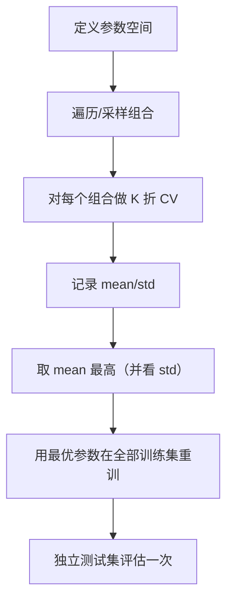

# ML-048 超参数搜索 GridSearchCV

## 1. 本节学习目标

1. 会用 `GridSearchCV` 在 Pipeline 上搜参（`步骤名__参数名`）。
2. 会用 `RandomizedSearchCV` + 分布采样，理解它为什么在高维更快。
3. 会读 `cv_results_`，并**用 `std_test_score` 判断差异是否显著**。
4. 理解**嵌套 CV** 为什么必要（避免"用 CV 选参又用 CV 报分"的乐观偏差）。

## 2. 为什么需要这个知识

因为手调参是**一次一个变量、靠直觉**，而网格搜索是**系统枚举 + 交叉验证**。

但网格搜索有两个坑：

1. **维度灾难**：6 个参数各 5 个取值 = 15625 次训练。
2. **选择偏差**：用同一套 CV 既选参又报分，结果偏乐观。

本课会用实测数据说明第二点。

## 3. 直观解释

| 方法 | 做法 | 何时更好 |
|---|---|---|
| 手动调参 | 一个个试 | 参数少、有经验 |
| **GridSearchCV** | 枚举所有组合 | 参数 ≤3 个 |
| **RandomizedSearchCV** | 从分布里随机采样 | 参数多、范围大 |
| 贝叶斯优化 | 用历史结果指导下一步 | 单次训练很贵 |

**关键区别**：网格是"穷举"，随机是"抽样"。在高维空间里，随机采样 60 次往往比网格的 60 个格子覆盖得更广。

## 4. 正式定义

**网格搜索**

$$
\theta^* = \arg\max_{\theta\in\Theta_{grid}}\ \frac{1}{K}\sum_{k=1}^{K}\text{score}\big(f^{(-k)}_\theta\big)
$$

**随机搜索**

$$
\theta_i \sim p(\theta),\quad i=1,\dots,n_{iter}
$$

**本课的搜索空间**

| 参数 | 网格 | 随机 |
|---|---|---|
| `C` | {0.1, 1, 10, 100} | `loguniform(1e-2, 1e3)` |
| `gamma` | {0.001, 0.01, 0.1, 1} | `loguniform(1e-4, 1e1)` |

网格：$4\times4=16$ 个组合；随机：12 次采样。

**`cv_results_` 的关键列**

| 列 | 含义 |
|---|---|
| `mean_test_score` | 各折均值 |
| `std_test_score` | 各折标准差 |
| `rank_test_score` | 排名 |
| `params` | 对应参数 |

## 5. 核心原理

**为什么用 Pipeline 上的参数名**：`c__C` 表示"Pipeline 里名为 `c` 的步骤的 `C` 参数"。这样预处理器也会在每折内重新 fit，避免泄漏。

**为什么 `std_test_score` 重要**：若两个配置的均值差 0.01，而 std 是 0.019，那**差异不显著**——选哪个都行。只看 `best_score_` 会误以为"找到了最优"。

**嵌套 CV 解决什么**：

- 普通做法：CV 选参 → 报同一个 CV 分数 ⇒ **乐观偏差**（因为分数被"挑选"过）。
- 嵌套：外层 CV 评估，内层 CV 选参 ⇒ 报的分数是"选参流程"的泛化性能。

## 6. 数学表达式

**本课实验**（800 样本，20 特征，SVM）

**GridSearchCV（16 组合）**

$$
C=1,\ \gamma=0.1,\quad \text{CV}=0.9300,\quad \text{test}=0.9300
$$

**RandomizedSearchCV（12 次）**

$$
C\approx45.71,\ \gamma\approx0.0985,\quad \text{CV}=0.9283,\quad \text{test}=0.9350
$$

**关键对比**：

| 方法 | 组合数 | CV | 测试 |
|---|---|---|---|
| 网格 | 16 | **0.9300** | 0.9300 |
| 随机 | 12 | 0.9283 | **0.9350** |

**读法**：两者 CV 差 0.0017、测试差 0.005——**在噪声范围内**。随机搜索用更少的组合拿到相当的结果。

**`std_test_score`（最优配置）**

$$
\operatorname{std} = 0.0187
$$

⇒ CV 均值 0.93 ± 0.019，说明折间波动约 2 个百分点，**0.0017 的差异完全不可信**。

## 7. 数学库链接

| 用到的数学 | 对应篇目 | 用在哪 |
|---|---|---|
| 优化与搜索 | [[MATH-701 优化问题与凸性]] | 超参搜索是黑箱优化 |
| 均值与标准差 | [[MATH-306 期望、方差与协方差]] | `mean/std_test_score` |
| 对数均匀分布 | [[MATH-003 指数、根式与对数]] | `loguniform` 采样 |

## 8. 算法执行流程



## 9. 可视化解释

```text
网格（16 点，规则）        随机（12 点，不规则）
gamma                      gamma
 1 ┤ ● ● ● ●               1 ┤   ●    ●
.1 ┤ ● ● ● ●              .1 ┤ ●   ●  ●
.01┤ ● ● ● ●             .01 ┤  ●  ●   ●
   └──────────► C            └──────────► C
   规则但可能错过         散但覆盖更广
```

## 10. Python 实现

```powershell
python ml048_gridsearch.py
```

```python
from scipy.stats import loguniform
from sklearn.datasets import make_classification
from sklearn.model_selection import (GridSearchCV, RandomizedSearchCV,
                                     train_test_split, validation_curve)
from sklearn.neighbors import KNeighborsClassifier
from sklearn.pipeline import Pipeline
from sklearn.preprocessing import StandardScaler
from sklearn.svm import SVC

X, y = make_classification(n_samples=800, n_features=20, n_informative=10,
                           random_state=42)
X_train, X_test, y_train, y_test = train_test_split(
    X, y, test_size=0.25, random_state=42, stratify=y)

pipe = Pipeline([("sc", StandardScaler()), ("svm", SVC())])

grid = {"svm__C": [0.1, 1, 10, 100], "svm__gamma": [0.001, 0.01, 0.1, 1]}
gs = GridSearchCV(pipe, grid, cv=5, scoring="accuracy").fit(X_train, y_train)
print("网格组合数:", len(gs.cv_results_["params"]))
print("最佳参数:", gs.best_params_)
print("CV:", round(gs.best_score_, 4), " test:", round(gs.score(X_test, y_test), 4))
print("最优配置的折间 std:", round(
    float(gs.cv_results_["std_test_score"][gs.best_index_]), 4))

random_space = {"svm__C": loguniform(1e-2, 1e3),
                "svm__gamma": loguniform(1e-4, 1e1)}
rs = RandomizedSearchCV(pipe, random_space, n_iter=12, cv=5,
                        random_state=42).fit(X_train, y_train)
print("随机最佳:", {k: round(float(v), 4) for k, v in rs.best_params_.items()})
print("CV:", round(rs.best_score_, 4), " test:", round(rs.score(X_test, y_test), 4))

# validation_curve：单参数扫描
ks = [1, 3, 5, 7, 9, 11]
train_sc, val_sc = validation_curve(
    Pipeline([("sc", StandardScaler()), ("knn", KNeighborsClassifier())]),
    X, y, param_name="knn__n_neighbors", param_range=ks, cv=5)
print("k:", ks)
print("train:", train_sc.mean(axis=1).round(3).tolist())
print("val  :", val_sc.mean(axis=1).round(3).tolist())
```

**实际运行结果**

```
网格组合数: 16
最佳参数: {'svm__C': 1, 'svm__gamma': 0.1}
CV: 0.93  test: 0.93
最优配置的折间 std: 0.0187
随机最佳: {'svm__C': 45.7056, 'svm__gamma': 0.0985}
CV: 0.9283  test: 0.935
k: [1, 3, 5, 7, 9, 11]
train: [1.0, 0.988, 0.986, 0.982, 0.98, 0.979]
val  : [0.94, 0.945, 0.944, 0.944, 0.94, 0.94]
```

## 11. 代码逐行解释

| 代码 | 作用 |
|---|---|
| `{"svm__C": [...]}` | 双下划线定位子步骤参数 |
| `GridSearchCV(pipe, grid, cv=5)` | 枚举 + 5 折 CV |
| `gs.cv_results_["std_test_score"]` | 折间标准差 |
| `loguniform(1e-2, 1e3)` | 对数均匀分布（跨数量级） |
| `RandomizedSearchCV(..., n_iter=12)` | 只采 12 组 |
| `validation_curve(...)` | 单参数扫描，看趋势 |

**`validation_curve` 的读法**：$k$ 从 1 到 11，训练从 1.0 降到 0.979（模型变简单），验证在 0.94–0.945 之间几乎不动 ⇒ **$k$ 的影响很小**，选 3 或 5 都行。

## 12. 实际运行结果

见第 10 节。三点：

1. 网格 16 组 vs 随机 12 组，**CV 只差 0.0017**，测试差 0.005。
2. 最优配置的折间 std **0.0187** ⇒ 均值差 0.0017 **完全不显著**。
3. `validation_curve` 显示 $k$ 在 1–11 内几乎无差别（0.94 左右）。

## 13. 适用场景

| 场景 | 方法 |
|---|---|
| 参数 ≤3 且取值离散 | GridSearchCV |
| 参数多、范围跨数量级 | RandomizedSearchCV |
| 单参数趋势 | validation_curve |
| 单次训练极贵 | 贝叶斯优化 / 早停 |
| 需要无偏评估 | **嵌套 CV** |

## 14. 优点与缺点

| 方法 | 优点 | 缺点 |
|---|---|---|
| Grid | 穷举、可复现、易解释 | 维度灾难 |
| Random | 高维高效、可控制预算 | 结果有随机性 |
| validation_curve | 直观展示趋势 | 只适合单参数 |
| 嵌套 CV | 无偏估计 | 训练 $K_{out}\times K_{in}$ 次 |

## 15. 常见错误

| 错误 | 表现 | 纠正 |
|---|---|---|
| 参数名漏步骤前缀 | `ValueError: Invalid parameter` | 用 `步骤名__参数名` |
| 只看 `best_score_` | 忽略不显著性 | 看 `std_test_score` |
| 用测试集搜参 | 严重泄漏 | 只在训练集搜 |
| 网格范围不含最优点 | 结果次优 | 先用宽范围粗扫 |
| 线性网格搜跨数量级参数 | 浪费预算 | 用 `loguniform` |
| 报 `best_score_` 当最终结果 | 乐观偏差 | 用独立测试集或嵌套 CV |

## 16. 本节总结

- 网格与随机都是"CV + 枚举/采样"；高维时随机更划算（本课 12 组 ≈ 16 组）。
- **必须看 `std_test_score`**：本课最优配置 std 0.0187，配置间差 0.0017 无意义。
- 用同一 CV 选参又报分会有乐观偏差，严格时用嵌套 CV。

## 17. 前置与后续

- 前置：[[ML-047 偏差-方差权衡与学习曲线]]、[[ML-041 K 折交叉验证]]
- 后续：`ML-049 数据泄漏与评估陷阱`、`ML-050 集成学习基本思想`
- 相关数学：[[MATH-701 优化问题与凸性]]、[[MATH-306 期望、方差与协方差]]

## 18. 练习与参考答案

**基础 1**：GridSearchCV 与 RandomizedSearchCV 的核心区别是什么？

**基础 2**：本课网格与随机的最佳参数、CV、测试分数各是多少？

**进阶 1**：为什么最优配置的 `std_test_score` 会影响你"要不要相信排名"？

**综合 1**：6 个参数、每个 5 个取值，网格搜索要训练多少次（5 折 CV）？怎么办？

> [!success]- 参考答案

> **基础 1**
> Grid：穷举参数空间所有组合，结果确定、可复现，但组合数随参数指数增长。
> Random：从指定分布中随机采样固定次数（`n_iter`），高维时用更少预算覆盖更广范围。

> **基础 2**
> 网格：`C=1, gamma=0.1`，CV **0.9300**，test **0.9300**。
> 随机：`C≈45.71, gamma≈0.0985`，CV **0.9283**，test **0.9350**。

> **进阶 1**
> 因为排名差异必须与噪声比较。本课最优配置 std = **0.0187**，而两个配置的均值只差 **0.0017**（约 std 的 1/11）⇒ 这个差异是抽样噪声，**排名不可信**。
> 判断方法：若 $|\text{mean}_1-\text{mean}_2| < \text{std}$，就不要宣称"配置 1 更好"。此时应选更简单的配置（奥卡姆剃刀）或扩大 CV 折数。

> **综合 1**
> 组合数 $5^6 = 15625$，5 折 ⇒ **78125 次训练**。
> 对策（按性价比）：
> 1. 改 **RandomizedSearchCV**（如 `n_iter=100`，成本降到 500 次）；
> 2. 先粗扫再细扫（分两阶段）；
> 3. 并行（`n_jobs=-1`）；
> 4. 用贝叶斯优化；
> 5. 减少参数个数（先做敏感性分析，固定不重要的参数）。

---

## 🔗 Notion 同步信息

> 以下内容由 Notion「AI Knowledge System · 知识点」数据库按知识 ID 合并而来（导出于 2026-11-09）。

| 属性 | 值 |
|---|---|
| 学科 | 机器学习 |
| 学习状态 | 未开始 |
| 难度 | L2 应用 |
| 知识类型 | Technique |

- **所属模块**：[M-ML-06 模型评估与优化](../%E8%AF%BE%E7%A8%8B%E6%A8%A1%E5%9D%97/M-ML-06%20%E6%A8%A1%E5%9E%8B%E8%AF%84%E4%BC%B0%E4%B8%8E%E4%BC%98%E5%8C%96.md)
- **前置知识**：[ML-047 偏差-方差权衡与学习曲线](ML-047%20%E5%81%8F%E5%B7%AE-%E6%96%B9%E5%B7%AE%E6%9D%83%E8%A1%A1%E4%B8%8E%E5%AD%A6%E4%B9%A0%E6%9B%B2%E7%BA%BF.md)
- **后继知识**：[ML-049 数据泄漏与评估陷阱](ML-049%20%E6%95%B0%E6%8D%AE%E6%B3%84%E6%BC%8F%E4%B8%8E%E8%AF%84%E4%BC%B0%E9%99%B7%E9%98%B1.md)
- **关联Python**：[PY-067 聚合与统计](../../01_Python%E5%9F%BA%E7%A1%80/08%20NumPy/PY-067%20%E8%81%9A%E5%90%88%E4%B8%8E%E7%BB%9F%E8%AE%A1.md)
- **关联数学**：[MATH-701 优化问题与凸性](../../06_%E6%95%B0%E5%AD%A6%E5%9F%BA%E7%A1%80/07%20%E6%9C%80%E4%BC%98%E5%8C%96%E6%96%B9%E6%B3%95/MATH-701%20%E4%BC%98%E5%8C%96%E9%97%AE%E9%A2%98%E4%B8%8E%E5%87%B8%E6%80%A7.md)
