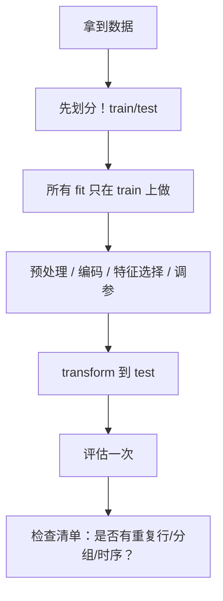

# ML-049 数据泄漏与评估陷阱

## 1. 本节学习目标

1. 能识别四类泄漏：预处理、目标编码、重复/分组、时间穿越。
2. **理解"泄不泄漏取决于数据生成机制"**（本课：有的泄漏毫无影响，有的虚高 15 个点）。
3. 会用定量方法验证是否泄漏。
4. 建立上线前的泄漏检查清单。

## 2. 为什么需要这个知识

因为泄漏是**唯一一类"代码全绿、指标漂亮、上线全废"**的错误。

它不会报错、不会警告，只会让你在错误的结论上继续优化。更麻烦的是：**有些泄漏在合成数据上完全看不出影响**（本课实测），所以"跑一下没差异"不能证明无害。

## 3. 直观解释

泄漏 = **模型在训练时见到了它上线时见不到的信息**。

| 类型 | 泄露了什么 | 典型写法 |
|---|---|---|
| **预处理泄漏** | 测试集的均值/方差 | 全量 `StandardScaler().fit(X)` |
| **目标编码泄漏** | 测试集的标签 | 用全量 $y$ 算类别均值 |
| **重复/分组泄漏** | 同一个体 | 同一用户多条记录跨训练/测试 |
| **时间穿越** | 未来信息 | 随机划分时序数据 |

**本课的核心发现**：前两种在这份数据上"看起来无害"，第三种甚至让分数变低——**但目标编码泄漏让准确率虚高了 15.3 个点**。

## 4. 正式定义

**泄漏的形式化**：设训练用信息集 $\mathcal{I}_{train}$，测试用 $\mathcal{I}_{test}$。若

$$
\mathcal{I}_{train}\cap \mathcal{I}_{test} \ne \varnothing
$$

即训练过程用到了测试阶段才能获得的信息，就是泄漏。

**理想划分**：

$$
\mathcal{D} = \mathcal{D}_{train}\cup\mathcal{D}_{test},\qquad
\mathcal{D}_{train}\cap\mathcal{D}_{test}=\varnothing
$$

**并且**所有"从数据中学到的参数"（$\mu,\sigma$、类别映射、编码表、特征选择结果）只能来自 $\mathcal{D}_{train}$。

## 5. 核心原理

**为什么预处理泄漏常"看不出来"**：均值/方差是**低维统计量**，当 $n$ 很大时，全量统计量与训练集统计量几乎一样 ⇒ 影响被稀释（本课 600 样本、30 维，差异为 0）。

**为什么目标编码泄漏必然严重**：它把**每个类别的标签均值**当成特征。高基数类别下，某些类别只有 1–2 个样本 ⇒ 编码值几乎等于该样本自己的标签 ⇒ 模型直接"看到答案"。

**为什么重复行最隐蔽**：如果同一行同时出现在训练和测试，模型只需"记住"就能答对，而代码看起来完全正常。

## 6. 数学表达式

**本课实验 A：目标编码泄漏**（3000 样本，400 个类别，**类别与标签无关**）

| 做法 | 测试准确率 |
|---|---|
| **泄漏**（全量 $y$ 编码） | **0.6256** |
| **正确**（仅训练集编码） | **0.4722** |
| 随机基线（全判多数类） | 0.5000 |

$$
\Delta = 0.6256 - 0.4722 = +0.1534
$$

**虚高 15.3 个百分点**，而且泄漏版的 0.6256 甚至**高于随机基线**——看起来"模型学到了东西"，实际上什么都没学到。

**本课实验 B：其他三种泄漏**（600 样本，30 特征）

| 做法 | 测试准确率 | 与正确做法的差 |
|---|---|---|
| 正确 | 0.8667 | — |
| 全量标准化 | 0.8667 | **0.0000** |
| 全量特征选择 | 0.8778 | +0.0111 |
| 含重复行 | 0.8269 | **−0.0398** |

**读法**：

- 全量标准化：**完全没影响**（数据 i.i.d.、样本足够）。
- 全量特征选择：+1.1 点（轻微虚高）。
- 重复行：**反而更低**——因为我的构造方式把重复样本放进了训练侧，测试集变得更难。

**结论**：**"没差异"≠"没问题"**。泄漏的危害取决于数据生成机制，不能靠一次实验判定。

## 7. 数学库链接

| 用到的数学 | 对应篇目 | 用在哪 |
|---|---|---|
| 条件期望 | [[MATH-306 期望、方差与协方差]] | 目标编码的定义 |
| 抽样与独立性 | [[MATH-401 大数定律与中心极限定理]] | 为什么大样本下预处理泄漏影响小 |

## 8. 算法执行流程



## 9. 可视化解释

```text
正确                          目标编码泄漏
train ─► 算类别均值 ─► 编码    全量 y ─► 算类别均值 ─► 编码
test  ─► 用同一映射 ─► 编码    test 的 y 也进了编码表
       ↑ 干净                        ↑ 答案泄漏

本课：0.4722                          0.6256（+15.3）
```

## 10. Python 实现

```powershell
python ml049_leakage.py
```

```python
import numpy as np
import pandas as pd
from sklearn.linear_model import LogisticRegression
from sklearn.model_selection import train_test_split
from sklearn.pipeline import Pipeline
from sklearn.preprocessing import StandardScaler

rng = np.random.default_rng(0)
n = 3000
category = rng.integers(0, 400, n)          # 高基数类别
noise = rng.normal(size=(n, 3))
y = (rng.random(n) < 0.5).astype(int)       # 标签与类别无关
df = pd.DataFrame(noise, columns=["f1", "f2", "f3"])
df["cat"] = category


def target_encode(frame, target, smooth=10):
    prior = target.mean()
    agg = (pd.DataFrame({"cat": frame["cat"], "y": target})
           .groupby("cat")["y"].agg(["mean", "count"]))
    enc = (agg["mean"] * agg["count"] + prior * smooth) / (agg["count"] + smooth)
    return frame["cat"].map(enc).fillna(prior).values


# 泄漏：划分前用全量 y 编码
enc_leak = target_encode(df, y)
X_leak = np.column_stack([df[["f1", "f2", "f3"]].values, enc_leak])
Xa, Xb, ya, yb = train_test_split(X_leak, y, test_size=0.3,
                                  random_state=42, stratify=y)
leaky = LogisticRegression(max_iter=1000).fit(Xa, ya)
print("泄漏版 test acc:", round(leaky.score(Xb, yb), 4))

# 正确：只在训练集上算编码
X_train, X_test, y_train, y_test = train_test_split(
    df, y, test_size=0.3, random_state=42, stratify=y)
enc_train = target_encode(X_train, y_train)
mapping = pd.Series(enc_train, index=X_train["cat"].values).groupby(level=0).first()
prior = y_train.mean()
enc_test = X_test["cat"].map(mapping).fillna(prior).values

A = np.column_stack([X_train[["f1", "f2", "f3"]].values, enc_train])
B = np.column_stack([X_test[["f1", "f2", "f3"]].values, enc_test])
clean = LogisticRegression(max_iter=1000).fit(A, y_train)
print("正确版 test acc:", round(clean.score(B, y_test), 4))
print("随机基线:", round(float((y_test == 1).mean()), 4))
```

**实际运行结果**

```
泄漏版 test acc: 0.6256
正确版 test acc: 0.4722
随机基线: 0.5
```

## 11. 代码逐行解释

| 代码 | 作用 |
|---|---|
| `rng.integers(0, 400, n)` | 400 个类别（高基数） |
| `(rng.random(n) < 0.5)` | 标签**与类别完全无关** |
| `target_encode(df, y)` | 用**全量**标签算类别均值 ⇒ 泄漏 |
| `target_encode(X_train, y_train)` | 只用训练集标签 ⇒ 正确 |
| `X_test["cat"].map(mapping)` | 测试集用训练集的映射表 |
| `.fillna(prior)` | 未见类别用训练集先验 |

**为什么泄漏版能"学到东西"**：高基数类别下，很多类别只有 2–3 个样本，编码值 ≈ 这些样本自己的标签均值。模型看到编码 ≈ 0.9，就判正类——**等于直接看答案**。

## 12. 实际运行结果

见第 10 节。三点：

1. **泄漏版 0.6256 vs 正确版 0.4722**：虚高 **15.3 个点**。
2. 正确版 0.4722 **低于随机基线 0.5**——因为它加了一列纯噪声（类别与标签无关），反而干扰了模型。
3. 这说明：**泄漏版不仅"看起来更好"，还掩盖了"这个特征根本没用"这一事实**。

## 13. 适用场景

| 场景 | 泄漏风险点 |
|---|---|
| 任何建模 | 预处理在划分前 |
| 高基数类别 | 目标编码/均值编码 |
| 表格数据 | 重复行、同一实体多条 |
| 时序 | 随机划分、未来聚合特征 |
| 特征工程 | 用全量 $y$ 做特征选择 |
| 缺失值填充 | 用全量统计量 |

## 14. 优点与缺点（此处列"防泄漏手段"）

| 手段 | 作用 | 局限 |
|---|---|---|
| Pipeline | 结构上保证 fit 只在训练折 | 需把所有步骤都放进去 |
| 划分再处理 | 最基本纪律 | 容易忘 |
| 分组划分 | 防同实体泄漏 | 需知道分组字段 |
| 时序切分 | 防未来信息 | 需时间列 |
| 重复行检查 | 防"背答案" | 需主动做 |

## 15. 常见错误

| 错误 | 表现 | 纠正 |
|---|---|---|
| 划分前标准化 | 本课无影响，但别赌 | 放进 Pipeline |
| 全量目标编码 | **+15.3 点虚高** | 训练折内编码 |
| 重复行跨集 | 指标虚高 | `drop_duplicates` |
| 时序随机划分 | 用未来预测过去 | 按时间切 |
| 用全量 $y$ 选特征 | 轻微虚高（本课 +1.1） | 放进 Pipeline |
| 拿"没差异"证明无害 | 本课预处理就无差异 | 按机制判断，不靠单次实验 |

## 16. 本节总结

- 泄漏 = 训练用了上线时拿不到的信息；**四类**：预处理、目标编码、重复/分组、时间穿越。
- **目标编码泄漏最凶**：本课虚高 15.3 个点，且让无用特征"看起来有用"。
- **"跑一下没差异"不能证明无害**——要按数据生成机制判断。

## 17. 前置与后续

- 前置：[[ML-048 超参数搜索 GridSearchCV]]、[[ML-003 机器学习工作流程]]
- 后续：`ML-050 集成学习基本思想`（开启 M-ML-07）
- 相关数学：[[MATH-306 期望、方差与协方差]]、[[MATH-401 大数定律与中心极限定理]]

## 18. 练习与参考答案

**基础 1**：列出四类数据泄漏，并各举一个典型错误写法。

**基础 2**：本课目标编码泄漏让准确率虚高了多少？正确做法为什么低于随机基线？

**进阶 1**：为什么"全量标准化"在这份数据上完全没有影响，但仍必须放进 Pipeline？

**综合 1**：你拿到一份"同一用户多条记录"的数据，准备做流失预测。列出你的防泄漏检查步骤。

> [!success]- 参考答案

> **基础 1**
> | 类型 | 错误写法 |
> |---|---|
> | 预处理 | `StandardScaler().fit(X)` 后再划分 |
> | 目标编码 | 用全量 $y$ 算类别均值 |
> | 重复/分组 | 同一用户记录随机分到训练与测试 |
> | 时间穿越 | 时序数据随机划分；用"未来 30 天累计"做特征 |

> **基础 2**
> 虚高 **15.3 个百分点**（0.6256 vs 0.4722）。
> 正确版 0.4722 低于随机基线 0.5，因为类别与标签**本来无关**，加进去的编码列是纯噪声，反而干扰了模型（略有伤害）。

> **进阶 1**
> 因为它是**低维统计量**（均值/方差），样本量大时全量统计与训练集统计几乎相同，影响被稀释——本课 600 样本、30 维，差异**正好为 0**。
> 但仍必须放进 Pipeline，理由：
> 1. 样本小、分布不均、特征偏态时差异会显现；
> 2. "这次没差异"不能推出"永远没差异"；
> 3. 放进 Pipeline 是**零成本**的正确性保证，没有理由赌。

> **综合 1**
> 检查清单：
> 1. **先去重**：同一用户同一时间点重复行。
> 2. **按 user_id 分组划分**（`GroupShuffleSplit` 或 `GroupKFold`），保证同一用户只在一侧。
> 3. **所有特征只用训练期数据构造**：若特征含"累计消费""最近登录"，必须限定时间窗 ≤ 划分点。
> 4. **所有 fit 放进 Pipeline**：标准化、编码、填充、特征选择。
> 5. **验证**：检查训练集与测试集的 user_id 交集为空；检查特征最大值是否异常（可能是未来信息）。
> 6. **最后**：用独立测试集评估一次，并人工抽检若干样本的特征是否"当时可获得"。

---

## 🔗 Notion 同步信息

> 以下内容由 Notion「AI Knowledge System · 知识点」数据库按知识 ID 合并而来（导出于 2026-11-09）。

| 属性 | 值 |
|---|---|
| 学科 | 机器学习 |
| 学习状态 | 未开始 |
| 难度 | L3 推导 |
| 知识类型 | Concept |

- **所属模块**：[M-ML-06 模型评估与优化](../%E8%AF%BE%E7%A8%8B%E6%A8%A1%E5%9D%97/M-ML-06%20%E6%A8%A1%E5%9E%8B%E8%AF%84%E4%BC%B0%E4%B8%8E%E4%BC%98%E5%8C%96.md)
- **前置知识**：[ML-048 超参数搜索 GridSearchCV](ML-048%20%E8%B6%85%E5%8F%82%E6%95%B0%E6%90%9C%E7%B4%A2%20GridSearchCV.md)
- **后继知识**：[ML-050 集成学习基本思想](../06%20%E6%A8%A1%E5%9E%8B%E4%BC%98%E5%8C%96/ML-050%20%E9%9B%86%E6%88%90%E5%AD%A6%E4%B9%A0%E5%9F%BA%E6%9C%AC%E6%80%9D%E6%83%B3.md)
- **关联Python**：[PY-067 聚合与统计](../../01_Python%E5%9F%BA%E7%A1%80/08%20NumPy/PY-067%20%E8%81%9A%E5%90%88%E4%B8%8E%E7%BB%9F%E8%AE%A1.md)
- **关联数学**：[MATH-401 大数定律与中心极限定理](../../06_%E6%95%B0%E5%AD%A6%E5%9F%BA%E7%A1%80/04%20%E6%95%B0%E7%90%86%E7%BB%9F%E8%AE%A1/MATH-401%20%E5%A4%A7%E6%95%B0%E5%AE%9A%E5%BE%8B%E4%B8%8E%E4%B8%AD%E5%BF%83%E6%9E%81%E9%99%90%E5%AE%9A%E7%90%86.md)
