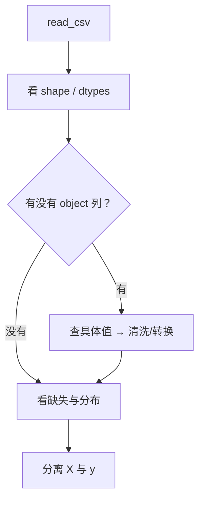

# ML-009 结构化数据读取

## 1. 本节学习目标

1. 会把 CSV / 内存数组读成 DataFrame，并一眼看出 `shape`、`dtypes`、缺失。
2. 知道 `read_csv` 最常用的 5 个参数各解决什么问题。
3. 会做"写出 → 读回"往返校验，确认无损。
4. 能把 DataFrame 正确切成 `X`（特征）与 `y`（标签）。

## 2. 为什么需要这个知识

因为**读取阶段埋的雷，后面全要还**：

- 编码选错 ⇒ 中文变乱码，类别被打散成几十个"不同"取值。
- 不指定 `dtype` ⇒ 数字列被读成字符串，`mean()` 直接报错。
- 不查 `dtypes` ⇒ 以为在做数值计算，其实在做字符串拼接。

`read_csv` 不是"打开文件"，是**重建类型系统**。这一步错了，后面每一步都在错的数据上工作。

## 3. 直观解释

CSV 是纯文本，**没有类型**：

```text
sepal length (cm),sepal width (cm),target
5.1,3.5,0
```

读进 pandas 后，"5.1" 这个字符串被推断成 `float64`。推断靠猜，猜错就要你出手：

| 现象 | 原因 |
|---|---|
| 数字列变 `object` | 混入了 `"unknown"`、`"-"`、空格 |
| 日期变字符串 | 没给 `parse_dates` |
| 中文乱码 | 编码不是 UTF-8（或需要 `utf-8-sig`） |
| 首列多出 `Unnamed: 0` | 写出时没加 `index=False` |

## 4. 正式定义

**结构化数据**：每行一个样本、每列一个字段，字段类型一致（数值/类别/时间）。

**DataFrame**：带行列标签的二维表；`df.dtypes` 给每列类型，`df.shape` 给 `(行, 列)`。

**五个核心参数**

| 参数 | 作用 | 典型值 |
|---|---|---|
| `sep` | 分隔符 | `","`、`"\t"` |
| `encoding` | 编码 | `"utf-8"`、`"utf-8-sig"`、`"gbk"` |
| `usecols` | 只读需要的列 | `["a","b"]` |
| `dtype` | 强制列类型 | `{"id": str, "score": float}` |
| `parse_dates` | 解析日期列 | `["date"]` |

**写出时**：`index=False`（不写行号）、`encoding="utf-8-sig"`（Excel 打开不乱码）。

## 5. 核心原理

**为什么类型推断会失败**：pandas 用前若干行采样推断类型。若某列大部分是数字、偶尔出现 `"N/A"` 或空串，可能整列被判为 `object`（字符串），后续数值运算全部失效。

**为什么 `id` 要用字符串**：`001` 与 `1` 在数值类型下相同，但语义不同（编号不该参与算术）。把 `id` 声明成 `str` 能避免"学出编号规律"的伪规律。

**往返校验**：`to_csv` 再 `read_csv`，比对 `shape` 与关键列统计量——这是最便宜的"无损性"验证。

## 6. 数学表达式

读取后的数据即矩阵

$$
X \in \mathbb{R}^{n\times d}, \qquad y \in \mathbb{R}^{n}
$$

**列类型一致性**：若某列 $j$ 的取值集合中混有不可解析项，则该列无法映射到 $\mathbb{R}$，需清洗后才能进模型（见 [[ML-010 数据清洗]]）。

**类别列的取值基数**（决定 One-Hot 维度）：

$$
|V_j| = \#\{\text{列 } j \text{ 的不同取值}\}
$$

## 7. 数学库链接

| 用到的数学 | 对应篇目 | 用在哪 |
|---|---|---|
| 矩阵与形状 | [[MATH-217 矩阵运算与维度]] | $(n,d)$ 的含义 |
| 描述统计 | [[MATH-306 期望、方差与协方差]] | `describe()` 的均值/标准差 |

## 8. 算法执行流程



## 9. 可视化解释

```text
CSV 文本                   DataFrame
"5.1,3.5,0"   ──推断──►   float64  float64  int64
"unknown,3.5,0" ──推断──►  object   float64  int64   ← 一列坏，全列变 object
```

## 10. Python 实现

把内存数组包装成 DataFrame，写出 CSV 再读回，做往返校验。

```powershell
python ml009_read.py
```

```python
import os
import tempfile

import pandas as pd
from sklearn.datasets import load_iris

iris = load_iris()
df = pd.DataFrame(iris.data, columns=iris.feature_names)
df["target"] = iris.target

print("shape:", df.shape)
print("dtypes:", df.dtypes.astype(str).tolist())
print("前 2 行:", df.head(2).round(2).to_dict("records"))
print("describe 形状:", df.describe().shape)

tmp = os.path.join(tempfile.gettempdir(), "ml009_demo.csv")
df.to_csv(tmp, index=False, encoding="utf-8-sig")
back = pd.read_csv(tmp)
print("往返 shape 一致:", back.shape == df.shape)
print("往返 target 均值一致:",
      round(float(back["target"].mean()), 4) == round(float(iris.target.mean()), 4))
os.remove(tmp)
```

**实际运行结果**

```
shape: (150, 5)
dtypes: ['float64', 'float64', 'float64', 'float64', 'int64']
前 2 行: [{'sepal length (cm)': 5.1, 'sepal width (cm)': 3.5, 'petal length (cm)': 1.4, 'petal width (cm)': 0.2, 'target': 0}, {'sepal length (cm)': 4.9, 'sepal width (cm)': 3.0, 'petal length (cm)': 1.4, 'petal width (cm)': 0.2, 'target': 0}]
describe 形状: (8, 5)
往返 shape 一致: True
往返 target 均值一致: True
```

## 11. 代码逐行解释

| 代码 | 作用 |
|---|---|
| `pd.DataFrame(iris.data, columns=...)` | 数组 + 列名 → 带标签的表 |
| `df.dtypes.astype(str)` | 把 dtype 对象转成字符串，输出才干净 |
| `df.describe()` | 数值列的 count/mean/std/min/25%/50%/75%/max |
| `to_csv(index=False, encoding="utf-8-sig")` | 不写行号；带 BOM 便于 Excel 打开 |
| `pd.read_csv(tmp)` | 读回，验证类型与形状是否还原 |

**为什么 `describe` 形状是 `(8, 5)`**：8 个统计量 × 5 列（4 特征 + target）。

## 12. 实际运行结果

见第 10 节。验收点：

- 5 列、150 行，dtype 全部数值 ⇒ 可直接进模型。
- 往返 `shape` 与 `target` 均值一致 ⇒ 读写无损。
- `describe` 覆盖 5 列 ⇒ 无 `object` 列。

## 13. 适用场景

| 文件 | 推荐做法 |
|---|---|
| 标准 CSV | `read_csv(encoding="utf-8")` |
| Excel 导出（带 BOM） | `encoding="utf-8-sig"` |
| 中文 Windows 旧文件 | 试 `gbk`，或先转码 |
| 大文件（>1GB） | `chunksize` 分块 或 `usecols` 减列 |
| 含 id 列 | `dtype={"id": str}` |
| 含日期列 | `parse_dates=["date"]` |
| 制表符分隔 | `sep="\t"` |

## 14. 优点与缺点

| 做法 | 优点 | 缺点 |
|---|---|---|
| 默认推断 | 省事 | 猜错不报错，静默污染 |
| 显式 `dtype` | 类型确定、可复现 | 要先知道列 |
| `usecols` 只读部分 | 省内存、快 | 后续要用的列不能漏 |
| Excel 读（`read_excel`） | 保留格式 | 慢、依赖 openpyxl |

## 15. 常见错误

| 错误 | 表现 | 纠正 |
|---|---|---|
| 不查 `dtypes` | object 列进入计算报错 | 读完立刻查 |
| `id` 当数值 | 学出伪规律 | `dtype={"id": str}` |
| 写出不加 `index=False` | 读回多 `Unnamed: 0` | 加上 |
| 中文 CSV 用 `utf-8` | Excel 打开乱码 | `utf-8-sig` |
| 大文件一次性读 | 内存爆 | `chunksize` / `usecols` |
| 相对路径依赖 cwd | 换目录找不到 | 用绝对路径或 `Path` |

## 16. 本节总结

- `read_csv` 是**重建类型**，不是打开文件；读完先查 `shape`/`dtypes`。
- 类型错了不会报错，只会让后续统计失真。
- 往返校验是成本最低的正确性检查。

## 17. 前置与后续

- 前置：[[ML-005 特征、标签、样本与数据集]]
- 后续：`ML-010 数据清洗`、`ML-011 缺失值处理`（待建）、`ML-013 类别特征编码`（待建）
- 相关 Python：[[PY-070 数据读取与写出]]

## 18. 练习与参考答案

**基础 1**：`read_csv` 里 `encoding="utf-8-sig"` 解决什么问题？

**基础 2**：读入数据后，怎么快速判断"有没有非数值列"？

**进阶 1**：为什么 `id` 列建议用字符串读入而不是整数？

**综合 1**：从一份含类别列的 CSV 中只保留数值列，报告形状。

> [!success]- 参考答案

> **基础 1**
> 去掉 UTF-8 BOM（`\ufeff`）。带 BOM 的文件用普通 `utf-8` 读，第一列列名会变成 `\ufeff列名`，导致按列名取值失败。

> **基础 2**
> ```python
> print(df.dtypes)
> print(df.select_dtypes(include="object").columns.tolist())
> ```
> 有输出即说明存在非数值列。

> **进阶 1**
> 因为整数类型会丢失前导零（`001` → `1`），且让编号参与算术没有意义；模型可能把"编号大小"当成真实信号。
> 用字符串读入后，若确实要作为特征，再显式编码（如按频率或目标编码）。

> **综合 1**
> ```python
> import pandas as pd
> from sklearn.datasets import load_iris
>
> df = pd.DataFrame(load_iris().data, columns=load_iris().feature_names)
> num = df.select_dtypes(include="number")
> print("只保留数值列:", num.shape)
> print("dtypes 唯一值:", sorted(set(num.dtypes.astype(str))))
> ```
> 实跑输出：
> ```
> 只保留数值列: (150, 4)
> dtypes 唯一值: ['float64']
> ```

---

## 🔗 Notion 同步信息

> 以下内容由 Notion「AI Knowledge System · 知识点」数据库按知识 ID 合并而来（导出于 2026-11-09）。

| 属性 | 值 |
|---|---|
| 学科 | 机器学习 |
| 学习状态 | 未开始 |
| 难度 | L1 概念 |
| 知识类型 | Technique |

- **所属模块**：[M-ML-02 数据处理与特征工程](../%E8%AF%BE%E7%A8%8B%E6%A8%A1%E5%9D%97/M-ML-02%20%E6%95%B0%E6%8D%AE%E5%A4%84%E7%90%86%E4%B8%8E%E7%89%B9%E5%BE%81%E5%B7%A5%E7%A8%8B.md)
- **前置知识**：[ML-005 特征、标签、样本与数据集](../01%20%E6%9C%BA%E5%99%A8%E5%AD%A6%E4%B9%A0%E5%9F%BA%E7%A1%80/ML-005%20%E7%89%B9%E5%BE%81%E3%80%81%E6%A0%87%E7%AD%BE%E3%80%81%E6%A0%B7%E6%9C%AC%E4%B8%8E%E6%95%B0%E6%8D%AE%E9%9B%86.md)
- **后继知识**：[ML-010 数据清洗](ML-010%20%E6%95%B0%E6%8D%AE%E6%B8%85%E6%B4%97.md)
- **关联Python**：[PY-070 数据读取与写出](../../01_Python%E5%9F%BA%E7%A1%80/09%20Pandas%E4%B8%8E%E5%8F%AF%E8%A7%86%E5%8C%96/PY-070%20%E6%95%B0%E6%8D%AE%E8%AF%BB%E5%8F%96%E4%B8%8E%E5%86%99%E5%87%BA.md)
