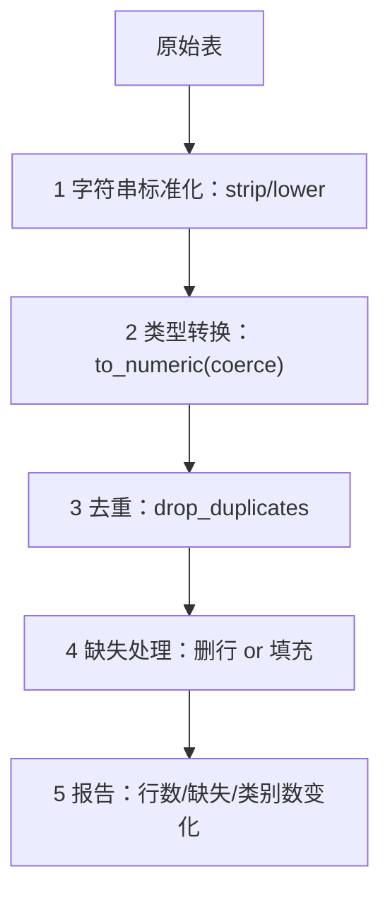

# ML-010 数据清洗

## 1. 本节学习目标

1. 会按"标准化 → 类型转换 → 去重 → 缺失处理"的顺序清洗表格。
2. 理解**顺序有讲究**：先去空格再去重，否则重复删不掉。
3. 能区分"错误值"与"合理异常值"，不盲目删。
4. 会写清洗前后的对照报告（行数、缺失数、类别数）。

## 2. 为什么需要这个知识

因为脏数据**不会报错，只会悄悄降低效果**：

- `" 北京"` 与 `"北京"` 被当成两个城市 ⇒ One-Hot 多出一列，样本被割裂。
- `"unknown"` 混在数值列 ⇒ 整列变字符串 ⇒ 均值算不出来。
- 重复行 ⇒ 同一批样本被训练两次、又被测试一次 ⇒ 泄漏。

这些问题的共同点：**代码全绿，指标全错**。

## 3. 直观解释

清洗像**洗菜**：

| 步骤 | 洗菜 | 清洗 |
|---|---|---|
| 1 | 先抖掉泥土 | 去首尾空格、统一大小写 |
| 2 | 摘掉烂叶 | 类型转换、非法值置空 |
| 3 | 去掉重复的 | 去重 |
| 4 | 补上缺口 | 缺失值填充 |

**顺序不能乱**：如果你先"去重"再"去空格"，`" 北京"` 与 `"北京"` 在去重时还不相等，重复就留下了——这就是本课的核心示范。

## 4. 正式定义

**清洗的目标**：把原始表 $D_{raw}$ 映射成可用于建模的 $D_{clean}$，且**不改变语义**。

**四类常见脏数据**

| 类型 | 例子 | 处理 |
|---|---|---|
| 格式不一致 | `" 北京"`、`"Beijing "`、`"beijing"` | `str.strip()`、`str.lower()`、映射表 |
| 类型错误 | `"unknown"`、`"-"`、`""` 在数值列 | `pd.to_numeric(..., errors="coerce")` |
| 重复记录 | 同一行出现两次 | `drop_duplicates()` |
| 缺失 | `NaN` / `None` / `"N/A"` | 删行、填充、或建模时处理 |

**清洗前后必须报告**：行数变化、缺失数变化、类别取值数变化——否则你不知道自己改了什么。

## 5. 核心原理

**为什么 `errors="coerce"` 是关键**：它把无法解析的值变成 `NaN` 而不是抛错，于是"脏值"变成"可统计的缺失"，后续可以统一用缺失值策略处理。

**为什么去重要放在标准化之后**：`drop_duplicates` 按值比较，`" 北京"` 与 `"北京"` 是两个不同字符串。

**为什么不能无脑删异常值**：异常值可能是真实信号（欺诈、故障）。删之前先问"这是错误还是罕见真实事件"。

**为什么清洗也要防泄漏**：填充用的中位数/众数**只能在训练集上算**，否则测试集信息进入训练（见 [[ML-003 机器学习工作流程]]）。

## 6. 数学表达式

**去重后的样本量**

$$
n_{clean} = n_{raw} - n_{dup}
$$

**中位数填充**（对列 $j$ 的缺失）

$$
x_{ij} \leftarrow \operatorname{median}\big(\{x_{kj} : x_{kj}\ \text{非缺失}\}\big)
$$

**填充比例的警戒线**（经验值）

$$
\text{缺失率}_j = \frac{\#\text{缺失}}{n}
$$

- $<5\%$：删行通常可接受。
- $5\%\sim30\%$：填充，并考虑加"是否缺失"指示列。
- $>50\%$：考虑整列删除（信息太少）。

## 7. 数学库链接

| 用到的数学 | 对应篇目 | 用在哪 |
|---|---|---|
| 中位数/均值 | [[MATH-306 期望、方差与协方差]] | 填充值的选择 |
| 抽样与偏差 | [[MATH-401 大数定律与中心极限定理]] | 删行过多会改变分布 |

## 8. 算法执行流程



## 9. 可视化解释

```text
原始                     标准化后                去重后
" 北京" ──strip──► "北京" ──dedupe──► 一条
"北京 " ──strip──► "北京"
"上海 " ──strip──► "上海"
```

## 10. Python 实现

构造一份典型脏表，按正确顺序清洗并输出前后对照。

```powershell
python ml010_clean.py
```

```python
import numpy as np
import pandas as pd

messy = pd.DataFrame({
    "city": [" 北京", "上海 ", "北京", " 上海", "广州", "北京 "],
    "age": ["25", "30", "unknown", "41", "38", "25"],
    "score": [88.0, np.nan, 92.0, 79.0, np.nan, 88.0],
})
print("原始:", messy.shape, " 缺失:", int(messy.isna().sum().sum()),
      " 重复:", int(messy.duplicated().sum()))

clean = messy.copy()
clean["city"] = clean["city"].str.strip()                    # 1 标准化
clean["age"] = pd.to_numeric(clean["age"], errors="coerce")  # 2 类型
before = len(clean)
clean = clean.drop_duplicates()                              # 3 去重
clean["score"] = clean["score"].fillna(clean["score"].median())  # 4 填充

print("清洗后:", clean.shape, " 去掉重复:", before - len(clean),
      " age 缺失:", int(clean["age"].isna().sum()))
print("城市取值:", sorted(clean["city"].unique().tolist()))
print("结果:", clean.round(2).to_dict("records"))
```

**实际运行结果**

```
原始: (6, 3)  缺失: 2  重复: 0
清洗后: (5, 3)  去掉重复: 1  age 缺失: 1
城市取值: ['上海', '北京', '广州']
结果: [{'city': '北京', 'age': 25.0, 'score': 88.0}, {'city': '上海', 'age': 30.0, 'score': 88.0}, {'city': '北京', 'age': nan, 'score': 92.0}, {'city': '上海', 'age': 41.0, 'score': 79.0}, {'city': '广州', 'age': 38.0, 'score': 88.0}]
```

## 11. 代码逐行解释

| 代码 | 作用 |
|---|---|
| `str.strip()` | 去首尾空格；**必须在去重前** |
| `pd.to_numeric(errors="coerce")` | `"unknown"` → `NaN`，不抛错 |
| `drop_duplicates()` | 标准化之后才有 1 条真重复被删 |
| `fillna(median())` | 用中位数填 `score` 的两个缺失 |
| `age` 仍 1 个缺失 | 这是**刻意保留**的：`unknown` 无法推断，不该乱填 |

**关键证据**：原始 `duplicated().sum()` 是 **0**——因为 `" 北京"` 与 `"北京 "` 还不相等。标准化之后再查，才删掉 1 条。**这就是"顺序有讲究"的实证**。

## 12. 实际运行结果

见第 10 节。三点：

1. 行数 6 → 5（去掉 1 条重复）。
2. 城市取值从 4 种（含带空格变体）收敛到 3 种。
3. `age` 的 `unknown` 变成 `NaN` 且**未被填**——这是刻意的：无法判断真值，保留缺失比乱填更诚实。

## 13. 适用场景

| 脏数据类型 | 处理方式 |
|---|---|
| 首尾空格 / 大小写不一 | `strip()` / `lower()` / 映射表 |
| 伪缺失词（`"unknown"`、`"-"`） | 先替换成 `NaN` 再统一处理 |
| 完全重复行 | `drop_duplicates()`（标准化后） |
| 数值列缺失 | 中位数/均值填充（训练集统计量） |
| 类别列缺失 | 众数填充或新增 `"未知"` 类 |
| 明显错误值（年龄 300） | 置为 `NaN` |
| 真实异常值（欺诈） | **保留**，用鲁棒模型处理 |

## 14. 优点与缺点

| 做法 | 优点 | 缺点 |
|---|---|---|
| 删行 | 简单、无偏差引入 | 丢信息；删多会改变分布 |
| 中位数填充 | 抗异常值 | 低估方差 |
| 均值填充 | 保持均值 | 被异常值带偏 |
| 加"是否缺失"指示列 | 保留缺失信息 | 特征变多 |
| 整列删除 | 去掉噪声列 | 可能误删弱信号 |

## 15. 常见错误

| 错误 | 表现 | 纠正 |
|---|---|---|
| 先去重后去空格 | 重复删不掉（本例 `0` 条） | 先标准化 |
| 用 `errors="raise"` | 一个脏值就崩 | 用 `coerce` 再处理 |
| 在**全量**数据上算中位数 | 数据泄漏 | 只在训练集算 |
| 无脑删异常值 | 丢掉真实信号 | 先分清"错"与"罕见" |
| 清洗后不报告 | 不知道改了什么 | 打印前后对照 |
| 把 `"unknown"` 当有效类别 | 与真实类别混在一起 | 先置 `NaN` |

## 16. 本节总结

- 清洗顺序：**标准化 → 类型 → 去重 → 缺失**。
- `errors="coerce"` 把脏值转成可统计的缺失。
- 清洗必须报告前后差异；填充统计量只能来自训练集。

## 17. 前置与后续

- 前置：[[ML-009 结构化数据读取]]
- 后续：`ML-011 缺失值处理`（待建）、`ML-012 异常值识别与处理`（待建）、`ML-013 类别特征编码`（待建）
- 相关 Python：[[PY-072 缺失值处理]]

## 18. 练习与参考答案

**基础 1**：清洗的四步标准顺序是什么？为什么不能颠倒？

**基础 2**：用中位数填充 `a` 列的缺失，并输出结果。

**进阶 1**：为什么本课的"原始重复数"是 0，而清洗后却删掉了 1 条？

**综合 1**：构造一份含空格、伪缺失词、重复行的数据，清洗并报告前后行数与缺失数。

> [!success]- 参考答案

> **基础 1**
> 标准化（去空格/统一大小写）→ 类型转换（coerce）→ 去重 → 缺失处理。
> 颠倒的后果：先去重会漏掉"只差空格"的重复；先填充会把 `"unknown"` 当有效值；先转类型会在字符串上失败。

> **基础 2**
> ```python
> import numpy as np, pandas as pd
> d = pd.DataFrame({"a": [1.0, np.nan, 3.0], "b": [np.nan, np.nan, 9.0]})
> print(d.fillna(d.median()).to_dict("list"))
> print("全空列:", [c for c in d.columns if d[c].isna().all()])
> ```
> 实跑输出：
> ```
> {'a': [1.0, 2.0, 3.0], 'b': [9.0, 9.0, 9.0]}
> 全空列: []
> ```
> 注意 `b` 列原本 2/3 缺失，填充后全变 9.0——**这种填法把方差抹平了**，应加"是否缺失"指示列或直接删列。

> **进阶 1**
> 因为 `duplicated()` 按原始字符串比较：`" 北京"`、`"北京 "`、`" 上海"` 互不相等，所以初始判重为 0。
> `strip()` 之后 `" 北京"` 与 `"北京"` 相同，才识别出 1 条重复。

> **综合 1**
> ```python
> import numpy as np, pandas as pd
> raw = pd.DataFrame({
>     "city": [" 北京", "北京", "上海 ", "上海", "广州 "],
>     "age": ["25", "25", "unknown", "41", "38"],
>     "v": [1.0, 1.0, np.nan, 3.0, 3.0],
> })
> print("原始:", raw.shape, "缺失:", int(raw.isna().sum().sum()), "重复:", int(raw.duplicated().sum()))
> c = raw.copy()
> c["city"] = c["city"].str.strip()
> c["age"] = pd.to_numeric(c["age"], errors="coerce")
> b = len(c)
> c = c.drop_duplicates(subset=["city", "age"])   # 指定业务主键
> c["v"] = c["v"].fillna(c["v"].median())
> print("清洗后:", c.shape, "去掉:", b - len(c), "剩余缺失:", int(c.isna().sum().sum()))
> ```
> 实跑输出：
> ```
> 原始: (5, 3) 缺失: 1 重复: 0
> 清洗后: (4, 3) 去掉: 1 剩余缺失: 1
> ```
> **易错点**：`drop_duplicates(subset=...)` 要按**业务主键**去重，不是整行完全相等——本例两行 `北京/25` 的 `v` 不同，但业务上是同一记录。

---

## 🔗 Notion 同步信息

> 以下内容由 Notion「AI Knowledge System · 知识点」数据库按知识 ID 合并而来（导出于 2026-11-09）。

| 属性 | 值 |
|---|---|
| 学科 | 机器学习 |
| 学习状态 | 未开始 |
| 难度 | L2 应用 |
| 知识类型 | Technique |

- **所属模块**：[M-ML-02 数据处理与特征工程](../%E8%AF%BE%E7%A8%8B%E6%A8%A1%E5%9D%97/M-ML-02%20%E6%95%B0%E6%8D%AE%E5%A4%84%E7%90%86%E4%B8%8E%E7%89%B9%E5%BE%81%E5%B7%A5%E7%A8%8B.md)
- **前置知识**：[ML-009 结构化数据读取](ML-009%20%E7%BB%93%E6%9E%84%E5%8C%96%E6%95%B0%E6%8D%AE%E8%AF%BB%E5%8F%96.md)
- **后继知识**：[ML-011 缺失值处理](ML-011%20%E7%BC%BA%E5%A4%B1%E5%80%BC%E5%A4%84%E7%90%86.md)
- **关联Python**：[PY-072 缺失值处理](../../01_Python%E5%9F%BA%E7%A1%80/09%20Pandas%E4%B8%8E%E5%8F%AF%E8%A7%86%E5%8C%96/PY-072%20%E7%BC%BA%E5%A4%B1%E5%80%BC%E5%A4%84%E7%90%86.md)
