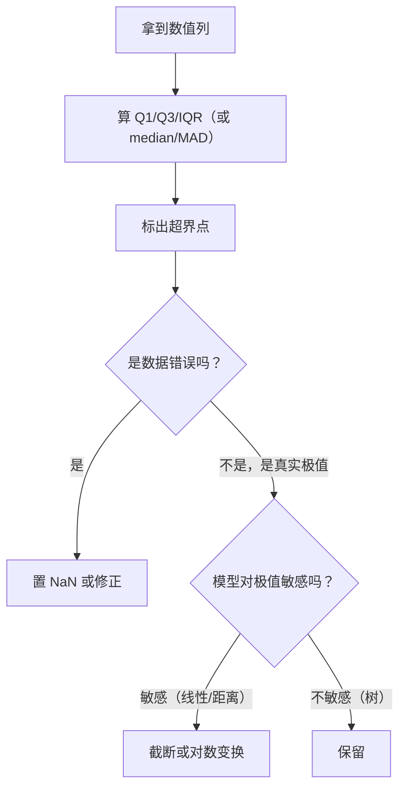

# ML-012 异常值识别与处理

## 1. 本节学习目标

1. 会用 **IQR 法**与 **z-score 法**找异常值，并知道两者的失效条件。
2. 理解"异常值 ≠ 错误值"，能判断该删、该截、还是该保留。
3. 会量化异常值对均值的影响（本课：12.7 → 3.36）。
4. 知道为什么 z-score 在极端异常值上会"失灵"。

## 2. 为什么需要这个知识

因为异常值会**污染统计量、扭曲模型、制造假规律**：

- 一个 100 混进 1–5 的分数里，均值从 3.36 变成 12.7。
- 线性回归会被单个远点"拉歪"整条线。
- 树模型虽相对稳健，但分箱边界会被极值带偏。

反过来，**乱删异常值更危险**：欺诈、故障、爆款都是异常值——删掉它们等于删掉业务价值。

## 3. 直观解释

先分清三类"异常"：

| 类型 | 例子 | 处理 |
|---|---|---|
| **数据错误** | 年龄 300、身高 25 米 | 置为缺失或修正 |
| **罕见但真实** | 一单 100 万、极端天气 | **保留**，用稳健方法 |
| **生成机制不同** | 机器人流量混在人类行为里 | 单独建模或剔除 |

**核心判断**：异常值**偏离**是统计事实，"该不该处理"是业务判断。统计方法只告诉你"谁偏得远"，不告诉你"该不该删"。

## 4. 正式定义

**IQR 法（箱线图法）**

$$
Q_1 = \text{25 分位},\ Q_3 = \text{75 分位},\ \text{IQR} = Q_3-Q_1
$$

$$
\text{下界} = Q_1 - 1.5\,\text{IQR},\qquad \text{上界} = Q_3 + 1.5\,\text{IQR}
$$

超出即"疑似异常"（3 IQR 为"极端异常"）。

**z-score 法**

$$
z_i = \frac{x_i - \bar x}{s}, \qquad |z_i| > 3 \Rightarrow \text{异常}
$$

**修正 z-score（MAD 版）**

$$
M_i = \frac{0.6745\,(x_i - \operatorname{median})}{\operatorname{MAD}}, \qquad |M_i| > 3.5 \Rightarrow \text{异常}
$$

**处理方式**

| 方式 | 公式 | 影响 |
|---|---|---|
| 删除 | 去掉该行 | 丢数据，可能改变分布 |
| 截断（winsorize） | $x\leftarrow\min(\max(x,lo),hi)$ | 保留样本、压缩极值 |
| 置缺失 | $x\leftarrow \text{NaN}$ | 交给缺失值流程 |
| 变换 | $\log(x)$、$\sqrt{x}$ | 压缩右偏 |

## 5. 核心原理

**为什么 IQR 能抓到 100，z-score 抓不到**：

z-score 用均值和标准差，而**这两个量本身被异常值污染**。当 $x=100$ 时，标准差被拉大到 $\approx30$，于是 $|z|=(100-12.7)/30\approx2.9$，**没超过 3**。

这叫**掩蔽效应（masking）**：异常值抬高了分母，把自己藏了起来。

**IQR 用分位数**，分位数不受极值影响（崩溃点 25%/75% 附近），所以稳定。

**这就是"用稳健统计量"的全部理由。**

## 6. 数学表达式

**本课实例**：$[1,2,2,3,3,3,4,4,5,100]$

$$
Q_1 = 2.25,\quad Q_3 = 4.0,\quad \text{IQR} = 1.75
$$

$$
\text{下界} = 2.25 - 2.625 = -0.375,\qquad \text{上界} = 4.0 + 2.625 = 6.625
$$

$100 > 6.625$ ⇒ 异常 ✓

**均值对比**

$$
\bar x_{raw} = 12.7,\qquad \bar x_{clip} = 3.36
$$

## 7. 数学库链接

| 用到的数学 | 对应篇目 | 用在哪 |
|---|---|---|
| 分位数与 IQR | [[MATH-306 期望、方差与协方差]] | 稳健统计量 |
| 标准差与 z 分数 | [[MATH-306 期望、方差与协方差]] | 标准化与掩蔽效应 |

## 8. 算法执行流程



## 9. 可视化解释

```text
箱线图
      ┌──────┐
   ├──┤      ├──────────────●  100
      └──────┘
   Q1=2.25  Q3=4  ↑上界 6.625
                 100 远在上界之外
```

## 10. Python 实现

```powershell
python ml012_outlier.py
```

```python
import numpy as np

s = np.array([1, 2, 2, 3, 3, 3, 4, 4, 5, 100.0])

q1, q3 = np.percentile(s, [25, 75])
iqr = q3 - q1
lo, hi = q1 - 1.5 * iqr, q3 + 1.5 * iqr
print(f"Q1={q1} Q3={q3} IQR={iqr} 下界={lo:.2f} 上界={hi:.2f}")

outliers = s[(s < lo) | (s > hi)]
print("IQR 判定的异常值:", outliers.tolist())

clipped = np.clip(s, lo, hi)
print(f"均值：原始 {s.mean():.2f} → 截断后 {clipped.mean():.2f}")

z = np.abs((s - s.mean()) / s.std())
print("z-score 判定 (|z|>3):", s[z > 3].tolist(), " 最大 |z|:", round(float(z.max()), 2))
```

**实际运行结果**

```
Q1=2.25 Q3=4.0 IQR=1.75 下界=-0.38 上界=6.62
IQR 判定的异常值: [100.0]
均值：原始 12.70 → 截断后 3.36
z-score 判定 (|z|>3): []  最大 |z|: 2.92
```

## 11. 代码逐行解释

| 代码 | 作用 |
|---|---|
| `np.percentile(s, [25,75])` | 算 Q1/Q3（线性插值） |
| `q1 - 1.5*iqr` | Tukey 下界；3.0 倍则是"极端异常" |
| `s[(s<lo)|(s>hi)]` | 布尔索引取超界点 |
| `np.clip` | 截断到边界（winsorize） |
| `(s - mean)/std` | z-score；再取绝对值 |
| `z > 3` | 经典阈值（3σ 原则） |

**最重要的输出是最后一行**：`最大 |z| = 2.92 < 3`，所以 **z-score 一个都没抓到**，而 IQR 抓到了 100。**同一份数据，两种方法结论相反**。

## 12. 实际运行结果

见第 10 节。三点：

1. IQR 上界 6.62，100 远超 ⇒ 判定异常。
2. 截断后均值从 **12.70 降到 3.36**，接近中位数 3.0 ⇒ 统计量恢复正常。
3. z-score 最大值 2.92 < 3 ⇒ **掩蔽效应**，方法失效。

## 13. 适用场景

| 数据特征 | 推荐方法 |
|---|---|
| 近似正态、无极端值 | z-score（3σ） |
| 偏态/有极端值 | **IQR** |
| 需要稳健性 | 修正 z-score（MAD） |
| 多维 | IsolationForest / LOF（见 ML-039） |
| 时序 | 滑动窗口 + 残差阈值 |

## 14. 优点与缺点

| 方法 | 优点 | 缺点 |
|---|---|---|
| IQR | 稳健、无需分布假设 | 只针对单变量；对多峰数据不灵 |
| z-score | 简单、可解释 | **被异常值污染（掩蔽）** |
| MAD | 最稳健 | 计算稍复杂、需解释 |
| 截断 | 保留样本 | 改变分布形状 |
| 删除 | 干净 | 丢信息、可能引入偏差 |

## 15. 常见错误

| 错误 | 表现 | 纠正 |
|---|---|---|
| 只用 z-score | 极端值抓不到（本例） | 先看分布，偏态用 IQR |
| 无脑删异常 | 删掉真实业务信号 | 先判断"错误 vs 罕见" |
| 在全量上算边界 | 泄漏 | 边界只用训练集算 |
| 删完不报告 | 不知道丢了多少 | 记录删除比例 |
| 对类别编码后的整数算 IQR | 无意义 | 只对连续数值列做 |

## 16. 本节总结

- 异常值处理的第一步是**分类**（错误/罕见/异机制），不是"删"。
- **IQR 稳健，z-score 会被极值掩蔽**；本例最大 |z| 只有 2.92。
- 截断比删除温和，适合"保留样本但压缩极值"。

## 17. 前置与后续

- 前置：[[ML-011 缺失值处理]]
- 后续：`ML-013 类别特征编码`、`ML-039 异常检测`（待建）
- 相关数学：[[MATH-306 期望、方差与协方差]]

## 18. 练习与参考答案

**基础 1**：写出 IQR 法的上下界公式，并说明为什么系数取 1.5。

**基础 2**：对 `[1,2,2,3,3,3,4,4,5,100]` 求 Q1、Q3、IQR。

**进阶 1**：为什么本例 z-score 一个异常值都没抓到？

**综合 1**：比较"原始 / 截断 / RobustScaler"三种处理后极值的量级。

> [!success]- 参考答案

> **基础 1**
> $$\text{下界}=Q_1-1.5\,\text{IQR},\qquad \text{上界}=Q_3+1.5\,\text{IQR}$$
> 1.5 是 Tukey 的经验取值：在正态假设下约 0.7% 的点会超界（两侧共约 1.4%），既能抓明显离群，又不会把正常尾部当异常。3.0 倍用于"极端异常"。

> **基础 2**
> $$Q_1 = 2.25,\quad Q_3 = 4.0,\quad \text{IQR} = 1.75$$

> **进阶 1**
> 因为 z-score 的分母 $s$ 被 100 自己抬高了。算出来 $s\approx29.9$，于是
> $$z_{100} = \frac{100-12.7}{29.9}\approx2.92 < 3$$
> 这叫**掩蔽效应**：异常值污染了均值和标准差，把自己藏起来了。

> **综合 1**
> ```python
> import numpy as np
> from sklearn.preprocessing import RobustScaler
>
> s = np.array([1,2,2,3,3,3,4,4,5,100.0])
> q1, q3 = np.percentile(s, [25, 75]); iqr = q3 - q1
> lo, hi = q1 - 1.5*iqr, q3 + 1.5*iqr
> c = np.clip(s, lo, hi)
> print("原均值/中位数:", round(s.mean(), 2), float(np.median(s)))
> print("裁剪后均值/中位数:", round(c.mean(), 2), float(np.median(c)))
> rs = RobustScaler().fit_transform(s.reshape(-1, 1)).ravel()
> print("Robust 后最大值:", round(float(rs.max()), 2), " 极差:", round(float(rs.max()-rs.min()), 2))
> ```
> 实跑输出：
> ```
> 原均值/中位数: 12.7 3.0
> 裁剪后均值/中位数: 3.36 3.0
> Robust 后最大值: 55.43  极差: 56.57
> ```
> **结论**：截断把均值拉回 3.36（接近中位数 3.0）；`RobustScaler` 只改尺度**不改数值**，所以极值仍是 55.43（把 100 映射到 55 倍 IQR），**它不消除异常值，只是让缩放不被它们主导**。
> **易错点**：以为 RobustScaler 能"处理"异常值——它只是抗干扰的缩放器。

---

## 🔗 Notion 同步信息

> 以下内容由 Notion「AI Knowledge System · 知识点」数据库按知识 ID 合并而来（导出于 2026-11-09）。

| 属性 | 值 |
|---|---|
| 学科 | 机器学习 |
| 学习状态 | 未开始 |
| 难度 | L2 应用 |
| 知识类型 | Technique |

- **所属模块**：[M-ML-02 数据处理与特征工程](../%E8%AF%BE%E7%A8%8B%E6%A8%A1%E5%9D%97/M-ML-02%20%E6%95%B0%E6%8D%AE%E5%A4%84%E7%90%86%E4%B8%8E%E7%89%B9%E5%BE%81%E5%B7%A5%E7%A8%8B.md)
- **前置知识**：[ML-011 缺失值处理](ML-011%20%E7%BC%BA%E5%A4%B1%E5%80%BC%E5%A4%84%E7%90%86.md)
- **后继知识**：[ML-013 类别特征编码](ML-013%20%E7%B1%BB%E5%88%AB%E7%89%B9%E5%BE%81%E7%BC%96%E7%A0%81.md)
- **关联Python**：[PY-072 缺失值处理](../../01_Python%E5%9F%BA%E7%A1%80/09%20Pandas%E4%B8%8E%E5%8F%AF%E8%A7%86%E5%8C%96/PY-072%20%E7%BC%BA%E5%A4%B1%E5%80%BC%E5%A4%84%E7%90%86.md)
- **关联数学**：[MATH-306 期望、方差与协方差](../../06_%E6%95%B0%E5%AD%A6%E5%9F%BA%E7%A1%80/03%20%E6%A6%82%E7%8E%87%E8%AE%BA/MATH-306%20%E6%9C%9F%E6%9C%9B%E3%80%81%E6%96%B9%E5%B7%AE%E4%B8%8E%E5%8D%8F%E6%96%B9%E5%B7%AE.md)
