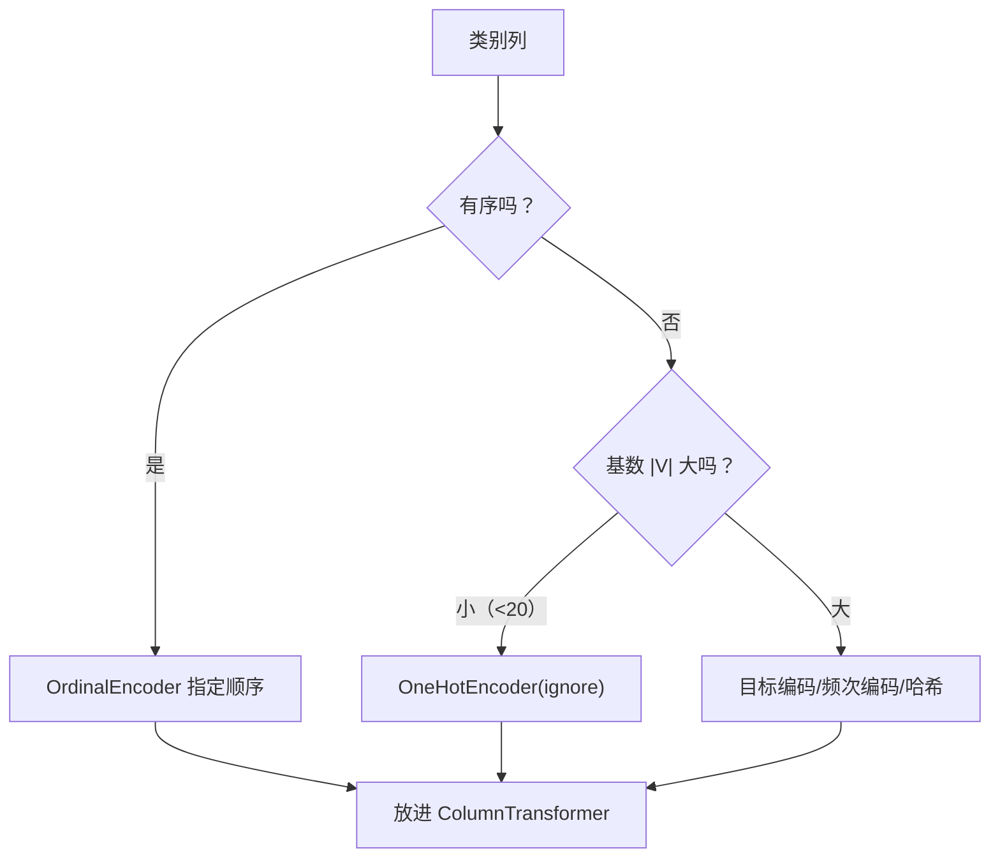

# ML-013 类别特征编码

## 1. 本节学习目标

1. 区分**无序类别**与**有序类别**，并各选对编码方式。
2. 会用 `OneHotEncoder`、`OrdinalEncoder`，知道 `handle_unknown="ignore"` 的作用。
3. 能算出 One-Hot 后的维度膨胀（$|V|$ 列）。
4. 知道高基数类别的替代方案（目标编码、频次编码）。

## 2. 为什么需要这个知识

因为模型只能算数，**看不懂 `"北京"`**。而编码方式选错，会直接注入错误假设：

- 把城市编码成 1/2/3 ⇒ 模型认为"3 号城市比 1 号大"。
- 把学历当成无序类别做 One-Hot ⇒ 丢掉"本科 < 硕士 < 博士"的顺序信息。
- 高基数类别（如用户 ID、邮编）做 One-Hot ⇒ 维度爆炸，且每列几乎全 0。

## 3. 直观解释

| 类别类型 | 例子 | 编码 | 理由 |
|---|---|---|---|
| **无序**（nominal） | 城市、颜色、品牌 | **One-Hot** | 之间没有大小关系 |
| **有序**（ordinal） | 学历、评级、尺寸 S/M/L | **有序整数** | 顺序有意义 |
| 二值 | 性别、是否 | 0/1 | 一个数就够 |

**One-Hot 的代价**：$|V|$ 个取值 ⇒ 多出 $|V|$ 列。城市有 300 个取值，就多 300 列，且每行只有 1 个 1。

## 4. 正式定义

**One-Hot 编码**

$$
\text{onehot}(v)_k = \mathbb{1}[v = V_k], \qquad k=1,\dots,|V|
$$

**有序编码**

$$
\text{ordinal}(v) = \text{rank}(v) \in \{0,1,\dots,|V|-1\}
$$

**维度变化**

| 编码 | 列数变化 |
|---|---|
| One-Hot | $1 \to |V|$（或 $|V|-1$，丢一列防共线） |
| Ordinal | $1 \to 1$ |

**未知类别处理**

- `handle_unknown="error"`：遇到训练时没见过的取值 **直接报错**。
- `handle_unknown="ignore"`：编码成全 0（安全，推荐）。

## 5. 核心原理

**为什么无序类别不能整数编码**：线性模型算 $w\cdot x$，整数编码让 $w$ 乘以"城市编号"，等于假设"城市编号越大，效应越强"。这是**强加的虚假结构**。

**为什么有序类别用 One-Hot 也浪费**：它丢掉了顺序（"博士"与"本科"的距离信息），需要更多数据才能学回来。

**为什么 `handle_unknown="ignore"` 重要**：训练集没有的城市，上线后一定会出现。用默认 `"error"`，线上第一次遇到就崩。

## 6. 数学表达式

**One-Hot 前后的维度**

$$
d_{after} = d_{num} + \sum_{j\in\text{cat}} |V_j|
$$

**本课实例**：`city` 有 3 个取值，4 行数据

$$
(4,1) \xrightarrow{\text{One-Hot}} (4,3)
$$

**目标编码（高基数替代）**

$$
\text{enc}(v) = \mathbb{E}[y \mid \text{cat}=v]
$$

需加平滑防泄漏：

$$
\text{enc}(v) = \frac{n_v\bar y_v + m\bar y_{global}}{n_v + m}
$$

## 7. 数学库链接

| 用到的数学 | 对应篇目 | 用在哪 |
|---|---|---|
| 集合与基数 | [[MATH-501 集合与集合运算]] | $|V|$ 的含义 |
| 条件期望 | [[MATH-306 期望、方差与协方差]] | 目标编码的定义 |

## 8. 算法执行流程



## 9. 可视化解释

```text
city        One-Hot
北京   →  [1, 0, 0]
上海   →  [0, 1, 0]
广州   →  [0, 0, 1]
深圳   →  [0, 0, 0]   ← handle_unknown="ignore"（训练时没见过）
```

## 10. Python 实现

```powershell
python ml013_encoding.py
```

```python
import pandas as pd
from sklearn.preprocessing import OneHotEncoder, OrdinalEncoder

df = pd.DataFrame({"city": ["北京", "上海", "北京", "广州"],
                   "size": ["S", "M", "L", "M"]})

ohe = OneHotEncoder(sparse_output=False, handle_unknown="ignore")
print("One-Hot 形状:", ohe.fit_transform(df[["city"]]).shape)
print("学到的类别:", ohe.categories_[0].tolist())
print("One-Hot 结果:\n", ohe.transform(df[["city"]]))

oe = OrdinalEncoder(categories=[["S", "M", "L"]])   # 显式给顺序
print("有序编码:", oe.fit_transform(df[["size"]]).ravel().tolist())

print("未知类别编码:", ohe.transform([["深圳"]]).tolist())
```

**实际运行结果**

```
One-Hot 形状: (4, 3)
学到的类别: ['上海', '北京', '广州']
One-Hot 结果:
 [[0. 1. 0.]
 [1. 0. 0.]
 [0. 1. 0.]
 [0. 0. 1.]]
有序编码: [0.0, 1.0, 2.0, 1.0]
未知类别编码: [[0.0, 0.0, 0.0]]
```

## 11. 代码逐行解释

| 代码 | 作用 |
|---|---|
| `sparse_output=False` | 返回稠密数组便于查看（默认稀疏） |
| `handle_unknown="ignore"` | 未见类别 → 全 0，不报错 |
| `ohe.categories_[0]` | 学到的类别**按字典序排序**（上海<北京<广州，按 Unicode） |
| `OrdinalEncoder(categories=[["S","M","L"]])` | **显式指定顺序**，不靠字母序 |
| `transform([["深圳"]])` | 演示未知类别 → `[0,0,0]` |

**注意类别顺序**：`categories_` 是 `['上海','北京','广州']`，与数据出现顺序无关——**按字典序**。若你的业务顺序重要，必须用 `OrdinalEncoder(categories=...)` 显式给。

## 12. 实际运行结果

见第 10 节。三点：

1. 4 行 1 列 → 4 行 **3 列**（$|V|=3$）。
2. 有序编码 `S/M/L → 0/1/2`，顺序被保留。
3. 未知类别 → `[0,0,0]`，不崩。

## 13. 适用场景

| 情形 | 方案 |
|---|---|
| 无序、取值少（<20） | One-Hot |
| 无序、取值多（>50） | 目标编码 / 频次编码 / 哈希 |
| 有序 | Ordinal（显式顺序） |
| 二值 | 0/1 |
| 高基数 + 树模型 | 目标编码或直接 Label 编码（树不假设序） |
| 线上会遇到新类别 | `handle_unknown="ignore"` |

## 14. 优点与缺点

| 编码 | 优点 | 缺点 |
|---|---|---|
| One-Hot | 无虚假序关系、可解释 | 维度膨胀、稀疏 |
| Ordinal | 紧凑 | 需人工给顺序；给错就注入错假设 |
| 目标编码 | 紧凑、含标签信息 | **易泄漏**，需 CV 内做 |
| 频次编码 | 无泄漏、简单 | 丢掉类别身份 |
| 哈希 | 支持新类别、省内存 | 碰撞、不可解释 |

## 15. 常见错误

| 错误 | 表现 | 纠正 |
|---|---|---|
| 无序类别用整数 | 模型学出虚假大小 | 用 One-Hot |
| 有序类别用 One-Hot | 丢顺序、需更多数据 | 用 Ordinal 显式顺序 |
| 忘记 `handle_unknown` | 线上遇新类别崩 | 设 `"ignore"` |
| 在**全量**上 fit 编码器 | 泄漏（类别集合含测试集） | 训练集 fit |
| 高基数硬 One-Hot | 维度爆炸、过拟合 | 目标编码/频次编码 |
| 目标编码在划分前算 | **严重泄漏** | 放进 CV/Pipeline |

## 16. 本节总结

- **无序 → One-Hot，有序 → Ordinal（显式顺序）**。
- One-Hot 代价是 $|V|$ 列；高基数要换方案。
- `handle_unknown="ignore"` 是上线必需项。
- 编码器也必须在训练集 `fit`。

## 17. 前置与后续

- 前置：[[ML-012 异常值识别与处理]]
- 后续：`ML-014 数值特征标准化与归一化`、`ML-016 预处理 Pipeline 与 ColumnTransformer`（待建）
- 相关数学：[[MATH-501 集合与集合运算]]、[[MATH-306 期望、方差与协方差]]
- 相关 Python：[[PY-008 字典与集合]]

## 18. 练习与参考答案

**基础 1**：城市、学历、性别、邮编，分别该用什么编码？

**基础 2**：写出 `OneHotEncoder` 的 `categories_` 与输出形状。

**进阶 1**：`handle_unknown="ignore"` 解决了什么问题？代价是什么？

**综合 1**：用 `ColumnTransformer` 组合"数值直通 + 类别 One-Hot"，输出形状与列名。

> [!success]- 参考答案

> **基础 1**
> | 特征 | 类型 | 编码 |
> |---|---|---|
> | 城市 | 无序 | One-Hot |
> | 学历 | 有序 | Ordinal（本科<硕士<博士） |
> | 性别 | 二值 | 0/1 |
> | 邮编 | 无序、高基数 | 目标编码/频次编码（**不要** One-Hot） |

> **基础 2**
> ```python
> import pandas as pd
> from sklearn.preprocessing import OneHotEncoder
> df = pd.DataFrame({"city": ["北京", "上海", "北京", "广州"]})
> ohe = OneHotEncoder(sparse_output=False, handle_unknown="ignore")
> print("形状:", ohe.fit_transform(df[["city"]]).shape)
> print("类别:", ohe.categories_[0].tolist())
> ```
> 实跑输出：
> ```
> 形状: (4, 3)
> 类别: ['上海', '北京', '广州']
> ```
> 注意类别按字典序排，不是出现顺序。

> **进阶 1**
> 解决"线上出现训练时没见过的类别导致 `ValueError`"的问题——改为编码成全 0，模型按"没有任何已知类别特征"处理。
> 代价：未知类别与"已知但全 0"的样本在特征空间里无法区分；若未知类别很多，模型会退化。

> **综合 1**
> ```python
> import pandas as pd
> from sklearn.compose import ColumnTransformer
> from sklearn.preprocessing import OneHotEncoder
>
> df = pd.DataFrame({"age": [25, 30, 41, 38, 52],
>                    "city": ["北京", "上海", "北京", "广州", "上海"]})
> pre = ColumnTransformer([("num", "passthrough", ["age"]),
>                          ("cat", OneHotEncoder(sparse_output=False), ["city"])])
> out = pre.fit_transform(df)
> print("形状:", out.shape)
> print("列名:", pre.get_feature_names_out().tolist())
> ```
> 实跑输出：
> ```
> 形状: (5, 4)
> 列名: ['num__age', 'cat__city_上海', 'cat__city_北京', 'cat__city_广州']
> ```
> **解读**：1 个数值列 + 3 个类别列 = 4 列。列名前缀（`num__`/`cat__`）由 `ColumnTransformer` 自动加，便于追溯来源。

---

## 🔗 Notion 同步信息

> 以下内容由 Notion「AI Knowledge System · 知识点」数据库按知识 ID 合并而来（导出于 2026-11-09）。

| 属性 | 值 |
|---|---|
| 学科 | 机器学习 |
| 学习状态 | 未开始 |
| 难度 | L2 应用 |
| 知识类型 | Technique |

- **所属模块**：[M-ML-02 数据处理与特征工程](../%E8%AF%BE%E7%A8%8B%E6%A8%A1%E5%9D%97/M-ML-02%20%E6%95%B0%E6%8D%AE%E5%A4%84%E7%90%86%E4%B8%8E%E7%89%B9%E5%BE%81%E5%B7%A5%E7%A8%8B.md)
- **前置知识**：[ML-012 异常值识别与处理](ML-012%20%E5%BC%82%E5%B8%B8%E5%80%BC%E8%AF%86%E5%88%AB%E4%B8%8E%E5%A4%84%E7%90%86.md)
- **后继知识**：[ML-014 数值特征标准化与归一化](ML-014%20%E6%95%B0%E5%80%BC%E7%89%B9%E5%BE%81%E6%A0%87%E5%87%86%E5%8C%96%E4%B8%8E%E5%BD%92%E4%B8%80%E5%8C%96.md)
- **关联Python**：[PY-008 字典与集合](../../01_Python%E5%9F%BA%E7%A1%80/03%20%E6%95%B0%E6%8D%AE%E7%BB%93%E6%9E%84/PY-008%20%E5%AD%97%E5%85%B8%E4%B8%8E%E9%9B%86%E5%90%88.md)
