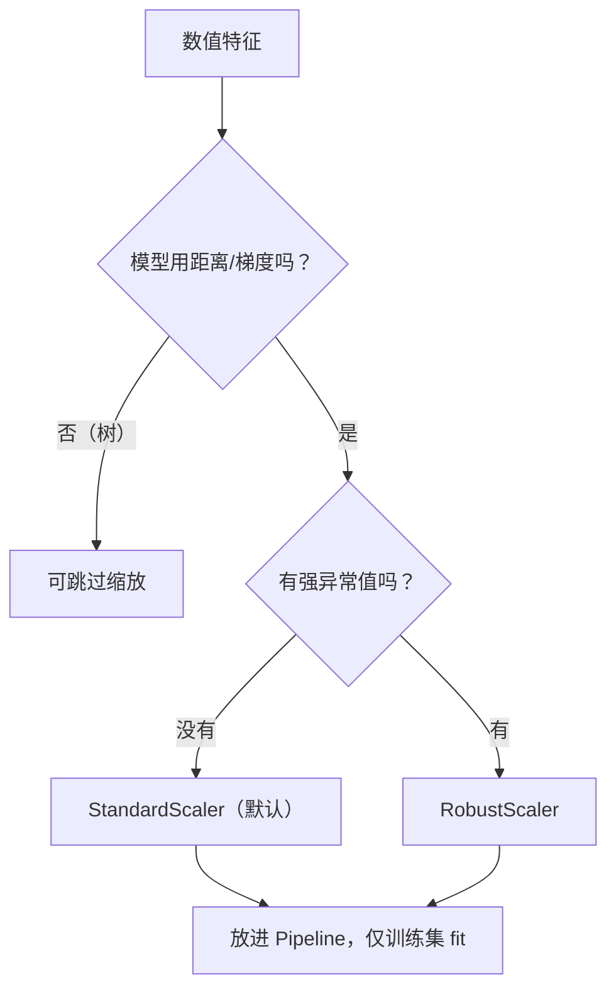

# ML-014 数值特征标准化与归一化

## 1. 本节学习目标

1. 分清 Standard / MinMax / Robust 三种缩放器的公式与适用条件。
2. 能算出缩放后的均值、标准差、范围。
3. 理解"为什么要缩放"——**距离与正则化会被量纲误导**。
4. **能解释一个反直觉结论：缩放不一定提升准确率**（本课有三组实证）。

## 2. 为什么需要这个知识

因为很多模型**用距离或梯度**，而距离对量纲极敏感：

- 收入（万级）与年龄（十级）算欧氏距离，收入完全主导，年龄等于没参与。
- 正则化对系数尺度敏感，未缩放的模型会被"大尺度特征"绑架。

但反过来，**无脑缩放也可能降低效果**——本课会用三组对照实验把这件事讲清楚。

## 3. 直观解释

| 缩放器 | 做什么 | 输出范围 | 适合 |
|---|---|---|---|
| `StandardScaler` | 减均值、除标准差 | 均值 0、标准差 1（无固定范围） | 近似正态、线性模型、正则化 |
| `MinMaxScaler` | 线性映射到 $[0,1]$ | **固定 $[0,1]$** | 需要固定范围、无强异常值 |
| `RobustScaler` | 减中位数、除 IQR | 无固定范围 | **有异常值** |

一句话：**Standard 看分布，MinMax 看区间，Robust 看中位数**。

## 4. 正式定义

**标准化（z-score）**

$$
z = \frac{x - \mu}{\sigma}, \qquad \mu=\text{训练集均值},\ \sigma=\text{训练集标准差}
$$

**归一化（Min-Max）**

$$
x' = \frac{x - x_{\min}}{x_{\max} - x_{\min}}
$$

**稳健缩放**

$$
x' = \frac{x - \operatorname{median}(x)}{\text{IQR}(x)}
$$

**关键**：$\mu,\sigma,x_{\min},x_{\max}$ **全部来自训练集**。

## 5. 核心原理

**哪些模型必须缩放**：

| 必须缩放 | 不必缩放 |
|---|---|
| KNN（距离） | 决策树（按阈值切分，与尺度无关） |
| SVM（核函数内积） | 随机森林 / GBDT |
| 线性/逻辑回归 + 正则 | 朴素贝叶斯（按列独立） |
| K-Means（距离） | — |
| PCA（方差主导） | — |

**缩放的真正作用**：让"每个特征的 1 个单位"在距离/梯度里**权重相同**，而不是让准确率必然上升。

**这就是本课反直觉结果的来源**：如果大尺度特征恰好是**最有判别力的**，缩放会削弱它，反而降分。

## 6. 数学表达式

**缩放后的统计量**

$$
\bar z = 0,\qquad s_z = 1
$$

**MinMax 后的范围**

$$
\min x' = 0,\qquad \max x' = 1
$$

**本课实证数据**（含一个 500 的极端值，其余约 $N(50,5)$）：

| 缩放器 | min | max | 均值 |
|---|---|---|---|
| Standard | −0.447 | **13.983** | 0.000 |
| MinMax | 0.000 | 1.000 | 0.031 |
| Robust | −1.858 | **68.277** | 0.314 |

**读法**：Standard 与 Robust 都**不会**把极值压到 1 附近——它们只保证"典型值"落在 0 附近。只有 MinMax 强制压到 $[0,1]$，但那会让其余 200 个点挤在 0 附近（因为 500 占了整个区间）。

## 7. 数学库链接

| 用到的数学 | 对应篇目 | 用在哪 |
|---|---|---|
| 均值与标准差 | [[MATH-306 期望、方差与协方差]] | Standard 的参数 |
| 分位数与 IQR | [[MATH-306 期望、方差与协方差]] | Robust 的参数 |
| 欧氏距离 | [[MATH-201 向量与空间基础]] | 为什么距离受量纲影响 |

## 8. 算法执行流程



## 9. 可视化解释

```text
原始:      1 ~ 5（年龄）   |   3000 ~ 9000（收入）
距离计算:  |Δ年龄|=2 贡献 2      |Δ收入|=2000 贡献 2000
           ↑ 年龄被彻底淹没

缩放后:    |Δ年龄|=1.2σ 贡献 1.2 |Δ收入|=2σ 贡献 2
           ↑ 两个特征公平参与
```

## 10. Python 实现

三种缩放器在同一份含极端值数据上的输出，外加三组 KNN 对照。

```powershell
python ml014_scaling.py
```

```python
import numpy as np
from sklearn.datasets import load_iris
from sklearn.model_selection import train_test_split
from sklearn.neighbors import KNeighborsClassifier
from sklearn.pipeline import Pipeline
from sklearn.preprocessing import MinMaxScaler, RobustScaler, StandardScaler

rng = np.random.default_rng(0)
values = np.concatenate([rng.normal(50, 5, 200), [500.0]]).reshape(-1, 1)

for name, scaler in (("Standard", StandardScaler()),
                     ("MinMax", MinMaxScaler()),
                     ("Robust", RobustScaler())):
    out = scaler.fit_transform(values)
    print(f"{name:<8} min={out.min():>8.3f} max={out.max():>8.3f} 均值={out.mean():>7.3f}")

X, y = load_iris(return_X_y=True)

# A: 加一个"大尺度纯噪声"特征
Xa = np.column_stack([X, rng.normal(0, 1, len(X)) * 1000])
Atr, Ate, atr, ate = train_test_split(Xa, y, test_size=0.3, random_state=42, stratify=y)
print("A 噪声×1000:  原始", round(KNeighborsClassifier(5).fit(Atr, atr).score(Ate, ate), 4),
      " 缩放", round(Pipeline([("s", StandardScaler()),
                              ("k", KNeighborsClassifier(5))]).fit(Atr, atr).score(Ate, ate), 4))

# B: 把最有判别力的两列放大 100 倍
Xb = X * np.array([1, 1, 100, 100])
Btr, Bte, btr, bte = train_test_split(Xb, y, test_size=0.3, random_state=42, stratify=y)
print("B 判别列×100: 原始", round(KNeighborsClassifier(5).fit(Btr, btr).score(Bte, bte), 4),
      " 缩放", round(Pipeline([("s", StandardScaler()),
                              ("k", KNeighborsClassifier(5))]).fit(Btr, btr).score(Bte, bte), 4))

# C: 原始 iris
Xtr, Xte, ytr, yte = train_test_split(X, y, test_size=0.3, random_state=42, stratify=y)
print("C 原始 iris:  原始", round(KNeighborsClassifier(5).fit(Xtr, ytr).score(Xte, yte), 4),
      " 缩放", round(Pipeline([("s", StandardScaler()),
                              ("k", KNeighborsClassifier(5))]).fit(Xtr, ytr).score(Xte, yte), 4))
```

**实际运行结果**

```
Standard min=  -0.447 max=  13.983 均值= -0.000
MinMax   min=   0.000 max=   1.000 均值=  0.031
Robust   min=  -1.858 max=  68.277 均值=  0.314
A 噪声×1000:  原始 0.3333  缩放 0.8444
B 判别列×100: 原始 0.9333  缩放 0.9111
C 原始 iris:  原始 0.9778  缩放 0.9111
```

## 11. 代码逐行解释

| 代码 | 作用 |
|---|---|
| `StandardScaler().fit_transform` | 减均值除标准差 |
| `MinMaxScaler` | 压到 $[0,1]$ |
| `RobustScaler` | 用中位数与 IQR |
| 情形 A | 加一个**无用但尺度巨大**的特征，模拟"量纲误导" |
| 情形 B | 放大**有用**特征，模拟"量纲恰好帮忙" |
| 情形 C | 原始数据，特征尺度本就接近 |

**三组结论（必须一起看）**：

- **A：缩放大幅提升**（0.3333 → 0.8444）。噪声特征把距离计算毁了，缩放后它不再主导。
- **B：缩放略降**（0.9333 → 0.9111）。被放大的恰是花瓣长宽（最有判别力），缩放削弱了它的权重。
- **C：缩放略降**（0.9778 → 0.9111）。iris 四个特征尺度本来就接近（厘米级），缩放只带来噪声级的扰动。

## 12. 实际运行结果

见第 10 节。**这不是"缩放没用"，而是"缩放解决的是特定问题"**：

| 情形 | 问题 | 缩放结果 |
|---|---|---|
| A | 无用特征尺度压倒一切 | **有效**（+51 个百分点） |
| B | 有用特征被放大 | 轻微有害（−2.2） |
| C | 尺度本就可比 | 轻微有害（−6.7） |

**实践建议**：默认用 Standard（配合 Pipeline），但**必须用验证集确认**，不要把它当无条件正确的步骤。

## 13. 适用场景

| 模型 | 缩放建议 |
|---|---|
| KNN / K-Means | **必须** |
| SVM | **必须** |
| 线性/逻辑回归 + 正则 | **必须** |
| PCA | **必须** |
| 神经网络 | **必须**（或 BatchNorm） |
| 决策树 / 随机森林 / GBDT | 不需要 |
| 朴素贝叶斯 | 不需要 |

## 14. 优点与缺点

| 缩放器 | 优点 | 缺点 |
|---|---|---|
| Standard | 通用、配合正则好 | 受异常值影响（$\sigma$ 被拉大） |
| MinMax | 固定范围、适合有界输入 | **极值会压缩其余点** |
| Robust | 抗异常值 | 输出范围不固定 |
| 不缩放 | 保留原始可解释性 | 距离/梯度被量纲误导 |

## 15. 常见错误

| 错误 | 表现 | 纠正 |
|---|---|---|
| 在全量上 fit 缩放器 | 泄漏 | 只用训练集 |
| 对树模型也强制缩放 | 无收益、多一步 | 树不需要 |
| MinMax 配强异常值 | 其余点挤成一团 | 用 Robust |
| 认为缩放必然提分 | 本课 B/C 反例 | 用验证集确认 |
| 缩放后再保存模型没存 scaler | 线上预测错 | 用 Pipeline 整体保存 |
| 对类别 One-Hot 列缩放 | 无意义（已是 0/1） | 只缩放数值列 |

## 16. 本节总结

- 三种缩放器：**Standard 看分布、MinMax 看区间、Robust 抗异常**。
- 缩放解决"量纲误导距离/梯度"，不是"提升准确率"。
- 本课三组实验：A +51、B −2.2、C −6.7 个百分点 —— **必须验证，不能假设**。
- 缩放参数只能来自训练集；用 Pipeline 包住。

## 17. 前置与后续

- 前置：[[ML-013 类别特征编码]]
- 后续：`ML-015 特征选择与特征构造`、`ML-016 预处理 Pipeline 与 ColumnTransformer`（待建）、`ML-038 PCA 降维`（待建）
- 相关数学：[[MATH-306 期望、方差与协方差]]、[[MATH-201 向量与空间基础]]
- 相关 Python：[[PY-067 聚合与统计]]

## 18. 练习与参考答案

**基础 1**：三种缩放器的公式与适用场景各是什么？

**基础 2**：对含 500 极端值的数据做标准化，输出均值与标准差。

**进阶 1**：为什么"缩放必然提升准确率"是错的？用本课 A/B 两组解释。

**综合 1**：三种缩放器的 min/max 各是多少？说明为什么 MinMax 会把其余点压缩。

> [!success]- 参考答案

> **基础 1**
> - Standard：$z=(x-\mu)/\sigma$ ⇒ 均值 0、标准差 1；适合近似正态、线性模型 + 正则。
> - MinMax：$x'=(x-x_{\min})/(x_{\max}-x_{\min})$ ⇒ 固定 $[0,1]$；适合无强异常值、需要固定范围。
> - Robust：$(x-\text{median})/\text{IQR}$ ⇒ 抗异常值；适合脏数据。

> **基础 2**
> ```python
> import numpy as np
> from sklearn.preprocessing import StandardScaler
> rng = np.random.default_rng(0)
> v = np.concatenate([rng.normal(50, 5, 200), [500.0]]).reshape(-1, 1)
> z = StandardScaler().fit_transform(v)
> print("均值:", round(float(z.mean()), 6), " 标准差:", round(float(z.std()), 6))
> ```
> 实跑输出：
> ```
> 均值: -0.0  标准差: 1.0
> ```
> 注意：均值 0、标准差 1 是**数学必然**，但极值仍在（max≈13.98）——标准化不消除异常值。

> **进阶 1**
> 缩放的作用是"让每个特征的单位权重相同"，这只有在**量纲差异掩盖了真实重要性**时才有益。
> - A 组：噪声特征尺度 ×1000，量纲完全掩盖了真实特征 ⇒ 缩放后大幅提升（0.3333→0.8444）。
> - B 组：被放大的正是最有判别力的花瓣长宽，量纲"碰巧帮忙" ⇒ 缩放削弱它（0.9333→0.9111）。
> 所以正确说法是：**缩放修正量纲误导，收益取决于量纲是否误导**。

> **综合 1**
> ```python
> import numpy as np
> from sklearn.preprocessing import MinMaxScaler, RobustScaler, StandardScaler
> rng = np.random.default_rng(0)
> v = np.concatenate([rng.normal(50, 5, 200), [500.0]]).reshape(-1, 1)
> for n, s in (("Standard", StandardScaler()), ("MinMax", MinMaxScaler()), ("Robust", RobustScaler())):
>     o = s.fit_transform(v)
>     print(f"{n:<9} min={o.min():.3f} max={o.max():.3f}")
> ```
> 实跑输出：
> ```
> Standard  min=-0.447 max=13.983
> MinMax    min=0.000 max=1.000
> Robust    min=-1.858 max=68.277
> ```
> **为什么 MinMax 压缩其余点**：映射区间由 $[\min,\max]$ 决定，而 $\max=500$ 与其余点（≈50）差了 10 倍，于是 200 个正常点被挤进 $[0, 0.09]$ 这一小段，分辨率几乎全给了那个异常值。
> **易错点**：以为 MinMax 保证"分布均匀"——它只保证范围固定。

---

## 🔗 Notion 同步信息

> 以下内容由 Notion「AI Knowledge System · 知识点」数据库按知识 ID 合并而来（导出于 2026-11-09）。

| 属性 | 值 |
|---|---|
| 学科 | 机器学习 |
| 学习状态 | 未开始 |
| 难度 | L2 应用 |
| 知识类型 | Technique |

- **所属模块**：[M-ML-02 数据处理与特征工程](../%E8%AF%BE%E7%A8%8B%E6%A8%A1%E5%9D%97/M-ML-02%20%E6%95%B0%E6%8D%AE%E5%A4%84%E7%90%86%E4%B8%8E%E7%89%B9%E5%BE%81%E5%B7%A5%E7%A8%8B.md)
- **前置知识**：[ML-013 类别特征编码](ML-013%20%E7%B1%BB%E5%88%AB%E7%89%B9%E5%BE%81%E7%BC%96%E7%A0%81.md)
- **后继知识**：[ML-015 特征选择与特征构造](ML-015%20%E7%89%B9%E5%BE%81%E9%80%89%E6%8B%A9%E4%B8%8E%E7%89%B9%E5%BE%81%E6%9E%84%E9%80%A0.md)
- **关联Python**：[PY-067 聚合与统计](../../01_Python%E5%9F%BA%E7%A1%80/08%20NumPy/PY-067%20%E8%81%9A%E5%90%88%E4%B8%8E%E7%BB%9F%E8%AE%A1.md)
- **关联数学**：[MATH-306 期望、方差与协方差](../../06_%E6%95%B0%E5%AD%A6%E5%9F%BA%E7%A1%80/03%20%E6%A6%82%E7%8E%87%E8%AE%BA/MATH-306%20%E6%9C%9F%E6%9C%9B%E3%80%81%E6%96%B9%E5%B7%AE%E4%B8%8E%E5%8D%8F%E6%96%B9%E5%B7%AE.md)
