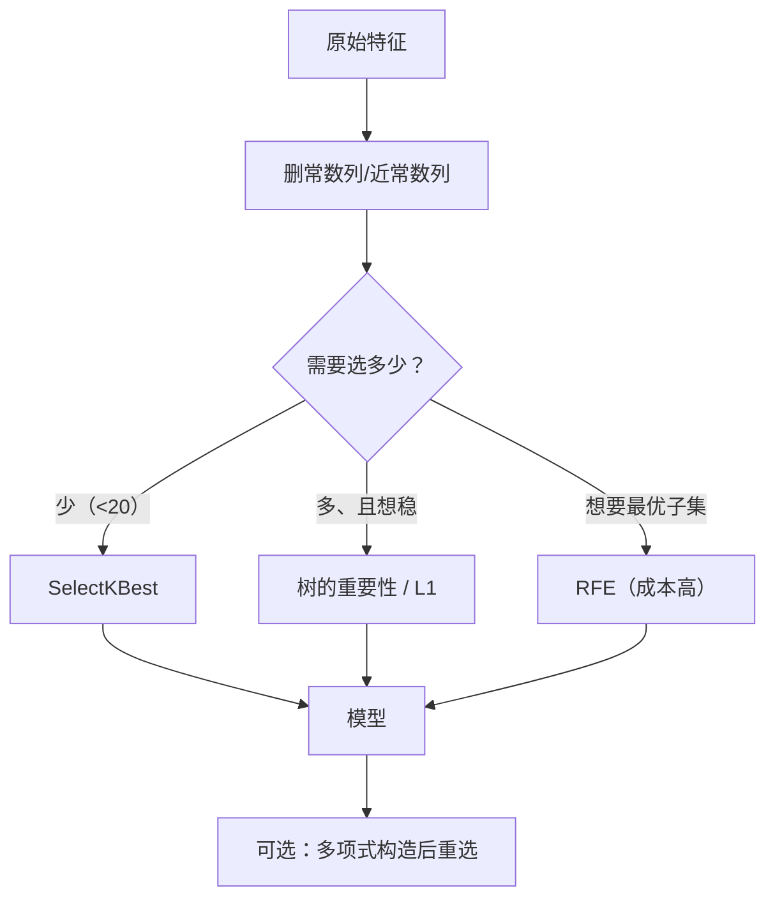

# ML-015 特征选择与特征构造

## 1. 本节学习目标

1. 分清**过滤式 / 包裹式 / 嵌入式**三类特征选择。
2. 会用 `VarianceThreshold`、`SelectKBest`，并读懂 `get_support()` 与 `scores_`。
3. 会用 `PolynomialFeatures` 构造交叉特征，并能算维度增长。
4. 知道"特征多不等于信息多"——噪声特征会稀释信号。

## 2. 为什么需要这个知识

因为**维度是成本**：

- 每多一个特征，参数量、过拟合风险、推理成本都上升。
- 常数列、近常数列、纯噪声列**零信息但占位**，还会让距离计算失真。
- 线性模型的系数估计在高度相关特征下不稳定。

而特征构造是反向操作：**用少量原始特征造出信息更密的组合**（如 $x_1x_2$、$x_1/x_2$），让线性模型也能拟合非线性关系。

## 3. 直观解释

**特征选择 = 减法**：从 100 个特征里挑 10 个真正有用的。
**特征构造 = 加法**：用 2 个特征造出 5 个（含交叉项、比值、平方）。

| 方法 | 怎么做 | 成本 | 例子 |
|---|---|---|---|
| 过滤式 | 按单变量统计量排序 | 低 | 方差阈值、卡方、互信息 |
| 包裹式 | 用模型效果反复试 | 高 | RFE、前向/后向选择 |
| 嵌入式 | 训练时自动稀疏 | 中 | L1 正则、树的重要性 |

## 4. 正式定义

**过滤式：方差阈值**

$$
\operatorname{Var}(x_j) \le \tau \Rightarrow \text{剔除}
$$

常数列方差为 0，直接删。

**过滤式：F 检验（分类）**

$$
F_j = \frac{\text{组间方差}}{\text{组内方差}}
$$

$F_j$ 越大 ⇒ 该特征对类别的区分力越强。

**过滤式：互信息**

$$
I(X_j;Y) = \sum_{x,y} p(x,y)\log\frac{p(x,y)}{p(x)p(y)}
$$

能捕捉**非线性**依赖（F 检验只看线性）。

**包裹式：RFE**

反复训练 → 删掉最不重要的 → 再训练，直到剩 $k$ 个。

**嵌入式：L1**

$$
\min_w \|Xw-y\|^2 + \lambda\|w\|_1 \Rightarrow \text{部分 } w_j = 0
$$

**特征构造：多项式展开**

$$
\text{Poly}(d=2, \text{2 特征}) = \{x_1, x_2, x_1^2, x_1x_2, x_2^2\} \Rightarrow 5 \text{ 列}
$$

**一般公式**（$d$ 个特征、二次、含偏置）

$$
\binom{d+2}{2} = \frac{(d+1)(d+2)}{2}
$$

不含偏置时减 1。

## 5. 核心原理

**为什么常数列必须删**：方差 0 ⇒ 对任何模型都不携带区分信息，但会让标准化除以 0（$\sigma=0$），直接产生 `NaN`。

**为什么单变量筛选不够**：两个单独看都弱的特征，组合起来可能很强（XOR 型）。过滤式会误删。

**为什么 L1 能选特征**：L1 的约束是菱形，最优解容易落在坐标轴上（见 [[MATH-708 L1 与 L2 正则化]]），于是部分系数**精确为 0**——这是"自动选择"的数学来源。

**为什么构造要谨慎**：$d$ 个特征的二次展开是 $O(d^2)$。100 个特征 ⇒ 5150 列，过拟合风险陡增。

## 6. 数学表达式

**本课实例**（iris 4 特征 + 常数列 + 噪声列 = 6 列）

`VarianceThreshold()` 保留掩码：

$$
[True, True, True, True, False, True]
$$

第 5 列（索引 4）是常数列 ⇒ 被删。

**SelectKBest(k=3) 的 F 分数**

$$
\text{scores} = [119.3,\ 49.2,\ 1180.2,\ 960.0]
$$

选中列掩码 $[True, False, True, True]$ ⇒ 保留第 1、3、4 列（花萼长、花瓣长、花瓣宽），丢掉花萼宽（$F=49.2$ 最小）。

**多项式维度**

$$
(150, 2) \xrightarrow{d=2} (150, 5)
$$

即 $x_1, x_2, x_1^2, x_1x_2, x_2^2$。

## 7. 数学库链接

| 用到的数学 | 对应篇目 | 用在哪 |
|---|---|---|
| 方差 | [[MATH-306 期望、方差与协方差]] | 方差阈值 |
| L1 稀疏性 | [[MATH-708 L1 与 L2 正则化]] | 嵌入式选择 |
| 特征值与主成分 | [[MATH-223 特征值与特征向量]] | 降维式选择（PCA） |

## 8. 算法执行流程



## 9. 可视化解释

```text
特征重要性排序（本课 F 分数）
花瓣长 1180 ████████████████████
花瓣宽  960 ████████████████
花萼长  119 ██
花萼宽   49 █            ← 被 k=3 淘汰
```

## 10. Python 实现

```powershell
python ml015_selection.py
```

```python
import numpy as np
from sklearn.datasets import load_iris
from sklearn.feature_selection import SelectKBest, VarianceThreshold, f_classif
from sklearn.preprocessing import PolynomialFeatures

X, y = load_iris(return_X_y=True)
rng = np.random.default_rng(0)

# 人为加一列常数、一列噪声
X_aug = np.column_stack([X, np.zeros(len(X)), rng.normal(size=len(X))])
print("加常量列+噪声列:", X_aug.shape)

vt = VarianceThreshold().fit(X_aug)
print("VarianceThreshold 保留:", vt.get_support().tolist())

sk = SelectKBest(f_classif, k=3).fit(X, y)
print("SelectKBest 保留:", sk.get_support().tolist())
print("F 分数:", sk.scores_.round(1).tolist())

poly = PolynomialFeatures(degree=2, include_bias=False)
print("2 特征二次展开:", poly.fit_transform(X[:, :2]).shape)
print("列名:", poly.get_feature_names_out(["x1", "x2"]).tolist())
```

**实际运行结果**

```
加常量列+噪声列: (150, 6)
VarianceThreshold 保留: [True, True, True, True, False, True]
SelectKBest 保留: [True, False, True, True]
F 分数: [119.3, 49.2, 1180.2, 960.0]
2 特征二次展开: (150, 5)
列名: ['x1', 'x2', 'x1^2', 'x1 x2', 'x2^2']
```

## 11. 代码逐行解释

| 代码 | 作用 |
|---|---|
| `np.column_stack([...])` | 拼接常数列（全 0）与噪声列 |
| `VarianceThreshold()` 默认阈值 0 | 只删方差恰为 0 的列 |
| `vt.get_support()` | 布尔掩码，`False` 即被删 |
| `SelectKBest(f_classif, k=3)` | 按 F 分数保留前 3 |
| `sk.scores_` | 每个特征的 F 值，可解释 |
| `PolynomialFeatures(degree=2, include_bias=False)` | 二次展开，不含常数项 |
| `get_feature_names_out` | 生成可读列名 |

**关键点**：`SelectKBest` 默认按分数**从高到低**取前 k 个。这里 `花萼宽` 的 $F=49.2$ 最小，被淘汰——但**不代表它无用**，只代表"单变量看它最弱"。

## 12. 实际运行结果

见第 10 节。三点：

1. 6 列中常数列被 `VarianceThreshold` 精准识别（第 5 位 `False`）。
2. `SelectKBest(k=3)` 淘汰花萼宽，保留 $F$ 值最高的三列。
3. 2 个特征的二次展开生成 5 列，与公式 $\binom{4}{2}=6$ 减偏置 = 5 一致。

## 13. 适用场景

| 场景 | 方法 |
|---|---|
| 有常数列/近常数列 | `VarianceThreshold` |
| 快速筛掉弱特征 | `SelectKBest` + `f_classif`/`mutual_info` |
| 想要可解释的重要性 | 树模型 `feature_importances_` |
| 想要稀疏模型 | L1 正则（`Lasso`/`LogisticRegression(penalty="l1")`） |
| 想要最优子集（贵） | `RFE` / `RFECV` |
| 线性模型拟合非线性 | `PolynomialFeatures` |
| 特征太多、相关性高 | PCA（见 `ML-038`，待建） |

## 14. 优点与缺点

| 方法 | 优点 | 缺点 |
|---|---|---|
| 方差阈值 | 极快、绝对安全 | 只能删常量类 |
| F 检验 | 快、可解释 | 只看线性关系 |
| 互信息 | 能抓非线性 | 慢、对离散化敏感 |
| L1 | 自动稀疏 | 相关特征会随机留一个 |
| RFE | 考虑特征组合 | 慢（要训练 $d$ 次） |
| 多项式构造 | 让线性模型拟合非线性 | 维度 $O(d^2)$ 爆炸 |

## 15. 常见错误

| 错误 | 表现 | 纠正 |
|---|---|---|
| 在全量数据上做特征选择 | **严重泄漏**（选择用了测试集标签） | 放进 Pipeline / 只在训练折做 |
| 只按单变量删特征 | 误删"组合起来有用"的特征 | 结合模型重要性 |
| 盲目扩大到 $d=3$ 多项式 | 维度爆炸 | 先选特征再构造 |
| 用 `get_support()` 的列序搞错 | 后续取错列 | 用 `get_feature_names_out` 核对 |
| 常数列不删 | 标准化除以 0 得 NaN | 先 `VarianceThreshold` |
| 把 `feature_importances_` 当因果 | 相关性≠因果 | 只作排序参考 |

## 16. 本节总结

- 三类选择：**过滤（快）、包裹（准但慢）、嵌入（训练时顺带）**。
- 常数列必须删；弱特征要结合多变量方法判断。
- 多项式构造能救线性模型，但维度 $O(d^2)$，要克制。
- **特征选择也会泄漏**——必须放进 Pipeline。

## 17. 前置与后续

- 前置：[[ML-014 数值特征标准化与归一化]]
- 后续：`ML-016 预处理 Pipeline 与 ColumnTransformer`（待建）、`ML-038 PCA 降维`（待建）、`ML-057 特征重要性与模型解释`（待建）
- 相关数学：[[MATH-708 L1 与 L2 正则化]]、[[MATH-223 特征值与特征向量]]

## 18. 练习与参考答案

**基础 1**：过滤式、包裹式、嵌入式各举一例，并说明成本差异。

**基础 2**：对含常数列的数据运行 `VarianceThreshold`，写出保留掩码。

**进阶 1**：为什么特征选择放在划分之前会造成数据泄漏？

**综合 1**：2 个特征做二次多项式展开（不含偏置）有多少列？100 个特征呢？

> [!success]- 参考答案

> **基础 1**
> - 过滤式：`SelectKBest(f_classif)` —— 只算单变量统计量，最便宜。
> - 包裹式：`RFE` —— 要训练 $d$ 次，最贵。
> - 嵌入式：`Lasso` / 树的 `feature_importances_` —— 训练时顺带完成，中等。

> **基础 2**
> ```python
> import numpy as np
> from sklearn.datasets import load_iris
> from sklearn.feature_selection import VarianceThreshold
>
> X, y = load_iris(return_X_y=True)
> Xa = np.column_stack([X, np.zeros(len(X))])
> print("保留掩码:", VarianceThreshold().fit(Xa).get_support().tolist())
> ```
> 实跑输出：
> ```
> 保留掩码: [True, True, True, True, False]
> ```

> **进阶 1**
> 因为特征选择用到了**标签**（F 检验、互信息、L1、树的重要性都要 $y$）。若在划分前对全量数据做选择，测试集的标签信息就进入了"哪些特征被保留"这个决策，评估会偏乐观。
> 正确做法：把选择器放进 `Pipeline`，它只看到训练折。

> **综合 1**
> **2 特征**：$x_1,x_2,x_1^2,x_1x_2,x_2^2$ ⇒ **5 列**（实跑确认）。
> **100 特征**：
> $$\binom{100+2}{2} - 1 = \frac{101\times102}{2} - 1 = 5151 - 1 = 5150$$
> 即 5150 列——从 100 列膨胀到 5150 列，过拟合风险与内存开销都急剧上升。

---

## 🔗 Notion 同步信息

> 以下内容由 Notion「AI Knowledge System · 知识点」数据库按知识 ID 合并而来（导出于 2026-11-09）。

| 属性 | 值 |
|---|---|
| 学科 | 机器学习 |
| 学习状态 | 未开始 |
| 难度 | L3 推导 |
| 知识类型 | Technique |

- **所属模块**：[M-ML-02 数据处理与特征工程](../%E8%AF%BE%E7%A8%8B%E6%A8%A1%E5%9D%97/M-ML-02%20%E6%95%B0%E6%8D%AE%E5%A4%84%E7%90%86%E4%B8%8E%E7%89%B9%E5%BE%81%E5%B7%A5%E7%A8%8B.md)
- **前置知识**：[ML-014 数值特征标准化与归一化](ML-014%20%E6%95%B0%E5%80%BC%E7%89%B9%E5%BE%81%E6%A0%87%E5%87%86%E5%8C%96%E4%B8%8E%E5%BD%92%E4%B8%80%E5%8C%96.md)
- **后继知识**：[ML-016 预处理 Pipeline 与 ColumnTransformer](ML-016%20%E9%A2%84%E5%A4%84%E7%90%86%20Pipeline%20%E4%B8%8E%20ColumnTransformer.md)
- **关联Python**：[PY-067 聚合与统计](../../01_Python%E5%9F%BA%E7%A1%80/08%20NumPy/PY-067%20%E8%81%9A%E5%90%88%E4%B8%8E%E7%BB%9F%E8%AE%A1.md)
- **关联数学**：[MATH-223 特征值与特征向量](../../06_%E6%95%B0%E5%AD%A6%E5%9F%BA%E7%A1%80/02%20%E7%BA%BF%E6%80%A7%E4%BB%A3%E6%95%B0/MATH-223%20%E7%89%B9%E5%BE%81%E5%80%BC%E4%B8%8E%E7%89%B9%E5%BE%81%E5%90%91%E9%87%8F.md) · [MATH-708 L1 与 L2 正则化](../../06_%E6%95%B0%E5%AD%A6%E5%9F%BA%E7%A1%80/07%20%E6%9C%80%E4%BC%98%E5%8C%96%E6%96%B9%E6%B3%95/MATH-708%20L1%20%E4%B8%8E%20L2%20%E6%AD%A3%E5%88%99%E5%8C%96.md)
