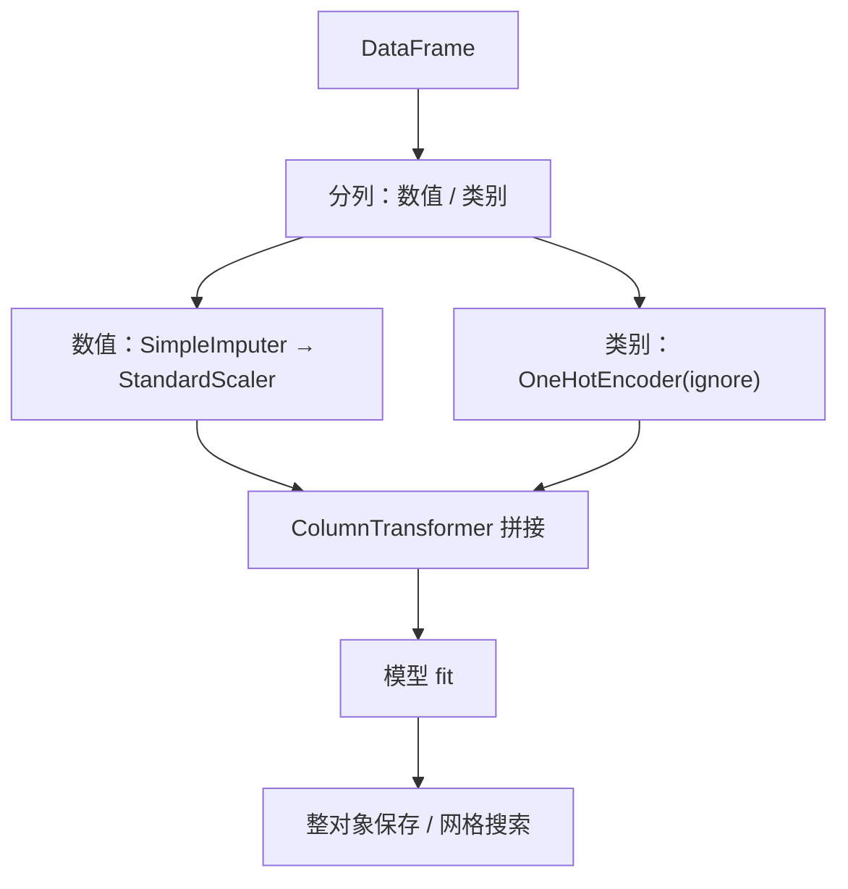

# ML-016 预处理 Pipeline 与 ColumnTransformer

## 1. 本节学习目标

1. 会对**数值列**与**类别列**分别施加不同预处理（`ColumnTransformer`）。
2. 能把"填充 → 缩放 → 编码 → 模型"串成**一个对象**（`Pipeline`）。
3. 会用 `步骤名__参数名` 的写法在 Pipeline 上做网格搜索。
4. 理解 Pipeline 对防泄漏的**结构性**保证。

## 2. 为什么需要这个知识

因为真实数据集**永远是混合类型**：数值列要填充+缩放，类别列要编码，两者不能走同一套处理。

手工分步做的后果：

- 训练时忘了对测试集做同样的变换 ⇒ 形状不匹配或结果错。
- 在划分前 fit 预处理器 ⇒ 数据泄漏。
- 保存模型时只存了 `clf`，忘了存 scaler ⇒ 线上预测全错。

`Pipeline` + `ColumnTransformer` 把这三类事故从"靠自觉"变成"结构上不可能"。

## 3. 直观解释

```text
                     ┌──── ColumnTransformer ────┐
数值列 age, income ──►│ 填充(median) → 标准化      │──┐
                     └───────────────────────────┘  ├──► 模型 → ŷ
                     ┌───────────────────────────┐  │
类别列 city ─────────►│ OneHotEncoder              │──┘
                     └───────────────────────────┘
```

一个 `Pipeline` 对象，`fit` 时按顺序拟合、`predict` 时按顺序变换。**它就是一个模型**。

## 4. 正式定义

**ColumnTransformer**：按列分组，每组配一个变换器

$$
X' = \big[\,T_1(X_{S_1})\ \big|\ T_2(X_{S_2})\ \big|\ \cdots\,\big]
$$

**Pipeline**：变换器链 + 末尾估计器

$$
\hat y = f_{\theta_k}\Big(T_{\theta_{k-1}}\big(\cdots T_{\theta_1}(X)\cdots\big)\Big)
$$

**访问子步骤参数**

$$
\text{param} = \texttt{步骤名\_\_参数名}
$$

例如 `clf__C`、`pre__num__imp__strategy`。

## 5. 核心原理

**为什么 Pipeline 能防泄漏**：`fit` 时，它把训练折的数据依次喂给每个变换器；交叉验证时，**每一折都重新 fit 变换器**，验证折的数据从未参与拟合。

**为什么列名要保留**：`get_feature_names_out()` 给出 `num__age`、`cat__city_北京` 这类名字，出问题时能立刻定位是哪一列。

**为什么网格搜索要写在 Pipeline 上**：如果只在模型上搜，预处理器仍是"全量 fit"的旧对象，泄漏照旧存在。

## 6. 数学表达式

**本课输出列数**

$$
d' = \underbrace{2}_{\text{age, income}} + \underbrace{3}_{\text{city 的 3 类}} = 5
$$

**交叉验证分数**

$$
\text{CV} = \frac{1}{5}\sum_{k=1}^{5}\text{score}_k = \frac{0.675+0.8+0.7+0.725+0.675}{5} = 0.715
$$

**注意**：单次划分给出 0.66，CV 给出 0.715——**单次划分低估了**，因为 50 条测试集波动大。

## 7. 数学库链接

| 用到的数学 | 对应篇目 | 用在哪 |
|---|---|---|
| 中位数填充 | [[MATH-306 期望、方差与协方差]] | imputer 参数 |
| 均值/标准差 | [[MATH-306 期望、方差与协方差]] | scaler 参数 |

## 8. 算法执行流程



## 9. 可视化解释

```text
原始（含缺失）           变换后
age=NaN, income=8000  →  [−1.2, −0.3, 0, 1, 0]
city="上海"
          ↑ 缺失被 median 填，城市被 One-Hot
```

## 10. Python 实现

```powershell
python ml016_pipeline.py
```

```python
import numpy as np
import pandas as pd
from sklearn.compose import ColumnTransformer
from sklearn.impute import SimpleImputer
from sklearn.linear_model import LogisticRegression
from sklearn.model_selection import GridSearchCV, cross_val_score, train_test_split
from sklearn.pipeline import Pipeline
from sklearn.preprocessing import OneHotEncoder, StandardScaler

rng = np.random.default_rng(0)
n = 200
age = rng.integers(20, 60, n).astype(float)
income = rng.normal(9000, 3000, n)
city = rng.choice(["北京", "上海", "广州"], n)
logit = (income - 9000) / 3000 + (age - 40) / 20
target = (rng.random(n) < 1 / (1 + np.exp(-logit))).astype(int)

df = pd.DataFrame({"age": age, "income": income, "city": city, "y": target})
df.loc[rng.choice(n, 20, replace=False), "age"] = np.nan
df.loc[rng.choice(n, 15, replace=False), "income"] = np.nan

num_cols, cat_cols = ["age", "income"], ["city"]
pre = ColumnTransformer([
    ("num", Pipeline([("imp", SimpleImputer(strategy="median")),
                      ("sc", StandardScaler())]), num_cols),
    ("cat", OneHotEncoder(handle_unknown="ignore", sparse_output=False), cat_cols),
])
pipe = Pipeline([("pre", pre), ("clf", LogisticRegression(max_iter=1000))])

X, y = df[num_cols + cat_cols], df["y"]
X_train, X_test, y_train, y_test = train_test_split(
    X, y, test_size=0.25, random_state=42, stratify=y)

pipe.fit(X_train, y_train)
print("缺失总数:", int(df.isna().sum().sum()))
print("输出列:", pipe.named_steps["pre"].get_feature_names_out().tolist())
print("测试准确率:", round(pipe.score(X_test, y_test), 4))

cv = cross_val_score(pipe, X, y, cv=5)
print("5 折 CV:", cv.round(3).tolist(), " 均值:", round(float(cv.mean()), 4))

gs = GridSearchCV(pipe, {"clf__C": [0.1, 1.0, 10.0]}, cv=5)
gs.fit(X, y)
print("最佳 C:", gs.best_params_, " 分数:", round(float(gs.best_score_), 4))
print("未知城市预测:", pipe.predict(pd.DataFrame(
    {"age": [35.0], "income": [9500.0], "city": ["深圳"]}))[0])
```

**实际运行结果**

```
缺失总数: 35
输出列: ['num__age', 'num__income', 'cat__city_上海', 'cat__city_北京', 'cat__city_广州']
测试准确率: 0.66
5 折 CV: [0.675, 0.8, 0.7, 0.725, 0.675]  均值: 0.715
最佳 C: {'clf__C': 1.0}  分数: 0.715
未知城市预测: 0
```

## 11. 代码逐行解释

| 代码 | 作用 |
|---|---|
| `ColumnTransformer([...])` | 按列分组处理 |
| `("num", Pipeline([...]), num_cols)` | 数值组：先填充再缩放（**顺序不能反**） |
| `("cat", OneHotEncoder(...), cat_cols)` | 类别组：One-Hot |
| `sparse_output=False` | 返回稠密数组，便于拼接 |
| `pipe.named_steps["pre"]` | 取出子步骤检查 |
| `{"clf__C": [...]}` | 双下划线指定"clf 步骤的 C 参数" |
| `predict(未知城市)` | `handle_unknown="ignore"` ⇒ 不崩 |

**顺序为什么不能反**：先缩放再填充，NaN 参与均值计算 ⇒ 缩放后仍 NaN；先填充再缩放才正确。

## 12. 实际运行结果

见第 10 节。三点：

1. 35 个缺失全被处理，输出 5 列（2 数值 + 3 类别）。
2. 单次划分 0.66，**5 折 CV 0.715**——单次划分偏低，因为测试集只有 50 条。
3. 未知城市"深圳"能正常预测（输出 0），不抛异常。

## 13. 适用场景

| 场景 | 做法 |
|---|---|
| 混合类型数据 | `ColumnTransformer` 分组 |
| 需要交叉验证 | 必须用 Pipeline（否则每折要手动重做预处理） |
| 需要调参 | `GridSearchCV(pipe, {"clf__C": ...})` |
| 需要上线 | `joblib.dump(pipe)` 整体保存 |
| 特征工程复杂 | 全放进 Pipeline，禁止手工分步 |

## 14. 优点与缺点

| 优点 | 缺点 |
|---|---|
| 结构上防泄漏 | 调试要 `named_steps` 逐层取 |
| 一个对象搞定训练+预测 | 嵌套深时参数名很长 |
| 支持整体 CV/调参/保存 | 自定义变换需实现 `fit/transform` |
| 列名可追溯 | 大矩阵拼接有内存开销 |

## 15. 常见错误

| 错误 | 表现 | 纠正 |
|---|---|---|
| 先缩放再填充 | NaN 残留 | 填充在前 |
| 在 Pipeline 外做预处理 | 泄漏 | 全部塞进 Pipeline |
| 参数名写 `C` 而非 `clf__C` | `ValueError: Invalid parameter` | 用 `步骤名__参数名` |
| 忘了 `sparse_output=False` 就拼接 | 类型不匹配 | 显式转稠密 |
| 只保存 `clf` | 线上缺 scaler | 保存整个 `pipe` |
| 对类别列也标准化 | 无意义 | 只缩放数值列 |

## 16. 本节总结

- `ColumnTransformer` 解决"不同列不同处理"，`Pipeline` 解决"串起来 + 防泄漏"。
- 参数用 `步骤名__参数名` 访问；CV 与调参都要作用在 Pipeline 上。
- 保存模型 = 保存整个 Pipeline。

## 17. 前置与后续

- 前置：[[ML-013 类别特征编码]]、[[ML-014 数值特征标准化与归一化]]、[[ML-015 特征选择与特征构造]]
- 后续：`ML-041 K 折交叉验证`（待建）、`ML-048 超参数搜索 GridSearchCV`（待建）、`ML-059 Pipeline 完整实践`（待建）
- 相关 Python：[[PY-049 包与项目结构]]

## 18. 练习与参考答案

**基础 1**：`ColumnTransformer` 与 `Pipeline` 各解决什么问题？

**基础 2**：数值组里"填充"和"缩放"的顺序能否交换？为什么？

**进阶 1**：为什么网格搜索作用在 Pipeline 上而不是只作用在模型上？

**综合 1**：本课 5 折 CV 均值与单次划分分数差多少？说明什么？

> [!success]- 参考答案

> **基础 1**
> - `ColumnTransformer`：**按列分组**施加不同预处理（数值列填充+缩放、类别列编码）。
> - `Pipeline`：把若干步骤**串成一个估计器**，统一 `fit`/`predict`/`score`，并保证 CV 时每折重新拟合。

> **基础 2**
> 不能交换。先缩放再填充：NaN 参与均值/标准差计算，缩放后该位置仍是 NaN，填充无法补救（缩放已污染）。
> 正确顺序：**填充 → 缩放**。

> **进阶 1**
> 因为预处理器（imputer、scaler、encoder）也是**从数据学的**。若只在模型上搜参，预处理器仍是"全量 fit"的对象，测试集信息已进入变换参数，属于数据泄漏。
> 放进 Pipeline 后，CV 的每一折都会**重新 fit 预处理器**，评估才干净。

> **综合 1**
> 单次划分 **0.66**，5 折 CV 均值 **0.715**，差 **0.055**（5.5 个百分点）。
> 说明：50 条测试集的单次估计波动很大，**一次划分的分数不能代表模型水平**；CV 用到了全部数据，估计更稳（各折 0.675–0.8，极差 0.125）。

---

## 🔗 Notion 同步信息

> 以下内容由 Notion「AI Knowledge System · 知识点」数据库按知识 ID 合并而来（导出于 2026-11-09）。

| 属性 | 值 |
|---|---|
| 学科 | 机器学习 |
| 学习状态 | 未开始 |
| 难度 | L3 推导 |
| 知识类型 | Technique |

- **所属模块**：[M-ML-02 数据处理与特征工程](../%E8%AF%BE%E7%A8%8B%E6%A8%A1%E5%9D%97/M-ML-02%20%E6%95%B0%E6%8D%AE%E5%A4%84%E7%90%86%E4%B8%8E%E7%89%B9%E5%BE%81%E5%B7%A5%E7%A8%8B.md)
- **前置知识**：[ML-015 特征选择与特征构造](ML-015%20%E7%89%B9%E5%BE%81%E9%80%89%E6%8B%A9%E4%B8%8E%E7%89%B9%E5%BE%81%E6%9E%84%E9%80%A0.md)
- **后继知识**：[ML-017 回归任务基本概念](../02%20%E7%9B%91%E7%9D%A3%E5%AD%A6%E4%B9%A0/ML-017%20%E5%9B%9E%E5%BD%92%E4%BB%BB%E5%8A%A1%E5%9F%BA%E6%9C%AC%E6%A6%82%E5%BF%B5.md)
- **关联Python**：[PY-049 包与项目结构](../../01_Python%E5%9F%BA%E7%A1%80/06%20%E6%A8%A1%E5%9D%97%E4%B8%8E%E5%8C%85/PY-049%20%E5%8C%85%E4%B8%8E%E9%A1%B9%E7%9B%AE%E7%BB%93%E6%9E%84.md)
