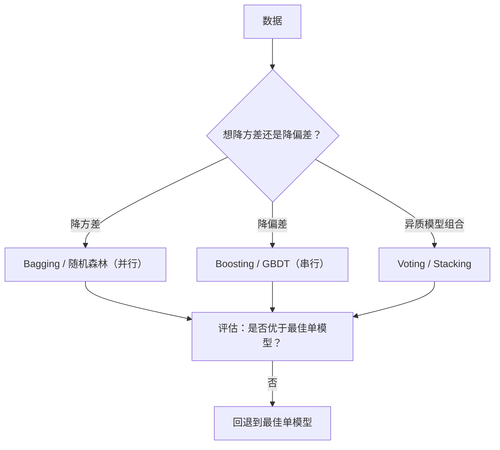

# ML-050 集成学习基本思想

## 1. 本节学习目标

1. 说清 Bagging 与 Boosting 的**根本差别**（降方差 vs 降偏差）。
2. 会用 `VotingClassifier`（hard/soft）与 `BaggingClassifier`。
3. **理解"集成不一定胜过最好的单模型"**（本课实测：soft voting 0.8533 < KNN 0.89）。
4. 知道集成为什么有效、什么时候会失效。

## 2. 为什么需要这个知识

因为"三个臭皮匠顶个诸葛亮"这句话**是有条件的**。

集成之所以有效，前提是**基模型要"好而不同"**：各自有一定准确率，且犯的错不完全重叠。如果基模型都差不多（高度相关），或者其中有一个明显更强，集成反而会拖后腿。

本课会实测出**集成不如最佳单模型**的情况，这个反例比"集成总是更好"更有教学价值。

## 3. 直观解释

| 范式 | 做法 | 主要降低 |
|---|---|---|
| **Bagging**（并行） | 有放回采样多份数据，各训一个模型，投票/平均 | **方差** |
| **Boosting**（串行） | 一个个训，每个修正前一个的错误 | **偏差** |
| **Stacking** | 用元模型学习"怎么组合" | 两者 |

**为什么 Bagging 降方差**：每个模型看到的是略有不同的数据，它们的错误方向不同，平均后方差被抵消。

**为什么 Boosting 降偏差**：每个新模型专注前一轮的残差，逐步逼近真实函数。

## 4. 正式定义

**Bagging 的预测**

$$
\hat y = \frac{1}{M}\sum_{m=1}^{M}\hat f_m(\mathbf{x})
$$

**方差缩减**（假设各模型方差 $\sigma^2$、两两相关系数 $\rho$）

$$
\operatorname{Var}\Big(\frac{1}{M}\sum_m \hat f_m\Big)
= \rho\sigma^2 + \frac{1-\rho}{M}\sigma^2
$$

**关键**：$M\to\infty$ 后方差趋近 $\rho\sigma^2$。**若 $\rho$ 高（模型太像），集成帮助有限。**

**Boosting 的加法模型**

$$
F_M(\mathbf{x}) = \sum_{m=1}^{M}\nu\, f_m(\mathbf{x})
$$

$\nu$ 是学习率（shrinkage）。

**Voting**

| 方式 | 规则 |
|---|---|
| hard | 多数票 |
| soft | 平均概率后取最大 |

## 5. 核心原理

**集成为什么有效**：

1. 基模型**准确率 > 0.5**（弱学习器也行）。
2. 基模型**错误不相关**（多样性）。

**多样性从哪来**：

| 手段 | 用于 |
|---|---|
| 样本扰动（bootstrap） | Bagging / RF |
| 特征扰动（随机选特征） | 随机森林 |
| 模型类型不同 | Voting / Stacking |
| 权重调整（重加权） | AdaBoost |

**本课的诚实反例**：三个基模型（LR 0.81、KNN 0.89、NB 0.8233）做 soft voting 只得 **0.8533**，**低于最好的 KNN（0.89）**。

原因：KNN 明显更强，而 LR/NB 的"票"把它拉低了。**当基模型水平差异大时，平均会伤害最强的那个。**

## 6. 数学表达式

**本课实验**（1000 样本，20 特征，70/30 划分）

**单模型**

| 模型 | 测试准确率 |
|---|---|
| 逻辑回归 | 0.8100 |
| KNN($k=7$) | **0.8900** |
| 高斯朴素贝叶斯 | 0.8233 |

**Voting**

| 方式 | 测试准确率 |
|---|---|
| hard | 0.8400 |
| soft | 0.8533 |

**树与集成**

| 模型 | 测试准确率 |
|---|---|
| 单棵决策树 | 0.7967 |
| Bagging（50 棵树） | 0.8200 |
| 随机森林（100 棵） | **0.8667** |
| GBDT（100 棵） | 0.8500 |

**两张表放在一起看**：

- 同质集成（树 + Bagging/RF/GBDT）：**全部优于单树**（0.7967 → 0.82/0.8667/0.85）。
- 异质集成（LR+KNN+NB）：**不如最好的单模型**（0.89 → 0.8533）。

## 7. 数学库链接

| 用到的数学 | 对应篇目 | 用在哪 |
|---|---|---|
| 期望与方差 | [[MATH-306 期望、方差与协方差]] | 方差缩减公式 |
| 相关系数 | [[MATH-306 期望、方差与协方差]] | $\rho$ 决定集成上限 |
| 加权平均 | [[MATH-306 期望、方差与协方差]] | soft voting |

## 8. 算法执行流程



## 9. 可视化解释

```text
Bagging（并行）              Boosting（串行）
数据1 → 模型1 ┐              模型1 → 残差
数据2 → 模型2 ├→ 平均/投票     ↓
数据3 → 模型3 ┘              模型2 → 残差
                             ↓
                            模型3 → 求和
误差方向不同 ⇒ 抵消          逐步修正 ⇒ 逼近
```

## 10. Python 实现

```powershell
python ml050_ensemble_intro.py
```

```python
from sklearn.datasets import make_classification
from sklearn.ensemble import (BaggingClassifier, GradientBoostingClassifier,
                              RandomForestClassifier, VotingClassifier)
from sklearn.linear_model import LogisticRegression
from sklearn.model_selection import train_test_split
from sklearn.naive_bayes import GaussianNB
from sklearn.neighbors import KNeighborsClassifier
from sklearn.pipeline import Pipeline
from sklearn.preprocessing import StandardScaler
from sklearn.tree import DecisionTreeClassifier

X, y = make_classification(n_samples=1000, n_features=20, n_informative=10,
                           random_state=3)
X_train, X_test, y_train, y_test = train_test_split(
    X, y, test_size=0.3, random_state=42, stratify=y)

base = [("lr", LogisticRegression(max_iter=1000)),
        ("knn", KNeighborsClassifier(7)),
        ("nb", GaussianNB())]

single = {}
for name, model in base:
    pipe = Pipeline([("sc", StandardScaler()), ("m", model)]).fit(X_train, y_train)
    single[name] = pipe.score(X_test, y_test)
print("单模型:", {k: round(v, 4) for k, v in single.items()})

wrapped = [(n, Pipeline([("sc", StandardScaler()), ("m", m)])) for n, m in base]
hard = VotingClassifier(wrapped, voting="hard").fit(X_train, y_train)
soft = VotingClassifier(wrapped, voting="soft").fit(X_train, y_train)
print("hard voting:", round(hard.score(X_test, y_test), 4))
print("soft voting:", round(soft.score(X_test, y_test), 4))

tree = DecisionTreeClassifier(random_state=42).fit(X_train, y_train)
bagging = BaggingClassifier(DecisionTreeClassifier(random_state=42),
                            n_estimators=50, random_state=42).fit(X_train, y_train)
rf = RandomForestClassifier(n_estimators=100, random_state=42).fit(X_train, y_train)
gbdt = GradientBoostingClassifier(n_estimators=100, random_state=42).fit(X_train, y_train)
for name, model in (("单树", tree), ("Bagging(50)", bagging),
                    ("随机森林(100)", rf), ("GBDT(100)", gbdt)):
    print(f"{name:<14} test={model.score(X_test, y_test):.4f}")
```

**实际运行结果**

```
单模型: {'lr': 0.81, 'knn': 0.89, 'nb': 0.8233}
hard voting: 0.84
soft voting: 0.8533
单树             test=0.7967
Bagging(50)    test=0.82
随机森林(100)      test=0.8667
GBDT(100)      test=0.85
```

## 11. 代码逐行解释

| 代码 | 作用 |
|---|---|
| `VotingClassifier(..., voting="hard")` | 多数票 |
| `voting="soft"` | 平均 `predict_proba` 后取最大 |
| `BaggingClassifier(tree, n_estimators=50)` | 50 棵树各训 bootstrap 样本 |
| `RandomForestClassifier` | Bagging + 随机特征选择 |
| `GradientBoostingClassifier` | 串行拟合残差 |

**`soft` 为什么通常优于 `hard`**：soft 用概率，保留了"置信度"信息；hard 只看 0/1 票。但本课 soft（0.8533）仍不如 KNN（0.89）——**投票方式不解决"基模型差异过大"的根本问题**。

## 12. 实际运行结果

见第 10 节。三点：

1. **异质集成不如最佳单模型**：soft 0.8533 < KNN 0.89。
2. **同质集成全部优于单树**：0.7967 → 0.8667（随机森林）。
3. 随机森林 > Bagging > GBDT > 单树（在本数据与参数下）。

## 13. 适用场景

| 场景 | 推荐 |
|---|---|
| 单模型过拟合（高方差） | Bagging / 随机森林 |
| 单模型欠拟合（高偏差） | Boosting / GBDT |
| 基模型水平相当、错误互补 | Voting / Stacking |
| 基模型差异大 | **直接用最好的那个** |
| 表格数据 | 随机森林 / GBDT 系列 |
| 需要可解释 | 单模型 + 特征重要性 |

## 14. 优点与缺点

| 范式 | 优点 | 缺点 |
|---|---|---|
| Bagging | 降方差、易并行、抗噪 | 不降偏差（基模型弱则仍弱） |
| Boosting | 降偏差、精度高 | 串行慢、对噪声敏感、易过拟合 |
| Voting | 简单、无需额外训练 | 基模型差异大时反而变差 |
| Stacking | 能学"怎么组合" | 复杂度高、易泄漏（必须嵌套 CV） |

## 15. 常见错误

| 错误 | 表现 | 纠正 |
|---|---|---|
| 认为集成必然更好 | 本课 0.8533 < 0.89 | 先比最佳单模型 |
| 基模型都同质 | 集成≈单个 | 增加多样性 |
| Stacking 不嵌套 CV | 严重泄漏 | 用嵌套 CV |
| Bagging 用于高偏差 | 无改善 | 换 Boosting |
| Boosting 不调学习率 | 过拟合 | 调小 `learning_rate` |
| 忽略推理成本 | 100 棵树慢 100 倍 | 按延迟要求选 |

## 16. 本节总结

- Bagging **降方差**（并行），Boosting **降偏差**（串行）。
- 集成有效性取决于**基模型的准确率与多样性**；方差缩减上限是 $\rho\sigma^2$。
- **集成不一定胜过最好的单模型**——本课 soft voting 0.8533 < KNN 0.89。

## 17. 前置与后续

- 前置：[[ML-049 数据泄漏与评估陷阱]]、[[ML-046 过拟合与欠拟合]]
- 后续：`ML-051 Bagging 与随机森林`、`ML-053 AdaBoost`、`ML-054 梯度提升树 GBDT`、`ML-056 Stacking 与 Voting`
- 相关数学：[[MATH-306 期望、方差与协方差]]

## 18. 练习与参考答案

**基础 1**：Bagging 与 Boosting 的核心区别是什么？各降什么？

**基础 2**：本课三个基模型、hard/soft voting 的准确率各是多少？

**进阶 1**：为什么本课 soft voting（0.8533）不如 KNN（0.89）？

**综合 1**：同质集成（单树 → Bagging → RF → GBDT）与异质集成（LR+KNN+NB）结果为何相反？

> [!success]- 参考答案

> **基础 1**
> - **Bagging**：并行，各模型在不同 bootstrap 样本上独立训练，最后平均/投票 ⇒ **降方差**。
> - **Boosting**：串行，每个模型专注修正前一个的残差 ⇒ **降偏差**。

> **基础 2**
> 单模型：LR **0.8100**、KNN **0.8900**、NB **0.8233**。
> hard voting **0.8400**、soft voting **0.8533**。

> **进阶 1**
> 因为三个基模型**水平差异太大**：KNN 0.89 明显强于 LR 0.81 与 NB 0.8233。
> soft voting 平均三者概率，相当于把两个较弱模型的"意见"等权混进来，把 KNN 的优势稀释了。
> 集成的方差缩减上限是 $\rho\sigma^2$；当基模型强弱悬殊时，"等权平均"不是好策略（此时该用加权投票或 Stacking）。

> **综合 1**
> - **同质集成**：单树 0.7967 是**高方差**模型（完全生长的树方差大）。Bagging/RF 用 bootstrap + 特征随机降方差 ⇒ 全部提升（0.82 / 0.8667）。GBDT 降偏差，也有提升（0.85）。**方向对，所以有效。**
> - **异质集成**：三个模型水平差距大（0.81 / 0.89 / 0.8233），等权投票反而拖累最强的 KNN ⇒ 0.8533 < 0.89。**方向不对，所以有害。**
> 结论：**集成前先确认"基模型是否水平相当、错误是否互补"**，否则不如直接用最好的单模型。

---

## 🔗 Notion 同步信息

> 以下内容由 Notion「AI Knowledge System · 知识点」数据库按知识 ID 合并而来（导出于 2026-11-09）。

| 属性 | 值 |
|---|---|
| 学科 | 机器学习 |
| 学习状态 | 未开始 |
| 难度 | L2 应用 |
| 知识类型 | Concept |

- **所属模块**：[M-ML-07 集成学习与高级算法](../%E8%AF%BE%E7%A8%8B%E6%A8%A1%E5%9D%97/M-ML-07%20%E9%9B%86%E6%88%90%E5%AD%A6%E4%B9%A0%E4%B8%8E%E9%AB%98%E7%BA%A7%E7%AE%97%E6%B3%95.md)
- **前置知识**：[ML-049 数据泄漏与评估陷阱](../04%20%E6%A8%A1%E5%9E%8B%E8%AF%84%E4%BC%B0/ML-049%20%E6%95%B0%E6%8D%AE%E6%B3%84%E6%BC%8F%E4%B8%8E%E8%AF%84%E4%BC%B0%E9%99%B7%E9%98%B1.md)
- **后继知识**：[ML-051 Bagging 与随机森林](ML-051%20Bagging%20%E4%B8%8E%E9%9A%8F%E6%9C%BA%E6%A3%AE%E6%9E%97.md)
- **关联Python**：[PY-067 聚合与统计](../../01_Python%E5%9F%BA%E7%A1%80/08%20NumPy/PY-067%20%E8%81%9A%E5%90%88%E4%B8%8E%E7%BB%9F%E8%AE%A1.md)
- **关联数学**：[MATH-306 期望、方差与协方差](../../06_%E6%95%B0%E5%AD%A6%E5%9F%BA%E7%A1%80/03%20%E6%A6%82%E7%8E%87%E8%AE%BA/MATH-306%20%E6%9C%9F%E6%9C%9B%E3%80%81%E6%96%B9%E5%B7%AE%E4%B8%8E%E5%8D%8F%E6%96%B9%E5%B7%AE.md)
