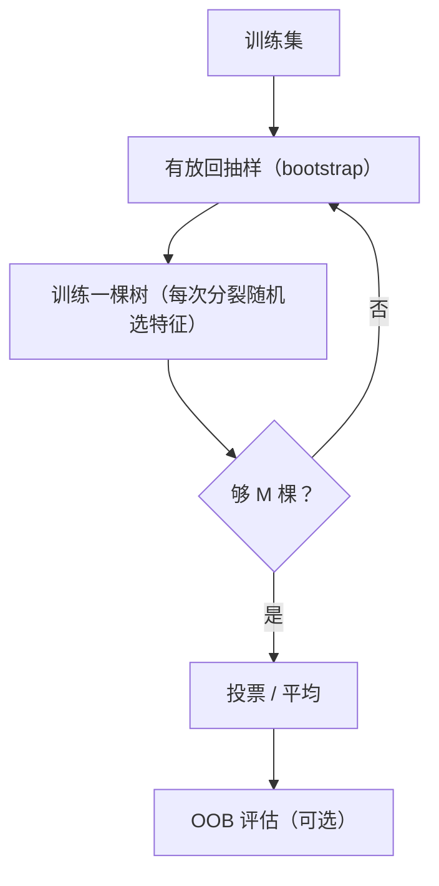

# ML-051 Bagging 与随机森林

## 1. 本节学习目标

1. 说清 Bagging 的两步（bootstrap 采样 + 聚合）与它为什么降方差。
2. 说清随机森林相比 Bagging 多做了什么（**特征随机**），以及为什么这很关键。
3. 会用 `oob_score` 做"几乎免费"的验证。
4. 会读 `feature_importances_` 并知道它的局限。

## 2. 为什么需要这个知识

单棵决策树是**高方差**模型：数据稍微一变，树结构可能完全不同。Bagging 用"多棵树投票"把这个方差压下去。

而随机森林在 Bagging 基础上加了**特征随机**，让树之间更不相似——这是它成为"表格数据默认基线"的原因。

## 3. 直观解释

**Bagging**（Bootstrap Aggregating）：

1. 从训练集**有放回**抽 $n$ 个样本，得到一份新数据集（约 63% 原样本被抽到）。
2. 在这份数据上训一棵树。
3. 重复 $M$ 次，得到 $M$ 棵树。
4. 分类投票、回归平均。

**随机森林**：在 Bagging 之上，每次**分裂时只看随机选的一部分特征**（默认 $\sqrt{d}$ 个）。

**为什么要这一步**：如果数据里有一个极强的特征，Bagging 的每棵树都会用它做根节点 ⇒ 树们高度相似 ⇒ 方差降不下来。特征随机强制树"看不同的东西"。

## 4. 正式定义

**Bagging 的聚合**

$$
\hat y = \operatorname{mode}\Big(\{f_m(\mathbf{x})\}_{m=1}^{M}\Big)
$$

**方差缩减**

$$
\operatorname{Var}\Big(\frac1M\sum_m \hat f_m\Big) = \rho\sigma^2 + \frac{1-\rho}{M}\sigma^2
$$

**关键**：$M$ 增大只能消掉第二项；第一项 $\rho\sigma^2$ 由**模型相关性**决定。

**随机森林做的**：用特征随机降低 $\rho$ ⇒ 连第一项也被压低。

**OOB（Out-of-Bag）**：每个样本约有 $1/3$ 概率**没被**某棵树的 bootstrap 抽到 ⇒ 可用"没见过它的树"来预测它 ⇒ 免费得到一份近似验证集。

$$
\text{OOB} = \frac{1}{n}\sum_i \mathbb{1}\Big[\operatorname{mode}\big(\{f_m(\mathbf{x}_i): i\notin \text{boot}_m\}\big) = y_i\Big]
$$

## 5. 核心原理

**为什么默认 `max_features="sqrt"`**：$d$ 个特征里挑 $\sqrt{d}$ 个，既保证多样性，又不会让单棵树太弱。

**为什么 `n_estimators` 越大越好（但有边际递减）**：更多树 ⇒ 第二项更小；但树太多只是浪费时间，测试分不再涨。

**本课实测**（2000 样本，20 特征，70/30）

| 模型 | 测试准确率 |
|---|---|
| 单树 | 0.8267 |
| Bagging $M=10$ | 0.8933 |
| Bagging $M=200$ | 0.9000 |
| RF $M=10$ | 0.8850 |
| RF $M=50$ | 0.9100 |
| RF $M=200$ | **0.9117** |

**读法**：Bagging 把 0.8267 提到 0.90；RF 再提到 0.9117。**特征随机带来了额外 1.2 个百分点。**

**OOB 分数 0.9257** 略高于测试集 0.9117——两者都是估计，差异在正常波动内。

## 6. 数学表达式

**`max_features` 的影响**

| 设置 | 测试准确率 |
|---|---|
| `"sqrt"`（默认，$\sqrt{20}\approx4$） | 0.9083 |
| `"log2"`（$\log_2 20\approx4$） | 0.9083 |
| `0.5`（10 个特征） | 0.9033 |

**读法**：取太多特征（0.5）反而略降（0.9033），因为树之间又变相似了。

**特征重要性前 5**：索引 `[7, 15, 14, 4, 13]`

## 7. 数学库链接

| 用到的数学 | 对应篇目 | 用在哪 |
|---|---|---|
| 方差与相关系数 | [[MATH-306 期望、方差与协方差]] | 方差缩减公式 |
| 有放回抽样 | [[MATH-301 概率基础与条件概率]] | bootstrap |
| 组合数 | [[MATH-504 排列组合与递归]] | 未被抽到的概率 $(1-1/n)^n\approx e^{-1}$ |

## 8. 算法执行流程



## 9. 可视化解释

```text
Bagging：数据不同，特征相同      随机森林：数据不同 + 特征不同
树1 [全部特征]                  树1 [f2,f7,f9]
树2 [全部特征]                  树2 [f1,f5,f8]
树3 [全部特征]                  树3 [f3,f6,f7]
   ↑ 若 f7 极强 ⇒ 三棵树都用      ↑ 强制看不同特征
     树高度相似 ⇒ ρ 大             树更不同 ⇒ ρ 小
```

## 10. Python 实现

```powershell
python ml051_bagging_rf.py
```

```python
import numpy as np
from sklearn.datasets import make_classification
from sklearn.ensemble import BaggingClassifier, RandomForestClassifier
from sklearn.model_selection import train_test_split
from sklearn.tree import DecisionTreeClassifier

X, y = make_classification(n_samples=2000, n_features=20, n_informative=12,
                           n_redundant=4, random_state=42)
X_train, X_test, y_train, y_test = train_test_split(
    X, y, test_size=0.3, random_state=42, stratify=y)

tree = DecisionTreeClassifier(random_state=42).fit(X_train, y_train)
print("单树:", round(tree.score(X_test, y_test), 4))

for n in (10, 50, 200):
    bag = BaggingClassifier(DecisionTreeClassifier(random_state=42),
                            n_estimators=n, random_state=42).fit(X_train, y_train)
    print(f"Bagging n={n}: {bag.score(X_test, y_test):.4f}")

for n in (10, 50, 200):
    rf = RandomForestClassifier(n_estimators=n, random_state=42).fit(X_train, y_train)
    print(f"RF n={n}: {rf.score(X_test, y_test):.4f}")

rf_oob = RandomForestClassifier(n_estimators=100, oob_score=True,
                                random_state=42).fit(X_train, y_train)
print("OOB 分数:", round(float(rf_oob.oob_score_), 4))

for mf in ("sqrt", "log2", 0.5):
    rf = RandomForestClassifier(n_estimators=100, max_features=mf,
                                random_state=42).fit(X_train, y_train)
    print(f"max_features={mf}: {rf.score(X_test, y_test):.4f}")

print("特征重要性前 5:", np.argsort(rf_oob.feature_importances_)[-5:].tolist())
```

**实际运行结果**

```
单树: 0.8267
Bagging n=10: 0.8933
Bagging n=50: 0.8933
Bagging n=200: 0.9000
RF n=10: 0.8850
RF n=50: 0.9100
RF n=200: 0.9117
OOB 分数: 0.9257
max_features=sqrt: 0.9083
max_features=log2: 0.9083
max_features=0.5: 0.9033
特征重要性前 5: [7, 15, 14, 4, 13]
```

## 11. 代码逐行解释

| 代码 | 作用 |
|---|---|
| `BaggingClassifier(tree, n_estimators=n)` | 纯 Bagging（特征全用） |
| `RandomForestClassifier(...)` | Bagging + 特征随机 |
| `oob_score=True` | 用袋外样本估准确率 |
| `max_features="sqrt"` | 每次分裂看 $\sqrt{d}$ 个特征 |
| `feature_importances_` | 不纯度下降的归一化贡献 |

**OOB 为什么"几乎免费"**：每棵树训练时约有 37% 的样本没被抽到，这些样本就是它天然的验证集。不用额外划分就能估泛化。

## 12. 实际运行结果

见第 10 节。三点：

1. **RF > Bagging > 单树**（0.9117 > 0.9000 > 0.8267）。
2. OOB 0.9257 略高于测试 0.9117——都是估计，属正常范围。
3. `max_features=0.5` 反而降到 0.9033 ⇒ **特征随机不能关太多**。

## 13. 适用场景

| 场景 | 说明 |
|---|---|
| 表格数据基线 | **首选随机森林** |
| 需要特征重要性 | 直接用 |
| 有噪声/异常值 | 比单树稳 |
| 高维稀疏（文本） | 不如线性模型 |
| 需要极低延迟 | 树多会慢，考虑减 `n_estimators` |

## 14. 优点与缺点

| 优点 | 缺点 |
|---|---|
| 降方差、抗过拟合 | 可解释性弱于单树 |
| 几乎不用调参 | 模型大、推理慢 |
| 能估特征重要性 | 高维稀疏数据效果差 |
| OOB 免费验证 | 不能外推（叶子是常数） |

## 15. 常见错误

| 错误 | 表现 | 纠正 |
|---|---|---|
| `max_features` 设太大 | 树变相似，退化成 Bagging | 保持 `sqrt` |
| `n_estimators` 设太小 | 方差没降够 | 100–500 |
| 拿重要性当因果 | 相关≠因果 | 只作排序参考 |
| 认为 OOB = 测试集 | 两者口径不同 | OOB 用于快速评估 |
| 不设 `random_state` | 结果不可复现 | 固定种子 |
| 对高维稀疏用 RF | 效果差 | 换线性/GBDT |

## 16. 本节总结

- Bagging = **bootstrap + 聚合**，降方差；随机森林再加**特征随机**降低树间相关性。
- 本课 RF 0.9117 > Bagging 0.9000 > 单树 0.8267。
- OOB 是"几乎免费"的验证；`max_features` 别调太大。

## 17. 前置与后续

- 前置：[[ML-050 集成学习基本思想]]
- 后续：[[ML-052 Extra Trees]]、`ML-053 AdaBoost`、`ML-057 特征重要性与模型解释`（待建）
- 相关数学：[[MATH-306 期望、方差与协方差]]、[[MATH-301 概率基础与条件概率]]

## 18. 练习与参考答案

**基础 1**：Bagging 的两步是什么？它主要降低偏差还是方差？

**基础 2**：本课单树、Bagging(200)、RF(200) 的准确率各是多少？

**进阶 1**：随机森林相对 Bagging 多了什么？为什么这一步能带来提升？

**综合 1**：本课 `max_features=0.5` 时准确率反而下降，怎么解释？

> [!success]- 参考答案

> **基础 1**
> ① 有放回抽样（bootstrap）生成多份数据；② 各自训练后聚合（投票/平均）。
> 主要降低**方差**（不降偏差，基模型弱则整体仍弱）。

> **基础 2**
> 单树 **0.8267**；Bagging(200) **0.9000**；RF(200) **0.9117**。

> **进阶 1**
> 多了**特征随机**：每次分裂只从随机子集（默认 $\sqrt{d}$）里选最优特征。
> 为什么有效：若某特征极强，Bagging 的每棵树都会用它做根 ⇒ 树高度相似（$\rho$ 大）⇒ 方差缩减公式里 $\rho\sigma^2$ 这一项压不下去。特征随机强制树看不同特征，降低 $\rho$，从而降低集成方差的上限。

> **综合 1**
> `max_features=0.5` 意味着每次分裂从 10 个特征里选（共 20 个），随机性变弱 ⇒ 树之间又变得相似 ⇒ $\rho$ 上升 ⇒ 集成收益下降。
> 本课数据：sqrt 0.9083、0.5 只有 0.9033。**特征随机要"够随机"才有效**，但也不能太极端（如 1 个特征会严重欠拟合）。

---

## 🔗 Notion 同步信息

> 以下内容由 Notion「AI Knowledge System · 知识点」数据库按知识 ID 合并而来（导出于 2026-11-09）。

| 属性 | 值 |
|---|---|
| 学科 | 机器学习 |
| 学习状态 | 未开始 |
| 难度 | L2 应用 |
| 知识类型 | Algorithm |

- **所属模块**：[M-ML-07 集成学习与高级算法](../%E8%AF%BE%E7%A8%8B%E6%A8%A1%E5%9D%97/M-ML-07%20%E9%9B%86%E6%88%90%E5%AD%A6%E4%B9%A0%E4%B8%8E%E9%AB%98%E7%BA%A7%E7%AE%97%E6%B3%95.md)
- **前置知识**：[ML-050 集成学习基本思想](ML-050%20%E9%9B%86%E6%88%90%E5%AD%A6%E4%B9%A0%E5%9F%BA%E6%9C%AC%E6%80%9D%E6%83%B3.md)
- **后继知识**：[ML-052 Extra Trees](ML-052%20Extra%20Trees.md)
- **关联Python**：[PY-067 聚合与统计](../../01_Python%E5%9F%BA%E7%A1%80/08%20NumPy/PY-067%20%E8%81%9A%E5%90%88%E4%B8%8E%E7%BB%9F%E8%AE%A1.md)
- **关联数学**：[MATH-306 期望、方差与协方差](../../06_%E6%95%B0%E5%AD%A6%E5%9F%BA%E7%A1%80/03%20%E6%A6%82%E7%8E%87%E8%AE%BA/MATH-306%20%E6%9C%9F%E6%9C%9B%E3%80%81%E6%96%B9%E5%B7%AE%E4%B8%8E%E5%8D%8F%E6%96%B9%E5%B7%AE.md)
