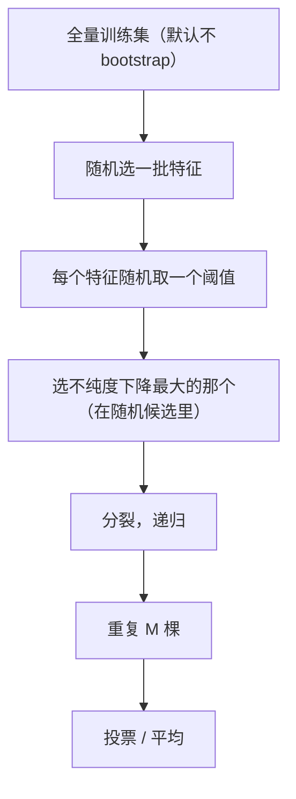

# ML-052 Extra Trees

## 1. 本节学习目标

1. 说清 Extra Trees（ET）与随机森林的**唯一关键差别**：切分点是否随机。
2. 理解这个差别带来的两个后果：**更快**、**方差更大**。
3. 会用本课实测数据比较二者（ET 0.9383 vs RF 0.9083，ET 还快一倍）。
4. 知道什么时候 ET 更好、什么时候 RF 更好。

## 2. 为什么需要这个知识

因为"随机森林是默认选择"不代表它总最好。

ET 通过**更激进的随机化**换来速度和多样性，在某些数据上反而更准。理解它俩的差别只有一个点，但影响很大——这是"用更少的计算换更多随机性"的典型案例。

## 3. 直观解释

两者都是"很多棵树 + 特征随机"，唯一区别在**怎么选切分点**：

| 模型 | 切分点选择 |
|---|---|
| 随机森林 | 在候选特征上**找最优阈值**（穷举或近似） |
| **Extra Trees** | 在候选特征上**随机取一个阈值**，不再找最优 |

一句话：**RF 在每个特征上"挑最好的刀口"，ET"随手切一刀"**。

**为什么这样反而可能更好**：

- 不找最优 ⇒ 计算量显著降低（更快）。
- 切分更随机 ⇒ 单棵树偏差略升、但树间多样性更大 ⇒ 集成后方差更低。

## 4. 正式定义

**随机森林的切分**

$$
(s^*, t^*) = \arg\min_{s\in S_{rand},\ t}\ \text{不纯度}\big(\text{左}(s,t)\big)+\text{不纯度}\big(\text{右}(s,t)\big)
$$

**Extra Trees 的切分**

$$
s \sim \text{Uniform}(S_{rand}),\qquad t \sim \text{Uniform}\big(\min x_s,\ \max x_s\big)
$$

**即：特征随机选，阈值也随机选。**

| 方面 | RF | ET |
|---|---|---|
| 特征随机 | ✅ | ✅ |
| 阈值最优 | ✅ | ❌（随机） |
| bootstrap | ✅ | ❌（默认用全量数据） |
| 速度 | 较慢 | **较快** |
| 偏差 | 较低 | 略高 |
| 方差 | 略高 | **较低** |

> 注意：`ExtraTreesClassifier` 的 `bootstrap` 默认是 **False**，即每棵树用**全量训练数据**、只靠特征+阈值随机来制造差异。

## 5. 核心原理

**为什么 ET 更快**：不用遍历所有候选阈值找最优，只需随机抽一个。分裂点数不变，但每次分裂的常数成本大幅降低。

**为什么 ET 方差可能更低**：随机阈值让树更"不像"，$\rho$ 更小；同时每棵树用全量数据（无 bootstrap）⇒ 每棵树的偏差更小。

**本课实测**（2000 样本，20 特征）

| 模型 | 测试准确率 | 耗时 |
|---|---|---|
| RF(100) | 0.9083 | 0.20 s |
| **Extra Trees(100)** | **0.9383** | **0.11 s** |

**ET 既更准又快近一倍**。但这个结果**依赖数据**，不是普遍规律。

**`min_samples_leaf` 的影响**

| `min_samples_leaf` | RF | ET |
|---|---|---|
| 1 | 0.9083 | **0.9383** |
| 5 | 0.8900 | 0.9267 |

增大叶子样本数后两者都降，ET 仍占优。

## 6. 数学表达式

**本课对照**

$$
\text{Acc}_{RF}=0.9083,\qquad \text{Acc}_{ET}=0.9383
$$

$$
\Delta = +0.0300
$$

**耗时比**

$$
\frac{t_{RF}}{t_{ET}} = \frac{0.20}{0.11}\approx 1.8
$$

**ET 的随机性来源**

$$
\rho_{ET} < \rho_{RF}\ \Rightarrow\ \operatorname{Var}_{ET}<\operatorname{Var}_{RF}
$$

（方差的第二项 $=\rho\sigma^2$，$\rho$ 小则上限低）

## 7. 数学库链接

| 用到的数学 | 对应篇目 | 用在哪 |
|---|---|---|
| 均匀分布 | [[MATH-303 随机变量与分布函数]] | 随机阈值 |
| 方差与相关系数 | [[MATH-306 期望、方差与协方差]] | $\rho\sigma^2$ |
| 不纯度（Gini/熵） | [[MATH-506 信息量与熵]] | 切分质量 |

## 8. 算法执行流程



## 9. 可视化解释

```text
RF：特征 f3 上候选阈值         ET：特征 f3 上直接随机一个
 1.2 2.5 3.8 4.1 5.6            ✗ 随机抽到 4.7
   ↑ 逐个算增益，选最好            ↑ 不比较，直接用
 慢但准                          快但更随机
```

## 10. Python 实现

```powershell
python ml052_extra_trees.py
```

```python
import time

from sklearn.datasets import make_classification
from sklearn.ensemble import ExtraTreesClassifier, RandomForestClassifier
from sklearn.model_selection import train_test_split

X, y = make_classification(n_samples=2000, n_features=20, n_informative=12,
                           n_redundant=4, random_state=42)
X_train, X_test, y_train, y_test = train_test_split(
    X, y, test_size=0.3, random_state=42, stratify=y)

for name, Model in (("RandomForest", RandomForestClassifier),
                    ("ExtraTrees", ExtraTreesClassifier)):
    start = time.time()
    model = Model(n_estimators=100, random_state=42).fit(X_train, y_train)
    print(f"{name:<13} test={model.score(X_test, y_test):.4f}"
          f" 耗时={time.time() - start:.2f}s")

for leaf in (1, 5):
    for name, Model in (("RF", RandomForestClassifier),
                        ("ET", ExtraTreesClassifier)):
        model = Model(n_estimators=100, min_samples_leaf=leaf,
                      random_state=42).fit(X_train, y_train)
        print(f"leaf={leaf} {name}: {model.score(X_test, y_test):.4f}")
```

**实际运行结果**

```
RandomForest  test=0.9083 耗时=0.20s
ExtraTrees    test=0.9383 耗时=0.11s
leaf=1 RF: 0.9083
leaf=1 ET: 0.9383
leaf=5 RF: 0.8900
leaf=5 ET: 0.9267
```

## 11. 代码逐行解释

| 代码 | 作用 |
|---|---|
| `ExtraTreesClassifier(n_estimators=100)` | 100 棵极端随机树 |
| `random_state=42` | 固定随机性（ET 随机性更强，更要固定种子） |
| `min_samples_leaf=leaf` | 控制叶子大小（正则化） |
| `time.time()` 包住 fit | 粗略计时（单机、单次，仅供量级参考） |

**计时说明**：本课耗时是**单次运行**的粗略值（0.20 s vs 0.11 s），受机器负载影响，只应看"量级差别"，不应把 1.8 倍当作精确基准。

## 12. 实际运行结果

见第 10 节。三点：

1. **ET 0.9383 > RF 0.9083**（+3.0 点）。
2. **ET 更快**（0.11 s vs 0.20 s，约 1.8 倍）。
3. `min_samples_leaf=5` 时两者都降，ET 仍领先（0.9267 vs 0.8900）。

**必须说明**：这里的"ET 更好"是**这份数据 + 这组参数**的结论。在别的数据上 RF 常常更好。**不要把它当成普遍规律。**

## 13. 适用场景

| 场景 | 建议 |
|---|---|
| 特征多、训练要快 | ET |
| 需要更强正则/更平滑 | RF |
| 数据有噪声标签 | RF（ET 随机性强，可能放大噪声） |
| 高维稀疏 | 两者都不理想 |
| 想快速拿基线 | ET（快） |

## 14. 优点与缺点

| 模型 | 优点 | 缺点 |
|---|---|---|
| Extra Trees | 快、方差低、参数少 | 偏差略高；对噪声更敏感 |
| Random Forest | 偏差更低、更稳 | 慢一些 |

## 15. 常见错误

| 错误 | 表现 | 纠正 |
|---|---|---|
| 认为 ET 一定更好 | 本课只是这份数据的结论 | 用 CV 比较 |
| 以为 ET 也做 bootstrap | 实际默认 `bootstrap=False` | 需要时显式设 True |
| 不固定 `random_state` | ET 随机性强，结果波动大 | 固定种子 |
| 用 ET 做精细特征重要性 | 随机阈值让重要性更 noisy | 用 RF 或多次平均 |
| 只看单次计时 | 受负载影响 | 多次测量取中位数 |

## 16. 本节总结

- ET 与 RF 的唯一关键差别：**切分阈值随机 vs 最优**。
- 后果：ET **更快**、**方差更低**，但**偏差略高**。
- 本课 ET 0.9383/0.11s vs RF 0.9083/0.20s —— 但**不可外推**。

## 17. 前置与后续

- 前置：[[ML-051 Bagging 与随机森林]]
- 后续：`ML-053 AdaBoost`、`ML-054 梯度提升树 GBDT`
- 相关数学：[[MATH-303 随机变量与分布函数]]、[[MATH-306 期望、方差与协方差]]

## 18. 练习与参考答案

**基础 1**：Extra Trees 与随机森林的核心差别是什么？

**基础 2**：本课两者的准确率与耗时各是多少？

**进阶 1**：为什么"随机阈值"会让模型更快，但也可能让偏差变大？

**综合 1**：你会怎么决定用 RF 还是 ET？

> [!success]- 参考答案

> **基础 1**
> 切分点的选择方式：随机森林在候选特征上**找最优阈值**；Extra Trees **随机取一个阈值**，不做最优搜索。
> 附带差别：ET 默认 `bootstrap=False`（每棵树用全量数据）。

> **基础 2**
> RF：**0.9083**，0.20 s；ET：**0.9383**，0.11 s。

> **进阶 1**
> - 更快：不用遍历阈值计算增益，每次分裂只算一次不纯度。
> - 偏差可能变大：最优阈值能让单棵树更好地拟合数据；随机阈值牺牲了单棵树的拟合精度。
> 但集成后：更随机的树 ⇒ 相关性 $\rho$ 更低 ⇒ 方差上限 $\rho\sigma^2$ 更低，所以总误差可能反而更小（本课就是这样）。

> **综合 1**
> 用**交叉验证比较**，而不是凭直觉。步骤：
> 1. 两者都在同一份数据上做 5 折 CV；
> 2. 同时记录**训练耗时**与**预测延迟**；
> 3. 若精度接近（差异 < std），选更快/更简单的（通常 ET）；
> 4. 若数据噪声大或样本少，优先 RF（ET 随机性强，易受噪声影响）；
> 5. 最终在独立测试集确认一次。
> **不要用单次划分的 +3 点就下结论**——本课 0.03 的差距需要有 std 作参照。

---

## 🔗 Notion 同步信息

> 以下内容由 Notion「AI Knowledge System · 知识点」数据库按知识 ID 合并而来（导出于 2026-11-09）。

| 属性 | 值 |
|---|---|
| 学科 | 机器学习 |
| 学习状态 | 未开始 |
| 难度 | L2 应用 |
| 知识类型 | Algorithm |

- **所属模块**：[M-ML-07 集成学习与高级算法](../%E8%AF%BE%E7%A8%8B%E6%A8%A1%E5%9D%97/M-ML-07%20%E9%9B%86%E6%88%90%E5%AD%A6%E4%B9%A0%E4%B8%8E%E9%AB%98%E7%BA%A7%E7%AE%97%E6%B3%95.md)
- **前置知识**：[ML-051 Bagging 与随机森林](ML-051%20Bagging%20%E4%B8%8E%E9%9A%8F%E6%9C%BA%E6%A3%AE%E6%9E%97.md)
- **后继知识**：[ML-053 AdaBoost](ML-053%20AdaBoost.md)
- **关联Python**：[PY-067 聚合与统计](../../01_Python%E5%9F%BA%E7%A1%80/08%20NumPy/PY-067%20%E8%81%9A%E5%90%88%E4%B8%8E%E7%BB%9F%E8%AE%A1.md)
- **关联数学**：[MATH-306 期望、方差与协方差](../../06_%E6%95%B0%E5%AD%A6%E5%9F%BA%E7%A1%80/03%20%E6%A6%82%E7%8E%87%E8%AE%BA/MATH-306%20%E6%9C%9F%E6%9C%9B%E3%80%81%E6%96%B9%E5%B7%AE%E4%B8%8E%E5%8D%8F%E6%96%B9%E5%B7%AE.md)
