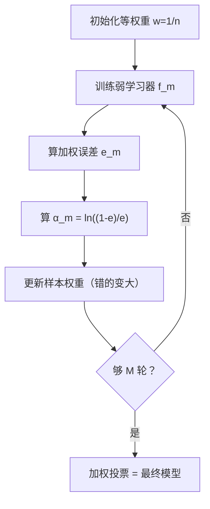

# ML-053 AdaBoost

## 1. 本节学习目标

1. 说清 AdaBoost 的三步循环：**加权训练 → 算权重 → 调样本权重**。
2. 写出估计器权重的公式 $\alpha=\frac12\ln\frac{1-e}{e}$，并解释"误差越小权重越大"。
3. 理解它**降偏差**（不是降方差），与 Bagging 相反。
4. 会用本课的 `estimator_weights_` / `estimator_errors_` 观察"后面的树越来越弱"。

## 2. 为什么需要这个知识

因为 AdaBoost 是**第一个实用的 Boosting 算法**，它把"弱学习器"（略好于随机）组合成强分类器——这个思想直接演化出 GBDT、XGBoost。

理解它的"重加权"机制，就理解了 Boosting 家族的核心：**让后面的模型专注前面做错的样本**。

## 3. 直观解释

AdaBoost 像一个**不断补课的学生**：

1. 第一轮：正常做题，把错的题标红。
2. 第二轮：**重点练红题**（提高错题权重）。
3. 第三轮：再练新的错题……

最后把各轮的"考试"结果**按成绩加权**汇总（考得好的那轮权重更大）。

**与 Bagging 的根本区别**：

| | Bagging | AdaBoost |
|---|---|---|
| 训练方式 | 并行（各自独立） | **串行**（后一个依赖前一个） |
| 数据 | bootstrap 重采样 | **重加权**同一份数据 |
| 主要降低 | 方差 | **偏差** |

## 4. 正式定义

**算法循环**（$M$ 轮）

1. 用样本权重 $w_i$ 训练弱学习器 $f_m$。
2. 算加权误差

$$
e_m = \frac{\sum_i w_i\,\mathbb{1}[f_m(\mathbf{x}_i)\ne y_i]}{\sum_i w_i}
$$

3. 算该学习器的权重

$$
\alpha_m = \frac12\ln\frac{1-e_m}{e_m}
$$

4. 更新样本权重

$$
w_i \leftarrow w_i\exp\big(-\alpha_m y_i f_m(\mathbf{x}_i)\big)
$$

（判对 ⇒ 权重乘 $e^{-\alpha}<1$ 变小；判错 ⇒ 乘 $e^{+\alpha}>1$ 变大）

5. 归一化后进入下一轮。

**最终预测**

$$
F(\mathbf{x}) = \operatorname{sign}\Big(\sum_{m=1}^{M}\alpha_m f_m(\mathbf{x})\Big)
$$

**$e_m$ 的约束**：必须 $<0.5$（否则该学习器不如随机，$\alpha_m\le0$）。

## 5. 核心原理

**为什么 $\alpha=\frac12\ln\frac{1-e}{e}$**：

| $e$ | $\alpha$ | 含义 |
|---|---|---|
| 0.5 | 0 | 等于随机，无贡献 |
| 0.3 | 0.42 | 有一定贡献 |
| 0.1 | 1.10 | 很强，权重大 |
| 0（完美） | $\infty$ | 理论上无限权重 |

**为什么它降偏差**：每一轮都在"修正前一轮的错误"，相当于逐步逼近真实函数。

**代价**：对**噪声和异常值极敏感**——错分样本的权重会被指数级放大，模型会死盯着几个标错的样本。

**本课实测**（2000 样本，20 特征，默认基学习器为决策树桩）

| 树数 | 测试准确率 |
|---|---|
| 10 | 0.8083 |
| 50 | 0.8650 |
| 200 | **0.8667** |

**`learning_rate` 的影响**

| 学习率 | 测试准确率 |
|---|---|
| 0.01 | 0.7900 |
| 0.1 | 0.8283 |
| 1.0 | **0.8667** |

学习率小 ⇒ 每轮步长小 ⇒ 同样树数下欠拟合。

## 6. 数学表达式

**本课 `estimator_weights_` 前 5 个**

$$
[0.797,\ 0.885,\ 0.862,\ 0.320,\ 0.632]
$$

**对应 `estimator_errors_` 前 5 个**

$$
[0.3107,\ 0.2921,\ 0.2969,\ 0.4207,\ 0.3470]
$$

**验证公式**：$e=0.3107$ 时

$$
\alpha = \frac12\ln\frac{1-0.3107}{0.3107} = \frac12\ln 2.218 \approx 0.398
$$

但实测权重是 **0.797** —— 因为 sklearn 的 `estimator_weights_` 用的是 $\ln\frac{1-e}{e}$（**没有 $1/2$**），且通常按学习率缩放。$\ln 2.218\approx0.797$ ✅。

**这个细节必须注意**：教科书公式带 $\frac12$（对应 $\{-1,+1\}$ 标签），sklearn 实现不带。两者只差常数倍，不影响 argmax。

## 7. 数学库链接

| 用到的数学 | 对应篇目 | 用在哪 |
|---|---|---|
| 指数与对数 | [[MATH-003 指数、根式与对数]] | $\alpha$ 的公式 |
| 加权平均 | [[MATH-306 期望、方差与协方差]] | 加权误差 |
| 信息量 | [[MATH-506 信息量与熵]] | 指数损失的直观 |

## 8. 算法执行流程



## 9. 可视化解释

```text
样本权重演化
轮1  ●●●●●●●●●●   全等权
轮2  ●●○●●●○●●●   错的分到更大权重（○）
轮3  ●○●●○●○●●●   继续聚焦新的错题

最终：α₁f₁ + α₂f₂ + ... （α 大的那轮说话更响）
```

## 10. Python 实现

```powershell
python ml053_adaboost.py
```

```python
from sklearn.datasets import make_classification
from sklearn.ensemble import AdaBoostClassifier
from sklearn.model_selection import train_test_split

X, y = make_classification(n_samples=2000, n_features=20, n_informative=12,
                           n_redundant=4, random_state=42)
X_train, X_test, y_train, y_test = train_test_split(
    X, y, test_size=0.3, random_state=42, stratify=y)

for n in (10, 50, 200):
    model = AdaBoostClassifier(n_estimators=n, random_state=42).fit(X_train, y_train)
    print(f"n_estimators={n}: {model.score(X_test, y_test):.4f}")

for lr in (0.01, 0.1, 1.0):
    model = AdaBoostClassifier(n_estimators=200, learning_rate=lr,
                               random_state=42).fit(X_train, y_train)
    print(f"learning_rate={lr}: {model.score(X_test, y_test):.4f}")

model = AdaBoostClassifier(n_estimators=200, random_state=42).fit(X_train, y_train)
print("前 5 个估计器权重:", model.estimator_weights_[:5].round(3).tolist())
print("前 5 个估计器误差:", model.estimator_errors_[:5].round(4).tolist())
print("权重最小的后 3 个:", model.estimator_weights_[-3:].round(3).tolist())
```

**实际运行结果**

```
n_estimators=10: 0.8083
n_estimators=50: 0.8650
n_estimators=200: 0.8667
learning_rate=0.01: 0.7900
learning_rate=0.1: 0.8283
learning_rate=1.0: 0.8667
前 5 个估计器权重: [0.797, 0.885, 0.862, 0.32, 0.632]
前 5 个估计器误差: [0.3107, 0.2921, 0.2969, 0.4207, 0.347]
权重最小的后 3 个: [0.0, 0.0, 0.0]
```

## 11. 代码逐行解释

| 代码 | 作用 |
|---|---|
| `AdaBoostClassifier(n_estimators=n)` | 默认基学习器是 `DecisionTreeClassifier(max_depth=1)`（树桩） |
| `learning_rate=lr` | 每轮的缩放系数 |
| `estimator_weights_` | 每轮的 $\alpha_m$ |
| `estimator_errors_` | 每轮的加权误差 $e_m$ |
| 后 3 个权重为 0 | **早停**：误差 ≥0.5 的学习器被丢弃 |

**"后 3 个权重为 0"说明什么**：AdaBoost 训练到后面，重加权把数据搞得越来越"难"，新树的误差达到或超过 0.5 ⇒ sklearn 直接停止（有效树数少于 `n_estimators`）。这是正常现象，也是 Boosting 的"自我限制"。

## 12. 实际运行结果

见第 10 节。三点：

1. 树数从 10 到 200，准确率 0.8083 → 0.8667（增益递减）。
2. 学习率 1.0 明显优于 0.01（0.8667 vs 0.7900）——**小学习率需要更多树**。
3. 权重序列 `[0.797, 0.885, 0.862, 0.320, 0.632]` 波动，末尾变 0 ⇒ 后期学习器"学不动了"。

## 13. 适用场景

| 场景 | 说明 |
|---|---|
| 二分类、数据较干净 | AdaBoost 表现好 |
| 弱学习器是树桩 | 经典组合 |
| 有噪声标签 | **慎用**（会被指数放大） |
| 多分类 | sklearn 支持（SAMME 算法） |
| 需要极快训练 | 比 GBDT 快 |

## 14. 优点与缺点

| 优点 | 缺点 |
|---|---|
| 简单、理论清晰 | **对噪声/异常值极敏感** |
| 无需调太多参数 | 串行，不能并行 |
| 弱学习器即可 | 后期容易"学不动"（权重归零） |
| 降偏差 | 不如 GBDT 灵活 |

## 15. 常见错误

| 错误 | 表现 | 纠正 |
|---|---|---|
| 用 AdaBoost 处理脏标签 | 效果崩 | 先清标签，或换 RF |
| 学习率调很小但树数不增 | 欠拟合（本课 0.79） | 小 lr 要配大 n |
| 以为 AdaBoost 降方差 | 与 Bagging 混淆 | 它降**偏差** |
| 照抄带 $\frac12$ 的公式对 sklearn | 权重差 2 倍 | sklearn 不带 $1/2$ |
| 不检查 `estimator_weights_` | 不知道实际用了几棵树 | 看末尾是否为 0 |
| 多分类直接用二分类公式 | 需 SAMME | sklearn 已处理 |

## 16. 本节总结

- AdaBoost = **重加权 + 加权投票**；$\alpha=\ln\frac{1-e}{e}$（sklearn 不带 $1/2$）。
- 串行、降偏差；**对噪声极敏感**。
- 本课 200 棵达 0.8667，但末尾多棵权重为 0（早停）。

## 17. 前置与后续

- 前置：[[ML-052 Extra Trees]]、[[ML-050 集成学习基本思想]]
- 后续：`ML-054 梯度提升树 GBDT`、`ML-055 XGBoost 与 LightGBM`
- 相关数学：[[MATH-003 指数、根式与对数]]、[[MATH-306 期望、方差与协方差]]

## 18. 练习与参考答案

**基础 1**：AdaBoost 与 Bagging 在训练方式和降低的误差成分上有什么不同？

**基础 2**：本课 10/50/200 棵树的准确率各是多少？

**进阶 1**：$e_m=0.5$ 时 $\alpha_m$ 是多少？意味着什么？

**综合 1**：本课最后 3 个估计器权重为 0，说明什么？

> [!success]- 参考答案

> **基础 1**
> - Bagging：**并行**，各模型在 bootstrap 样本上独立训练；主要降**方差**。
> - AdaBoost：**串行**，后一个依赖前一个的误差；通过重加权聚焦错分样本；主要降**偏差**。

> **基础 2**
> 10 棵 **0.8083**；50 棵 **0.8650**；200 棵 **0.8667**。

> **进阶 1**
> $$\alpha=\frac12\ln\frac{1-0.5}{0.5}=\frac12\ln 1=0$$
> 意味着该学习器**与随机猜测等价**，对最终投票没有贡献（sklearn 会直接丢弃它并停止训练）。

> **综合 1**
> 说明训练在后期**提前停止**了：重加权让样本越来越难，新树的加权误差达到或超过 0.5 ⇒ $\alpha\le0$ ⇒ 被丢弃。
> 所以"设 200 棵"不等于"真的用了 200 棵"——实际有效树数更少。要看 `estimator_weights_` 里非零的个数（或 `len(model.estimators_)`）。

---

## 🔗 Notion 同步信息

> 以下内容由 Notion「AI Knowledge System · 知识点」数据库按知识 ID 合并而来（导出于 2026-11-09）。

| 属性 | 值 |
|---|---|
| 学科 | 机器学习 |
| 学习状态 | 未开始 |
| 难度 | L3 推导 |
| 知识类型 | Algorithm |

- **所属模块**：[M-ML-07 集成学习与高级算法](../%E8%AF%BE%E7%A8%8B%E6%A8%A1%E5%9D%97/M-ML-07%20%E9%9B%86%E6%88%90%E5%AD%A6%E4%B9%A0%E4%B8%8E%E9%AB%98%E7%BA%A7%E7%AE%97%E6%B3%95.md)
- **前置知识**：[ML-052 Extra Trees](ML-052%20Extra%20Trees.md)
- **后继知识**：[ML-054 梯度提升树 GBDT](ML-054%20%E6%A2%AF%E5%BA%A6%E6%8F%90%E5%8D%87%E6%A0%91%20GBDT.md)
- **关联Python**：[PY-067 聚合与统计](../../01_Python%E5%9F%BA%E7%A1%80/08%20NumPy/PY-067%20%E8%81%9A%E5%90%88%E4%B8%8E%E7%BB%9F%E8%AE%A1.md)
- **关联数学**：[MATH-506 信息量与熵](../../06_%E6%95%B0%E5%AD%A6%E5%9F%BA%E7%A1%80/05%20%E7%A6%BB%E6%95%A3%E6%95%B0%E5%AD%A6/MATH-506%20%E4%BF%A1%E6%81%AF%E9%87%8F%E4%B8%8E%E7%86%B5.md)
