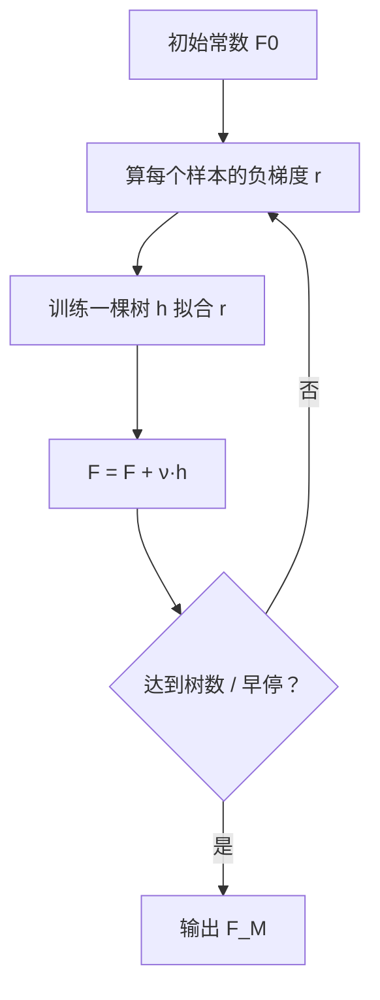

# ML-054 梯度提升树 GBDT

## 1. 本节学习目标

1. 说清 GBDT 与 AdaBoost 的核心区别：**拟合残差（负梯度）而非重加权**。
2. 写出加法模型与学习率的作用。
3. 会用 `n_iter_no_change` 做**早停**，并读 `n_estimators_` 看实际树数。
4. 理解"学习率 × 树数"的权衡（本课 lr=0.01/100 棵只有 0.8417）。

## 2. 为什么需要这个知识

因为 GBDT 是**表格数据上最强的经典算法家族**（XGBoost / LightGBM / CatBoost 都是它的工程优化版）。

它的核心思想极简：**每一棵新树去拟合"当前模型还差多少"（残差/负梯度）**。理解了这一点，后面三个库就都是"同一个思想的更快实现"。

## 3. 直观解释

GBDT 像**接力补差**：

1. 第一棵树预测，算出"还差多少"（残差）。
2. 第二棵树专门学这个残差。
3. 第三棵树学"前两棵合起来还差的"。
4. ……

最终预测 = **所有树的输出之和**（不是投票！）。

**与 AdaBoost 的区别**：

| | AdaBoost | GBDT |
|---|---|---|
| 修正方式 | 调整**样本权重** | 拟合**残差（负梯度）** |
| 聚合方式 | 加权投票 | **加法求和** |
| 损失 | 固定（指数损失） | **任意可微损失** |
| 基学习器 | 通常是树桩 | 通常是深度 3–8 的树 |

## 4. 正式定义

**加法模型**

$$
F_M(\mathbf{x}) = F_0 + \sum_{m=1}^{M}\nu\, h_m(\mathbf{x})
$$

$F_0$ 是初始常数（如均值/对数几率），$\nu$ 是学习率（shrinkage），$h_m$ 是第 $m$ 棵树。

**每轮拟合负梯度**

$$
r_{im} = -\left[\frac{\partial L(y_i, F(\mathbf{x}_i))}{\partial F(\mathbf{x}_i)}\right]_{F=F_{m-1}}
$$

$$
h_m = \arg\min_h \sum_i \big(r_{im}-h(\mathbf{x}_i)\big)^2
$$

**平方损失时**：$r_{im} = y_i - F_{m-1}(\mathbf{x}_i)$，即**残差**。

**更新**

$$
F_m = F_{m-1} + \nu\, h_m
$$

**学习率的作用**：$\nu$ 小 ⇒ 每步走得小 ⇒ 需要更多树，但通常泛化更好。

## 5. 核心原理

**为什么拟合负梯度**：函数空间里的梯度下降。每个 $h_m$ 是"沿负梯度方向走一步"的近似。

**为什么学习率小更好（但更慢）**：

- $\nu$ 大 ⇒ 每棵树影响大 ⇒ 容易过拟合、对单棵树误差敏感。
- $\nu$ 小 ⇒ 需要更多树，但模型更平滑。

**本课的"学习率 × 树数"实证**

| $n$ | lr | 测试准确率 | 耗时 |
|---|---|---|---|
| 100 | 0.1 | 0.9083 | 0.45 s |
| 100 | 0.01 | **0.8417** | 0.45 s |
| 500 | 0.01 | 0.8867 | 2.21 s |
| 50 | 0.5 | **0.9183** | 0.23 s |

**读法**：

- lr=0.01 配 100 棵 **严重欠拟合**（0.8417）——步子太小、树太少。
- lr=0.01 配 500 棵追到 0.8867，但仍不如 lr=0.1 配 100 棵。
- **lr=0.5 配 50 棵反而最好（0.9183）**——因为这份数据"简单"，大步快走就够。

**这个结果说明**：教材常说"小学习率 + 多树更好"，但在**简单数据上大步反而更划算**。要用 CV 定，不能照抄经验。

## 6. 数学表达式

**本课早停结果**（`n_estimators=500, lr=0.05, n_iter_no_change=10`）

$$
n_{actual} = 347,\qquad \text{test}=0.92
$$

即：设了 500 棵，早停在 347 棵就停，且测试分 0.92 优于不早停的 0.9083。

**训练 vs 测试**

$$
\text{train}=0.9821,\qquad \text{test}=0.9083
$$

差 7.4 个百分点 ⇒ GBDT 也在过拟合，早停/正则有必要。

## 7. 数学库链接

| 用到的数学 | 对应篇目 | 用在哪 |
|---|---|---|
| 梯度下降 | [[MATH-721 梯度下降]] | 拟合负梯度的理论来源 |
| 导数与链式法则 | [[MATH-122 求导法则与链式法则]] | 负梯度的计算 |
| 平方损失求导 | [[MATH-124 不定积分]] | 残差 = 负梯度 |

## 8. 算法执行流程



## 9. 可视化解释

```text
第1棵：拟合 y                         残差大
第2棵：拟合 残差1                     残差变小
第3棵：拟合 残差2                     残差更小
...
最终：F = F0 + ν(h1 + h2 + h3 + ...)   ← 求和，不是投票
```

## 10. Python 实现

```powershell
python ml054_gbdt.py
```

```python
import time

from sklearn.datasets import make_classification
from sklearn.ensemble import GradientBoostingClassifier
from sklearn.model_selection import train_test_split

X, y = make_classification(n_samples=2000, n_features=20, n_informative=12,
                           n_redundant=4, random_state=42)
X_train, X_test, y_train, y_test = train_test_split(
    X, y, test_size=0.3, random_state=42, stratify=y)

for n, lr in ((100, 0.1), (100, 0.01), (500, 0.01), (50, 0.5)):
    start = time.time()
    model = GradientBoostingClassifier(n_estimators=n, learning_rate=lr,
                                       random_state=42).fit(X_train, y_train)
    print(f"n={n:>3} lr={lr}: test={model.score(X_test, y_test):.4f}"
          f" 耗时={time.time() - start:.2f}s")

early = GradientBoostingClassifier(n_estimators=500, learning_rate=0.05,
                                   n_iter_no_change=10, validation_fraction=0.1,
                                   random_state=42).fit(X_train, y_train)
print("早停后实际树数:", early.n_estimators_)
print("早停模型 test:", round(early.score(X_test, y_test), 4))

base = GradientBoostingClassifier(n_estimators=100, learning_rate=0.1,
                                  random_state=42).fit(X_train, y_train)
print("train acc:", round(base.score(X_train, y_train), 4))
print("test  acc:", round(base.score(X_test, y_test), 4))
```

**实际运行结果**

```
n=100 lr=0.1: test=0.9083 耗时=0.45s
n=100 lr=0.01: test=0.8417 耗时=0.45s
n=500 lr=0.01: test=0.8867 耗时=2.21s
n= 50 lr=0.5: test=0.9183 耗时=0.23s
早停后实际树数: 347
早停模型 test: 0.92
train acc: 0.9821
test  acc: 0.9083
```

## 11. 代码逐行解释

| 代码 | 作用 |
|---|---|
| `GradientBoostingClassifier(n_estimators=n, learning_rate=lr)` | 两个核心超参 |
| `n_iter_no_change=10` | 连续 10 轮无提升就停 |
| `validation_fraction=0.1` | 从训练集切 10% 做早停监控 |
| `n_estimators_` | **实际**用了多少棵树（早停后） |
| `model.score` | 分类默认准确率 |

**`n_estimators_` 与 `n_estimators` 不同**：前者是训练后的实际值，后者是你设的上限。报告"用了多少棵树"要看前者。

## 12. 实际运行结果

见第 10 节。三点：

1. **lr=0.01 + 100 棵严重欠拟合**（0.8417），说明小学习率必须配大 $n$。
2. **lr=0.5 + 50 棵最好**（0.9183）——在简单数据上大步快走更划算。
3. **早停（347 棵）得 0.92**，优于不早停的 0.9083，且比跑满 500 棵省时。

## 13. 适用场景

| 场景 | 说明 |
|---|---|
| 表格数据主力 | GBDT/XGB/LGBM 是首选 |
| 需要高精度 | 调 `learning_rate` + `n_estimators` |
| 数据量大 | 用 `HistGradientBoosting`（sklearn）或 LightGBM |
| 有缺失值 | `HistGradientBoosting` 原生支持 |
| 需要极强可解释 | 改用单树/线性模型 |

## 14. 优点与缺点

| 优点 | 缺点 |
|---|---|
| 精度高（表格数据最强之一） | 串行，训练较慢 |
| 支持任意可微损失 | 超参多（lr/n/depth/subsample） |
| 能捕捉复杂交互 | 对噪声标签敏感 |
| 特征重要性可用 | 易过拟合，需早停 |

## 15. 常见错误

| 错误 | 表现 | 纠正 |
|---|---|---|
| 小 lr 不加大 n | 本课 0.8417 欠拟合 | lr 小则 n 大 |
| 不设早停 | 跑满且过拟合 | `n_iter_no_change` |
| 只看 `n_estimators` | 不知道实际几棵 | 看 `n_estimators_` |
| 学习率照抄教程 | 本课 lr=0.5 反而好 | 用 CV 定 |
| 认为 GBDT = AdaBoost | 机制不同 | 残差 vs 重加权 |
| 不做特征缩放就断言 | 树不需要缩放 | 但线性基学习器需要 |

## 16. 本节总结

- GBDT = **加法模型 + 拟合负梯度**（平方损失时就是残差）。
- 学习率与树数**必须一起调**：小 lr 要配大 n（本课 0.01/100 只 0.8417）。
- 早停能同时省时与提分（本课 347 棵得 0.92）。

## 17. 前置与后续

- 前置：[[ML-053 AdaBoost]]
- 后续：`ML-055 XGBoost 与 LightGBM`、`ML-056 Stacking 与 Voting`
- 相关数学：[[MATH-721 梯度下降]]、[[MATH-122 求导法则与链式法则]]

## 18. 练习与参考答案

**基础 1**：GBDT 与 AdaBoost 在"如何修正错误"上有什么不同？

**基础 2**：本课 lr=0.01 时，100 棵与 500 棵的准确率各是多少？

**进阶 1**：为什么小学习率必须配更多树？

**综合 1**：本课 lr=0.5/50 棵（0.9183）优于 lr=0.1/100 棵（0.9083），说明"小学习率更好"是错的吗？

> [!success]- 参考答案

> **基础 1**
> - AdaBoost：调整**样本权重**，让后续学习器聚焦被错分的样本。
> - GBDT：让新树**拟合负梯度（残差）**，直接修正"当前预测还差多少"。
> 前者是重加权，后者是函数空间的梯度下降。

> **基础 2**
> 100 棵 **0.8417**（欠拟合）；500 棵 **0.8867**。

> **进阶 1**
> 因为每棵树的贡献被学习率 $\nu$ 缩放：$F_m=F_{m-1}+\nu h_m$。
> $\nu$ 小 ⇒ 每步移动距离小 ⇒ 需要更多步才能到达最优点。若树数不够，模型停在半路 ⇒ 欠拟合（本课 0.8417 就是这种情况）。

> **综合 1**
> 不是"错的"，而是**不能无条件套用**。
> "小学习率 + 多树"的优势在**复杂数据、易过拟合**时显现（更平滑、泛化更好）。本课数据由 `make_classification` 生成、结构简单且可分，大步快走（lr=0.5、50 棵）就足够，反而是更省时的等效解。
> 正确做法：把 `learning_rate` 与 `n_estimators` 放进 **CV 网格**一起搜，而不是照抄默认值。同时用早停自动定树数。

---

## 🔗 Notion 同步信息

> 以下内容由 Notion「AI Knowledge System · 知识点」数据库按知识 ID 合并而来（导出于 2026-11-09）。

| 属性 | 值 |
|---|---|
| 学科 | 机器学习 |
| 学习状态 | 未开始 |
| 难度 | L3 推导 |
| 知识类型 | Algorithm |

- **所属模块**：[M-ML-07 集成学习与高级算法](../%E8%AF%BE%E7%A8%8B%E6%A8%A1%E5%9D%97/M-ML-07%20%E9%9B%86%E6%88%90%E5%AD%A6%E4%B9%A0%E4%B8%8E%E9%AB%98%E7%BA%A7%E7%AE%97%E6%B3%95.md)
- **前置知识**：[ML-053 AdaBoost](ML-053%20AdaBoost.md)
- **后继知识**：[ML-055 XGBoost 与 LightGBM](ML-055%20XGBoost%20%E4%B8%8E%20LightGBM.md)
- **关联Python**：[PY-067 聚合与统计](../../01_Python%E5%9F%BA%E7%A1%80/08%20NumPy/PY-067%20%E8%81%9A%E5%90%88%E4%B8%8E%E7%BB%9F%E8%AE%A1.md)
- **关联数学**：[MATH-721 梯度下降](../../06_%E6%95%B0%E5%AD%A6%E5%9F%BA%E7%A1%80/07%20%E6%9C%80%E4%BC%98%E5%8C%96%E6%96%B9%E6%B3%95/MATH-721%20%E6%A2%AF%E5%BA%A6%E4%B8%8B%E9%99%8D.md) · [MATH-124 不定积分](../../06_%E6%95%B0%E5%AD%A6%E5%9F%BA%E7%A1%80/01%20%E9%AB%98%E7%AD%89%E6%95%B0%E5%AD%A6/MATH-124%20%E4%B8%8D%E5%AE%9A%E7%A7%AF%E5%88%86.md)
