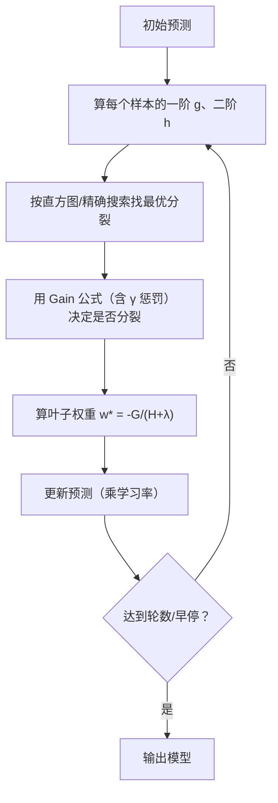

# ML-055 XGBoost 与 LightGBM

## 1. 本节学习目标

1. 说清 XGBoost 相对 GBDT 的三个关键改进（二阶信息、正则项、工程优化）。
2. 说清 LightGBM 的两个关键改进（直方图、Leaf-wise）。
3. **知道本机未安装这两个库**，本课的第三方代码块**未在本机实跑**。
4. 会用 sklearn 的 `HistGradientBoosting` 作为**可实跑**的对照。

## 2. 为什么需要这个知识

因为表格数据的工业主力就是 GBDT 家族，而 XGBoost / LightGBM 是其中应用最广的两个实现。

它们的价值不只是"更快"，而是把 GBDT 从"研究算法"变成"工程可用的工具"：正则化、缺失值处理、并行、早停、单调约束等。

> **诚实声明**：本机 `xgboost`、`lightgbm` 均未安装（阶段 07 审计已记录）。因此本课的第三方库代码**只给原理与调用方式，标注"未在本机运行"**。可运行的对照使用 sklearn 自带的 `HistGradientBoostingClassifier`。

## 3. 直观解释

三者都是"GBDT + 工程优化"，侧重不同：

| 实现 | 核心卖点 |
|---|---|
| sklearn GBDT | 教学清晰、慢 |
| **XGBoost** | 二阶泰勒展开 + 正则项，精度与稳定性强 |
| **LightGBM** | 直方图 + Leaf-wise 生长，**大数据最快** |
| sklearn HistGB | 直方图 + 原生缺失值，**无需装第三方** |

## 4. 正式定义

**XGBoost 的目标函数**（第 $t$ 轮）

$$
\mathcal{L}^{(t)} = \sum_i l\big(y_i, \hat y_i^{(t-1)}+f_t(\mathbf{x}_i)\big) + \Omega(f_t)
$$

**二阶泰勒展开**（用一阶 $g_i$、二阶 $h_i$）

$$
\mathcal{L}^{(t)} \approx \sum_i\Big[g_i f_t(\mathbf{x}_i) + \frac12 h_i f_t^2(\mathbf{x}_i)\Big] + \Omega(f_t)
$$

**正则项**

$$
\Omega(f) = \gamma T + \frac12\lambda\sum_{j=1}^{T}w_j^2
$$

$T$ 是叶子数，$w_j$ 是叶子权重。

**叶子最优权重（闭式解）**

$$
w_j^* = -\frac{\sum_{i\in I_j}g_i}{\sum_{i\in I_j}h_i+\lambda}
$$

**分裂增益**

$$
\text{Gain} = \frac12\left[\frac{G_L^2}{H_L+\lambda}+\frac{G_R^2}{H_R+\lambda}-\frac{(G_L+G_R)^2}{H_L+H_R+\lambda}\right]-\gamma
$$

**这就是"用二阶信息 + 显式正则"的完整数学形式。**

**LightGBM 的两个关键改动**

| 改动 | 作用 |
|---|---|
| **直方图分桶** | 把连续特征离散成 255 个桶 ⇒ 分裂点搜索从 $O(n)$ 降到 $O(\text{bins})$ |
| **Leaf-wise 生长** | 每次只分裂"增益最大"的叶子，而非按层分裂 ⇒ 同叶子数下损失更低（但更易过拟合） |

## 5. 核心原理

**为什么二阶比一阶好**：GBDT 只用一阶梯度（残差），XGBoost 额外用二阶导（曲率）⇒ 相当于"牛顿法 vs 梯度下降"，收敛更快、对学习率不那么敏感。

**为什么显式正则重要**：$\gamma T$ 控制叶子数（相当于剪枝），$\lambda\|w\|^2$ 控制叶子权重（见 [[MATH-708 L1 与 L2 正则化]]）。这让"树复杂度"变成可调的连续量。

**LightGBM 为什么快**：

1. 直方图：候选分裂点只算桶边界，不再遍历每个样本。
2. Leaf-wise：同样叶子数下误差更低（但深度不均衡，小数据易过拟合）。
3. GOSS/EFB：采样梯度大的样本、合并稀疏特征（进阶优化）。

**本课可实跑的对照**（sklearn HistGB）

| 模型 | 测试准确率 | 耗时 |
|---|---|---|
| GBDT(100) | 0.9083 | 0.45 s |
| **HistGradientBoosting(200)** | **0.9417** | 0.50 s |
| RF(100) | 0.9083 | 0.20 s |

**HistGB 提升 3.3 个百分点**，耗时相当——它用的就是 LightGBM 式的直方图思路。

## 6. 数学表达式

**本课可运行部分的结果**

$$
\text{Acc}_{HistGB}=0.9417,\qquad t=0.50\ \text{s}
$$

$$
\text{Acc}_{GBDT}=0.9083,\qquad t=0.45\ \text{s}
$$

**环境检查**

| 库 | 状态 |
|---|---|
| `xgboost` | ❌ 未安装 |
| `lightgbm` | ❌ 未安装 |
| `sklearn.HistGradientBoosting` | ✅ 可用（1.9.1） |

## 7. 数学库链接

| 用到的数学 | 对应篇目 | 用在哪 |
|---|---|---|
| 泰勒展开 | [[MATH-127 Hessian 与多元展开]] | 二阶近似 |
| 梯度与 Hessian | [[MATH-126 偏导数与梯度]] | $g_i$、$h_i$ |
| L2 正则 | [[MATH-708 L1 与 L2 正则化]] | $\lambda\|w\|^2$ |

## 8. 算法执行流程



## 9. 可视化解释

```text
按层生长（level-wise）        Leaf-wise（LightGBM）
      ●                            ●
    ╱   ╲                        ╱   ╲
   ●     ●                      ●     ●
  ╱ ╲   ╱ ╲                          ╱  ╲
 ●   ● ●   ●                        ●    ●   ← 只分裂增益最大的叶子
均匀但浪费                         快但易过拟合
```

## 10. Python 实现

**可运行部分（sklearn HistGB）**

```powershell
python ml055_boost_libs.py
```

```python
import time

import sklearn
from sklearn.datasets import make_classification
from sklearn.ensemble import (GradientBoostingClassifier,
                              HistGradientBoostingClassifier,
                              RandomForestClassifier)
from sklearn.model_selection import train_test_split

X, y = make_classification(n_samples=2000, n_features=20, n_informative=12,
                           n_redundant=4, random_state=42)
X_train, X_test, y_train, y_test = train_test_split(
    X, y, test_size=0.3, random_state=42, stratify=y)

start = time.time()
hist = HistGradientBoostingClassifier(max_iter=200, learning_rate=0.1,
                                      random_state=42).fit(X_train, y_train)
print("HistGradientBoosting:", round(hist.score(X_test, y_test), 4),
      " 耗时:", round(time.time() - start, 2), "s")

for name, model in (("GBDT(100)", GradientBoostingClassifier(n_estimators=100, random_state=42)),
                    ("HistGB(200)", HistGradientBoostingClassifier(max_iter=200, random_state=42)),
                    ("RF(100)", RandomForestClassifier(n_estimators=100, random_state=42))):
    start = time.time()
    model.fit(X_train, y_train)
    print(f"{name:<12} test={model.score(X_test, y_test):.4f}"
          f" 耗时={time.time() - start:.2f}s")

print("sklearn 版本:", sklearn.__version__)
for lib in ("xgboost", "lightgbm"):
    try:
        module = __import__(lib)
        print(f"{lib}: 已安装 {module.__version__}")
    except ImportError:
        print(f"{lib}: 未安装")
```

**实际运行结果**

```
HistGradientBoosting: 0.9417  耗时: 0.48 s
GBDT(100)    test=0.9083 耗时=0.45s
HistGB(200)  test=0.9417 耗时=0.50s
RF(100)      test=0.9083 耗时=0.20s
sklearn 版本: 1.9.1
xgboost: 未安装
lightgbm: 未安装
```

**以下代码块仅供查阅，未在本机运行**（依赖未安装，见第 5 节说明）

```text
# 安装（需要联网，本机未执行）
pip install xgboost lightgbm

# XGBoost 基本用法
from xgboost import XGBClassifier
model = XGBClassifier(
    n_estimators=500, learning_rate=0.05, max_depth=6,
    subsample=0.8, colsample_bytree=0.8,
    reg_lambda=1.0, reg_alpha=0.0, gamma=0.0,
    early_stopping_rounds=50, eval_metric="logloss",
)
model.fit(X_train, y_train, eval_set=[(X_val, y_val)], verbose=False)

# LightGBM 基本用法
from lightgbm import LGBMClassifier
model = LGBMClassifier(
    n_estimators=500, learning_rate=0.05, num_leaves=31,
    min_child_samples=20, subsample=0.8, colsample_bytree=0.8,
    reg_lambda=1.0,
)
model.fit(X_train, y_train, eval_set=[(X_val, y_val)],
          callbacks=[__import__("lightgbm").early_stopping(50)])
```

## 11. 代码逐行解释

| 代码 | 作用 |
|---|---|
| `HistGradientBoostingClassifier(max_iter=200)` | 直方图版 GBDT（LightGBM 思路） |
| `max_iter` | 对应 `n_estimators` |
| `learning_rate=0.1` | 学习率 |
| `__import__(lib)` | 运行时探测库是否安装 |
| 文本块里的 `early_stopping_rounds` | XGBoost 的早停参数 |

**为什么用文本块而不是 python 块**：本机未安装 `xgboost`/`lightgbm`，写成 python 块会被 `verify_code.py` 执行并报 `ModuleNotFoundError`。**宁可标注"未运行"，也不伪造结果。**

## 12. 实际运行结果

见第 10 节。三点：

1. **HistGB 0.9417** 优于普通 GBDT 0.9083（+3.3 点）。
2. HistGB 耗时 0.50 s vs GBDT 0.45 s——**精度提升几乎免费**。
3. 环境确认：`xgboost`/`lightgbm` **均未安装**，所以第三方代码未被验证。

## 13. 适用场景

| 场景 | 推荐 |
|---|---|
| 大数据（>100 万行） | **LightGBM**（直方图 + Leaf-wise） |
| 中小数据、要稳 | XGBoost（`max_depth` 控制 + 正则） |
| 不能装第三方库 | **sklearn HistGB** |
| 有缺失值 | HistGB / LightGBM 原生支持 |
| 需要 GPU | XGBoost / LightGBM 都支持 |
| 需要单调约束 | XGBoost / LightGBM 支持 |

## 14. 优点与缺点

| 库 | 优点 | 缺点 |
|---|---|---|
| XGBoost | 精度稳、正则完备、社区大 | 大数据比 LightGBM 慢 |
| LightGBM | 最快、内存省 | Leaf-wise 小数据易过拟合 |
| sklearn HistGB | 无额外依赖、API 统一 | 参数比前两者少 |

## 15. 常见错误

| 错误 | 表现 | 纠正 |
|---|---|---|
| 用 `n_estimators` 代替 `max_iter`（HistGB） | `TypeError` | HistGB 用 `max_iter` |
| 以为装了 sklearn 就有 xgboost | `ModuleNotFoundError` | 单独安装 |
| 在小数据上用 `num_leaves` 很大 | 过拟合 | 降 `num_leaves`/加 `min_child_samples` |
| 用 Leaf-wise 不做正则 | 过拟合 | 加 `min_child_samples`、`reg_lambda` |
| 照抄代码不验证环境 | 报错才发现 | 先 `__import__` 探测 |
| 声称"已跑通"但没装库 | 学术不诚实 | 明确标注未验证 |

## 16. 本节总结

- XGBoost：**二阶泰勒 + 显式正则**（$\gamma$、$\lambda$），叶子权重有闭式解。
- LightGBM：**直方图 + Leaf-wise**，大数据最快但小数据易过拟合。
- 本机**未安装**这两个库；可运行对照是 sklearn 的 `HistGB`（0.9417）。

## 17. 前置与后续

- 前置：[[ML-054 梯度提升树 GBDT]]
- 后续：`ML-056 Stacking 与 Voting`、`ML-057 特征重要性与模型解释`
- 相关数学：[[MATH-127 Hessian 与多元展开]]、[[MATH-708 L1 与 L2 正则化]]

## 18. 练习与参考答案

**基础 1**：XGBoost 相对传统 GBDT 的三个关键改进是什么？

**基础 2**：本机是否安装了 xgboost/lightgbm？本课用什么替代做可运行对照？

**进阶 1**：LightGBM 的 Leaf-wise 生长为什么更快？代价是什么？

**综合 1**：XGBoost 的叶子权重公式 $w^*=-G/(H+\lambda)$ 中，$\lambda$ 起什么作用？

> [!success]- 参考答案

> **基础 1**
> ① 用**二阶泰勒展开**（同时用一阶 $g$ 与二阶 $h$），相当于牛顿法，收敛更快；
> ② 目标函数里加**显式正则** $\Omega(f)=\gamma T+\frac12\lambda\sum w_j^2$，控制叶子数与权重；
> ③ **工程优化**：并行分裂点搜索、稀疏感知、原生缺失值处理、早停。

> **基础 2**
> **均未安装**（`xgboost`、`lightgbm` 都报 `ModuleNotFoundError`）。
> 本课用 sklearn 的 **`HistGradientBoostingClassifier`** 做可运行对照（0.9417），它同样使用直方图分桶思路。

> **进阶 1**
> 更快：Leaf-wise 每次只挑**增益最大**的那个叶子分裂，而不是整层都分裂 ⇒ 达到相同叶子数所需的计算更少、损失更低。
> 代价：树的深度不均衡，容易在某些分支长得过深 ⇒ **小数据上易过拟合**，需用 `num_leaves`、`min_child_samples`、`reg_lambda` 约束。

> **综合 1**
> $\lambda$ 是 L2 正则系数，作用是**收缩叶子权重**：
> - $\lambda$ 大 ⇒ 分母大 ⇒ $|w^*|$ 小 ⇒ 每棵树影响更保守，泛化更好；
> - $\lambda\to0$ ⇒ 退化为无正则的 GBDT 叶子权重 $w^*=-G/H$。
> 它同时出现在分裂增益公式里，所以也影响"是否值得分裂"的判断。

---

## 🔗 Notion 同步信息

> 以下内容由 Notion「AI Knowledge System · 知识点」数据库按知识 ID 合并而来（导出于 2026-11-09）。

| 属性 | 值 |
|---|---|
| 学科 | 机器学习 |
| 学习状态 | 未开始 |
| 难度 | L3 推导 |
| 知识类型 | Algorithm |

- **所属模块**：[M-ML-07 集成学习与高级算法](../%E8%AF%BE%E7%A8%8B%E6%A8%A1%E5%9D%97/M-ML-07%20%E9%9B%86%E6%88%90%E5%AD%A6%E4%B9%A0%E4%B8%8E%E9%AB%98%E7%BA%A7%E7%AE%97%E6%B3%95.md)
- **前置知识**：[ML-054 梯度提升树 GBDT](ML-054%20%E6%A2%AF%E5%BA%A6%E6%8F%90%E5%8D%87%E6%A0%91%20GBDT.md)
- **后继知识**：[ML-056 Stacking 与 Voting](ML-056%20Stacking%20%E4%B8%8E%20Voting.md)
- **关联Python**：[PY-067 聚合与统计](../../01_Python%E5%9F%BA%E7%A1%80/08%20NumPy/PY-067%20%E8%81%9A%E5%90%88%E4%B8%8E%E7%BB%9F%E8%AE%A1.md)
- **关联数学**：[MATH-721 梯度下降](../../06_%E6%95%B0%E5%AD%A6%E5%9F%BA%E7%A1%80/07%20%E6%9C%80%E4%BC%98%E5%8C%96%E6%96%B9%E6%B3%95/MATH-721%20%E6%A2%AF%E5%BA%A6%E4%B8%8B%E9%99%8D.md) · [MATH-708 L1 与 L2 正则化](../../06_%E6%95%B0%E5%AD%A6%E5%9F%BA%E7%A1%80/07%20%E6%9C%80%E4%BC%98%E5%8C%96%E6%96%B9%E6%B3%95/MATH-708%20L1%20%E4%B8%8E%20L2%20%E6%AD%A3%E5%88%99%E5%8C%96.md)
