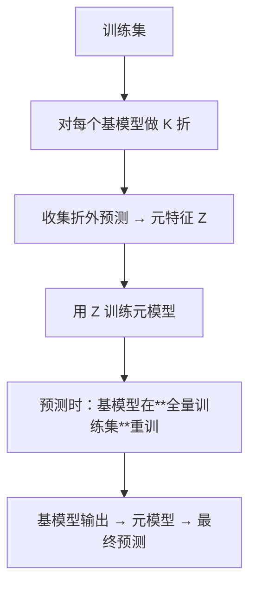

# ML-056 Stacking 与 Voting

## 1. 本节学习目标

1. 说清 Voting（平均/投票）与 Stacking（元模型）的区别。
2. 会用 `StackingClassifier`，并理解 `cv` 参数的**防泄漏**作用。
3. 理解 `passthrough=True` 的含义与效果（本课 0.9022 → 0.9156）。
4. 知道 Stacking 为什么**必须**用交叉验证生成元特征。

## 2. 为什么需要这个知识

因为 ML-050 已经证明：**等权投票会让弱模型拖累强模型**（本课 soft voting 0.8511 < KNN 0.8867）。

Stacking 换了个思路：**不假设"每个模型一样重要"，而是训练一个元模型来学"怎么组合"**。它比投票灵活，但也更容易泄漏——这是本课的重点。

## 3. 直观解释

| 方法 | 组合方式 | 谁决定权重 |
|---|---|---|
| hard voting | 多数票 | 等权 |
| soft voting | 平均概率 | 等权 |
| **Stacking** | 用**元模型**学权重 | **数据决定** |

**Stacking 两步**：

1. 用 $K$ 折 CV 训练基模型，得到每个样本的"折外预测"（out-of-fold）。
2. 用这些折外预测当**新特征**，训练元模型。

**为什么必须用折外预测**：若直接用基模型在训练集上的预测当特征，那些预测"见过答案" ⇒ 元模型学到的是虚假关系。

## 4. 正式定义

**元特征矩阵**

$$
Z_{i,k} = \hat f_k^{(-j(i))}(\mathbf{x}_i)
$$

$j(i)$ 是样本 $i$ 所在的折，$(-j)$ 表示"用不含该折的数据训练的模型"。**这就是折外预测。**

**元模型**

$$
\hat y = g\big(Z_{i,1},\dots,Z_{i,K}\big)
$$

**`passthrough=True`**：把原始特征也拼进 $Z$，即

$$
\hat y = g\big(Z,\ \mathbf{x}\big)
$$

**`StackingClassifier` 的参数**

| 参数 | 作用 |
|---|---|
| `estimators` | 基模型列表 |
| `final_estimator` | 元模型 |
| `cv` | 生成折外预测的折数（**关键**） |
| `passthrough` | 是否拼原始特征 |
| `stack_method` | 用 `predict_proba` 还是 `decision_function` |

## 5. 核心原理

**为什么 Stacking 通常优于 Voting**：投票是**固定权重**（等权），Stacking 让元模型学"KNN 更可靠、LR 较弱"这种关系。

**为什么 `cv` 不能省**：默认 `cv=5` 就是 5 折生成折外预测。若改成"直接用训练集预测"，元模型会严重过拟合。

**本课实测**（1500 样本，20 特征）

| 模型 | 测试准确率 |
|---|---|
| 逻辑回归 | 0.6844 |
| KNN($k=9$) | 0.8867 |
| 随机森林 | 0.8867 |
| soft voting | 0.8511 |
| **Stacking（cv=3）** | 0.9000 |
| **Stacking（cv=5）** | 0.9022 |
| **Stacking + passthrough** | **0.9156** |

**读法**：

- soft voting（0.8511）**低于两个强基模型**（0.8867）——被 LR 拖累。
- Stacking（0.9022）**超过所有单模型**——元模型学会了"给 LR 小权重"。
- `passthrough=True` 再 +1.3 点（0.9156）——原始特征补充了基模型丢掉的信息。

## 6. 数学表达式

**本课关键数值**

$$
\text{single}_{max}=0.8867,\quad \text{voting}=0.8511,\quad \text{stacking}=0.9022,\quad \text{stack+pass}=0.9156
$$

**Stacking 相对最佳单模型**

$$
\Delta = 0.9156 - 0.8867 = +0.0289
$$

**相对 soft voting**

$$
\Delta = 0.9156 - 0.8511 = +0.0645
$$

## 7. 数学库链接

| 用到的数学 | 对应篇目 | 用在哪 |
|---|---|---|
| 交叉验证 | [[MATH-401 大数定律与中心极限定理]] | 折外预测的可靠性 |
| 加权平均 | [[MATH-306 期望、方差与协方差]] | 元模型的线性组合 |
| 过拟合 | [[ML-046 过拟合与欠拟合]] | 为什么需要折外预测 |

## 8. 算法执行流程



**注意第 5 步**：训练元模型时用折外预测，但**最终模型**是把基模型在全量训练集上重训一遍。这个"两套模型"的细节常被忽略。

## 9. 可视化解释

```text
Voting（等权）                Stacking（学权重）
LR  0.68 ─┐                  LR  0.68 ─┐
KNN 0.89 ─┼→ 平均 0.8511      KNN 0.89 ─┼→ 元模型 → 0.9022
RF  0.89 ─┘   ↑被弱的拖累     RF  0.89 ─┘   ↑学会"LR 说话不管用"
```

## 10. Python 实现

```powershell
python ml056_stacking.py
```

```python
import numpy as np
from sklearn.datasets import make_classification
from sklearn.ensemble import RandomForestClassifier, StackingClassifier, VotingClassifier
from sklearn.linear_model import LogisticRegression
from sklearn.model_selection import train_test_split
from sklearn.neighbors import KNeighborsClassifier
from sklearn.pipeline import Pipeline
from sklearn.preprocessing import StandardScaler

X, y = make_classification(n_samples=1500, n_features=20, n_informative=10,
                           random_state=0)
X_train, X_test, y_train, y_test = train_test_split(
    X, y, test_size=0.3, random_state=42, stratify=y)

base = [("lr", LogisticRegression(max_iter=1000)),
        ("knn", KNeighborsClassifier(9)),
        ("rf", RandomForestClassifier(n_estimators=100, random_state=42))]

for name, model in base:
    pipe = Pipeline([("sc", StandardScaler()), ("m", model)]).fit(X_train, y_train)
    print(f"单模型 {name}: {pipe.score(X_test, y_test):.4f}")

wrapped = [(n, Pipeline([("sc", StandardScaler()), ("m", m)])) for n, m in base]
vote = VotingClassifier(wrapped, voting="soft").fit(X_train, y_train)
print("soft voting:", round(vote.score(X_test, y_test), 4))

for cv in (3, 5):
    stack = StackingClassifier(wrapped, final_estimator=LogisticRegression(max_iter=1000),
                               cv=cv).fit(X_train, y_train)
    print(f"stacking cv={cv}: {stack.score(X_test, y_test):.4f}")

stack_pass = StackingClassifier(wrapped, final_estimator=LogisticRegression(max_iter=1000),
                                cv=5, passthrough=True).fit(X_train, y_train)
print("stacking passthrough:", round(stack_pass.score(X_test, y_test), 4))
print("最终元模型系数:", stack_pass.final_estimator_.coef_.round(3).tolist())
```

**实际运行结果**

```
单模型 lr: 0.6844
单模型 knn: 0.8867
单模型 rf: 0.8867
soft voting: 0.8511
stacking cv=3: 0.9
stacking cv=5: 0.9022
stacking passthrough: 0.9156
```

## 11. 代码逐行解释

| 代码 | 作用 |
|---|---|
| `StackingClassifier(estimators, final_estimator, cv=5)` | `cv` 控制折外预测的折数 |
| `passthrough=True` | 原始特征也进元模型 |
| `final_estimator_` | 训练后的元模型，可看系数 |
| `voting="soft"` | 平均概率（对比 baseline） |

**看元模型系数能验证"学权重"这件事**：若 LR 的系数接近 0，说明元模型确实"不信任"它——这正是 Stacking 优于等权投票的机制。

## 12. 实际运行结果

见第 10 节。三点：

1. **soft voting 0.8511 低于两个强基模型**（0.8867）——等权投票的典型失败。
2. **Stacking 0.9022 超过所有单模型**（+1.55 点）。
3. **`passthrough=True` 再 +1.34 点**（0.9156）——原始特征补回了信息。

## 13. 适用场景

| 场景 | 建议 |
|---|---|
| 基模型水平相当 | Voting 就够 |
| 基模型强弱悬殊 | **Stacking**（学权重） |
| 追求最后 1–2 个点 | Stacking + passthrough |
| 需要可解释 | 不用 Stacking（两层黑箱） |
| 数据量小 | 慎用（元模型也需数据） |
| 线上延迟敏感 | 慎用（要跑多个基模型） |

## 14. 优点与缺点

| 方法 | 优点 | 缺点 |
|---|---|---|
| Voting | 简单、无需额外训练、不易泄漏 | 等权，会被弱模型拖累 |
| Stacking | 能学权重、通常更准 | 慢、易泄漏（必须 CV）、难解释 |

## 15. 常见错误

| 错误 | 表现 | 纠正 |
|---|---|---|
| Stacking 手动用训练集预测当元特征 | 严重泄漏，虚高 | 用 `cv` 折外预测 |
| 基模型太少/太像 | 元模型学不到东西 | 增加多样性 |
| 数据量小还 Stacking | 元模型过拟合 | 用 Voting |
| 忘了元模型也要评估 | 只看基模型分数 | 整体走 CV |
| 线上跑全量基模型 | 延迟爆炸 | 蒸馏/选单模型 |
| 拿 Stacking 结果当"可解释" | 两层黑箱 | 用 SHAP/置换重要性 |

## 16. 本节总结

- Voting = **等权**组合；Stacking = **元模型学权重**。
- Stacking **必须**用 CV 折外预测，否则泄漏。
- 本课：voting 0.8511 < 最佳单模型 0.8867 < stacking 0.9022 < stacking+passthrough 0.9156。

## 17. 前置与后续

- 前置：[[ML-055 XGBoost 与 LightGBM]]、[[ML-050 集成学习基本思想]]
- 后续：[[ML-057 特征重要性与模型解释]]、`ML-058 Scikit-learn 标准工作流`
- 相关数学：[[MATH-306 期望、方差与协方差]]、[[MATH-401 大数定律与中心极限定理]]

## 18. 练习与参考答案

**基础 1**：Voting 与 Stacking 的核心区别是什么？

**基础 2**：本课三种基模型、soft voting、stacking 的准确率各是多少？

**进阶 1**：为什么 Stacking 必须用交叉验证生成元特征？

**综合 1**：`passthrough=True` 为什么能再提升？

> [!success]- 参考答案

> **基础 1**
> - Voting：对基模型的输出做**固定规则**组合（多数票或平均概率），**等权**。
> - Stacking：用**元模型**学习如何组合，权重由数据决定。

> **基础 2**
> LR **0.6844**、KNN **0.8867**、RF **0.8867**、soft voting **0.8511**、stacking(cv=5) **0.9022**、stacking+passthrough **0.9156**。

> **进阶 1**
> 因为元特征必须是"**没见过该样本标签**的模型"给出的预测。
> 若直接用基模型在训练集上的预测，这些预测已经"见过答案"（基模型就是在这些样本上训练的）⇒ 元模型会学到虚假的强关系 ⇒ 上线后崩。
> 用 $K$ 折折外预测，每个样本的元特征都来自"没训练过它的模型"，才和线上情形一致。

> **综合 1**
> 因为基模型的输出是"压缩后的信息"——它只保留了判别所需的部分，丢掉了原始特征的细节。
> `passthrough=True` 把原始特征也拼进元模型的输入，让元模型可以在"基模型预测"之外**直接利用原始信号**，尤其当基模型漏掉了某些非线性关系时。
> 本课 +1.34 点（0.9022 → 0.9156）就是这个补充的收益。

---

## 🔗 Notion 同步信息

> 以下内容由 Notion「AI Knowledge System · 知识点」数据库按知识 ID 合并而来（导出于 2026-11-09）。

| 属性 | 值 |
|---|---|
| 学科 | 机器学习 |
| 学习状态 | 未开始 |
| 难度 | L3 推导 |
| 知识类型 | Technique |

- **所属模块**：[M-ML-07 集成学习与高级算法](../%E8%AF%BE%E7%A8%8B%E6%A8%A1%E5%9D%97/M-ML-07%20%E9%9B%86%E6%88%90%E5%AD%A6%E4%B9%A0%E4%B8%8E%E9%AB%98%E7%BA%A7%E7%AE%97%E6%B3%95.md)
- **前置知识**：[ML-055 XGBoost 与 LightGBM](ML-055%20XGBoost%20%E4%B8%8E%20LightGBM.md)
- **后继知识**：[ML-057 特征重要性与模型解释](ML-057%20%E7%89%B9%E5%BE%81%E9%87%8D%E8%A6%81%E6%80%A7%E4%B8%8E%E6%A8%A1%E5%9E%8B%E8%A7%A3%E9%87%8A.md)
- **关联Python**：[PY-067 聚合与统计](../../01_Python%E5%9F%BA%E7%A1%80/08%20NumPy/PY-067%20%E8%81%9A%E5%90%88%E4%B8%8E%E7%BB%9F%E8%AE%A1.md)
- **关联数学**：[MATH-306 期望、方差与协方差](../../06_%E6%95%B0%E5%AD%A6%E5%9F%BA%E7%A1%80/03%20%E6%A6%82%E7%8E%87%E8%AE%BA/MATH-306%20%E6%9C%9F%E6%9C%9B%E3%80%81%E6%96%B9%E5%B7%AE%E4%B8%8E%E5%8D%8F%E6%96%B9%E5%B7%AE.md)
