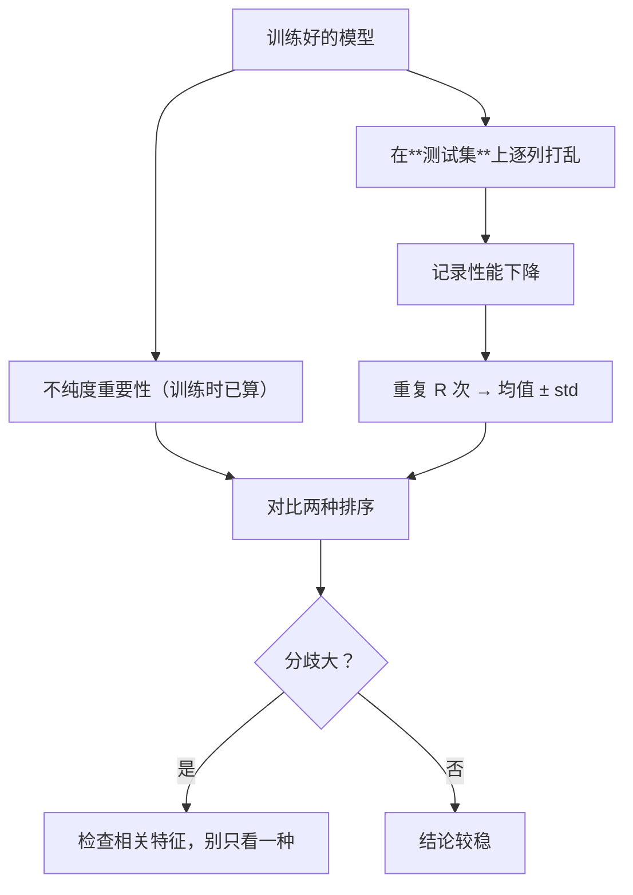

# ML-057 特征重要性与模型解释

## 1. 本节学习目标

1. 说清**不纯度重要性**与**置换重要性**的原理与偏差。
2. **理解两者可能给出完全不同的排序**（本课 top5 只有 2 个重合）。
3. 会用 `permutation_importance`，并读 `importances_std` 判断显著性。
4. 知道"重要性 ≠ 因果"，以及置换重要性的失效场景。

## 2. 为什么需要这个知识

因为"模型为什么这样预测"是业务方第一个问题，而**最常用的 `feature_importances_` 有系统性偏差**。

它偏向高基数、连续型特征（因为这类特征有更多可切分点，更容易带来不纯度下降）。本课实测：同一模型上，不纯度 top5 与置换 top5 **只有 2 个重合**。

用错方法，你会给业务一份错误的"关键因素"清单。

## 3. 直观解释

两种方法的思路完全不同：

| 方法 | 做法 | 衡量 |
|---|---|---|
| **不纯度重要性**（`feature_importances_`） | 统计该特征带来的不纯度下降总量 | "模型用了它多少" |
| **置换重要性**（permutation） | 把该列**打乱**，看性能掉多少 | "它对预测有多关键" |

**类比**：

- 不纯度重要性 = "这个零件在机器里被用了几次"。
- 置换重要性 = "把这个零件拆掉，机器还能转吗"。

**后者更接近业务想要的答案**（"哪个因素真正影响结果"）。

## 4. 正式定义

**不纯度重要性**（树模型）

$$
\text{Imp}(j) = \frac{1}{N_{tree}}\sum_{t}\sum_{\text{split on } j}\frac{n_{node}}{n}\,\Delta\text{不纯度}
$$

**置换重要性**

$$
\text{PI}(j) = \text{score}(\mathcal{D}) - \text{score}\big(\mathcal{D}^{(j)}_{\text{perm}}\big)
$$

$\mathcal{D}^{(j)}_{\text{perm}}$ 是"把第 $j$ 列随机打乱、其余不变"的数据集。

**多次重复取均值与标准差**

$$
\overline{\text{PI}}_j = \frac{1}{R}\sum_{r=1}^{R}\text{PI}_j^{(r)},\qquad
s_j = \operatorname{std}\big(\text{PI}_j^{(r)}\big)
$$

**判据**：若 $\overline{\text{PI}}_j \le s_j$，该特征的重要性**不显著**。

## 5. 核心原理

**不纯度重要性的偏差来源**：

1. **高基数偏向**：连续/多取值特征有更多阈值可选 ⇒ 更容易"碰巧"降低不纯度。
2. **训练集计算**：它是在训练集上统计的，天然偏乐观。
3. **相关特征分摊**：两个高度相关的特征会"平分"重要性。

**置换重要性的优势与陷阱**：

- 优势：直接对应"预测性能"，单位是"准确率下降"。
- 陷阱 1：**相关特征会互相掩护**——打乱其中一个，另一个还在，性能掉得少 ⇒ 两者都显得不重要。
- 陷阱 2：**在训练集上做会低估**（模型已见过），应**在测试集上做**。

**本课实测**（breast cancer，随机森林 200 棵）

| 方法 | Top-5 特征索引 |
|---|---|
| 不纯度 | [22, 23, 27, 7, 20] |
| 置换 | [21, 22, 27, 25, 29] |
| **交集** | **[22, 27]** |

**只有 2 个重合**。这不说明哪个"错"，而是两者量的东西不同。

**低维对照**（10 特征）：两者 top5 **完全一致** `[5, 9, 0, 4, 2]`。

⇒ **特征越多、相关性越强，两者分歧越大。**

## 6. 数学表达式

**本课置换重要性（top5）**

$$
\text{mean} = [0.0042,\ 0.0035,\ 0.0,\ 0.0,\ 0.0]
$$

$$
\text{std} = [0.0034,\ 0.0056,\ 0.007,\ 0.0,\ 0.0]
$$

**关键观察**：**均值 0.0042 < std 0.0034 的 2 倍**，且后三个均值为 0。

**这说明**：在这个数据上（breast cancer，准确率已到 0.98），**单独打乱任何一列几乎都不影响准确率**——因为信息高度冗余，其他特征能补上。

**这就是置换重要性在"高冗余 + 饱和性能"数据上的失效**：不是特征不重要，而是"去掉一个不影响结果"。

## 7. 数学库链接

| 用到的数学 | 对应篇目 | 用在哪 |
|---|---|---|
| 不纯度（Gini/熵） | [[MATH-506 信息量与熵]] | 不纯度重要性 |
| 期望与标准差 | [[MATH-306 期望、方差与协方差]] | 置换重要性的均值/std |
| 相关性 | [[MATH-306 期望、方差与协方差]] | 相关特征互相掩护 |

## 8. 算法执行流程



## 9. 可视化解释

```text
不纯度重要性（模型内部视角）
 f22 ████████  f23 ██████  f27 █████  f7 ███  f20 ██

置换重要性（性能视角）
 f21 ███████  f22 █████  f27 ████  f25 ██  f29 ██

重合：f22, f27  ⇒ 分歧来自"模型用了" vs "预测需要"
```

## 10. Python 实现

```powershell
python ml057_importance.py
```

```python
import numpy as np
from sklearn.datasets import load_breast_cancer, make_classification
from sklearn.ensemble import RandomForestClassifier
from sklearn.inspection import permutation_importance
from sklearn.model_selection import train_test_split

X, y = load_breast_cancer(return_X_y=True)
X_train, X_test, y_train, y_test = train_test_split(
    X, y, test_size=0.25, random_state=42, stratify=y)

rf = RandomForestClassifier(n_estimators=200, random_state=42).fit(X_train, y_train)
impurity = rf.feature_importances_
perm = permutation_importance(rf, X_test, y_test, n_repeats=10, random_state=42)

top_imp = np.argsort(impurity)[-5:][::-1].tolist()
top_perm = np.argsort(perm.importances_mean)[-5:][::-1].tolist()
print("不纯度 Top5:", top_imp)
print("置换   Top5:", top_perm)
print("交集:", sorted(set(top_imp) & set(top_perm)))
print("置换均值 Top5:", perm.importances_mean[top_perm].round(4).tolist())
print("置换标准差 Top5:", perm.importances_std[top_perm].round(4).tolist())

# 低维对照：两者是否一致
X2, y2 = make_classification(n_samples=1000, n_features=10, n_informative=5,
                             n_redundant=2, random_state=5)
Xa, Xb, ya, yb = train_test_split(X2, y2, test_size=0.3, random_state=42, stratify=y2)
rf2 = RandomForestClassifier(n_estimators=200, random_state=42).fit(Xa, ya)
perm2 = permutation_importance(rf2, Xb, yb, n_repeats=10, random_state=42)
print("低维 不纯度 Top5:", np.argsort(rf2.feature_importances_)[-5:][::-1].tolist())
print("低维 置换   Top5:", np.argsort(perm2.importances_mean)[-5:][::-1].tolist())
```

**实际运行结果**

```
不纯度 Top5: [22, 23, 27, 7, 20]
置换   Top5: [21, 22, 27, 25, 29]
交集: [22, 27]
置换均值 Top5: [0.0042, 0.0035, 0.0, 0.0, 0.0]
置换标准差 Top5: [0.0034, 0.0056, 0.007, 0.0, 0.0]
低维 不纯度 Top5: [5, 9, 0, 4, 2]
低维 置换   Top5: [5, 9, 0, 4, 2]
```

## 11. 代码逐行解释

| 代码 | 作用 |
|---|---|
| `rf.feature_importances_` | 不纯度重要性（fit 时已算好） |
| `permutation_importance(rf, X_test, y_test, n_repeats=10)` | **在测试集上**打乱 |
| `importances_mean` | 每列打乱后的平均性能下降 |
| `importances_std` | 重复 10 次的标准差 |
| `np.argsort(...)[-5:][::-1]` | 取 top5 并降序 |

**为什么在 `X_test` 上做**：在训练集上打乱，模型"记住"了训练数据，性能下降会被低估甚至为负。

## 12. 实际运行结果

见第 10 节。三点：

1. 两种方法 top5 **只重合 2 个**（[22, 27]）。
2. 置换重要性均值极小（0.0042）且**小于其 std**（0.0034）⇒ 单个特征打乱几乎不影响准确率。
3. **低维数据上两者完全一致** ⇒ 分歧随特征数/冗余度增大。

## 13. 适用场景

| 目的 | 方法 |
|---|---|
| 快速看"模型用了哪些" | 不纯度重要性 |
| 回答"哪个因素真正影响结果" | **置换重要性** |
| 需要显著性 | 置换重要性 + std |
| 特征高度相关 | 分组打乱，或先聚类 |
| 需要方向（正/负） | SHAP / 部分依赖图 |
| 需要因果 | **都不够**，要做实验/因果推断 |

## 14. 优点与缺点

| 方法 | 优点 | 缺点 |
|---|---|---|
| 不纯度 | 免费、快 | 偏向高基数、训练集统计、相关特征分摊 |
| 置换 | 对应性能、可在测试集做 | 慢（$R\times d$ 次预测）、相关特征互相掩护 |

## 15. 常见错误

| 错误 | 表现 | 纠正 |
|---|---|---|
| 把不纯度重要性当"重要性" | 高基数特征虚高 | 用置换重要性交叉验证 |
| 在训练集上做置换 | 低估甚至为负 | 在测试集做 |
| 只看均值不看 std | 把噪声当信号 | 比较 mean 与 std |
| 认为重要性=因果 | 相关≠因果 | 明确措辞 |
| 相关特征只打乱一列 | 两者都不显著 | 分组打乱 |
| 用重要性做特征删除的唯一依据 | 删掉冗余但有用的特征 | 结合 CV 验证 |

## 16. 本节总结

- 不纯度重要性 = "模型**用了**多少"；置换重要性 = "**去掉后性能掉多少**"。
- 两者**可能严重分歧**（本课 top5 只重合 2 个），特征越多/越相关分歧越大。
- 置换重要性要**在测试集做**，并看 `mean` 与 `std` 的比较。
- **重要性 ≠ 因果**。

## 17. 前置与后续

- 前置：[[ML-056 Stacking 与 Voting]]、[[ML-051 Bagging 与随机森林]]
- 后续：`ML-058 Scikit-learn 标准工作流`（开启 M-ML-08）
- 相关数学：[[MATH-506 信息量与熵]]、[[MATH-306 期望、方差与协方差]]

## 18. 练习与参考答案

**基础 1**：不纯度重要性与置换重要性的原理各是什么？

**基础 2**：本课两种方法的 Top5 各是什么？交集是几个？

**进阶 1**：为什么置换重要性的均值可能小于标准差？

**综合 1**：业务问"哪些因素最影响流失"，你会用哪种重要性？怎么保证结论可信？

> [!success]- 参考答案

> **基础 1**
> - 不纯度：统计该特征在树的所有分裂中带来的不纯度下降总量（按样本数加权）。
> - 置换：把该列随机打乱，看模型性能下降多少；重复多次取均值。

> **基础 2**
> 不纯度 **[22, 23, 27, 7, 20]**；置换 **[21, 22, 27, 25, 29]**；交集 **[22, 27]**（2 个）。

> **进阶 1**
> 因为在这份数据上（breast cancer，准确率 0.98），**特征高度冗余**：打乱任何一列，其他相关特征仍能提供同样的信息 ⇒ 性能几乎不掉。
> 于是每次重复测到的"下降"都在 0 附近波动，均值（0.0042）自然小于标准差（0.0034）——这表示**该特征的可替代性强**，而不是"无用"。

> **综合 1**
> 用**置换重要性**（在测试集上），并做三件事保证可信：
> 1. **看 std**：只报 mean > std 的特征，其余标为"不显著"。
> 2. **处理相关性**：把高度相关的特征**分组合并**后再打乱（组内一起打乱），避免互相掩护。
> 3. **交叉验证结论**：删掉"不重要"的特征后重训，看 CV 分数是否真的不变。
> 最后向业务说明：**这是"模型依赖度"，不是因果**；要因果需做 A/B 实验或因果推断。

---

## 🔗 Notion 同步信息

> 以下内容由 Notion「AI Knowledge System · 知识点」数据库按知识 ID 合并而来（导出于 2026-11-09）。

| 属性 | 值 |
|---|---|
| 学科 | 机器学习 |
| 学习状态 | 未开始 |
| 难度 | L2 应用 |
| 知识类型 | Technique |

- **所属模块**：[M-ML-07 集成学习与高级算法](../%E8%AF%BE%E7%A8%8B%E6%A8%A1%E5%9D%97/M-ML-07%20%E9%9B%86%E6%88%90%E5%AD%A6%E4%B9%A0%E4%B8%8E%E9%AB%98%E7%BA%A7%E7%AE%97%E6%B3%95.md)
- **前置知识**：[ML-056 Stacking 与 Voting](ML-056%20Stacking%20%E4%B8%8E%20Voting.md)
- **后继知识**：[ML-058 Scikit-learn 标准工作流](../07%20%E5%B7%A5%E7%A8%8B%E5%AE%9E%E8%B7%B5/ML-058%20Scikit-learn%20%E6%A0%87%E5%87%86%E5%B7%A5%E4%BD%9C%E6%B5%81.md)
- **关联Python**：[PY-067 聚合与统计](../../01_Python%E5%9F%BA%E7%A1%80/08%20NumPy/PY-067%20%E8%81%9A%E5%90%88%E4%B8%8E%E7%BB%9F%E8%AE%A1.md)
- **关联数学**：[MATH-506 信息量与熵](../../06_%E6%95%B0%E5%AD%A6%E5%9F%BA%E7%A1%80/05%20%E7%A6%BB%E6%95%A3%E6%95%B0%E5%AD%A6/MATH-506%20%E4%BF%A1%E6%81%AF%E9%87%8F%E4%B8%8E%E7%86%B5.md)
