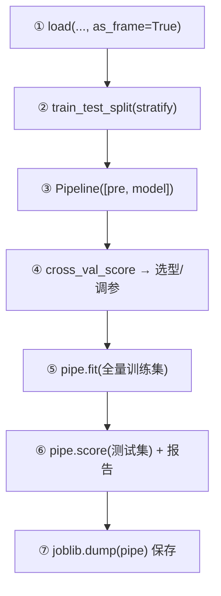

# ML-058 Scikit-learn 标准工作流

## 1. 本节学习目标

1. 能按"数据 → 划分 → Pipeline → CV → 重训 → 测试 → 报告"的顺序走完整流程。
2. 理解每一步的**产物**与**不可省的理由**。
3. 会用 `as_frame=True` 保留列名，避免"因为数组没有列名而搞错特征"。
4. 形成可复用的脚本骨架。

## 2. 为什么需要这个知识

因为前面 57 篇讲的都是"零件"，而工程实践要的是**一条能重复跑的流水线**。

标准工作流的价值在于：**任何一步顺序错了，结果就不可信**（比如先标准化再划分、先调参再划分）。把它写成固定骨架，能避免 90% 的低级错误。

## 3. 直观解释

标准流程六步（与 ML-003 的六步一致，这里落到代码）：

```text
① 载入（保留列名）
② 划分（stratify）
③ 建 Pipeline（预处理 + 模型）
④ CV 评估（选模型/超参）
⑤ 全量训练集重训
⑥ 测试集评估 + 报告
```

**关键纪律**：

- 第 ② 步之后，**任何 fit 都只能碰训练数据**。
- 第 ⑥ 步的测试集**只看一次**。

## 4. 正式定义

**Pipeline 的形式**

$$
\hat y = f_{\theta_k}\Big(T_{\theta_{k-1}}\big(\cdots T_{\theta_1}(\mathbf{x})\cdots\big)\Big)
$$

**CV 估计**

$$
\hat R_{CV}=\frac1K\sum_{k=1}^{K}\hat R\big(f^{(-k)}_{\hat\theta^{(-k)}}\big)
$$

注意 $\hat\theta^{(-k)}$：**每一折的预处理参数也重新估计**。

**报告格式**（本课采用）

$$
\text{CV}=0.9802\pm0.0128,\qquad \text{Test}=0.9825
$$

## 5. 核心原理

**为什么 `as_frame=True` 有用**：`load_breast_cancer(return_X_y=True)` 返回 numpy 数组，没有列名。一旦要做特征工程/解释，你就得靠索引猜。`as_frame=True` 直接给带列名的 DataFrame。

**为什么 CV 分数与测试分数不必相同**：CV 是 5 次评估的平均（每次训练集 80%），测试是一次评估（训练集 80%）。两者差异在抽样噪声范围内就是正常的。

**本课数值**：CV 0.9802、Test 0.9825，差 0.0023——**远小于 CV 的 std 0.0128**，说明一致。

## 6. 数学表达式

**本课数据**

$$
n=569,\qquad d=30
$$

（`breast_cancer` 的 `frame` 是 569 行 × 31 列，含 `target` 列）

**评估**

$$
\text{CV}=0.9802\pm0.0128,\qquad \text{Test}=0.9825
$$

**分类报告（前两类）**

| 类 | precision | recall | f1 | support |
|---|---|---|---|---|
| 0（malignant） | 0.976 | 0.976 | 0.976 | 42 |
| 1（benign） | 0.986 | 0.986 | 0.986 | 72 |

## 7. 数学库链接

| 用到的数学 | 对应篇目 | 用在哪 |
|---|---|---|
| 抽样与标准误 | [[MATH-401 大数定律与中心极限定理]] | CV 与测试的差 |
| 均值与标准差 | [[MATH-306 期望、方差与协方差]] | 报 `mean ± std` |

## 8. 算法执行流程



## 9. 可视化解释

```text
数据 100%
├──── 训练 80% ────┤├─ 测试 20% ─┤
   ↓
   CV 5 折（只在训练集内切）
   ↓
   用最优配置在"整个训练 80%"重训
   ↓
   测试集评估一次 → 报结果
```

## 10. Python 实现

```powershell
python ml058_workflow.py
```

```python
import numpy as np
from sklearn.datasets import load_breast_cancer
from sklearn.linear_model import LogisticRegression
from sklearn.metrics import accuracy_score, classification_report
from sklearn.model_selection import cross_val_score, train_test_split
from sklearn.pipeline import Pipeline
from sklearn.preprocessing import StandardScaler

# ① 载入（保留列名）
cancer = load_breast_cancer(as_frame=True)
df = cancer.frame
print("数据形状:", df.shape)
print("目标类别:", cancer.target_names.tolist())

X, y = df.drop(columns="target"), df["target"]

# ② 划分（分层）
X_train, X_test, y_train, y_test = train_test_split(
    X, y, test_size=0.2, random_state=42, stratify=y)

# ③ Pipeline（预处理 + 模型）
pipe = Pipeline([("sc", StandardScaler()),
                 ("clf", LogisticRegression(max_iter=2000))])

# ④ CV 评估
cv = cross_val_score(pipe, X_train, y_train, cv=5, scoring="accuracy")
print("CV: %.4f ± %.4f" % (cv.mean(), cv.std()))

# ⑤ 在全部训练集上重训
pipe.fit(X_train, y_train)

# ⑥ 测试集评估（只此一次）
pred = pipe.predict(X_test)
print("测试准确率:", round(accuracy_score(y_test, pred), 4))
print(classification_report(y_test, pred, digits=3))
```

**实际运行结果**

```
数据形状: (569, 31)
目标类别: ['malignant', 'benign']
CV: 0.9802 ± 0.0128
测试准确率: 0.9825
              precision    recall  f1-score   support

           0      0.976     0.976     0.976        42
           1      0.986     0.986     0.986        72

    accuracy                          0.982       114
   macro avg      0.981     0.981     0.981       114
weighted avg      0.982     0.982     0.982       114
```

## 11. 代码逐行解释

| 代码 | 作用 |
|---|---|
| `load_breast_cancer(as_frame=True)` | 返回带列名的 `frame` |
| `df.drop(columns="target")` | 分离特征与标签 |
| `train_test_split(..., stratify=y)` | 保持类别比例 |
| `Pipeline([...])` | 预处理与模型绑成一个对象 |
| `cross_val_score(pipe, X_train, ...)` | 只在**训练集**内做 CV |
| `pipe.fit(X_train, y_train)` | 用全部训练集重训（CV 后必须重训） |
| `classification_report` | 每类 P/R/F1 + 三种平均 |

**为什么 CV 之后要"重训"**：`cross_val_score` 训练出的 5 个模型都被丢弃了（它只返回分数）。要让模型可用，必须用全部训练集 `fit` 一次。

## 12. 实际运行结果

见第 10 节。三点：

1. **CV 0.9802 ± 0.0128**，标准差 1.28 个百分点——5 折之间有一定波动。
2. **测试 0.9825**，与 CV 差 0.0023 < std ⇒ 一致，没有异常。
3. 两类 P/R/F1 都在 0.97–0.99，说明两类都好（数据本身易分）。

## 13. 适用场景

| 场景 | 调整 |
|---|---|
| 数据量小 | 加大 CV 折数、用重复 CV |
| 类别不平衡 | `stratify` + 换指标（F1/AUC） |
| 混合类型 | `ColumnTransformer`（见 ML-059） |
| 需要调参 | 在第 ④ 步换 `GridSearchCV` |
| 要上线 | 加 `joblib.dump`（见 ML-060） |

## 14. 优点与缺点

| 优点 | 缺点 |
|---|---|
| 顺序固定、可复用 | 模板化容易"不看数据就套" |
| 结构上防泄漏 | 复杂预处理要写较多代码 |
| 便于交接与复现 | 不覆盖深度学习流程 |

## 15. 常见错误

| 错误 | 表现 | 纠正 |
|---|---|---|
| 用 `return_X_y=True` 后忘记列名 | 特征解释困难 | 用 `as_frame=True` |
| 先标准化再划分 | 泄漏 | 放进 Pipeline |
| CV 后不重训 | 拿不到可用模型 | `fit` 全部训练集 |
| 测试集反复看 | 隐性过拟合 | 只看一次 |
| 只报准确率 | 掩盖某类问题 | 加 `classification_report` |
| 不固定 `random_state` | 结果不可复现 | 全程固定种子 |

## 16. 本节总结

- 标准工作流：**载入 → 划分 → Pipeline → CV → 重训 → 测试 → 报告**。
- CV 只看分数、不留模型；要可用必须重训。
- 报 `CV mean ± std` 与测试分数，两者差 < std 才说明一致。

## 17. 前置与后续

- 前置：[[ML-057 特征重要性与模型解释]]、[[ML-003 机器学习工作流程]]
- 后续：[[ML-059 Pipeline 完整实践]]、[[ML-060 模型保存与加载 joblib]]、`ML-061 预测接口与部署基础`
- 相关数学：[[MATH-401 大数定律与中心极限定理]]

## 18. 练习与参考答案

**基础 1**：标准工作流的六步是什么？

**基础 2**：本课的 CV 与测试分数各是多少？两者差多少？

**进阶 1**：为什么 `cross_val_score` 之后还要 `pipe.fit()`？

**综合 1**：CV 0.9802±0.0128、测试 0.9825，如何判断这个结果"正常"？

> [!success]- 参考答案

> **基础 1**
> ① 载入数据（保留列名）② 划分训练/测试（分层）③ 建 Pipeline ④ 交叉验证评估/选型 ⑤ 用全部训练集重训 ⑥ 测试集评估 + 报告（可选 ⑦ 保存模型）。

> **基础 2**
> CV **0.9802 ± 0.0128**；测试 **0.9825**；差 **0.0023**。

> **进阶 1**
> 因为 `cross_val_score` 只是"训练 5 次、每次在验证折上打分、返回分数"，**那 5 个模型不会被保留**。
> 要让模型可用于预测，必须用**全部训练数据**重新 `fit` 一次。跳过这步会导致 `NotFittedError` 或拿到只见过 80% 数据的模型。

> **综合 1**
> 判据是**"测试分数落在 CV 的波动范围内"**：
> $$|\text{Test}-\text{CV}| = 0.0023 < \text{std}=0.0128$$
> 说明差异完全可以用抽样噪声解释 ⇒ 正常。
> 反之，若测试分数比 CV 低很多（比如 0.90 vs 0.98），就要怀疑：数据分布不一致、划分没分层、或存在泄漏（训练时见过测试信息）。

---

## 🔗 Notion 同步信息

> 以下内容由 Notion「AI Knowledge System · 知识点」数据库按知识 ID 合并而来（导出于 2026-11-09）。

| 属性 | 值 |
|---|---|
| 学科 | 机器学习 |
| 学习状态 | 未开始 |
| 难度 | L2 应用 |
| 知识类型 | Technique |

- **所属模块**：[M-ML-08 机器学习工程实践](../%E8%AF%BE%E7%A8%8B%E6%A8%A1%E5%9D%97/M-ML-08%20%E6%9C%BA%E5%99%A8%E5%AD%A6%E4%B9%A0%E5%B7%A5%E7%A8%8B%E5%AE%9E%E8%B7%B5.md)
- **前置知识**：[ML-057 特征重要性与模型解释](../06%20%E6%A8%A1%E5%9E%8B%E4%BC%98%E5%8C%96/ML-057%20%E7%89%B9%E5%BE%81%E9%87%8D%E8%A6%81%E6%80%A7%E4%B8%8E%E6%A8%A1%E5%9E%8B%E8%A7%A3%E9%87%8A.md)
- **后继知识**：[ML-059 Pipeline 完整实践](ML-059%20Pipeline%20%E5%AE%8C%E6%95%B4%E5%AE%9E%E8%B7%B5.md)
- **关联Python**：[PY-067 聚合与统计](../../01_Python%E5%9F%BA%E7%A1%80/08%20NumPy/PY-067%20%E8%81%9A%E5%90%88%E4%B8%8E%E7%BB%9F%E8%AE%A1.md)
- **关联数学**：[MATH-401 大数定律与中心极限定理](../../06_%E6%95%B0%E5%AD%A6%E5%9F%BA%E7%A1%80/04%20%E6%95%B0%E7%90%86%E7%BB%9F%E8%AE%A1/MATH-401%20%E5%A4%A7%E6%95%B0%E5%AE%9A%E5%BE%8B%E4%B8%8E%E4%B8%AD%E5%BF%83%E6%9E%81%E9%99%90%E5%AE%9A%E7%90%86.md)
