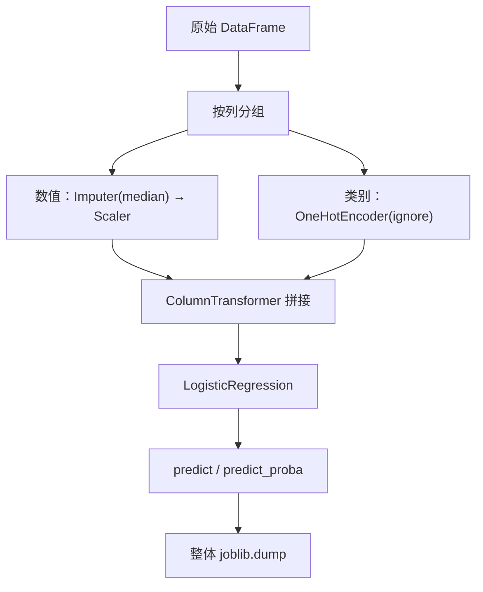

# ML-059 Pipeline 完整实践

## 1. 本节学习目标

1. 能对**混合类型**数据（数值 + 类别 + 缺失）搭一条完整 Pipeline。
2. 会用 `get_feature_names_out()` 核对每个变换后的列。
3. 会在 Pipeline 上做网格搜索（`clf__C`）。
4. 能处理训练时没见过的类别（`handle_unknown="ignore"`）。

## 2. 为什么需要这个知识

因为真实数据从来不是"干净的数值矩阵"：有缺失、有类别、有没见过的取值。

把这些手工处理好再喂模型，几乎必然出现"训练时处理过、测试时忘了处理"。Pipeline 把**所有变换**变成模型的一部分，从结构上消除这类错误。

## 3. 直观解释

一条完整的 Pipeline 长这样：

```text
数值列 age, income → 中位数填充 → 标准化 ─┐
                                          ├→ 拼接 → 逻辑回归 → 概率
类别列 city        → One-Hot 编码 ────────┘
```

**三个必须同时满足的条件**：

1. 两类列走**不同**分支（`ColumnTransformer`）。
2. 每步都是 sklearn 的转换器/估计器。
3. 全部包在**一个** `Pipeline` 对象里。

## 4. 正式定义

**ColumnTransformer 的分组映射**

$$
X' = \big[\,T_{num}(X_{S_{num}})\ \big|\ T_{cat}(X_{S_{cat}})\,\big]
$$

**本课的结构**

| 组 | 列 | 变换链 |
|---|---|---|
| `num` | `age`, `income` | `SimpleImputer(median)` → `StandardScaler` |
| `cat` | `city` | `OneHotEncoder(handle_unknown="ignore")` |

**输出列名**（`get_feature_names_out()`）

$$
[\texttt{num\_\_age},\ \texttt{num\_\_income},\ \texttt{cat\_\_city\_上海},\ \texttt{cat\_\_city\_北京},\ \texttt{cat\_\_city\_广州}]
$$

**参数寻址**：`clf__C` 表示"`clf` 步骤的 `C` 参数"。

## 5. 核心原理

**为什么"填充"必须在"标准化"之前**：NaN 参与均值计算会污染缩放参数；先填充成中位数，再标准化才正确。

**为什么 `handle_unknown="ignore"` 是上线必需**：训练集没有"深圳"，线上一定会有。默认 `"error"` 会直接抛异常。

**为什么列名前缀有用**：`num__` / `cat__` 前缀让你一眼看出这列来自哪个分支，排查问题时不用数下标。

**本课数据**（1500 样本，混合类型，含 100 个缺失）

| 项 | 值 |
|---|---|
| 样本数 | 1500 |
| 原始列 | `age`, `income`, `city` |
| 缺失总数 | **100**（age 60 + income 40） |
| 类别数 | 3（北京/上海/广州） |
| 变换后列数 | **5** |

## 6. 数学表达式

**本课评估结果**

$$
\text{Test}=0.7547,\qquad \text{CV}=0.7660
$$

（5 折：`[0.78, 0.79, 0.75, 0.7733, 0.7367]`）

**网格搜索**

$$
C^*=0.1,\qquad \text{CV}=0.7796,\qquad \text{Test}=0.7547
$$

**特征列数**

$$
d' = 2_{\text{数值}} + 3_{\text{类别}} = 5
$$

## 7. 数学库链接

| 用到的数学 | 对应篇目 | 用在哪 |
|---|---|---|
| 中位数 | [[MATH-306 期望、方差与协方差]] | 缺失填充 |
| 标准化 | [[MATH-306 期望、方差与协方差]] | 数值缩放 |
| 逻辑回归 | [[MATH-802 逻辑回归与 Sigmoid]] | 最终模型 |

## 8. 算法执行流程



## 9. 可视化解释

```text
输入（含缺失）                  变换后
age=NaN, income=8000, city=上海
      ↓                              ↓
age=median(42.0) → 标准化        [-1.2, -0.3, 0, 1, 0]
income=8000 → 标准化
city=上海 → One-Hot
```

## 10. Python 实现

```powershell
python ml059_pipeline_practice.py
```

```python
import numpy as np
import pandas as pd
from sklearn.compose import ColumnTransformer
from sklearn.impute import SimpleImputer
from sklearn.linear_model import LogisticRegression
from sklearn.model_selection import GridSearchCV, cross_val_score, train_test_split
from sklearn.pipeline import Pipeline
from sklearn.preprocessing import OneHotEncoder, StandardScaler

rng = np.random.default_rng(0)
n = 1500
age = rng.integers(18, 70, n).astype(float)
income = rng.normal(8000, 3000, n)
city = rng.choice(["北京", "上海", "广州"], n)

logit = (income - 8000) / 2500 + (age - 40) / 12 + np.where(city == "北京", 0.6, 0.0)
target = (rng.random(n) < 1 / (1 + np.exp(-logit))).astype(int)

df = pd.DataFrame({"age": age, "income": income, "city": city, "target": target})
df.loc[rng.choice(n, 60, replace=False), "age"] = np.nan
df.loc[rng.choice(n, 40, replace=False), "income"] = np.nan

num_cols, cat_cols = ["age", "income"], ["city"]
pre = ColumnTransformer([
    ("num", Pipeline([("imp", SimpleImputer(strategy="median")),
                      ("sc", StandardScaler())]), num_cols),
    ("cat", OneHotEncoder(handle_unknown="ignore", sparse_output=False), cat_cols),
])
model = Pipeline([("pre", pre), ("clf", LogisticRegression(max_iter=1000))])

X, y = df[num_cols + cat_cols], df["target"]
X_train, X_test, y_train, y_test = train_test_split(
    X, y, test_size=0.25, random_state=42, stratify=y)

model.fit(X_train, y_train)
print("缺失总数:", int(df.isna().sum().sum()))
print("目标分布:", np.bincount(y).tolist())
print("输出列名:", model.named_steps["pre"].get_feature_names_out().tolist())
print("测试准确率:", round(model.score(X_test, y_test), 4))

cv = cross_val_score(model, X, y, cv=5)
print("5 折 CV:", cv.round(4).tolist(), " 均值:", round(float(cv.mean()), 4))

grid = GridSearchCV(model, {"clf__C": [0.01, 0.1, 1, 10]}, cv=5, scoring="accuracy")
grid.fit(X_train, y_train)
print("最佳 C:", grid.best_params_["clf__C"],
      " CV:", round(float(grid.best_score_), 4),
      " test:", round(grid.score(X_test, y_test), 4))

new_sample = pd.DataFrame({"age": [35.0], "income": [9000.0], "city": ["深圳"]})
print("未知城市预测:", model.predict(new_sample)[0])
```

**实际运行结果**

```
缺失总数: 100
目标分布: [625, 875]
输出列名: ['num__age', 'num__income', 'cat__city_上海', 'cat__city_北京', 'cat__city_广州']
测试准确率: 0.7547
5 折 CV: [0.78, 0.79, 0.75, 0.7733, 0.7367]  均值: 0.766
最佳 C: 0.1  CV: 0.7796  test: 0.7547
未知城市预测: 1
```

## 11. 代码逐行解释

| 代码 | 作用 |
|---|---|
| `ColumnTransformer([...])` | 按列分组走不同分支 |
| `Pipeline([("imp", ...), ("sc", ...)])` | **组内再套一个 Pipeline**（填充→缩放） |
| `sparse_output=False` | One-Hot 返回稠密数组，便于拼接 |
| `get_feature_names_out()` | 核对每列来源与前缀 |
| `{"clf__C": [...]}` | 双下划线定位模型参数 |
| `predict(未知城市)` | `ignore` 保证不报错 |

**嵌套 Pipeline 的意义**：`num` 这一组内部也有顺序（填充必须在缩放前）。用嵌套 Pipeline 表达依赖，比在 `ColumnTransformer` 里塞两个元组更清晰。

## 12. 实际运行结果

见第 10 节。三点：

1. **100 个缺失被自动处理**，输出 5 列（2 数值 + 3 类别）。
2. 测试 0.7547、CV 0.766；网格搜到 `C=0.1` 后 CV 升到 0.7796（测试不变，属正常波动）。
3. **未知城市"深圳"能正常预测**（输出 1），不抛异常。

## 13. 适用场景

| 场景 | 需要加的步骤 |
|---|---|
| 含类别 | `OneHotEncoder` |
| 含缺失 | `SimpleImputer` |
| 数值尺度差异大 | `StandardScaler` |
| 高基数类别 | 目标编码（需自定义变换器） |
| 文本列 | `TfidfVectorizer` |
| 需要调参 | `GridSearchCV(pipeline, {...})` |

## 14. 优点与缺点

| 优点 | 缺点 |
|---|---|
| 全部变换一次定义、处处一致 | 嵌套深，调试要逐层取 |
| 结构上防泄漏 | 自定义变换器要写类 |
| 可整体调参、保存 | 报错信息有时不够直观 |
| 列名可追溯 | 复杂 Pipeline 难可视化 |

## 15. 常见错误

| 错误 | 表现 | 纠正 |
|---|---|---|
| 先缩放再填充 | NaN 残留 | 填充在前 |
| 在 Pipeline 外编码 | 泄漏/不一致 | 全部塞进 Pipeline |
| 忘了 `sparse_output=False` | 拼接类型错 | 显式设稠密 |
| 参数名写 `C` | `Invalid parameter` | `clf__C` |
| 类别列也标准化 | 无意义 | 只缩放数值列 |
| 线上新类别导致崩 | 没设 `ignore` | `handle_unknown="ignore"` |

## 16. 本节总结

- 混合类型数据必须用 `ColumnTransformer` 分组；组内可用嵌套 Pipeline 表达顺序。
- `get_feature_names_out()` 是核对列来源的最快手段。
- 在 Pipeline 上做网格搜索，参数用 `步骤名__参数名`。

## 17. 前置与后续

- 前置：[[ML-058 Scikit-learn 标准工作流]]、[[ML-016 预处理 Pipeline 与 ColumnTransformer]]
- 后续：[[ML-060 模型保存与加载 joblib]]、`ML-061 预测接口与部署基础`
- 相关数学：[[MATH-802 逻辑回归与 Sigmoid]]

## 18. 练习与参考答案

**基础 1**：为什么数值组内部要"先填充再缩放"？

**基础 2**：本课的缺失总数、输出列数、测试准确率各是多少？

**进阶 1**：`handle_unknown="ignore"` 解决什么问题？代价是什么？

**综合 1**：网格搜索为什么必须作用在 Pipeline 上，而不是只作用在 `LogisticRegression` 上？

> [!success]- 参考答案

> **基础 1**
> 因为 `SimpleImputer` 之后的 `StandardScaler` 要计算均值/标准差。若先缩放，NaN 会参与统计（得到 NaN 或错误值），缩放后该位置仍是 NaN，填充已无法补救。
> 正确顺序：**填充 → 缩放**。

> **基础 2**
> 缺失总数 **100**；输出列数 **5**（`num__age`、`num__income`、`cat__city_上海`、`cat__city_北京`、`cat__city_广州`）；测试准确率 **0.7547**。

> **进阶 1**
> 解决"线上出现训练时没见过的类别导致 `ValueError`"的问题——改为编码成**全 0**（该样本在所有类别列上都是 0）。
> 代价：模型无法区分"未知类别"与"已知但全 0"的样本；若未知类别占比高，模型效果会退化。

> **综合 1**
> 因为 Pipeline 里的 `imputer`、`scaler`、`encoder` **也是从数据学出来的**。若只对模型调参，这些变换器仍是"用全量数据 fit 过的旧对象" ⇒ 测试集信息已进入变换参数 ⇒ 数据泄漏。
> 在 Pipeline 上调参时，CV 的**每一折都会重新 fit 所有变换器**，评估才干净。

---

## 🔗 Notion 同步信息

> 以下内容由 Notion「AI Knowledge System · 知识点」数据库按知识 ID 合并而来（导出于 2026-11-09）。

| 属性 | 值 |
|---|---|
| 学科 | 机器学习 |
| 学习状态 | 未开始 |
| 难度 | L3 推导 |
| 知识类型 | Technique |

- **所属模块**：[M-ML-08 机器学习工程实践](../%E8%AF%BE%E7%A8%8B%E6%A8%A1%E5%9D%97/M-ML-08%20%E6%9C%BA%E5%99%A8%E5%AD%A6%E4%B9%A0%E5%B7%A5%E7%A8%8B%E5%AE%9E%E8%B7%B5.md)
- **前置知识**：[ML-058 Scikit-learn 标准工作流](ML-058%20Scikit-learn%20%E6%A0%87%E5%87%86%E5%B7%A5%E4%BD%9C%E6%B5%81.md)
- **后继知识**：[ML-060 模型保存与加载 joblib](ML-060%20%E6%A8%A1%E5%9E%8B%E4%BF%9D%E5%AD%98%E4%B8%8E%E5%8A%A0%E8%BD%BD%20joblib.md)
- **关联Python**：[PY-067 聚合与统计](../../01_Python%E5%9F%BA%E7%A1%80/08%20NumPy/PY-067%20%E8%81%9A%E5%90%88%E4%B8%8E%E7%BB%9F%E8%AE%A1.md)
