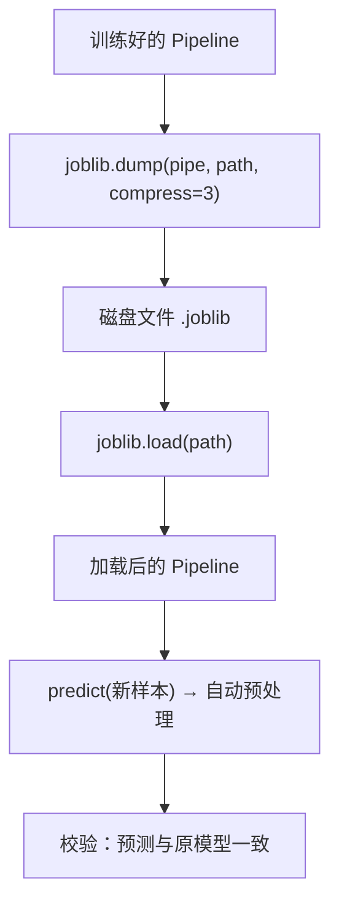

# ML-060 模型保存与加载 joblib

## 1. 本节学习目标

1. 会用 `joblib.dump/load` 保存与恢复**整个 Pipeline**。
2. 知道为什么必须存 Pipeline 而不是只存模型（scaler 也要存）。
3. 会比较 joblib 与 pickle 的体积与适用场景（本课：1.69 KB vs 2.57 KB）。
4. 知道版本不兼容的风险与规避方法。

## 2. 为什么需要这个知识

因为训练只是一次性工作，**上线后要反复预测**。总不能每次预测都重训一遍。

而模型保存最容易犯的错是：**只存了模型，忘了存预处理器**。上线时输入没被同样地标准化/编码 ⇒ 预测全错，且不报任何错。

## 3. 直观解释

保存模型 = **把"训练好的对象"序列化到磁盘**。

| 工具 | 特点 |
|---|---|
| `joblib` | sklearn 生态默认，**对大 numpy 数组高效**，支持压缩 |
| `pickle` | Python 内置，通用但慢、体积大 |
| ONNX | 跨语言/跨框架，需额外转换 |

**最重要的一条**：保存的对象应该是**整个 Pipeline**，这样加载后 `predict` 会自动做同样的预处理。

## 4. 正式定义

**序列化**

$$
\text{model} \xrightarrow{\text{dump}} \text{file} \xrightarrow{\text{load}} \text{model}'
$$

要求：$\text{model}'$ 的行为与 $\text{model}$ **完全一致**（同样的输入给同样的输出）。

**压缩**

```text
joblib.dump(model, path, compress=3)   # 0–9，越大越慢越小
```

**版本约束**：加载时的 `sklearn` 版本最好与训练时一致，否则可能报 `InconsistentVersionWarning` 或行为异常。

## 5. 核心原理

**为什么 joblib 对 numpy 友好**：它把大数组单独存成二进制块，避免 pickle 的逐对象开销。

**为什么必须存 Pipeline**：Pipeline 里含 `SimpleImputer`（中位数）、`StandardScaler`（均值方差）、`OneHotEncoder`（类别表）。这些**都是从训练集学的参数**，丢了它们，加载后的模型就不知道该怎么处理新输入。

**本课实测**

| 格式 | 体积 |
|---|---|
| joblib（compress=3） | **1.69 KB** |
| pickle | 2.57 KB |
| 压缩比 | **1.52×** |

**验证**：加载后预测与原模型**逐条一致**（`True`），准确率同为 0.7547。

## 6. 数学表达式

**本课验证结果**

$$
\text{pred}_{loaded}(\mathbf{x}) = \text{pred}_{orig}(\mathbf{x})\quad \forall \mathbf{x}\in\text{抽查样本}
$$

$$
\text{Acc}_{loaded}=0.7547=\text{Acc}_{orig}
$$

**体积**

$$
\frac{V_{pickle}}{V_{joblib}}=\frac{2.57}{1.69}\approx1.52
$$

**注意**：这里模型很小（逻辑回归 + 3 个特征），所以只有 KB 级。真实场景（随机森林 500 棵）会到几十–几百 MB，压缩收益更明显。

## 7. 数学库链接

| 用到的数学 | 对应篇目 | 用在哪 |
|---|---|---|
| 无（工程主题） | — | 本课偏工程实现 |

> 本课不引入新数学，重点是"参数要一起存"这一工程纪律。

## 8. 算法执行流程



## 9. 可视化解释

```text
只存模型（错）                 存整个 Pipeline（对）
clf.joblib                     pipe.joblib
  └ 只有权重                     ├ imputer（中位数）
                                 ├ scaler（均值/方差）
上线：新输入未标准化             ├ encoder（类别表）
  ⇒ 预测全错、不报错             └ clf（权重）
                               上线：predict 自动预处理 ✅
```

## 10. Python 实现

```powershell
python ml060_joblib.py
```

```python
import os
import pickle
import tempfile

import joblib
import numpy as np
import pandas as pd
from sklearn.compose import ColumnTransformer
from sklearn.impute import SimpleImputer
from sklearn.linear_model import LogisticRegression
from sklearn.model_selection import train_test_split
from sklearn.pipeline import Pipeline
from sklearn.preprocessing import OneHotEncoder, StandardScaler

rng = np.random.default_rng(0)
n = 1500
age = rng.integers(18, 70, n).astype(float)
income = rng.normal(8000, 3000, n)
city = rng.choice(["北京", "上海", "广州"], n)
logit = (income - 8000) / 2500 + (age - 40) / 12 + np.where(city == "北京", 0.6, 0.0)
target = (rng.random(n) < 1 / (1 + np.exp(-logit))).astype(int)

df = pd.DataFrame({"age": age, "income": income, "city": city, "target": target})
df.loc[rng.choice(n, 60, replace=False), "age"] = np.nan

num_cols, cat_cols = ["age", "income"], ["city"]
pre = ColumnTransformer([
    ("num", Pipeline([("imp", SimpleImputer(strategy="median")),
                      ("sc", StandardScaler())]), num_cols),
    ("cat", OneHotEncoder(handle_unknown="ignore", sparse_output=False), cat_cols),
])
pipe = Pipeline([("pre", pre), ("clf", LogisticRegression(max_iter=1000))])

X, y = df[num_cols + cat_cols], df["target"]
X_train, X_test, y_train, y_test = train_test_split(
    X, y, test_size=0.25, random_state=42, stratify=y)
pipe.fit(X_train, y_train)
print("原模型准确率:", round(pipe.score(X_test, y_test), 4))

joblib_path = os.path.join(tempfile.gettempdir(), "ml060_pipe.joblib")
pickle_path = os.path.join(tempfile.gettempdir(), "ml060_pipe.pkl")

joblib.dump(pipe, joblib_path, compress=3)
with open(pickle_path, "wb") as f:
    pickle.dump(pipe, f)

print("joblib 大小: %.2f KB" % (os.path.getsize(joblib_path) / 1024))
print("pickle 大小: %.2f KB" % (os.path.getsize(pickle_path) / 1024))
print("压缩比:", round(os.path.getsize(pickle_path) / os.path.getsize(joblib_path), 2))

loaded = joblib.load(joblib_path)
print("预测一致:", bool((loaded.predict(X_test[:20]) == pipe.predict(X_test[:20])).all()))
print("加载后准确率:", round(loaded.score(X_test, y_test), 4))

new_sample = pd.DataFrame({"age": [35.0], "income": [9000.0], "city": ["深圳"]})
print("未知城市预测:", loaded.predict(new_sample)[0])

os.remove(joblib_path)
os.remove(pickle_path)
print("临时文件已清理")
```

**实际运行结果**

```
原模型准确率: 0.7547
joblib 大小: 1.69 KB
pickle 大小: 2.57 KB
压缩比: 1.52
预测一致: True
加载后准确率: 0.7547
未知城市预测: 1
临时文件已清理
```

## 11. 代码逐行解释

| 代码 | 作用 |
|---|---|
| `joblib.dump(pipe, path, compress=3)` | 序列化整个 Pipeline，压缩级别 3 |
| `pickle.dump(pipe, f)` | 对照：内置序列化 |
| `os.path.getsize(...)/1024` | 转 KB |
| `joblib.load(path)` | 反序列化 |
| `loaded.predict(...) == pipe.predict(...)` | 一致性校验 |

**校验是必须的**：保存/加载后应**至少抽查一批样本**比对预测，确认行为一致。本课抽了 20 条（`True`）。

## 12. 实际运行结果

见第 10 节。三点：

1. joblib **1.69 KB** vs pickle **2.57 KB**（压缩比 1.52）。
2. 加载后预测**逐条一致**，准确率同为 0.7547。
3. 未知城市仍能预测（靠 encoder 里的 `handle_unknown="ignore"`）。

## 13. 适用场景

| 场景 | 做法 |
|---|---|
| sklearn 模型上线 | `joblib.dump(pipe)` |
| 需要压缩存储 | `compress=3`（或 9） |
| 跨语言部署 | 转 ONNX |
| 需要版本管理 | 文件名带版本/日期 |
| 大模型（GBDT 上千棵） | joblib + 压缩，注意加载时间 |

## 14. 优点与缺点

| 工具 | 优点 | 缺点 |
|---|---|---|
| joblib | 快、对大数组友好、支持压缩 | 绑定 Python/sklearn 版本 |
| pickle | 内置、通用 | 慢、体积大、同样有版本问题 |
| ONNX | 跨语言、可优化 | 转换可能丢失特性、需额外工具 |

## 15. 常见错误

| 错误 | 表现 | 纠正 |
|---|---|---|
| 只存 `clf` 不存 Pipeline | 上线预测错、不报错 | 存整个 `pipe` |
| 加载后不校验 | 静默错误 | 比对一批预测 |
| 版本不一致 | `InconsistentVersionWarning` | 锁定依赖版本 |
| 用 `compress=9` 存大模型 | 加载慢 | 用 3 左右 |
| 文件路径用相对路径 | 换目录找不到 | 用绝对路径/配置项 |
| 把 token 写进模型元数据 | 泄密 | 敏感信息不入模型文件 |

## 16. 本节总结

- **存整个 Pipeline**，不要只存模型。
- joblib 比 pickle 小且快（本课 1.52×）。
- 保存后必须**加载并校验预测一致**，并注意版本一致性。

## 17. 前置与后续

- 前置：[[ML-059 Pipeline 完整实践]]
- 后续：`ML-061 预测接口与部署基础`、`ML-062 实验记录与可复现性`
- 相关 Python：[[PY-041 文件读写]]、[[PY-049 包与项目结构]]

## 18. 练习与参考答案

**基础 1**：为什么必须保存整个 Pipeline 而不是只保存模型？

**基础 2**：本课 joblib 与 pickle 的体积各是多少？加载后预测是否一致？

**进阶 1**：`compress` 参数怎么选？为什么不是越大越好？

**综合 1**：模型上线后预测结果明显偏差，但代码没报错。可能是什么原因？

> [!success]- 参考答案

> **基础 1**
> 因为 Pipeline 里包含**从训练集学到的预处理参数**：`SimpleImputer` 的中位数、`StandardScaler` 的均值/方差、`OneHotEncoder` 的类别表。
> 只存模型的话，上线时新输入没被同样的方式处理 ⇒ 特征尺度/编码全错 ⇒ 预测错误且**不会报异常**（因为形状可能刚好对得上）。

> **基础 2**
> joblib **1.69 KB**，pickle **2.57 KB**（压缩比 1.52）；加载后预测**完全一致**（`True`），准确率同为 0.7547。

> **进阶 1**
> `compress` 取 0–9：越大文件越小但**保存/加载越慢**。
> 实践经验：`3` 左右性价比最高。若模型很大且加载频繁（如每次请求都 lazy load），压缩反而拖慢启动；若只是归档存储，可以用 9。

> **综合 1**
> 最常见的三个原因：
> 1. **只存了模型、没存预处理** ⇒ 上线输入未标准化/未编码。
> 2. **训练与上线特征顺序不一致** ⇒ 列错位（DataFrame 列名对但顺序变、或数组下标错）。
> 3. **版本不一致** ⇒ 加载的 sklearn 版本与训练时不同，行为变了。
> 排查顺序：先比对"上线输入经过 Pipeline 后的特征矩阵"与"训练时同样输入的矩阵"是否一致；再核对版本；最后确认保存的是整个 Pipeline。

---

## 🔗 Notion 同步信息

> 以下内容由 Notion「AI Knowledge System · 知识点」数据库按知识 ID 合并而来（导出于 2026-11-09）。

| 属性 | 值 |
|---|---|
| 学科 | 机器学习 |
| 学习状态 | 未开始 |
| 难度 | L2 应用 |
| 知识类型 | Technique |

- **所属模块**：[M-ML-08 机器学习工程实践](../%E8%AF%BE%E7%A8%8B%E6%A8%A1%E5%9D%97/M-ML-08%20%E6%9C%BA%E5%99%A8%E5%AD%A6%E4%B9%A0%E5%B7%A5%E7%A8%8B%E5%AE%9E%E8%B7%B5.md)
- **前置知识**：[ML-059 Pipeline 完整实践](ML-059%20Pipeline%20%E5%AE%8C%E6%95%B4%E5%AE%9E%E8%B7%B5.md)
- **后继知识**：[ML-061 预测接口与部署基础](ML-061%20%E9%A2%84%E6%B5%8B%E6%8E%A5%E5%8F%A3%E4%B8%8E%E9%83%A8%E7%BD%B2%E5%9F%BA%E7%A1%80.md)
- **关联Python**：[PY-041 文件读写](../../01_Python%E5%9F%BA%E7%A1%80/05%20%E5%BC%82%E5%B8%B8%E4%B8%8E%E6%96%87%E4%BB%B6/PY-041%20%E6%96%87%E4%BB%B6%E8%AF%BB%E5%86%99.md)
