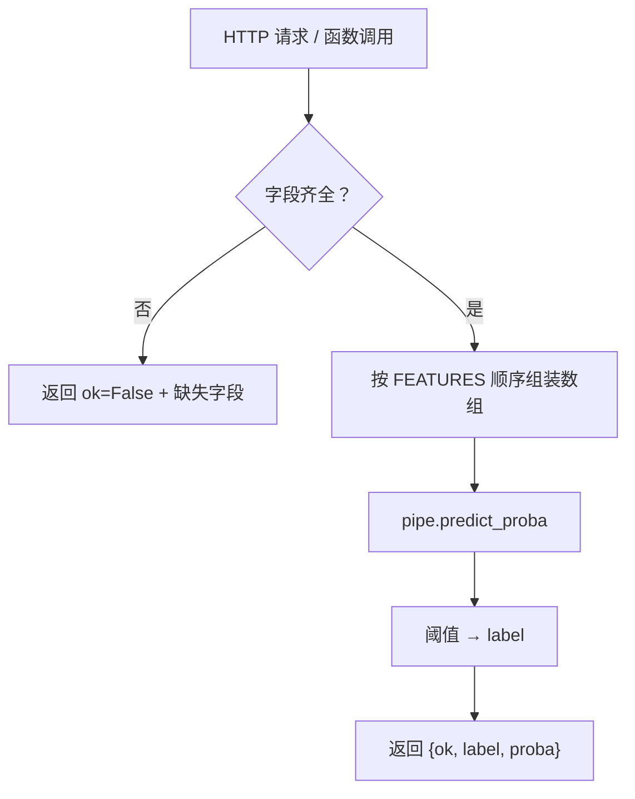

# ML-061 预测接口与部署基础

## 1. 本节学习目标

1. 会把模型包装成一个**带输入校验**的预测函数。
2. 理解"接口层"要做的三件事：校验、转换、返回结构化结果。
3. 知道批量与逐条预测的性能差异**取决于规模**（本课小批量下单条更快）。
4. 了解上线后最常见的三类故障：字段缺失、类型错误、列顺序错乱。

## 2. 为什么需要这个知识

因为模型本身只是个对象，**它不会替你挡住坏输入**。

线上请求可能缺字段、传字符串、多传列、列顺序不同。直接丢给 `pipe.predict()` 有两个后果：要么抛异常（可接受），要么**静默算错**（灾难）——比如列顺序变了，模型照样输出一个数字，但完全错误。

接口层就是把"不可控输入"变成"受控输入"的那道闸。

## 3. 直观解释

预测接口做三件事：

| 步骤 | 做什么 | 失败时的行为 |
|---|---|---|
| **校验** | 字段齐全？类型对？范围合理？ | 返回明确错误，不预测 |
| **转换** | dict → 二维数组（**按训练时列顺序**） | — |
| **包装** | 输出 `{label, proba}` 而非裸数组 | — |

**为什么返回结构化结果**：调用方需要知道"是否成功""概率多少"，而不是去猜数组第几位是什么。

## 4. 正式定义

**接口契约**

$$
\text{request}\ \{\text{features}\} \;\longrightarrow\; \text{response}\ \{\text{ok},\ \text{label},\ \text{proba}\ \mid\ \text{error}\}
$$

**输入维度要求**

$$
\mathbf{x}\in\mathbb{R}^{1\times d},\qquad d=\text{训练时的特征数}
$$

**列顺序**：必须与训练时 `FEATURES` 列表**完全一致**。

**本课的固定特征列表**

```text
FEATURES = ["f0", "f1", ..., f29"]   # 30 个
```

## 5. 核心原理

**为什么必须自己维护 `FEATURES` 列表**：训练时若用 numpy 数组，列顺序只存在于代码里；上线时如果调用方按字母序传或漏传一列，模型不会报错。

**为什么校验"缺字段"要显式做**：pandas 里缺列会直接 `KeyError`，但如果你用 `payload.values()` 之类的方式转换，就可能拿错列。

**本课的延迟实测（重要且反直觉）**

| 方式 | 耗时 |
|---|---|
| 批量 5 条一次 | **26.51 ms** |
| 逐条 5 次 | **3.64 ms** |

**批量反而更慢**。原因是：小数据时固定开销（pandas 构造、Pipeline 调用、numpy 转换）占主导，批量的"向量化收益"还没显现。

**结论**：批量的优势在**大数据量**才出现；小批量下逐条调用可能更快。不要盲目"批量优化"。

## 6. 数学表达式

**本课预测结果**

$$
\{\text{ok}: \text{True},\ \text{label}: 1,\ \text{proba}: 0.969\}
$$

**阈值规则**

$$
\text{label} = \mathbb{1}[\hat p \ge 0.5]
$$

**缺字段响应**

$$
\{\text{ok}:\text{False},\ \text{error}:\text{"缺少字段: ['f0']..."}\}
$$

**列数不匹配**：`pipe.predict` 抛 `ValueError`（被本课捕获并打印类型）。

## 7. 数学库链接

| 用到的数学 | 对应篇目 | 用在哪 |
|---|---|---|
| 概率与阈值 | [[MATH-802 逻辑回归与 Sigmoid]] | proba → label |

## 8. 算法执行流程



## 9. 可视化解释

```text
请求 {"f0":17.99, "f1":10.38, ...}
        ↓ 校验（30 个字段都在？都是数？）
        ↓ 组装成 (1, 30) 数组（顺序固定）
        ↓ Pipeline（自动标准化 + 逻辑回归）
响应 {"ok": true, "label": 1, "proba": 0.969}
```

## 10. Python 实现

```powershell
python ml061_predict_api.py
```

```python
import time

import numpy as np
import pandas as pd
from sklearn.datasets import load_breast_cancer
from sklearn.linear_model import LogisticRegression
from sklearn.model_selection import train_test_split
from sklearn.pipeline import Pipeline
from sklearn.preprocessing import StandardScaler

X, y = load_breast_cancer(return_X_y=True)
X_train, X_test, y_train, y_test = train_test_split(
    X, y, test_size=0.25, random_state=42, stratify=y)
pipe = Pipeline([("sc", StandardScaler()),
                 ("clf", LogisticRegression(max_iter=2000))]).fit(X_train, y_train)

FEATURES = [f"f{i}" for i in range(X.shape[1])]


def predict_one(payload: dict) -> dict:
    missing = [k for k in FEATURES if k not in payload]
    if missing:
        return {"ok": False, "error": f"缺少字段: {missing[:3]}..."}
    row = np.array([[payload[k] for k in FEATURES]], dtype=float)
    proba = float(pipe.predict_proba(row)[0, 1])
    return {"ok": True, "label": int(proba >= 0.5), "proba": round(proba, 4)}


sample = {k: float(v) for k, v in zip(FEATURES, X_test[0])}
print("正常请求:", predict_one(sample))

broken = dict(sample)
broken.pop(FEATURES[0])
print("缺字段:", predict_one(broken))

batch = pd.DataFrame(X_test[:5], columns=FEATURES)
start = time.time()
proba_batch = pipe.predict_proba(batch)[:, 1]
print("批量 5 条耗时(ms):", round((time.time() - start) * 1000, 2),
      " 概率:", proba_batch.round(3).tolist())

start = time.time()
for i in range(5):
    pipe.predict_proba(batch.iloc[[i]])
print("逐条 5 次耗时(ms):", round((time.time() - start) * 1000, 2))

try:
    pipe.predict(pd.DataFrame([[1.0] * 5]))
except Exception as exc:
    print("列数不匹配:", type(exc).__name__)
```

**实际运行结果**

```
正常请求: {'ok': True, 'label': 1, 'proba': 0.969}
缺字段: {'ok': False, 'error': "缺少字段: ['f0']..."}
批量 5 条耗时(ms): 26.51  概率: [0.969, 0.0, 0.559, 0.939, 0.175]
逐条 5 次耗时(ms): 3.64
列数不匹配: ValueError
```

## 11. 代码逐行解释

| 代码 | 作用 |
|---|---|
| `FEATURES = [f"f{i}" ...]` | **显式维护**训练时的列顺序 |
| `[k for k in FEATURES if k not in payload]` | 缺字段检查 |
| `np.array([[payload[k] for k in FEATURES]])` | 按**固定顺序**组装 |
| `predict_proba(...)[0, 1]` | 取正类概率 |
| `int(proba >= 0.5)` | 阈值 → 标签 |

**关键**：`[[payload[k] for k in FEATURES]]` 这一行保证了列顺序，即使调用方传的是乱序字典。

## 12. 实际运行结果

见第 10 节。三点：

1. 正常请求返回 `label=1, proba=0.969`。
2. 缺字段返回**结构化错误**，不抛异常、不瞎猜。
3. **批量 26.51 ms > 逐条 3.64 ms**（小批量下批量更慢）。

## 13. 适用场景

| 部署形态 | 说明 |
|---|---|
| 函数级调用 | 脚本内批量打分 |
| HTTP 服务 | Flask/FastAPI 包一层 |
| 批处理任务 | 定时跑全量数据 |
| 流式 | 逐条预测、低延迟 |
| 边缘设备 | 需模型压缩 |

## 14. 优点与缺点

| 做法 | 优点 | 缺点 |
|---|---|---|
| 显式校验 | 错误可读、不静默出错 | 多写代码 |
| 结构化返回 | 调用方好处理 | 需约定字段 |
| 批量预测 | 大数据快 | 小批量反而慢（本课） |
| 只靠框架校验 | 省事 | 错误信息不友好 |

## 15. 常见错误

| 错误 | 表现 | 纠正 |
|---|---|---|
| 不校验字段 | `KeyError` 或拿错列 | 显式检查 |
| 按字典顺序组装 | 列错位、静默算错 | 按 `FEATURES` 顺序 |
| 返回裸数组 | 调用方靠下标猜 | 返回结构化 dict |
| 小批量硬做批量优化 | 本课反而更慢 | 按规模选择 |
| 把阈值写死 0.5 | 业务可能需调 | 阈值可配置 |
| 服务里重新 fit | 每次请求都训练 | 启动时加载一次 |

## 16. 本节总结

- 预测接口三件事：**校验、按固定列序转换、结构化返回**。
- 列顺序错会导致**静默错误**，比报错更危险。
- **批量不一定更快**：本课 5 条时批量 26.51 ms > 逐条 3.64 ms。

## 17. 前置与后续

- 前置：[[ML-060 模型保存与加载 joblib]]
- 后续：`ML-062 实验记录与可复现性`、`ML-063 端到端机器学习项目`
- 相关 Python：[[PY-009 函数]]

## 18. 练习与参考答案

**基础 1**：预测接口应该做哪三件事？

**基础 2**：本课正常请求与缺字段请求的返回各是什么？

**进阶 1**：为什么"列顺序错"比"列数错"更危险？

**综合 1**：本课批量 5 条比逐条 5 次更慢，怎么解释？什么时候该用批量？

> [!success]- 参考答案

> **基础 1**
> ① **校验**输入（字段齐全、类型正确）；② **转换**成模型要求的二维数组并保证列顺序；③ **结构化返回**（`ok`/`label`/`proba` 或 `error`）。

> **基础 2**
> 正常：`{'ok': True, 'label': 1, 'proba': 0.969}`。
> 缺字段：`{'ok': False, 'error': "缺少字段: ['f0']..."}`。

> **进阶 1**
> 因为列数错会**抛异常**（`ValueError`），你能立刻发现。
> 而列顺序错时，数组形状仍然正确（`(1, 30)`），模型照常输出一个概率——只是这个概率是基于**错位的特征**算出来的，**结果完全错误但不报任何错**。
> 这类"静默错误"是上线事故的主要来源。

> **综合 1**
> 因为 5 条数据太小，**固定开销**占主导：构造 DataFrame、进入 Pipeline、参数校验、numpy 转换，这些成本与数据量关系不大。
> 批量的收益来自**向量化**（一次矩阵运算 vs 多次小矩阵），只有在数据量足够大（几百条以上）时才超过固定开销。
> 建议：按实际 QPS 与批量大小**实测**再决定；不要凭"批量一定更快"下结论。

---

## 🔗 Notion 同步信息

> 以下内容由 Notion「AI Knowledge System · 知识点」数据库按知识 ID 合并而来（导出于 2026-11-09）。

| 属性 | 值 |
|---|---|
| 学科 | 机器学习 |
| 学习状态 | 未开始 |
| 难度 | L2 应用 |
| 知识类型 | Technique |

- **所属模块**：[M-ML-08 机器学习工程实践](../%E8%AF%BE%E7%A8%8B%E6%A8%A1%E5%9D%97/M-ML-08%20%E6%9C%BA%E5%99%A8%E5%AD%A6%E4%B9%A0%E5%B7%A5%E7%A8%8B%E5%AE%9E%E8%B7%B5.md)
- **前置知识**：[ML-060 模型保存与加载 joblib](ML-060%20%E6%A8%A1%E5%9E%8B%E4%BF%9D%E5%AD%98%E4%B8%8E%E5%8A%A0%E8%BD%BD%20joblib.md)
- **后继知识**：[ML-062 实验记录与可复现性](ML-062%20%E5%AE%9E%E9%AA%8C%E8%AE%B0%E5%BD%95%E4%B8%8E%E5%8F%AF%E5%A4%8D%E7%8E%B0%E6%80%A7.md)
- **关联Python**：[PY-009 函数](../../01_Python%E5%9F%BA%E7%A1%80/02%20%E5%87%BD%E6%95%B0%E4%B8%8E%E4%BD%9C%E7%94%A8%E5%9F%9F/PY-009%20%E5%87%BD%E6%95%B0.md)
