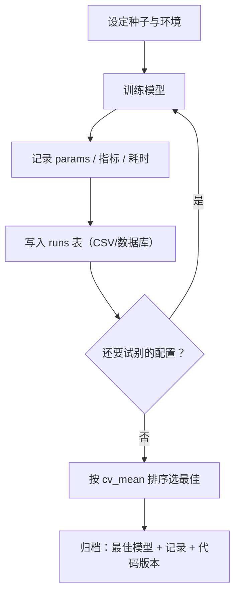

# ML-062 实验记录与可复现性

## 1. 本节学习目标

1. 会记录一个"最小但够用"的实验表：**参数、指标、耗时、随机种子**。
2. **理解"同种子可复现、不同种子会变"**（本课：同种子完全一致，换种子最大差 0.16）。
3. 知道可复现性包含哪四层（数据、代码、环境、随机性）。
4. 会写出可交接的实验记录格式。

## 2. 为什么需要这个知识

因为**一周后你就会忘记那次 0.986 是怎么跑出来的**。

更麻烦的是：报告里的分数如果没有记录参数与种子，别人（或未来的你）**无法重现**。而 ML 项目的价值往往在于"能复现地迭代"，不在于某一次的好结果。

## 3. 直观解释

一次实验至少要记这五样：

| 项 | 例子 |
|---|---|
| 模型与参数 | `lr, {"C": 1.0}` |
| 指标（含波动） | `cv 0.9695 ± 0.0095` |
| 测试分数 | `0.986` |
| 耗时 | `0.005 s` |
| **随机种子** | `42` |

**为什么"含波动"重要**：只记 `0.9695` 无法判断"换个种子是否还是这个数"。本课实测不同种子最大差 **0.16**——比很多"模型改进"都大。

## 4. 正式定义

**可复现性的四层**

| 层 | 要素 | 常见疏漏 |
|---|---|---|
| 数据 | 版本、划分方式 | 数据更新后旧结果失效 |
| 代码 | 提交哈希、脚本 | 改了代码没记 |
| 环境 | Python/库版本 | 换机器跑不出 |
| 随机性 | 种子、线程数 | 没设种子 |

**实验记录的最小字段**

```text
run_id, model, params, cv_mean, cv_std, test_acc, fit_sec, seed, data_version
```

**可复现的形式化**

$$
\text{train}(\mathcal{D}, \theta, s) \Rightarrow \text{metrics}
$$

给定相同 $(\mathcal{D}, \theta, s)$（数据、超参、种子），结果应当相同。

## 5. 核心原理

**为什么同种子一定一致**：sklearn 的随机性全部由 `random_state` 控制（采样、特征子集、初始化）。固定它就固定了整条随机路径。

**为什么换种子会变**：不同的 bootstrap 样本/特征子集/划分 ⇒ 不同的模型 ⇒ 不同的分数。

**本课实测**

| 对比 | 结果 |
|---|---|
| 同种子（7 vs 7） | **完全一致**（`True`） |
| 不同种子（7 vs 8） | 概率最大差 **0.16** |

**0.16 的概率差**在二分类里足以改变一批样本的判定——这意味着**不记种子的结果几乎没有参考价值**。

## 6. 数学表达式

**本课实验表**

| run_id | model | params | cv_mean | cv_std | test_acc | fit_sec |
|---|---|---|---|---|---|---|
| 1 | lr | `{"C": 1.0}` | **0.9695** | 0.0095 | **0.986** | 0.005 |
| 2 | rf | `{"n_estimators": 100}` | 0.9601 | 0.0206 | 0.958 | 0.078 |

**最佳选择**：按 `cv_mean` 取最大 ⇒ **lr**（0.9695 > 0.9601）。

**注意**：rf 的 `cv_std`（0.0206）是 lr（0.0095）的 2 倍 ⇒ rf 的结果更不稳定。

## 7. 数学库链接

| 用到的数学 | 对应篇目 | 用在哪 |
|---|---|---|
| 均值与标准差 | [[MATH-306 期望、方差与协方差]] | `cv_mean ± cv_std` |
| 抽样波动 | [[MATH-401 大数定律与中心极限定理]] | 换种子为何会变 |

## 8. 算法执行流程



## 9. 可视化解释

```text
不记录                          记录之后
"我跑出 0.986"                  run 1: lr C=1, cv 0.9695±0.0095, test 0.986, seed 42
  ↑ 一周后：怎么跑的？            run 2: rf n=100, cv 0.9601±0.0206, test 0.958, seed 42
    换个人：复现不了                ↑ 可复现、可比较、可交接
```

## 10. Python 实现

```powershell
python ml062_experiments.py
```

```python
import json

import numpy as np
import pandas as pd
from sklearn.datasets import load_breast_cancer
from sklearn.ensemble import RandomForestClassifier
from sklearn.linear_model import LogisticRegression
from sklearn.model_selection import cross_val_score, train_test_split
from sklearn.pipeline import Pipeline
from sklearn.preprocessing import StandardScaler

X, y = load_breast_cancer(return_X_y=True)
X_train, X_test, y_train, y_test = train_test_split(
    X, y, test_size=0.25, random_state=42, stratify=y)

runs = []
candidates = [
    ("lr", Pipeline([("sc", StandardScaler()),
                     ("clf", LogisticRegression(max_iter=2000))]), {"C": 1.0}),
    ("rf", RandomForestClassifier(n_estimators=100, random_state=42),
     {"n_estimators": 100}),
]

for name, model, params in candidates:
    import time
    start = time.time()
    model.fit(X_train, y_train)
    fit_sec = time.time() - start
    cv = cross_val_score(model, X_train, y_train, cv=5)
    runs.append({
        "run_id": len(runs) + 1,
        "model": name,
        "params": json.dumps(params),
        "cv_mean": round(float(cv.mean()), 4),
        "cv_std": round(float(cv.std()), 4),
        "test_acc": round(model.score(X_test, y_test), 4),
        "fit_sec": round(fit_sec, 3),
        "seed": 42,
    })

table = pd.DataFrame(runs)
print(table.to_string(index=False))
print("按 cv_mean 选最佳:", table.loc[table["cv_mean"].idxmax(), "model"])

# 可复现性验证
a = RandomForestClassifier(n_estimators=50, random_state=7).fit(X_train, y_train).predict_proba(X_test)[:5]
b = RandomForestClassifier(n_estimators=50, random_state=7).fit(X_train, y_train).predict_proba(X_test)[:5]
c = RandomForestClassifier(n_estimators=50, random_state=8).fit(X_train, y_train).predict_proba(X_test)[:5]
print("同种子一致:", bool(np.allclose(a, b)))
print("不同种子最大差:", round(float(np.abs(a - c).max()), 4))
```

**实际运行结果**

```
 run_id model                params  cv_mean  cv_std  test_acc  fit_sec  seed
      1    lr            {"C": 1.0}   0.9695  0.0095     0.986    0.005    42
      2    rf {"n_estimators": 100}   0.9601  0.0206     0.958    0.078    42
按 cv_mean 选最佳: lr
同种子一致: True
不同种子最大差: 0.16
```

## 11. 代码逐行解释

| 代码 | 作用 |
|---|---|
| `runs.append({...})` | 每次实验追加一行 |
| `json.dumps(params)` | 参数字典存成字符串（便于落表） |
| `cv.mean()/cv.std()` | 均值与波动一起记 |
| `fit_sec` | 训练耗时（用于成本判断） |
| `random_state=7` vs `8` | 演示种子对结果的影响 |

**为什么参数存成 JSON 字符串**：CSV/数据库里不能存 dict，序列化成字符串后仍可读、可还原。

## 12. 实际运行结果

见第 10 节。三点：

1. **lr 更好**：cv 0.9695 vs 0.9601，test 0.986 vs 0.958，且快 15 倍（0.005s vs 0.078s）。
2. rf 的 `cv_std`（0.0206）是 lr（0.0095）的 2 倍 ⇒ 更不稳定。
3. **同种子完全一致；换种子概率最大差 0.16**。

## 13. 适用场景

| 场景 | 记录粒度 |
|---|---|
| 个人探索 | 一个 CSV 就够 |
| 团队协作 | 需要工具（MLflow/W&B） |
| 需要审计 | 加代码哈希、数据版本 |
| 论文复现 | 全套环境锁定 |

## 14. 优点与缺点

| 做法 | 优点 | 缺点 |
|---|---|---|
| CSV 记录 | 简单、可 diff | 无 UI、难查历史 |
| 实验平台 | 可视化、可对比 | 有学习成本 |
| 只记分数 | 省事 | **不可复现** |

## 15. 常见错误

| 错误 | 表现 | 纠正 |
|---|---|---|
| 不记种子 | 别人复现不出 | 每行都记 `seed` |
| 只记最好的一次 | 选择偏差 | 记录所有尝试 |
| 不记库版本 | 换环境结果变 | 记 `sklearn.__version__` |
| 参数用默认值不写 | 默认值变了就复现不了 | 显式写出 |
| 数据更新后不标注 | 旧分数失效 | 记录数据版本/哈希 |
| 用测试分数选模型 | 泄漏 | 用 `cv_mean` 选 |

## 16. 本节总结

- 实验记录最小集：**参数、指标（含 std）、耗时、种子**。
- **同种子可复现，换种子会变**（本课概率最大差 0.16）——所以种子必须记。
- 选模型用 `cv_mean`，不用测试分数。

## 17. 前置与后续

- 前置：[[ML-061 预测接口与部署基础]]
- 后续：`ML-063 端到端机器学习项目`、`ML-064 模型监控与常见问题`
- 相关 Python：[[PY-053 单元测试与 pytest]]

## 18. 练习与参考答案

**基础 1**：一次实验至少要记录哪五样东西？

**基础 2**：本课 lr 与 rf 的 `cv_mean`、`test_acc`、`fit_sec` 各是多少？

**进阶 1**：为什么"不记种子"会让实验记录基本失效？

**综合 1**：同种子完全一致、换种子概率差 0.16，这对"模型改进"有什么启示？

> [!success]- 参考答案

> **基础 1**
> ① 模型与参数 ② 指标（含 `cv_mean ± cv_std`）③ 测试分数 ④ 训练耗时 ⑤ **随机种子**（外加数据/环境版本更佳）。

> **基础 2**
> lr：cv **0.9695 ± 0.0095**、test **0.986**、fit **0.005 s**。
> rf：cv **0.9601 ± 0.0206**、test **0.958**、fit **0.078 s**。

> **进阶 1**
> 因为种子控制着划分、采样、特征子集等**全部随机性**。本课实测：同种子结果完全一致，换种子概率最大差 **0.16**。
> 0.16 的概率差足以改变大量样本的判定 ⇒ 不知道种子，就无法判断你报的 0.986 是"模型好"还是"这次划分运气好"，也就无法复现。

> **综合 1**
> 启示：**任何小于"种子间波动"的改进都不可信**。
> 本课换种子最大差 0.16（概率）意味着：若某个改动只让测试准确率提升 0.01–0.02，那很可能只是随机波动。
> 正确做法：
> 1. 所有对比都在**同一组种子**下做；
> 2. 报**多次种子的均值 ± 标准差**，而不是单次；
> 3. 只有当改进幅度**大于标准差**时，才认为有效。

---

## 🔗 Notion 同步信息

> 以下内容由 Notion「AI Knowledge System · 知识点」数据库按知识 ID 合并而来（导出于 2026-11-09）。

| 属性 | 值 |
|---|---|
| 学科 | 机器学习 |
| 学习状态 | 未开始 |
| 难度 | L2 应用 |
| 知识类型 | Technique |

- **所属模块**：[M-ML-08 机器学习工程实践](../%E8%AF%BE%E7%A8%8B%E6%A8%A1%E5%9D%97/M-ML-08%20%E6%9C%BA%E5%99%A8%E5%AD%A6%E4%B9%A0%E5%B7%A5%E7%A8%8B%E5%AE%9E%E8%B7%B5.md)
- **前置知识**：[ML-061 预测接口与部署基础](ML-061%20%E9%A2%84%E6%B5%8B%E6%8E%A5%E5%8F%A3%E4%B8%8E%E9%83%A8%E7%BD%B2%E5%9F%BA%E7%A1%80.md)
- **后继知识**：[ML-063 端到端机器学习项目](ML-063%20%E7%AB%AF%E5%88%B0%E7%AB%AF%E6%9C%BA%E5%99%A8%E5%AD%A6%E4%B9%A0%E9%A1%B9%E7%9B%AE.md)
- **关联Python**：[PY-055 Git 基础](../../01_Python%E5%9F%BA%E7%A1%80/06%20%E6%A8%A1%E5%9D%97%E4%B8%8E%E5%8C%85/PY-055%20Git%20%E5%9F%BA%E7%A1%80.md)
