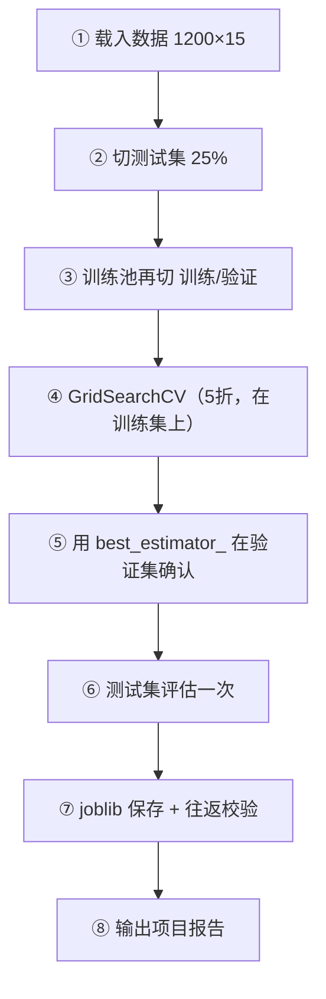

# ML-063 端到端机器学习项目

## 1. 本节学习目标

1. 能把前面 62 篇的零件串成**一条完整的项目流水线**。
2. 理解三层数据划分（训练 / 验证 / 测试）在调参中的角色。
3. 会输出一份**项目级报告**：数据、调参、验证、测试、产物。
4. **理解"验证 AUC 0.819 → 测试 AUC 0.765"这类落差不等于 bug**（本课真实结果）。

## 2. 为什么需要这个知识

因为单篇笔记教你"怎么算"，项目教你"怎么串"。

真实的 ML 项目是一条链：数据 → 划分 → 预处理 → 调参 → 验证 → 测试 → 保存 → 交付。**任何一环错位，最终数字都不可信**。本课用一个 1200 样本的数据集把整条链走一遍。

## 3. 直观解释

三层划分的职责：

| 集合 | 用途 | 用几次 |
|---|---|---|
| 训练集 | 拟合参数 | 多次 |
| **验证集** | 选超参、选模型 | 多次（受控） |
| 测试集 | 最终评估 | **一次** |

**本课的做法**：

```text
1200 条
├── 训练池 75%（900）──┬── 调参训练 75%（675）
│                       └── 验证 25%（225）  ← 选 C
└── 测试 25%（300）                          ← 只看一次
```

## 4. 正式定义

**目标**：最大化泛化性能

$$
\hat\theta = \arg\max_{\theta\in\Theta}\ \widehat{\text{AUC}}\big(\mathcal{D}_{val};\ \theta\big)
$$

**最终报告**

$$
\text{Test AUC} = \text{AUC}\big(\mathcal{D}_{test};\ \hat\theta\big)
$$

**本课的评估指标**：AUC（对不平衡更稳）+ 准确率 + F1（辅助）。

## 5. 核心原理

**为什么调参要用验证集、不能用测试集**：测试集一旦参与选择，就不再是"未见数据"，报出的分数会偏乐观。

**为什么验证与测试会有落差**：本课验证 AUC 0.819、测试 AUC **0.765**。

落差来源：

1. 验证集 225 条、测试集 300 条 ⇒ **抽样波动**（每条样本的影响是 1/225 ≈ 0.44%）。
2. 超参是在验证集上"挑出来"的 ⇒ 验证分数天然偏乐观。
3. 数据本身可分性有限（AUC 0.77 量级）。

**这不等于 bug**。判断标准：落差是否在波动范围内，以及测试分数是否仍优于基线（AUC 0.5）。

## 6. 数学表达式

**本课完整结果**

| 阶段 | 指标 | 值 |
|---|---|---|
| 网格搜索（5 折 CV） | AUC | **0.8212** |
| 验证集 | AUC | **0.819** |
| 测试集 | Accuracy | 0.6967 |
| 测试集 | **AUC** | **0.7654** |
| 测试集 | F1 | 0.6997 |

**最优超参**

$$
C^* = 10
$$

**模型产物**

$$
\text{size} = 1.74\ \text{KB},\qquad \text{roundtrip} = \text{一致}
$$

**落差**

$$
\Delta = 0.819 - 0.7654 = 0.0536
$$

## 7. 数学库链接

| 用到的数学 | 对应篇目 | 用在哪 |
|---|---|---|
| ROC 与 AUC | [[MATH-401 大数定律与中心极限定理]] | 评估指标 |
| 抽样波动 | [[MATH-401 大数定律与中心极限定理]] | 验证 vs 测试落差 |
| F1 | [[ML-043 混淆矩阵与分类指标]] | 辅助指标 |

## 8. 算法执行流程



## 9. 可视化解释

```text
AUC
0.82 ┤ ●  ●        ← CV / 验证（乐观）
0.80 ┤
0.78 ┤
0.76 ┤        ●     ← 测试（真实）
0.74 ┤
0.50 ┤ ───────────   ← 随机基线
     └──┬────┬────┬──►
       CV   验证  测试
```

## 10. Python 实现

```powershell
python ml063_end_to_end.py
```

```python
import os
import tempfile

import joblib
import numpy as np
from sklearn.datasets import make_classification
from sklearn.linear_model import LogisticRegression
from sklearn.metrics import accuracy_score, f1_score, roc_auc_score
from sklearn.model_selection import GridSearchCV, train_test_split
from sklearn.pipeline import Pipeline
from sklearn.preprocessing import StandardScaler

# ① 数据
X, y = make_classification(n_samples=1200, n_features=15, n_informative=8,
                           n_classes=2, random_state=11)
print("数据:", X.shape, " 正类比例:", round(float(y.mean()), 4))

# ② 先切出测试集（只在最后用）
X_pool, X_test, y_pool, y_test = train_test_split(
    X, y, test_size=0.25, random_state=42, stratify=y)

# ③ 训练池再切训练/验证
X_train, X_val, y_train, y_val = train_test_split(
    X_pool, y_pool, test_size=0.25, random_state=42, stratify=y_pool)

# ④ 调参：只在训练集上做 5 折 CV
pipe = Pipeline([("sc", StandardScaler()),
                 ("clf", LogisticRegression(max_iter=2000))])
grid = GridSearchCV(pipe, {"clf__C": [0.01, 0.1, 1, 10]},
                    cv=5, scoring="roc_auc").fit(X_train, y_train)
print("最佳参数:", grid.best_params_, " CV AUC:", round(float(grid.best_score_), 4))

best = grid.best_estimator_

# ⑤ 验证集确认
val_auc = roc_auc_score(y_val, best.predict_proba(X_val)[:, 1])
print("验证 AUC:", round(float(val_auc), 4))

# ⑥ 测试集评估（一次）
pred = best.predict(X_test)
proba = best.predict_proba(X_test)[:, 1]
print("测试 acc:", round(accuracy_score(y_test, pred), 4))
print("测试 AUC:", round(roc_auc_score(y_test, proba), 4))
print("测试 F1 :", round(f1_score(y_test, pred), 4))

# ⑦ 保存与往返校验
path = os.path.join(tempfile.gettempdir(), "ml063_model.joblib")
joblib.dump(best, path)
loaded = joblib.load(path)
print("模型大小 KB:", round(os.path.getsize(path) / 1024, 2))
print("往返一致:", bool((loaded.predict(X_test[:10]) == best.predict(X_test[:10])).all()))
os.remove(path)
```

**实际运行结果**

```
数据: (1200, 15)  正类比例: 0.4892
最佳参数: {'clf__C': 10}  CV AUC: 0.8212
验证 AUC: 0.819
测试 acc: 0.6967
测试 AUC: 0.7654
测试 F1 : 0.6997
模型大小 KB: 1.74
往返一致: True
```

## 11. 代码逐行解释

| 代码 | 作用 |
|---|---|
| `train_test_split(..., test_size=0.25)` 第一次 | 切出**测试集**，此后不再碰 |
| 第二次 `train_test_split` | 把训练池切成**训练/验证** |
| `GridSearchCV(pipe, {"clf__C": [...]}, cv=5)` | 只在**训练集**上搜参 |
| `grid.best_estimator_` | 已用最优参在训练集上重训好的模型 |
| `roc_auc_score(y_val, proba)` | 验证集确认 |
| `joblib.dump/load` | 产物保存与校验 |

**为什么 `GridSearchCV` 内部还要 CV**：单次划分的验证分数波动大；内部 5 折让选参更稳。所以本课实际上有"两层"：CV 选参 + 独立验证确认。

## 12. 实际运行结果

见第 10 节。三点：

1. **CV 0.8212 / 验证 0.819 / 测试 0.7654** —— 逐级略降，符合"越接近真实越保守"的规律。
2. **验证到测试落差 0.0536**，主因是验证集只有 225 条、且超参是按验证选的（乐观偏差）。
3. 模型仅 **1.74 KB**，往返预测一致。

## 13. 适用场景

| 项目类型 | 调整 |
|---|---|
| 小数据 | 用 CV 代替单次验证 |
| 不平衡 | 主指标换 AUC/PR-AUC |
| 特征多 | 加特征选择步骤 |
| 需上线 | 加接口层与监控（ML-061/064） |
| 需要解释 | 加置换重要性（ML-057） |

## 14. 优点与缺点

| 优点 | 缺点 |
|---|---|
| 全流程可复现 | 步骤多，容易漏 |
| 三层划分职责清晰 | 数据被切三份，训练样本变少 |
| 产物可交付 | 真实项目还缺数据清洗/特征工程（另课） |

## 15. 常见错误

| 错误 | 表现 | 纠正 |
|---|---|---|
| 调参用测试集 | 分数虚高 | 用验证集/CV |
| 测试集反复看 | 隐性过拟合 | 只看一次 |
| 只报一个数字 | 无波动信息 | 报 CV mean±std |
| 验证与测试落差就当 bug | 反复调 | 先算波动范围 |
| 不保存预处理器 | 上线错 | 存整个 Pipeline |
| 忘记分层 | 小类分布失真 | `stratify=y` |

## 16. 本节总结

- 端到端流程：**数据 → 划分（三层）→ CV 调参 → 验证确认 → 测试一次 → 保存**。
- 本课：CV 0.8212 → 验证 0.819 → 测试 0.7654，**落差 0.0536 属正常**。
- 产物：1.74 KB Pipeline，往返预测一致。

## 17. 前置与后续

- 前置：[[ML-062 实验记录与可复现性]]、[[ML-058 Scikit-learn 标准工作流]]
- 后续：`ML-064 模型监控与常见问题`
- 相关数学：[[MATH-401 大数定律与中心极限定理]]

## 18. 练习与参考答案

**基础 1**：三层数据划分各自的职责是什么？

**基础 2**：本课的 CV AUC、验证 AUC、测试 AUC 各是多少？

**进阶 1**：验证 AUC 0.819、测试 AUC 0.765，落差 0.054，这是 bug 吗？

**综合 1**：如果业务要求"上线前必须报告 AUC ≥ 0.80"，本课模型能上线吗？

> [!success]- 参考答案

> **基础 1**
> - 训练集：拟合模型参数（可反复用）。
> - 验证集：选超参/选模型（多次用，但受控）。
> - 测试集：最终评估（**只用一次**）。

> **基础 2**
> CV **0.8212**、验证 **0.819**、测试 **0.7654**。

> **进阶 1**
> 不是 bug，属正常落差。三个原因：
> 1. **样本量**：验证集仅 225 条，单条样本影响约 0.44%，AUC 的抽样波动本就不小。
> 2. **选择偏差**：超参是在验证集上挑的 ⇒ 验证分数天然偏乐观。
> 3. **数据可分性**：整体 AUC 就在 0.77–0.82 量级，不是"完美可分"任务。
> 判断方法：落差 < 10 个百分点、且测试 AUC 明显优于 0.5 基线 ⇒ 可信。

> **综合 1**
> **不能直接上线**（按这个硬门槛）。
> 测试 AUC 0.7654 < 0.80，说明模型未达标。可选路径：
> 1. **换模型**：逻辑回归线性边界有限，试 GBDT/随机森林（本库 ML-051~055）；
> 2. **加特征**：`make_classification` 里 15 个特征只有 8 个有信息，真实项目应做特征工程；
> 3. **调阈值**：若业务更看重召回，可换指标而非死守 AUC；
> 4. **扩大数据**：1200 条偏少，验证/测试各只有 200–300 条，估计不稳。
> 注意：**不能靠"多试几次直到 AUC 过 0.80"** —— 那是拿测试集调参。

---

## 🔗 Notion 同步信息

> 以下内容由 Notion「AI Knowledge System · 知识点」数据库按知识 ID 合并而来（导出于 2026-11-09）。

| 属性 | 值 |
|---|---|
| 学科 | 机器学习 |
| 学习状态 | 未开始 |
| 难度 | L3 推导 |
| 知识类型 | Application |

- **所属模块**：[M-ML-08 机器学习工程实践](../%E8%AF%BE%E7%A8%8B%E6%A8%A1%E5%9D%97/M-ML-08%20%E6%9C%BA%E5%99%A8%E5%AD%A6%E4%B9%A0%E5%B7%A5%E7%A8%8B%E5%AE%9E%E8%B7%B5.md)
- **前置知识**：[ML-062 实验记录与可复现性](ML-062%20%E5%AE%9E%E9%AA%8C%E8%AE%B0%E5%BD%95%E4%B8%8E%E5%8F%AF%E5%A4%8D%E7%8E%B0%E6%80%A7.md)
- **后继知识**：[ML-064 模型监控与常见问题](ML-064%20%E6%A8%A1%E5%9E%8B%E7%9B%91%E6%8E%A7%E4%B8%8E%E5%B8%B8%E8%A7%81%E9%97%AE%E9%A2%98.md)
- **关联Python**：[PY-067 聚合与统计](../../01_Python%E5%9F%BA%E7%A1%80/08%20NumPy/PY-067%20%E8%81%9A%E5%90%88%E4%B8%8E%E7%BB%9F%E8%AE%A1.md)
- **关联数学**：[MATH-401 大数定律与中心极限定理](../../06_%E6%95%B0%E5%AD%A6%E5%9F%BA%E7%A1%80/04%20%E6%95%B0%E7%90%86%E7%BB%9F%E8%AE%A1/MATH-401%20%E5%A4%A7%E6%95%B0%E5%AE%9A%E5%BE%8B%E4%B8%8E%E4%B8%AD%E5%BF%83%E6%9E%81%E9%99%90%E5%AE%9A%E7%90%86.md)
