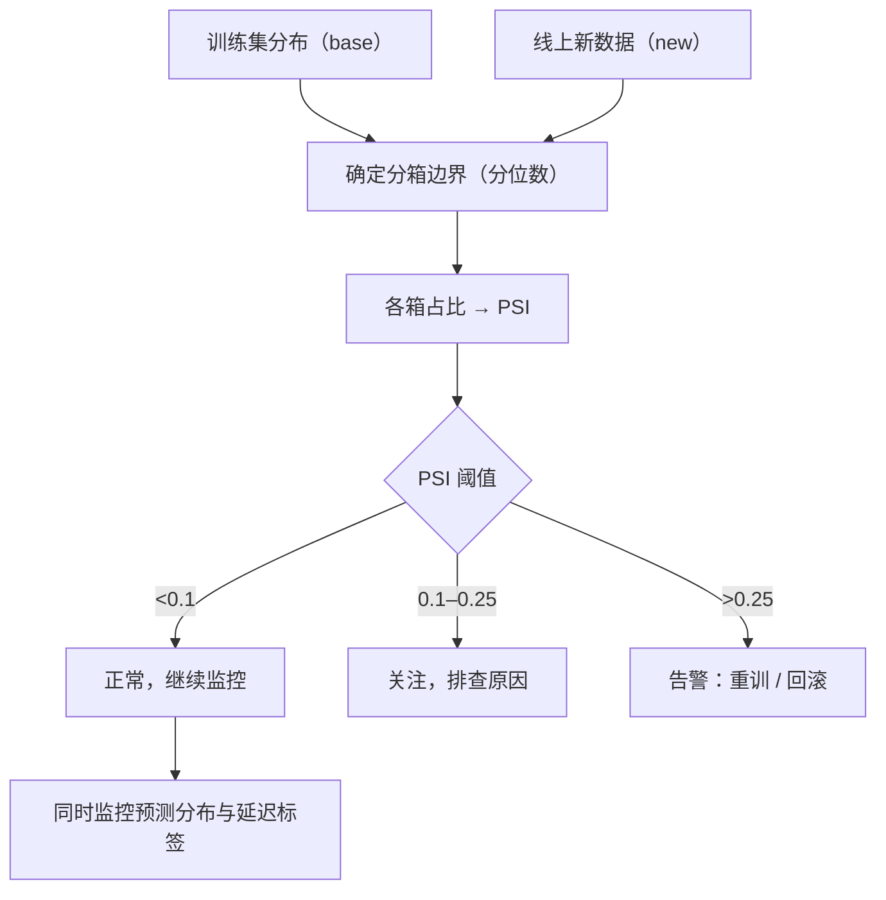

# ML-064 模型监控与常见问题

## 1. 本节学习目标

1. 会用 **PSI**（群体稳定性指数）量化特征漂移。
2. 理解"特征漂移 → 性能衰减"的因果链（本课：准确率 0.8462 → 0.7275）。
3. 知道监控要盯的三类信号：数据、预测、效果。
4. 能列出 ML 项目的常见失败模式与对策。

## 2. 为什么需要这个知识

因为**模型上线不是终点，是衰减的起点**。

用户行为会变、上游数据会变、业务规则会变。模型在训练分布上最优，分布一漂就退化——而且**它不会报错**，只会安静地给出越来越差的预测。

监控就是给模型装一个"体检仪"。

## 3. 直观解释

监控三个层次：

| 层次 | 看什么 | 举例 |
|---|---|---|
| **数据层** | 输入分布有没有变 | 年龄均值从 38 变 42 |
| **预测层** | 输出分布有没有变 | 正类比例从 30% 变 55% |
| **效果层** | 真实标签的指标 | AUC 从 0.82 掉到 0.70 |

**难点**：效果层需要**延迟到达的标签**（如"用户 30 天后是否流失"）。所以线上常用前两层做**早期预警**。

**PSI 的作用**：把"分布变没变"量化成一个数。

$$
\text{PSI}<0.1\ \text{稳定},\quad 0.1\!-\!0.25\ \text{需关注},\quad >0.25\ \text{显著漂移}
$$

## 4. 正式定义

**PSI（Population Stability Index）**

$$
\text{PSI} = \sum_{i=1}^{B}\big(p_i^{new}-p_i^{base}\big)\ln\frac{p_i^{new}}{p_i^{base}}
$$

$p_i$ 是第 $i$ 个分箱内的样本占比（本课用**分位数分箱**，10 箱）。

**经验阈值**

| PSI | 判断 |
|---|---|
| < 0.1 | 无显著变化 |
| 0.1–0.25 | 有变化，关注 |
| > 0.25 | 显著漂移，需处理 |

**性能衰减**

$$
\Delta\text{Acc} = \text{Acc}_{train\ dist} - \text{Acc}_{shifted\ dist}
$$

## 5. 核心原理

**为什么 PSI 能反映"分布变了"**：它比较两个分布在同样分箱上的占比差异，并对相对变化取对数加权——对"某箱占比翻倍"这类变化很敏感。

**为什么漂移会伤性能**：模型学到的是"训练分布下的条件关系"。分布变了，样本落到训练时"没怎么见过"的区域 ⇒ 预测不可靠。

**本课实测（漂移的量化）**

| 情形 | PSI |
|---|---|
| 同分布 | **0.0202** |
| 均值 +0.2 | 0.0462 |
| 均值 +0.5 | **0.3303** |
| 均值 +1.5 | **2.2508** |
| 方差翻倍 | 0.4934 |

**性能衰减**

| 情形 | 准确率 |
|---|---|
| 原始训练分布 | **0.8462** |
| 前 3 个特征 +3.0 后 | **0.7275** |

**掉 11.9 个百分点**——这就是"数据漂移会真实伤害业务"的证据。

## 6. 数学表达式

**本课关键数值**

$$
\text{PSI}_{\text{same}}=0.0202 < 0.1 \Rightarrow \text{稳定}
$$

$$
\text{PSI}_{\mu+0.5}=0.3303 > 0.25 \Rightarrow \text{显著漂移}
$$

$$
\Delta\text{Acc}=0.8462-0.7275=0.1187
$$

## 7. 数学库链接

| 用到的数学 | 对应篇目 | 用在哪 |
|---|---|---|
| 分位数与直方图 | [[MATH-306 期望、方差与协方差]] | PSI 的分箱 |
| 对数 | [[MATH-003 指数、根式与对数]] | PSI 的 $\ln$ |
| KL 散度 | [[MATH-507 交叉熵与 KL 散度]] | PSI 与 KL 的关系 |

**PSI 与 KL 的关系**：PSI 是对称化的近似（$p-q$ 乘 $\ln(p/q)$），而 KL 是单侧 $\sum p\ln(p/q)$。PSI 更"对称"、更易解释。

## 8. 算法执行流程



## 9. 可视化解释

```text
Base 分布（训练）             New 分布（漂移后）
  ▁▃▇▅▂▁                      ▁▂▅▇▅▂
  均值 0                       均值 0.5
        ↓ PSI 比较
  PSI = 0.3303 ⇒ 显著漂移 ⇒ 性能可能已掉
```

## 10. Python 实现

```powershell
python ml064_monitoring.py
```

```python
import numpy as np
from sklearn.datasets import make_classification
from sklearn.linear_model import LogisticRegression
from sklearn.pipeline import Pipeline
from sklearn.preprocessing import StandardScaler


def psi(base: np.ndarray, new: np.ndarray, bins: int = 10) -> float:
    """群体稳定性指数：比较两个样本在同样分箱上的占比差异。"""
    edges = np.quantile(base, np.linspace(0, 1, bins + 1))
    edges[0], edges[-1] = -np.inf, np.inf
    base_pct = np.histogram(base, bins=edges)[0] / len(base)
    new_pct = np.histogram(new, bins=edges)[0] / len(new)
    base_pct = np.clip(base_pct, 1e-6, None)
    new_pct = np.clip(new_pct, 1e-6, None)
    return float(np.sum((new_pct - base_pct) * np.log(new_pct / base_pct)))


rng = np.random.default_rng(0)
base = rng.normal(0, 1, 1000)
print("同分布        PSI:", round(psi(base, rng.normal(0, 1, 1000)), 4))
print("均值 +0.2     PSI:", round(psi(base, rng.normal(0.2, 1, 1000)), 4))
print("均值 +0.5     PSI:", round(psi(base, rng.normal(0.5, 1, 1000)), 4))
print("均值 +1.5     PSI:", round(psi(base, rng.normal(1.5, 1, 1000)), 4))
print("方差翻倍      PSI:", round(psi(base, rng.normal(0, 2, 1000)), 4))

# 漂移对性能的影响
X, y = make_classification(n_samples=800, n_features=10, n_informative=6,
                           random_state=3)
model = Pipeline([("sc", StandardScaler()),
                  ("clf", LogisticRegression(max_iter=1000))]).fit(X, y)
print("原始训练分布 acc:", round(model.score(X, y), 4))

X_shifted = X.copy()
X_shifted[:, :3] += 3.0
print("前 3 特征 +3 后 acc:", round(model.score(X_shifted, y), 4))
print("衰减:", round(model.score(X, y) - model.score(X_shifted, y), 4))
```

**实际运行结果**

```
同分布        PSI: 0.0202
均值 +0.2     PSI: 0.0462
均值 +0.5     PSI: 0.3303
均值 +1.5     PSI: 2.2508
方差翻倍      PSI: 0.4934
原始训练分布 acc: 0.8462
前 3 特征 +3 后 acc: 0.7275
衰减: 0.1187
```

## 11. 代码逐行解释

| 代码 | 作用 |
|---|---|
| `np.quantile(base, linspace(0,1,11))` | 用 **base 的分位数**定箱边界 |
| `edges[0]/-1 = ±inf` | 保证新数据超出范围也能入箱 |
| `np.histogram(..., bins=edges)[0]/len(...)` | 各箱占比 |
| `np.clip(..., 1e-6, None)` | 避免 $\ln 0$ |
| `X_shifted[:, :3] += 3.0` | 模拟"前 3 个特征整体右移" |

**关键细节**：分箱边界必须**固定用 base 的分位数**，不能每次用新数据重算——否则新旧分布各自分箱，PSI 失去意义。

## 12. 实际运行结果

见第 10 节。三点：

1. **同分布 PSI 0.0202**（< 0.1，正常噪声水平）。
2. 均值 +0.5 就到 **0.3303**（> 0.25，显著漂移）；+1.5 高达 **2.2508**。
3. **特征漂移让准确率从 0.8462 掉到 0.7275**（−11.9 点）。

## 13. 适用场景

| 监控对象 | 指标/做法 |
|---|---|
| 输入特征 | PSI、均值/分位数对比 |
| 预测分布 | 正类比例、概率分位数 |
| 模型效果 | AUC/F1（需延迟标签） |
| 数据质量 | 缺失率、异常值比例、类型错误 |
| 系统指标 | 延迟、QPS、错误率 |

## 14. 优点与缺点

| 指标 | 优点 | 缺点 |
|---|---|---|
| PSI | 简单、可解释、无需标签 | 对分箱敏感；单变量 |
| 预测分布 | 实时、无需标签 | 变化不等于效果变差 |
| 真实指标 | 最准 | 标签延迟、可能数周后才知道 |
| 多变量漂移检测 | 能发现交互漂移 | 复杂、难定位 |

## 15. 常见错误（含 ML 项目常见失败模式）

| 错误/失败模式 | 表现 | 纠正 |
|---|---|---|
| 不监控 | 性能悄悄衰减 | 上 PSI + 预测分布看板 |
| 用新数据重算分箱 | PSI 失真 | 固定 base 分箱 |
| 只看真实指标 | 发现太晚 | 加早期预警 |
| 漂移就立刻重训 | 可能是短期波动 | 连续观察 + 分层排查 |
| 重训不复核 | 新模型更差 | 影子模式对比 |
| **数据泄漏** | 离线好、线上崩 | 见 ML-049 |
| **训练/线上特征不一致** | 静默错误 | 特征管道共用 |
| **只优化离线指标** | 业务无提升 | 对齐业务目标 |
| **样本偏差** | 只覆盖部分用户 | 检查数据来源 |

## 16. 本节总结

- 监控三层：**数据（PSI）、预测分布、真实效果**；前两层能提前预警。
- 阈值：PSI **< 0.1 稳定**、**> 0.25 显著漂移**。
- 漂移会真实伤性能：本课 **0.8462 → 0.7275**。

## 17. 前置与后续

- 前置：[[ML-063 端到端机器学习项目]]、[[ML-049 数据泄漏与评估陷阱]]
- 后续：阶段 07 已完成 64 篇；下一步是阶段 08 深度学习（待建）
- 相关数学：[[MATH-306 期望、方差与协方差]]、[[MATH-507 交叉熵与 KL 散度]]

## 18. 练习与参考答案

**基础 1**：监控的三个层次是什么？哪个最难以及为什么？

**基础 2**：本课各漂移情形下的 PSI 是多少？

**进阶 1**：为什么 PSI 的分箱边界要固定用 base 的分位数？

**综合 1**：本课特征漂移后准确率从 0.8462 掉到 0.7275，你会怎么处理？

> [!success]- 参考答案

> **基础 1**
> ① 数据层（输入分布）② 预测层（输出分布）③ 效果层（真实指标）。
> **效果层最难**：需要**延迟到达的真实标签**（如"30 天后是否流失"），可能几周后才知道，无法实时预警。

> **基础 2**
> 同分布 **0.0202**；+0.2 → **0.0462**；+0.5 → **0.3303**；+1.5 → **2.2508**；方差翻倍 → **0.4934**。

> **进阶 1**
> PSI 的语义是"**同一个分箱方案下**，两个样本的占比差异"。
> 若每次用新数据重算分位数，两边的箱子位置都变了 ⇒ 比较的不是"同一把尺子" ⇒ 数值失去意义（甚至会出现"分布没变但 PSI 很大"的假警报）。
> 正确做法：用**训练集（base）的分位数**定死边界，长期复用。

> **综合 1**
> 按顺序：
> 1. **确认漂移真实**：看 PSI（本课场景已 >0.25）+ 预测分布是否也变了；排除上游数据故障（如单位从元变万元）。
> 2. **定位原因**：逐特征算 PSI，找出哪几列漂移（本课是"前 3 个特征 +3"）。
> 3. **判断性质**：短期波动（促销、节假日）还是长期趋势（用户结构变化）。
> 4. **处理**：短期 → 观察 + 阈值放宽；长期 → 用新数据**重训**，并做**影子模式**对比（新模型与旧模型并行预测，确认更优再切）。
> 5. **复盘**：把这次的漂移特征加入常规监控，缩短发现时间。

---

## 🔗 Notion 同步信息

> 以下内容由 Notion「AI Knowledge System · 知识点」数据库按知识 ID 合并而来（导出于 2026-11-09）。

| 属性 | 值 |
|---|---|
| 学科 | 机器学习 |
| 学习状态 | 未开始 |
| 难度 | L2 应用 |
| 知识类型 | Technique |

- **所属模块**：[M-ML-08 机器学习工程实践](../%E8%AF%BE%E7%A8%8B%E6%A8%A1%E5%9D%97/M-ML-08%20%E6%9C%BA%E5%99%A8%E5%AD%A6%E4%B9%A0%E5%B7%A5%E7%A8%8B%E5%AE%9E%E8%B7%B5.md)
- **前置知识**：[ML-063 端到端机器学习项目](ML-063%20%E7%AB%AF%E5%88%B0%E7%AB%AF%E6%9C%BA%E5%99%A8%E5%AD%A6%E4%B9%A0%E9%A1%B9%E7%9B%AE.md)
- **关联Python**：[PY-067 聚合与统计](../../01_Python%E5%9F%BA%E7%A1%80/08%20NumPy/PY-067%20%E8%81%9A%E5%90%88%E4%B8%8E%E7%BB%9F%E8%AE%A1.md)
- **关联数学**：[MATH-306 期望、方差与协方差](../../06_%E6%95%B0%E5%AD%A6%E5%9F%BA%E7%A1%80/03%20%E6%A6%82%E7%8E%87%E8%AE%BA/MATH-306%20%E6%9C%9F%E6%9C%9B%E3%80%81%E6%96%B9%E5%B7%AE%E4%B8%8E%E5%8D%8F%E6%96%B9%E5%B7%AE.md)
