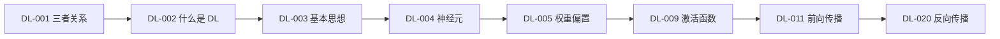

# 🧠 神经网络基础 · 分支索引

> 段位：`DL-001` ~ `DL-022`（M-DL-01 + M-DL-02）
> 上位：[[04_深度学习/00 模块索引\|深度学习模块索引]]
> 定位：**从单个神经元到能跑起来的训练循环**。这一段决定后面 CNN/RNN 是"理解"还是"背结构"。

---

## 一、这一段装什么

| 模块 | 号段 | 核心问题 |
|---|---|---|
| M-DL-01 基础与神经元 | DL-001 ~ DL-010 | 深度学习是什么？神经元怎么算？为什么要多层？ |
| M-DL-02 前向·损失·反向 | DL-011 ~ DL-022 | 预测怎么算、误差怎么量、梯度怎么传？ |

## 二、学习顺序

## 三、必须亲手算过的三件事

1. 手算一次 $z=w^\top x+b$，并与 `nn.Linear` 对拍（DL-005）。
2. 手算一次 XOR 的两层权重（DL-003 练习）。
3. 手算一次单神经元的梯度 $\partial L/\partial w$（DL-020）。

## 四、知识点登记（22 条）

| 知识 ID | 名称 | 难度 | 状态 | 笔记 |
|---|---|---|---|---|
| `DL-001` | 人工智能、机器学习与深度学习的关系 | L1 | planned | [[DL-001 人工智能、机器学习与深度学习的关系]] |
| `DL-002` | 什么是深度学习 | L1 | planned | [[DL-002 什么是深度学习]] |
| `DL-003` | 神经网络的基本思想 | L2 | planned | [[DL-003 神经网络的基本思想]] |
| `DL-004` | 生物神经元与人工神经元 | L1 | planned | [[DL-004 生物神经元与人工神经元]] |
| `DL-005` | 人工神经元：权重、偏置与线性组合 | L2 | planned | [[DL-005 人工神经元——权重、偏置与线性组合]] |
| `DL-006` | 输入层、隐藏层与输出层 | M-DL-01 | L2 | planned | [[DL-006 输入层、隐藏层与输出层]] |
| `DL-007` | 感知机与感知机学习规则 | M-DL-01 | L2 | planned | [[DL-007 感知机与感知机学习规则]] |
| `DL-008` | 多层感知机 MLP | M-DL-01 | L2 | planned | [[DL-008 多层感知机 MLP]] |
| `DL-009` | 激活函数：Sigmoid、Tanh、ReLU | M-DL-01 | L2 | planned | [[DL-009 激活函数——Sigmoid、Tanh、ReLU]] |
| `DL-010` | 激活函数：Leaky ReLU、GELU 与选型 | M-DL-01 | L2 | planned | [[DL-010 激活函数——Leaky ReLU、GELU 与选型]] |
| `DL-011` | 神经网络前向传播 | M-DL-02 | L2 | planned | [[DL-011 神经网络前向传播]] |
| `DL-012` | 线性变换的矩阵形式 | M-DL-02 | L2 | planned | [[DL-012 线性变换的矩阵形式]] |
| `DL-013` | 输出层设计与输出维度 | M-DL-02 | L2 | planned | [[DL-013 输出层设计与输出维度]] |
| `DL-014` | 损失函数总览与选择 | M-DL-02 | L2 | planned | [[DL-014 损失函数总览与选择]] |
| `DL-015` | 均方误差 MSE | M-DL-02 | L2 | planned | [[DL-015 均方误差 MSE]] |
| `DL-016` | 二分类交叉熵 | M-DL-02 | L3 | planned | [[DL-016 二分类交叉熵]] |
| `DL-017` | 多分类交叉熵与 Softmax | M-DL-02 | L3 | planned | [[DL-017 多分类交叉熵与 Softmax]] |
| `DL-018` | 计算图 | M-DL-02 | L2 | planned | [[DL-018 计算图]] |
| `DL-019` | 梯度的含义与链式法则 | M-DL-02 | L3 | planned | [[DL-019 梯度的含义与链式法则]] |
| `DL-020` | 反向传播：单神经元手算 | M-DL-02 | L3 | planned | [[DL-020 反向传播——单神经元手算]] |
| `DL-021` | 多层网络的反向传播 | M-DL-02 | L3 | planned | [[DL-021 多层网络的反向传播]] |
| `DL-022` | 梯度消失与梯度爆炸 | M-DL-02 | L3 | planned | [[DL-022 梯度消失与梯度爆炸]] |

> 本目录计划 22 篇，**已全部完成**（DL-001 ~ DL-022，M-DL-01 + M-DL-02 收官）。

## 五、导航

- 上一级：[[04_深度学习/00 模块索引\|深度学习模块索引]]
- 知识索引：[[08_知识索引/04 深度学习知识索引\|深度学习知识索引]]
- 规则：[[08_知识索引/06 知识关联索引\|知识关联索引]]
