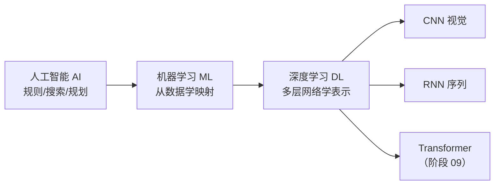

# DL-001 人工智能、机器学习与深度学习的关系

## 1. 本节学习目标

1. 分清 **AI ⊃ ML ⊃ DL** 三层包含关系，不再混用。
2. 说清三者各自"解决什么问题、靠什么手段"。
3. 理解深度学习的**分水岭**：特征由人设计 → 特征由模型自己学。
4. 会用参数量对比感知"表示学习换来了什么"。

## 2. 为什么需要这个知识

因为这三个词天天混着用，导致一些常见误会：

- "AI 就是深度学习"——错，规则系统、专家系统也是 AI。
- "机器学习一定比传统编程强"——错，规则清楚的问题用规则更快更稳。
- "深度学习是机器学习的新分支"——它更像机器学习的**一种表示学习方式**。

分清边界，才知道**什么问题该用哪一层工具**，这是选型的第一步。

## 3. 直观解释

用"识别垃圾邮件"举例，三层各怎么做：

| 层次 | 做法 | 谁在干活 |
|---|---|---|
| **规则系统**（AI 的一部分） | 写死：含"中奖""免费"就判垃圾 | 人写规则 |
| **机器学习** | 人设计特征（关键词频率、链接数），模型学权重 | 人设计特征，模型学映射 |
| **深度学习** | 直接把原始文本喂给网络，**特征自己学** | 模型学特征 + 映射 |

**关键差别在"特征"两个字**：前两者要人告诉机器"看什么"，深度学习让机器自己找"该看什么"。

## 4. 正式定义

**包含关系**

$$
\text{AI} \supset \text{ML} \supset \text{DL}
$$

| 概念 | 定义 | 判定标准 |
|---|---|---|
| **人工智能 AI** | 让机器表现出智能行为的一切方法 | 是否表现出"智能" |
| **机器学习 ML** | 从数据中自动获取规律，无需显式编程 | 性能是否**随数据**提升 |
| **深度学习 DL** | 用**多层可微网络**自动学习分层表示 | 是否**端到端**学表示 |

**形式化对比**

- 规则系统：$y = f_{\text{human}}(x)$，$f$ 由人写死。
- 机器学习：$y = f_{\theta}(x)$，$\theta$ 从数据学，**输入特征由人给**。
- 深度学习：$y = f_{\theta_2}(g_{\theta_1}(x))$，**$g$ 也学**（表示学习）。

## 5. 核心原理

**为什么深度学习要等到 2012 年才爆发**——它需要三个条件同时成立：

| 条件 | 说明 |
|---|---|
| **数据** | ImageNet 百万级标注图像 |
| **算力** | GPU 并行矩阵运算 |
| **算法** | ReLU 缓解梯度消失、Dropout 抑制过拟合 |

缺一个都跑不起来。**深度学习不是"更聪明的算法"，是"更大规模的可微函数拟合"**。

**参数量视角**：表示学习不是免费的，它用参数换特征工程。

| 模型 | 结构 | 参数量 |
|---|---|---|
| 线性模型（MNIST） | 784 → 10 | 7,850 |
| 两层网络（MNIST） | 784 → 128 → 10 | **101,770** |

同任务下参数量差 **13 倍**，多出来的就是"自己学特征"的成本。

## 6. 数学表达式

**线性模型**

$$
\hat{\mathbf{y}} = W\mathbf{x} + \mathbf{b}
$$

**多层网络**

$$
\mathbf{h} = \sigma(W_1\mathbf{x}+\mathbf{b}_1),\qquad
\hat{\mathbf{y}} = W_2\mathbf{h}+\mathbf{b}_2
$$

$\sigma$ 是非线性激活。**没有 $\sigma$，两层会塌缩成一层**（下一节 DL-002 会实测证明）。

## 7. 数学推导

**为什么"没有激活就塌缩"**

$$
W_2(W_1\mathbf{x}+\mathbf{b}_1)+\mathbf{b}_2
= (W_2W_1)\mathbf{x} + (W_2\mathbf{b}_1+\mathbf{b}_2)
= W_{\text{eff}}\mathbf{x}+\mathbf{b}_{\text{eff}}
$$

其中 $W_{\text{eff}}=W_2W_1$。**两个线性映射的复合仍是线性映射**，堆多少层都等于一层。

**参数量公式**

$$
\text{Params}(n_{in}\to n_{out}) = n_{in}\times n_{out} + n_{out}
$$

例：$784\to128$ 是 $784\times128+128=100{,}480$；$128\to10$ 是 $128\times10+10=1{,}290$；合计 **101,770**。

## 8. 结构示意图



## 9. 具体计算示例

**MNIST 两层网络参数量**

```text
784 × 128 + 128 = 100,480
128 × 10  + 10  =   1,290
合计            = 101,770
```

**线性模型**

```text
784 × 10 + 10 = 7,850
```

**比值**：$101{,}770 / 7{,}850 \approx 12.96$ 倍。

## 10. Python 实现

```python
import torch
import torch.nn as nn

print("torch:", torch.__version__)
print("cuda :", torch.cuda.is_available())


def count(model: nn.Module) -> int:
    return sum(p.numel() for p in model.parameters())


linear = nn.Sequential(nn.Linear(784, 10))
two_layer = nn.Sequential(nn.Linear(784, 128), nn.ReLU(), nn.Linear(128, 10))

print("线性模型参数量:", count(linear))
print("两层网络参数量:", count(two_layer))
print("倍数:", round(count(two_layer) / count(linear), 2))

x = torch.randn(4, 784)
print("输入形状:", tuple(x.shape))
print("线性输出:", tuple(linear(x).shape))
print("两层输出:", tuple(two_layer(x).shape))
```

## 11. PyTorch 实现说明

同一件事，PyTorch 用**层对象**表达：

- `nn.Linear(in, out)` = 一个可学习矩阵 + 偏置。
- `nn.Sequential(...)` = 按顺序串联。
- `model.parameters()` = 所有可学习张量。
- `p.numel()` = 元素个数（即参数量）。

**这就是"深度学习的工程形态"：把数学写成可微模块，用 autograd 求梯度。**

## 12. 代码逐行解释

| 代码 | 作用 |
|---|---|
| `nn.Linear(784, 10)` | 784 维输入 → 10 维输出 |
| `nn.ReLU()` | 非线性激活，**决定了两层不是一层** |
| `sum(p.numel() for p in model.parameters())` | 统计参数量 |
| `torch.randn(4, 784)` | 4 个样本、每个 784 维（模拟 MNIST 一批） |
| `model(x)` | 前向传播，返回 `(4, 10)` |

## 13. 实际运行结果

```text
torch: 2.15.0+cu132
cuda : True
线性模型参数量: 7850
两层网络参数量: 101770
倍数: 12.96
输入形状: (4, 784)
线性输出: (4, 10)
两层输出: (4, 10)
```

**读法**：两者输出形状相同，**区别全在中间的表示**——线性模型直接映射，两层网络先投影到 128 维"学出来的特征空间"再分类。

## 14. 应用场景

| 场景 | 该用哪层 | 理由 |
|---|---|---|
| 发票验真规则明确 | 规则系统 | 快、可审计、零训练 |
| 表格数据（几十列） | **机器学习** | 特征工程够用，DL 易过拟合 |
| 图像/语音/长文本 | **深度学习** | 原始输入维度高，人设计不出好特征 |
| 需要可解释 | 规则/线性模型/树 | 网络是黑箱 |
| 数据只有几百条 | 传统 ML | DL 需要大量数据 |

## 15. 优点与缺点

| | 优点 | 缺点 |
|---|---|---|
| 规则系统 | 可控、可解释、零数据 | 难覆盖长尾、维护成本高 |
| 机器学习 | 少数据可用、可解释、训练快 | 依赖人工特征 |
| 深度学习 | 自动学特征、上限高 | 吃数据、吃算力、黑箱 |

## 16. 常见错误

| 错误 | 纠正 |
|---|---|
| 把"AI"当"深度学习" | AI 还包括规则、搜索、规划 |
| 认为 DL 一定优于 ML | 表格数据上 GBDT 常胜（见 ML-055/063） |
| 以为"层数多就是深度学习" | 无激活的多层等于一层 |
| 忽略数据量前提 | 小数据上 DL 极易过拟合 |
| 把"参数量大"当"能力强" | 参数量是成本，不是能力 |

## 17. 本节总结

- **AI ⊃ ML ⊃ DL**；深度学习的关键是**端到端学表示**。
- 深度学习爆发依赖**数据 + 算力 + 算法**三者同时到位。
- 表示学习不免费：MNIST 上参数量 **7,850 → 101,770（12.96 倍）**。

## 18. 前置与后续

- 前置：[[ML-001 什么是机器学习]]、[[ML-002 机器学习三大范式]]
- 后续：[[DL-002 什么是深度学习]]、[[DL-003 神经网络的基本思想]]
- 相关机器学习：[[ML-003 机器学习工作流程]]
- 阶段 09 待学习：Transformer、注意力机制

---

## 练习与参考答案

**基础 1**：AI、ML、DL 三者的包含关系是什么？深度学习与机器学习的核心差别在哪？

**基础 2**：MNIST 上线性模型与两层网络的参数量各是多少？倍数多少？

**进阶 1**：为什么"堆多层但不加激活"不能算深度学习？

**综合**：业务方说"我们要上 AI，直接上深度学习吧"。请给出你的判断流程（至少 4 个问题）。

> [!success]- 参考答案

> **基础 1**
> - 关系：$\text{AI} \supset \text{ML} \supset \text{DL}$。
> - 核心差别：**特征由谁给**。机器学习需要人设计特征（关键词频率、像素统计），深度学习把原始输入直接喂进网络，**表示（特征）由模型自己学**。

> **基础 2**
> 线性 784→10：**7,850**；两层 784→128→10：**101,770**；倍数 **12.96**。
> 计算：$784\times10+10=7850$；$(784\times128+128)+(128\times10+10)=100480+1290=101770$。

> **进阶 1**
> 因为**线性映射的复合仍是线性映射**：
> $$W_2(W_1x+b_1)+b_2=(W_2W_1)x+(W_2b_1+b_2)$$
> 无论堆多少层，都等价于一个单层 $W_{\text{eff}}x+b_{\text{eff}}$。
> DL-002 会实测：两层无激活与等价单层的最大差只有 $3.7\times10^{-8}$（浮点误差）；加 ReLU 后差到 0.1573。
> **非线性激活才是"深度"的必要条件。**

> **综合（参考流程）**
> 1. **问题类型**：是感知类（图像/语音/文本）还是表格/规则类？感知类才考虑 DL。
> 2. **数据量**：有标注样本多少？几百条 ⇒ 传统 ML；上万条以上才谈 DL。
> 3. **特征可得性**：领域特征能不能手工设计？能 ⇒ ML 更划算（可解释、训练快）。
> 4. **算力与维护**：有没有 GPU、能不能承担训练与调参成本？
> 5. **可解释要求**：金融/医疗等强监管场景，黑箱可能不可接受。
> 6. **基线先行**：无论选什么，先做逻辑回归/GBDT 基线——如果基线已达业务线，DL 未必值得。
> 结论口径：**"上 AI"不等于"上 DL"**；先用最小可行基线，再决定是否升级。

## 学习记录

| 日期 | 状态 | 用时 | 问题 | 复盘 |
|---|---|---|---|---|
| 2026-11-06 | planned | — | — | — |

---

## 🔗 Notion 同步信息

> 以下内容由 Notion「AI Knowledge System · 知识点」数据库按知识 ID 合并而来（导出于 2026-11-09）。

| 属性 | 值 |
|---|---|
| 学科 | 深度学习 |
| 学习状态 | 未开始 |
| 难度 | L1 概念 |
| 知识类型 | Concept |

- **所属模块**：[M-DL-01 深度学习基础与神经网络入门](../%E8%AF%BE%E7%A8%8B%E6%A8%A1%E5%9D%97/M-DL-01%20%E6%B7%B1%E5%BA%A6%E5%AD%A6%E4%B9%A0%E5%9F%BA%E7%A1%80%E4%B8%8E%E7%A5%9E%E7%BB%8F%E7%BD%91%E7%BB%9C%E5%85%A5%E9%97%A8.md)
- **前置知识**：[ML-001 什么是机器学习](../../03_%E6%9C%BA%E5%99%A8%E5%AD%A6%E4%B9%A0/01%20%E6%9C%BA%E5%99%A8%E5%AD%A6%E4%B9%A0%E5%9F%BA%E7%A1%80/ML-001%20%E4%BB%80%E4%B9%88%E6%98%AF%E6%9C%BA%E5%99%A8%E5%AD%A6%E4%B9%A0.md) · [ML-002 机器学习三大范式](../../03_%E6%9C%BA%E5%99%A8%E5%AD%A6%E4%B9%A0/01%20%E6%9C%BA%E5%99%A8%E5%AD%A6%E4%B9%A0%E5%9F%BA%E7%A1%80/ML-002%20%E6%9C%BA%E5%99%A8%E5%AD%A6%E4%B9%A0%E4%B8%89%E5%A4%A7%E8%8C%83%E5%BC%8F.md)
- **后继知识**：[DL-002 什么是深度学习](DL-002%20%E4%BB%80%E4%B9%88%E6%98%AF%E6%B7%B1%E5%BA%A6%E5%AD%A6%E4%B9%A0.md)
- **关联Python**：[PY-009 函数](../../01_Python%E5%9F%BA%E7%A1%80/02%20%E5%87%BD%E6%95%B0%E4%B8%8E%E4%BD%9C%E7%94%A8%E5%9F%9F/PY-009%20%E5%87%BD%E6%95%B0.md)
