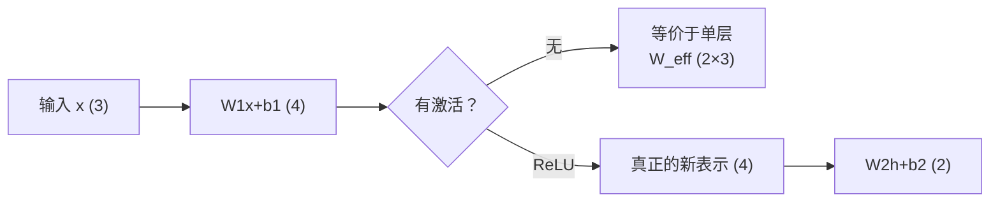

# DL-002 什么是深度学习

## 1. 本节学习目标

1. 给"深度学习"一个**可检验**的定义：多层 + 可微 + 表示学习。
2. 亲手验证"**没有非线性，多层等于一层**"（最大差异 $3.7\times10^{-8}$）。
3. 验证"**加了 ReLU 就不再等价**"（差异 0.1573）。
4. 理解"深度"指**非线性变换的层数**，不是参数量。

## 2. 为什么需要这个知识

因为"深度学习"这四个字最容易产生的误解是：**层数多就叫深度**。

这个误解直接导致一种无效做法——堆很多 `nn.Linear` 不加激活。模型能跑、不报错，但**表达能力等于一层**。本节用数值把这件事钉死。

## 3. 直观解释

**深度学习 = 用可微的"模块"搭出一条很长的变换链，让模型自己决定中间表示长什么样。**

三个关键词：

| 关键词 | 含义 | 缺了会怎样 |
|---|---|---|
| **多层** | 中间至少有一层隐表示 | 退化为线性模型 |
| **可微** | 每层都能求梯度 | 无法反向传播 |
| **表示学习** | 中间层不是人设计的，是学出来的 | 就是传统 ML |

**一个反例帮助记忆**：$y=W_2(W_1x+b_1)+b_2$ 看起来很"深"，但化简后是 $W_{\text{eff}}x+b_{\text{eff}}$——**它只有一层**。

## 4. 正式定义

**定义（本课口径）**：深度学习是**由多个可微非线性层堆叠而成的参数化函数族**，通过最小化损失函数端到端学习"输入 → 中间表示 → 输出"的映射。

$$
\mathbf{h}^{(1)} = \sigma_1(W_1\mathbf{x}+\mathbf{b}_1),\quad
\mathbf{h}^{(2)} = \sigma_2(W_2\mathbf{h}^{(1)}+\mathbf{b}_2),\quad
\hat{\mathbf{y}} = W_3\mathbf{h}^{(2)}+\mathbf{b}_3
$$

**可检验的三条判据**

1. 至少 2 个可学习层（不含输入）。
2. 层间存在**非线性**。
3. 损失对全部参数的梯度可由反向传播求得。

## 5. 核心原理

**为什么必须非线性**：线性变换的复合仍是线性变换。

$$
W_2(W_1\mathbf{x}+\mathbf{b}_1)+\mathbf{b}_2
= \underbrace{(W_2W_1)}_{W_{\text{eff}}}\mathbf{x}
+ \underbrace{(W_2\mathbf{b}_1+\mathbf{b}_2)}_{\mathbf{b}_{\text{eff}}}
$$

**加非线性后**：$\sigma$ 不是仿射的，无法被后续矩阵吸收，**表示能力才真正增加**。

**深度的收益来自"分段线性/非线性拼接"**：ReLU 网络把输入空间切成许多区域，每个区域一个线性函数——**区域数量随层数指数增长**。这才是"深"的价值。

## 6. 数学表达式

**无激活的两层网络**

$$
\hat{\mathbf{y}} = W_2W_1\mathbf{x} + (W_2\mathbf{b}_1+\mathbf{b}_2)
$$

**带 ReLU 的两层网络**

$$
\hat{\mathbf{y}} = W_2\,\mathrm{ReLU}(W_1\mathbf{x}+\mathbf{b}_1)+\mathbf{b}_2
$$

二者形式上的唯一区别是中间那个 $\mathrm{ReLU}$，但函数族大小差很多。

## 7. 数学推导

**塌缩的严格推导**

设 $W_1\in\mathbb{R}^{4\times3}$，$W_2\in\mathbb{R}^{2\times4}$。

第一层：$\mathbf{u}=W_1\mathbf{x}+\mathbf{b}_1\in\mathbb{R}^{4}$
第二层：$\hat{\mathbf{y}}=W_2\mathbf{u}+\mathbf{b}_2\in\mathbb{R}^{2}$

代入：

$$
\hat{\mathbf{y}}=W_2(W_1\mathbf{x}+\mathbf{b}_1)+\mathbf{b}_2
=(W_2W_1)\mathbf{x}+(W_2\mathbf{b}_1+\mathbf{b}_2)
$$

其中 $W_2W_1\in\mathbb{R}^{2\times3}$，与"直接用 $2\times3$ 矩阵"完全等价。
**参数量从 26 降到 8，表达能力一模一样。**

## 8. 结构示意图



## 9. 具体计算示例

**本课实测的网络**

| 层 | 形状 | 参数量 |
|---|---|---|
| `Linear(3,4)` | $W_1: 4\times3$，$b_1:4$ | $12+4=16$ |
| `Linear(4,2)` | $W_2: 2\times4$，$b_2:2$ | $8+2=10$ |
| 合计 | — | **26** |

**等价单层**：$W_{\text{eff}}:2\times3$ + $b_{\text{eff}}:2$ = **8** 个参数。

**26 个参数的网络，真实自由度只有 8 个**——这就是"没有非线性"的代价。

## 10. Python 实现

```python
import torch
import torch.nn as nn

torch.manual_seed(0)
net = nn.Sequential(nn.Linear(3, 4), nn.Linear(4, 2))
x = torch.randn(5, 3)

with torch.no_grad():
    out_net = net(x)
    w_eff = net[1].weight @ net[0].weight
    b_eff = net[1].weight @ net[0].bias + net[1].bias
    out_lin = x @ w_eff.T + b_eff

print("两层无激活输出形状:", tuple(out_net.shape))
print("等价单层权重形状:", tuple(w_eff.shape))
print("最大差异:", float((out_net - out_lin).abs().max()))
print("第一层参数量:", sum(p.numel() for p in net[0].parameters()))
print("整个网络参数量:", sum(p.numel() for p in net.parameters()))
```

## 11. PyTorch 实现（加激活）

```python
import torch
import torch.nn as nn

torch.manual_seed(0)
x = torch.randn(5, 3)
net2 = nn.Sequential(nn.Linear(3, 4), nn.ReLU(), nn.Linear(4, 2))

with torch.no_grad():
    out_act = net2(x)
    w_eff2 = net2[2].weight @ net2[0].weight
    b_eff2 = net2[2].weight @ net2[0].bias + net2[2].bias
    out_lin2 = x @ w_eff2.T + b_eff2

print("加 ReLU 后最大差异:", round(float((out_act - out_lin2).abs().max()), 4))
```

## 12. 代码逐行解释

| 代码 | 作用 |
|---|---|
| `nn.Sequential(nn.Linear(3,4), nn.Linear(4,2))` | 两层，**层间无激活** |
| `net[1].weight @ net[0].weight` | 手动算 $W_2W_1$ |
| `net[1].weight @ net[0].bias + net[1].bias` | 手动算 $W_2b_1+b_2$ |
| `x @ w_eff.T + b_eff` | 用等价单层算输出 |
| `(out_net - out_lin).abs().max()` | 两者差异，应≈0 |
| `nn.ReLU()` | 加入非线性，破坏可合并性 |

**关键**：`w_eff` 形状是 `(2, 3)` —— 两层网络的"真实自由度"就是这一个 $2\times3$ 矩阵加偏置。

## 13. 实际运行结果

```text
两层无激活输出形状: (5, 2)
等价单层权重形状: (2, 3)
最大差异: 3.725290298461914e-08
第一层参数量: 16
整个网络参数量: 26
加 ReLU 后最大差异: 0.1573
```

**两个数字对比就是本节的结论**：

- 无激活：$3.7\times10^{-8}$ = **浮点误差级** ⇒ 完全等价。
- 加 ReLU：$0.1573$ = **真实差异** ⇒ 不再是同一个函数。

## 14. 应用场景

| 场景 | 是否需要"深" |
|---|---|
| 图像分类 | 需要（分层提取边缘→纹理→部件） |
| 表格回归 | 往往不需要（浅层/线性够用） |
| 小样本 | 不需要（深 = 更多参数 = 更易过拟合） |
| 需要可解释 | 慎用（深层难解释） |

## 15. 优点与缺点

| 优点 | 缺点 |
|---|---|
| 自动学分层表示 | 需要大量数据 |
| 端到端优化 | 训练慢、调参难 |
| 上限高（视觉/语音/语言） | 黑箱、难调试 |

## 16. 常见错误

| 错误 | 现象 | 纠正 |
|---|---|---|
| 堆 `Linear` 不加激活 | 参数量涨但能力不变 | 每两层之间加非线性 |
| 以为"参数多=深度" | 26 参数只有 8 自由度 | 看**非线性层数** |
| 用 `nn.Sequential` 忘了激活 | 与上面同 | 显式写 `ReLU`/`GELU` |
| 认为深一定更好 | 小数据上更差 | 用验证集判断 |
| 把 `ModuleList` 当 Sequential | 不会自动串联 | 显式实现 `forward` |

## 17. 本节总结

- 深度学习 = **多层 + 非线性 + 可微 + 表示学习**。
- 无激活的多层**严格等价于一层**（实测差 $3.7\times10^{-8}$）。
- 加 ReLU 后等价性被破坏（差 0.1573），**这才是"深度"**。

## 18. 前置与后续

- 前置：[[DL-001 人工智能、机器学习与深度学习的关系]]
- 后续：[[DL-003 神经网络的基本思想]]、[[DL-004 生物神经元与人工神经元]]
- 相关数学：[[MATH-217 矩阵运算与维度]]
- 相关机器学习：[[ML-025 逻辑回归]]

---

## 练习与参考答案

**基础 1**：判断一个模型是不是"深度学习"，看哪三条？

**基础 2**：本课两层无激活网络与等价单层的最大差异是多少？这个数字说明什么？

**进阶 1**：为什么"参数量 26"的网络真实自由度只有 8？剩下的自由度去哪了？

**综合**：有人写了一个 10 层全 `nn.Linear` 的网络，训练集准确率 0.85、测试集 0.85，且与单层逻辑回归结果几乎一样。请诊断原因并给出改法。

> [!success]- 参考答案

> **基础 1**
> ① 至少 2 个可学习层；② 层间有**非线性**激活；③ 梯度可由反向传播求得（可微）。
> 三条缺一，就不能称为深度学习（缺 ② 会塌缩成线性模型）。

> **基础 2**
> **$3.725\times10^{-8}$**（浮点误差量级）。
> 说明两层无激活网络与"用 $W_{\text{eff}}=W_2W_1$ 的单层"**输出完全相同**——它实际上只有一层，堆叠没有任何表达能力的增加。

> **进阶 1**
> 因为 $W_2W_1$ 的秩最多是 $\min(2,4,3)=2$，它能表达的所有映射都可被一个 $2\times3$ 矩阵（6 个元素）+ 2 个偏置 = **8 个自由度**表示。
> 原网络的 26 个参数里，有 18 个是**冗余的**（不同组合给出同一个 $W_{\text{eff}}$）。
> 换句话说：**没有非线性时，参数多只是"重复表达同一件事"**。

> **综合（诊断 + 改法）**
> **诊断**：全 `nn.Linear` 无激活 ⇒ 10 层塌缩为 1 层，等价于线性模型 ⇒ 表现与逻辑回归几乎一致，完全符合理论。
> **改法**：
> 1. 每个 `Linear` 之后加非线性（`ReLU`/`GELU`），最后一层除外；
> 2. 加 `BatchNorm`/`Dropout` 提高训练稳定性与泛化（DL-036/035）；
> 3. 重新训练后看验证集：**若仍无提升，说明任务本身近似线性**——这时不是"加深度"，而是"加特征/换任务表示"。
> **判据**：加激活后若训练准确率明显上升但测试不升，转向正则化；若两者都不升，转向数据与特征。

## 学习记录

| 日期 | 状态 | 用时 | 问题 | 复盘 |
|---|---|---|---|---|
| 2026-11-06 | planned | — | — | — |

---

## 🔗 Notion 同步信息

> 以下内容由 Notion「AI Knowledge System · 知识点」数据库按知识 ID 合并而来（导出于 2026-11-09）。

| 属性 | 值 |
|---|---|
| 学科 | 深度学习 |
| 学习状态 | 未开始 |
| 难度 | L1 概念 |
| 知识类型 | Concept |

- **所属模块**：[M-DL-01 深度学习基础与神经网络入门](../%E8%AF%BE%E7%A8%8B%E6%A8%A1%E5%9D%97/M-DL-01%20%E6%B7%B1%E5%BA%A6%E5%AD%A6%E4%B9%A0%E5%9F%BA%E7%A1%80%E4%B8%8E%E7%A5%9E%E7%BB%8F%E7%BD%91%E7%BB%9C%E5%85%A5%E9%97%A8.md)
- **前置知识**：[DL-001 人工智能、机器学习与深度学习的关系](DL-001%20%E4%BA%BA%E5%B7%A5%E6%99%BA%E8%83%BD%E3%80%81%E6%9C%BA%E5%99%A8%E5%AD%A6%E4%B9%A0%E4%B8%8E%E6%B7%B1%E5%BA%A6%E5%AD%A6%E4%B9%A0%E7%9A%84%E5%85%B3%E7%B3%BB.md)
- **后继知识**：[DL-003 神经网络的基本思想](DL-003%20%E7%A5%9E%E7%BB%8F%E7%BD%91%E7%BB%9C%E7%9A%84%E5%9F%BA%E6%9C%AC%E6%80%9D%E6%83%B3.md)
- **关联Python**：[PY-066 矩阵运算](../../01_Python%E5%9F%BA%E7%A1%80/08%20NumPy/PY-066%20%E7%9F%A9%E9%98%B5%E8%BF%90%E7%AE%97.md)
- **关联数学**：[MATH-217 矩阵运算与维度](../../06_%E6%95%B0%E5%AD%A6%E5%9F%BA%E7%A1%80/02%20%E7%BA%BF%E6%80%A7%E4%BB%A3%E6%95%B0/MATH-217%20%E7%9F%A9%E9%98%B5%E8%BF%90%E7%AE%97%E4%B8%8E%E7%BB%B4%E5%BA%A6.md)
