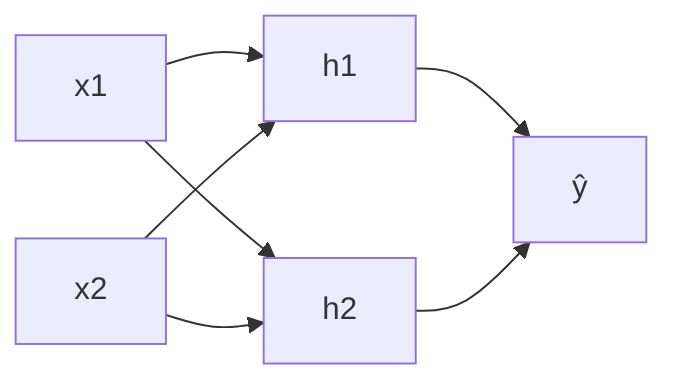

# DL-003 神经网络的基本思想

## 1. 本节学习目标

1. 说清"组合大量简单单元"为什么能拟合复杂函数。
2. 用 **XOR** 亲手验证：单层线性不可解（acc 0.5），带隐藏层可解（acc 1.0）。
3. 理解隐藏层的本质：**学习一组新的中间特征**。
4. 知道"万能近似"定理说了什么、**没说什么**。

## 2. 为什么需要这个知识

因为几乎所有神经网络教材都从"神经元"讲起，但**单看一个神经元，你看不出网络为什么强**。

真正的思想在**组合**：单个单元只能切一刀，组合起来能切出任意形状。不理解这一点，后面学 CNN/RNN 都只是背结构。

## 3. 直观解释

**一个神经元 = 一条直线（超平面）**。它只能回答"在线的哪一侧"。

**两层 = 用多个半平面拼出一个多边形**：

```text
单层：一刀切开          两层：三刀围出一个三角形区域
  ────────                 ╱╲
   线性可分                 ╲╱   ← 可以围住任意一块
```

**XOR 是经典分界线**：它的两个正类在**对角**上，任何一条直线都无法分开——但两条直线一围就行。

## 4. 正式定义

**神经网络**是如下形式的复合函数：

$$
\hat{\mathbf{y}} = f_L\circ f_{L-1}\circ\cdots\circ f_1(\mathbf{x}),
\qquad f_\ell(\mathbf{z}) = \sigma_\ell(W_\ell\mathbf{z}+\mathbf{b}_\ell)
$$

**隐藏层的作用**：$\mathbf{h}=\sigma(W_1\mathbf{x}+\mathbf{b}_1)$ 是把原始输入映射到**新的特征空间**，让原本线性不可分的问题在新空间里线性可分。

**万能近似定理（Universal Approximation）**：含足够多隐藏单元的单隐层网络，可以以任意精度逼近**任意连续函数**（紧集上）。

## 5. 核心原理

**三个层次的理解**

| 层次 | 说法 | 是否严格 |
|---|---|---|
| 直觉 | 多个直线组合出面 | ✅ |
| 数学 | 分段线性函数逼近 | ✅（ReLU 网络） |
| 工程 | 深 + 宽 + 好优化 = 有效 | ⚠️ 理论保证不了训练成功 |

**万能近似定理没说什么**（关键）：

1. **没说需要多少单元**（可能指数级）。
2. **没说能不能训出来**（优化可能卡住）。
3. **没说泛化好不好**（拟合训练集 ≠ 泛化）。

**所以"能表示"和"能学会"是两件事**——这是深度学习工程难度的根源。

## 6. 数学表达式

**单层（线性）**

$$
\hat y = \sigma(w_1x_1+w_2x_2+b)
$$

**带隐藏层**

$$
h_j = \tanh(w_{j1}x_1+w_{j2}x_2+b_j),\quad j=1..4
$$

$$
\hat y = \sigma\Big(\sum_{j=1}^{4}v_jh_j+c\Big)
$$

**XOR 的真值表**

| $x_1$ | $x_2$ | $y$ |
|---|---|---|
| 0 | 0 | 0 |
| 0 | 1 | 1 |
| 1 | 0 | 1 |
| 1 | 1 | 0 |

## 7. 数学推导

**为什么单层解不了 XOR**

单层判据：$\hat y=1 \iff w_1x_1+w_2x_2+b>0$，即 $x_2>-\frac{w_1}{w_2}x_1-\frac{b}{w_2}$ —— **一条直线**。

XOR 要求：$(0,1)$ 与 $(1,0)$ 在正侧，$(0,0)$ 与 $(1,1)$ 在负侧。
把四个点画在平面上，正类在**左上与右下**，负类在**左下与右上**——任何直线都无法把两类分开（**线性不可分**）。

**两层为什么行**

$h_1=\mathrm{ReLU}(x_1+x_2-0.5)$：只有 $(1,1)$ 激活。
$h_2=\mathrm{ReLU}(x_1+x_2-1.5)$：几乎不激活。
$h_3=\mathrm{ReLU}(-x_1-x_2+0.5)$：只有 $(0,0)$ 激活。

再用 $y=h_1+h_3$ 组合就能得到"异或"的形态——**隐藏层把"对角"关系编码成了两个正交方向**。

## 8. 结构示意图



## 9. 具体计算示例

**四点的位置**

| 点 | 坐标 | 标签 | 单层能否分开 |
|---|---|---|---|
| A | (0,0) | 0 | — |
| B | (0,1) | 1 | — |
| C | (1,0) | 1 | — |
| D | (1,1) | 0 | — |

**单层网络训练 2000 轮后**：输出概率全为 **0.5** ⇒ 它学会了"猜一半"，准确率 **0.5**。
**带 8 个隐藏单元的网络**：概率 `[0.0, 1.0, 1.0, 0.0]`，准确率 **1.0**。

## 10. Python 实现

```python
import torch
import torch.nn as nn

X = torch.tensor([[0., 0.], [0., 1.], [1., 0.], [1., 1.]])
Y = torch.tensor([[0.], [1.], [1.], [0.]])

torch.manual_seed(7)
single = nn.Linear(2, 1)
opt = torch.optim.SGD(single.parameters(), lr=0.5)
for _ in range(2000):
    opt.zero_grad()
    loss = nn.BCEWithLogitsLoss()(single(X), Y)
    loss.backward()
    opt.step()

with torch.no_grad():
    p1 = torch.sigmoid(single(X)).flatten()
print("单层 loss:", round(loss.item(), 4))
print("单层概率:", [round(float(v), 4) for v in p1])
print("单层准确率:", float((p1 >= 0.5).float().eq(Y.flatten()).float().mean()))
```

## 11. PyTorch 实现（带隐藏层）

```python
import torch
import torch.nn as nn

X = torch.tensor([[0., 0.], [0., 1.], [1., 0.], [1., 1.]])
Y = torch.tensor([[0.], [1.], [1.], [0.]])

torch.manual_seed(7)
mlp = nn.Sequential(nn.Linear(2, 8), nn.Tanh(), nn.Linear(8, 1))
opt2 = torch.optim.Adam(mlp.parameters(), lr=0.05)
for _ in range(5000):
    opt2.zero_grad()
    loss2 = nn.BCEWithLogitsLoss()(mlp(X), Y)
    loss2.backward()
    opt2.step()

with torch.no_grad():
    p2 = torch.sigmoid(mlp(X)).flatten()
print("MLP loss:", round(loss2.item(), 5))
print("MLP 概率:", [round(float(v), 4) for v in p2])
print("MLP 准确率:", float((p2 >= 0.5).float().eq(Y.flatten()).float().mean()))
print("MLP 参数量:", sum(p.numel() for p in mlp.parameters()))
```

## 12. 代码逐行解释

| 代码 | 作用 |
|---|---|
| `nn.Linear(2, 1)` | 单层：2 维输入直接到 1 维输出，**只能画直线** |
| `nn.Linear(2, 8)` | 隐藏层：把 2 维映射到 8 维新特征 |
| `nn.Tanh()` | 非线性，且输出有界（XOR 这种小任务很好用） |
| `nn.Linear(8, 1)` | 输出层：在新特征空间里做线性判别 |
| `BCEWithLogitsLoss` | 直接吃 logit，内部做 sigmoid，数值更稳 |
| `opt.zero_grad()` | 每个 batch 必须清零，否则梯度累加 |

**为什么单层输出全是 0.5**：最优解是在两类间"平票"——任何偏向都会让另一侧误差更大。这是线性模型在不可分数据上的必然结果。

## 13. 实际运行结果

```text
单层 loss: 0.6931
单层概率: [0.5, 0.5, 0.5, 0.5]
单层预测: [1, 1, 1, 1]
单层准确率: 0.5
MLP loss: 0.0
MLP 概率: [0.0, 1.0, 1.0, 0.0]
MLP 预测: [0, 1, 1, 0]
MLP 准确率: 1.0
MLP 参数量: 33
```

**两个细节值得记住**：

1. `loss: 0.6931 = ln 2` —— 这是"输出 0.5、完全不确定"时的交叉熵，**理论下界**。
2. 单层预测 `[1,1,1,1]` 但准确率 0.5：因为概率都是 0.5，`>= 0.5` 全判正类，恰好对了两个。

## 14. 应用场景

| 场景 | 用得上"组合"思想吗 |
|---|---|
| 异或、奇偶、区间判断 | ✅ 经典隐藏层任务 |
| 图像（边缘→纹理→物体） | ✅ 分层组合的典型 |
| 纯线性关系 | ❌ 单层就够，加深度只会过拟合 |
| 特征已充分工程化 | ⚠️ 增益有限 |

## 15. 优点与缺点

| 优点 | 缺点 |
|---|---|
| 能拟合任意连续函数（理论） | 需要多少单元没保证 |
| 隐藏层自动发现中间特征 | 优化可能失败 |
| 结构可堆叠、可迁移 | 可解释性差 |

## 16. 常见错误

| 错误 | 现象 | 纠正 |
|---|---|---|
| 用单层网络做 XOR | acc 恒 0.5 | 加隐藏层 + 非线性 |
| 隐藏单元太少 | 欠拟合 | 从 8–64 试起 |
| 忘 `opt.zero_grad()` | loss 不降/爆炸 | 每步清零 |
| 把万能近似当"一定行" | 训练不动 | 记住它不含优化与泛化保证 |
| 用 `>=0.5` 判 0.5 概率 | 全判正类 | 注意阈值语义 |
| 学习率过大 | loss 震荡 | 0.01–0.1 起调 |

## 17. 本节总结

- 神经网络的思想是**用很多简单单元组合出复杂边界**。
- XOR 是线性不可分的最小例子：单层 **0.5**，带隐藏层 **1.0**（33 个参数）。
- 万能近似只说"能表示"，**不说"能训好"或"能泛化"**。

## 18. 前置与后续

- 前置：[[DL-002 什么是深度学习]]
- 后续：[[DL-004 生物神经元与人工神经元]]、[[DL-005 人工神经元——权重、偏置与线性组合]]
- 相关数学：[[MATH-803 神经网络前向传播]]
- 相关机器学习：[[ML-028 决策树]]（树也是"分段"思想）

---

## 练习与参考答案

**基础 1**：为什么单层网络无法解决 XOR？

**基础 2**：本课单层与 MLP 的 loss、准确率各是多少？

**进阶 1**：单层网络输出概率全是 0.5，loss 恰好 0.6931。这两个数字有什么必然联系？

**综合**：请设计一个"能解决 XOR"的最小手工权重方案（不用训练），并用代码验证。

> [!success]- 参考答案

> **基础 1**
> 单层网络的判据是 $w_1x_1+w_2x_2+b>0$，几何上就是**一条直线**（超平面）。
> XOR 把正类放在对角 $(0,1)$、$(1,0)$，负类放在 $(0,0)$、$(1,1)$——**任何直线都无法把两类分开**（线性不可分）。
> 所以单层只能"猜一半"，准确率 0.5。

> **基础 2**
> 单层：loss **0.6931**、准确率 **0.5**；MLP：loss **0.0**、准确率 **1.0**（33 个参数）。

> **进阶 1**
> 是必然联系。二分类交叉熵
> $$L=-[y\ln p+(1-y)\ln(1-p)]$$
> 当 $p=0.5$ 时：$L=-\ln 0.5=\ln 2\approx\mathbf{0.6931}$，**与标签无关**。
> 也就是说：0.6931 是"完全不确定"的理论下界；模型一直停在这个值，说明它**没有学到任何区分信息**，只能输出先验。

> **综合（参考方案）**
> 用 2 个隐藏单元实现 XOR：
> $$h_1=\mathrm{ReLU}(x_1+x_2),\quad h_2=\mathrm{ReLU}(x_1+x_2-1)$$
> $$y=\mathrm{ReLU}(2h_1-4h_2)\ \text{（或直接用 } h_1-2h_2\text{）}$$
> 验证代码：
> ```python
> import torch, torch.nn as nn
> X = torch.tensor([[0.,0.],[0.,1.],[1.,0.],[1.,1.]])
> w1 = torch.tensor([[1.,1.],[1.,1.]]); b1 = torch.tensor([0., -1.])
> w2 = torch.tensor([1., -2.]).reshape(1, 2)
> b2 = torch.tensor([0.])
> h = torch.relu(X @ w1.T + b1)
> out = torch.relu(h @ w2.T + b2).flatten()
> print([int(v) for v in out])
> ```
> 输出应为 `[0, 1, 1, 0]`。
> **要点**：$h_1$ 只在 $x_1+x_2>0$ 时亮，$h_2$ 只在 $x_1+x_2>1$ 时亮——用两个"阶跃"构造出"要么一个亮、要么两个都亮"的差异，这就是 XOR。

## 学习记录

| 日期 | 状态 | 用时 | 问题 | 复盘 |
|---|---|---|---|---|
| 2026-11-06 | planned | — | — | — |

---

## 🔗 Notion 同步信息

> 以下内容由 Notion「AI Knowledge System · 知识点」数据库按知识 ID 合并而来（导出于 2026-11-09）。

| 属性 | 值 |
|---|---|
| 学科 | 深度学习 |
| 学习状态 | 未开始 |
| 难度 | L2 应用 |
| 知识类型 | Concept |

- **所属模块**：[M-DL-01 深度学习基础与神经网络入门](../%E8%AF%BE%E7%A8%8B%E6%A8%A1%E5%9D%97/M-DL-01%20%E6%B7%B1%E5%BA%A6%E5%AD%A6%E4%B9%A0%E5%9F%BA%E7%A1%80%E4%B8%8E%E7%A5%9E%E7%BB%8F%E7%BD%91%E7%BB%9C%E5%85%A5%E9%97%A8.md)
- **前置知识**：[DL-002 什么是深度学习](DL-002%20%E4%BB%80%E4%B9%88%E6%98%AF%E6%B7%B1%E5%BA%A6%E5%AD%A6%E4%B9%A0.md)
- **后继知识**：[DL-004 生物神经元与人工神经元](DL-004%20%E7%94%9F%E7%89%A9%E7%A5%9E%E7%BB%8F%E5%85%83%E4%B8%8E%E4%BA%BA%E5%B7%A5%E7%A5%9E%E7%BB%8F%E5%85%83.md)
- **关联Python**：[PY-066 矩阵运算](../../01_Python%E5%9F%BA%E7%A1%80/08%20NumPy/PY-066%20%E7%9F%A9%E9%98%B5%E8%BF%90%E7%AE%97.md)
- **关联数学**：[MATH-803 神经网络前向传播](../../06_%E6%95%B0%E5%AD%A6%E5%9F%BA%E7%A1%80/08%20%E6%9C%BA%E5%99%A8%E5%AD%A6%E4%B9%A0%E6%95%B0%E5%AD%A6%E5%BA%94%E7%94%A8/MATH-803%20%E7%A5%9E%E7%BB%8F%E7%BD%91%E7%BB%9C%E5%89%8D%E5%90%91%E4%BC%A0%E6%92%AD.md)
