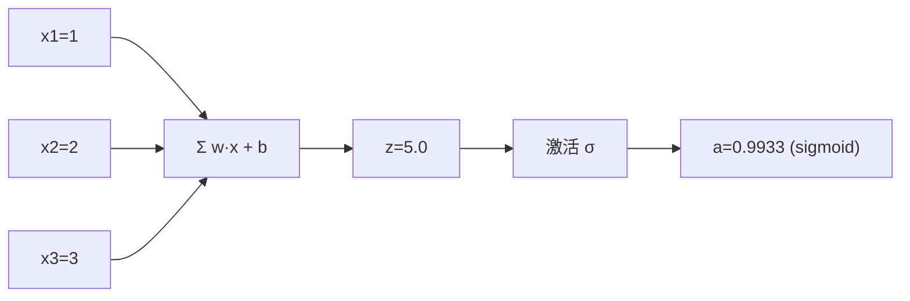

# DL-004 生物神经元与人工神经元

## 1. 本节学习目标

1. 说清生物神经元的工作环节与人工神经元的**对应关系**。
2. 明确两者的**关键差异**（不要被"仿生"叙事误导）。
3. 会用数值走一遍"加权求和 → 激活 → 输出"。
4. 知道人工神经元**丢掉了**生物神经元的哪些特性。

## 2. 为什么需要这个知识

因为"神经网络模仿大脑"这句话**只对了一小半**，它容易带来两个错误期待：

- 以为网络会像大脑一样"自主理解"——实际上它只是函数拟合。
- 以为需要严格仿生才能有效——实际上人工神经元是高度简化的数学模型。

**知道差异，才不会把工程问题误解成"没模仿好大脑"**。

## 3. 直观解释

**生物神经元**的工作流程：

```text
树突接收信号 → 胞体整合 → 超过阈值 → 轴突发放电 → 突触传给下一个神经元
```

**人工神经元**：

```text
输入 x → 加权求和 Σwx+b → 激活函数 → 输出
```

**一一对应**：

| 生物 | 人工 |
|---|---|
| 树突接收 | 输入 $x_i$ |
| 突触强度 | 权重 $w_i$ |
| 胞体整合 | 加权求和 $\sum w_ix_i$ |
| 兴奋阈值 | 偏置 $b$ |
| 是否放电 | 激活函数 $\sigma$ |
| 轴突输出 | 输出值 |

## 4. 正式定义

**人工神经元**

$$
z=\sum_{i=1}^{n}w_ix_i+b=\mathbf{w}^\top\mathbf{x}+b,
\qquad
a=\sigma(z)
$$

| 符号 | 含义 |
|---|---|
| $\mathbf{x}\in\mathbb{R}^n$ | 输入 |
| $\mathbf{w}\in\mathbb{R}^n$ | 权重（可学习） |
| $b\in\mathbb{R}$ | 偏置（可学习） |
| $z$ | 加权和（logit / 净输入） |
| $\sigma$ | 激活函数 |
| $a$ | 输出（激活值） |

## 5. 核心原理

**生物 vs 人工的关键差异**

| 维度 | 生物神经元 | 人工神经元 |
|---|---|---|
| 信号形式 | 脉冲（spike）时序 | 连续实数 |
| 时间动态 | 有不应期、时滞 | 无时间概念 |
| 连接 | 上千个突触，动态可塑 | 固定矩阵元素 |
| 学习机制 | 突触可塑性（多机制） | 反向传播（全局梯度） |
| 能耗 | 约 20 W（全脑） | GPU 数百瓦 |
| 规模 | 约 $8.6\times10^{10}$ 神经元 | 百万–千亿参数 |

**最重要的一条**：人工神经元**没有时间维度**。脉冲神经网络（SNN）才处理时序，本课程不涉及。

**所以准确的表述是**：人工神经元是"**受生物启发的极简数学模型**"，不是"大脑的模拟"。

## 6. 数学表达式

**加权求和**

$$
z=0.5\times1+(-1)\times2+2\times3+0.5=5.0
$$

**不同激活函数下**

| 激活 | 公式 | $z=5$ 时的值 |
|---|---|---|
| Sigmoid | $\frac{1}{1+e^{-z}}$ | **0.9933** |
| Tanh | $\frac{e^z-e^{-z}}{e^z+e^{-z}}$ | **0.9999** |
| ReLU | $\max(0,z)$ | **5.0** |
| Leaky ReLU | $\max(0.01z,z)$ | **5.0** |
| GELU | $z\cdot\Phi(z)$ | **5.0** |

## 7. 数学推导

**Sigmoid 的数值计算**

$$
\sigma(5)=\frac{1}{1+e^{-5}}=\frac{1}{1+0.006738}=0.99331
$$

**Tanh 与 Sigmoid 的关系**

$$
\tanh(z)=2\sigma(2z)-1
$$

验证：$2\sigma(10)-1=2\times0.999955-1=0.99991$ ⇒ 与 $\tanh(5)=0.9999$ 一致。

**为什么 ReLU 系列在 $z=5$ 时都等于 5**：正区间是恒等映射（GELU 在 $z$ 较大时也近似恒等）。

## 8. 结构示意图



## 9. 具体计算示例

**手算**

```text
z = 0.5×1 + (−1)×2 + 2×3 + 0.5
  = 0.5 − 2 + 6 + 0.5
  = 5.0
```

**阈值判据**（仿生"是否放电"）：$z\ge 0$ ⇒ 放电。本例 $5.0\ge0$ ⇒ **是**。

**不同激活给出的输出**：sigmoid 0.9933（接近 1）、tanh 0.9999（接近 1）、ReLU 5.0（无界）。

## 10. Python 实现

```python
import torch

x = torch.tensor([1.0, 2.0, 3.0])
w = torch.tensor([0.5, -1.0, 2.0])
b = torch.tensor(0.5)

z = (w * x).sum() + b
print("加权求和 z:", float(z))
print("阈值判据 z>=0 →", bool(z >= 0))
print("sigmoid(z):", round(float(torch.sigmoid(z)), 4))
print("tanh(z):", round(float(torch.tanh(z)), 4))
print("relu(z):", round(float(torch.relu(z)), 4))
print("leaky_relu(z,0.01):", round(float(torch.nn.functional.leaky_relu(z, 0.01)), 4))
print("gelu(z):", round(float(torch.nn.functional.gelu(z)), 4))
```

## 11. PyTorch 实现（作为一层）

```python
import torch
import torch.nn as nn

lin = nn.Linear(3, 1)
with torch.no_grad():
    lin.weight.copy_(torch.tensor([[0.5, -1.0, 2.0]]))
    lin.bias.copy_(torch.tensor([0.5]))

x = torch.tensor([1.0, 2.0, 3.0])
print("nn.Linear 输出:", round(float(lin(x).detach()), 4))
```

## 12. 代码逐行解释

| 代码 | 作用 |
|---|---|
| `(w * x).sum() + b` | 手工实现 $\mathbf{w}^\top\mathbf{x}+b$ |
| `torch.sigmoid(z)` | 压缩到 (0,1)，最像"放电强度" |
| `torch.tanh(z)` | 压缩到 (−1,1)，零中心 |
| `torch.relu(z)` | 负半轴截断为 0，正半轴恒等 |
| `F.leaky_relu(z, 0.01)` | 负半轴保留 1% 斜率，避免"死神经元" |
| `F.gelu(z)` | 平滑版 ReLU，Transformer 常用 |
| `lin.weight.copy_(...)` | 把手工权重塞进 PyTorch 层，验证等价性 |

## 13. 实际运行结果

```text
加权求和 z: 5.0
阈值判据 z>=0 → True
sigmoid(z): 0.9933
tanh(z): 0.9999
relu(z): 5.0
leaky_relu(z,0.01): 5.0
gelu(z): 5.0
nn.Linear 输出: 5.0
```

**读法**：`nn.Linear` 的输出 5.0 与手算完全一致 ⇒ **一个"神经元"在 PyTorch 里就是 `nn.Linear(3,1)` + 一个激活**。

## 14. 应用场景

| 场景 | 该选什么激活 |
|---|---|
| 二分类输出 | Sigmoid |
| 多分类输出 | Softmax（见 DL-017） |
| 隐藏层（CNN/MLP） | ReLU |
| 隐藏层（防死神经元） | Leaky ReLU / GELU |
| 小网络、需要零中心 | Tanh |

## 15. 优点与缺点

| 优点 | 缺点 |
|---|---|
| 数学形式极简、可微、可批量 | 无时间动态，不能处理脉冲 |
| 参数少、易训练 | 与真实神经元差异巨大 |
| 可堆叠成任意网络 | 单位"智能"极低，靠规模取胜 |

## 16. 常见错误

| 错误 | 现象 | 纠正 |
|---|---|---|
| 以为人工神经元=真实神经元 | 期待"自主理解" | 它是简化数学模型 |
| 把偏置当"阈值"等同 | 符号/作用混淆 | 偏置是**可学习**的阈值偏移 |
| 输出层用 ReLU | 概率无法解释 | 二分类用 Sigmoid、多分类 Softmax |
| 隐藏层用 Sigmoid 很深 | 梯度消失 | 改 ReLU/GELU（DL-022） |
| 说"神经元越多越像大脑" | 无依据 | 规模不等于仿生程度 |

## 17. 本节总结

- 人工神经元 = **加权求和 + 偏置 + 激活**，与生物神经元有对应但**高度简化**。
- 最大差异：**没有时间维度**，学习靠反向传播而非突触可塑性。
- 同一 $z=5$ 在不同激活下：sigmoid 0.9933、tanh 0.9999、ReLU 5.0。

## 18. 前置与后续

- 前置：[[DL-003 神经网络的基本思想]]
- 后续：[[DL-005 人工神经元——权重、偏置与线性组合]]、`DL-009 激活函数——Sigmoid、Tanh、ReLU`（待建）
- 相关数学：[[MATH-803 神经网络前向传播]]
- 相关机器学习：[[ML-025 逻辑回归]]（单个神经元 + sigmoid 就是它）

---

## 练习与参考答案

**基础 1**：生物神经元与人工神经元的五个对应关系是什么？

**基础 2**：本课 $z$ 是多少？在 sigmoid、tanh、ReLU 下输出各是多少？

**进阶 1**：为什么说"人工神经元不是大脑的模拟"？举两个决定性差异。

**综合**：业务方担心"神经网络不可解释"。请用单个神经元的视角解释"它其实就是一个带激活的加权打分器"，并说明可解释性从哪一层开始丢失。

> [!success]- 参考答案

> **基础 1**
> 树突接收 ↔ 输入 $x_i$；突触强度 ↔ 权重 $w_i$；胞体整合 ↔ 加权求和 $\sum w_ix_i+b$；兴奋阈值 ↔ 偏置 $b$ 与激活阈值；轴突发放 ↔ 输出 $a=\sigma(z)$。

> **基础 2**
> $z=0.5-2+6+0.5=\mathbf{5.0}$；sigmoid **0.9933**、tanh **0.9999**、ReLU **5.0**。

> **进阶 1**
> 两个决定性差异：
> 1. **没有时间维度**：生物神经元用脉冲时序编码信息，有人不应期与时滞；人工神经元一次前向就出实数，无时间概念。
> 2. **学习机制不同**：生物靠局部突触可塑性（多种机制、在线、无全局目标）；人工靠**反向传播**——需要把整个网络的梯度从输出传回每一层，这在生物上缺乏证据。
> 另外规模/能耗也差几个数量级（人脑约 20 W，GPU 数百瓦）。

> **综合（参考回答）**
> 单个神经元确实可以解释：
> $$a=\sigma\Big(\sum_i w_ix_i+b\Big)$$
> 它就是一个**加权打分器**——每个特征乘一个权重再相加，最后用激活函数压缩。权重符号=方向（正/负相关），绝对值=重要程度。
> **可解释性在哪丢失**：
> 1. **单层**：完全可解释（相当于逻辑回归，看系数即可）。
> 2. **加隐藏层**：中间特征是人命名的，但 $h_j=\sigma(\sum w_{ji}x_i)$ 还能逐层展开解释。
> 3. **多层 + 非线性**：特征交互项爆炸，单个权重不再有"独立含义"，只能靠**事后归因**（置换重要性、SHAP、显著性图）。
> 4. **深度网络**：只能给"局部解释"，无法给全局因果。
> 结论：**不要把"可解释"寄托在网络结构上**，要落到事后解释工具与业务约束（如单调性约束）。

## 学习记录

| 日期 | 状态 | 用时 | 问题 | 复盘 |
|---|---|---|---|---|
| 2026-11-06 | planned | — | — | — |

---

## 🔗 Notion 同步信息

> 以下内容由 Notion「AI Knowledge System · 知识点」数据库按知识 ID 合并而来（导出于 2026-11-09）。

| 属性 | 值 |
|---|---|
| 学科 | 深度学习 |
| 学习状态 | 未开始 |
| 难度 | L1 概念 |
| 知识类型 | Concept |

- **所属模块**：[M-DL-01 深度学习基础与神经网络入门](../%E8%AF%BE%E7%A8%8B%E6%A8%A1%E5%9D%97/M-DL-01%20%E6%B7%B1%E5%BA%A6%E5%AD%A6%E4%B9%A0%E5%9F%BA%E7%A1%80%E4%B8%8E%E7%A5%9E%E7%BB%8F%E7%BD%91%E7%BB%9C%E5%85%A5%E9%97%A8.md)
- **前置知识**：[DL-003 神经网络的基本思想](DL-003%20%E7%A5%9E%E7%BB%8F%E7%BD%91%E7%BB%9C%E7%9A%84%E5%9F%BA%E6%9C%AC%E6%80%9D%E6%83%B3.md)
- **后继知识**：[DL-005 人工神经元：权重、偏置与线性组合](DL-005%20%E4%BA%BA%E5%B7%A5%E7%A5%9E%E7%BB%8F%E5%85%83%E2%80%94%E2%80%94%E6%9D%83%E9%87%8D%E3%80%81%E5%81%8F%E7%BD%AE%E4%B8%8E%E7%BA%BF%E6%80%A7%E7%BB%84%E5%90%88.md)
- **关联数学**：[MATH-803 神经网络前向传播](../../06_%E6%95%B0%E5%AD%A6%E5%9F%BA%E7%A1%80/08%20%E6%9C%BA%E5%99%A8%E5%AD%A6%E4%B9%A0%E6%95%B0%E5%AD%A6%E5%BA%94%E7%94%A8/MATH-803%20%E7%A5%9E%E7%BB%8F%E7%BD%91%E7%BB%9C%E5%89%8D%E5%90%91%E4%BC%A0%E6%92%AD.md)
