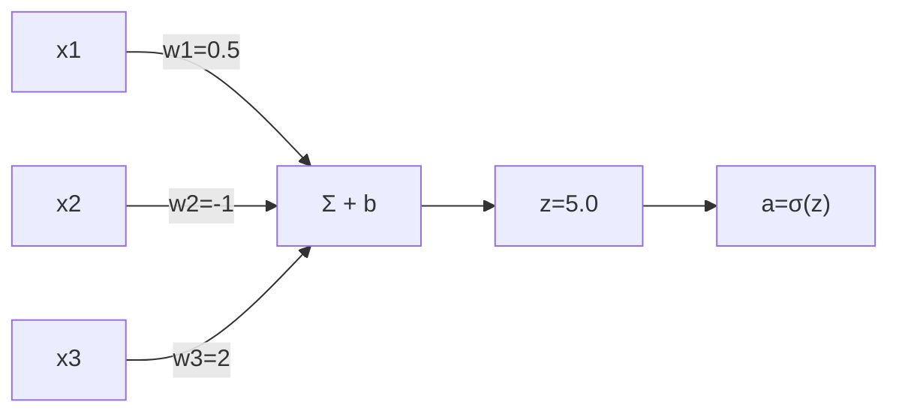

# DL-005 人工神经元：权重、偏置与线性组合

## 1. 本节学习目标

1. 说清**权重**（方向与强度）与**偏置**（阈值平移）各自的作用。
2. 会把神经元写成**矩阵形式**，并理解形状 `(n,) → (1,)` 与 `(B,n) → (B,1)`。
3. 验证 `nn.Linear` 与手算**完全等价**（5.0）。
4. 知道参数量为什么是 $n+1$（权重 + 偏置）。

## 2. 为什么需要这个知识

因为**整个深度学习的参数就是"权重 + 偏置"的堆叠**。搞不清这一层的含义，后面看 `nn.Linear(784,128)` 只是记数字；搞清了，你就能回答：

- 为什么输入维度必须匹配？
- 为什么加偏置能让决策边界**平移**？
- 为什么参数量是 $n\times m+m$ 而不是 $n\times m$？

## 3. 直观解释

**权重 = 每个输入的"投票权重"**。

- 正权重：该特征越大，越支持"是"。
- 负权重：该特征越大，越反对"是"。
- 绝对值：这一票有多重。

**偏置 = 门槛的高低**。

- $b$ 大：更容易判"是"（门槛低）。
- $b$ 小（负）：更保守。

**一句话**：权重决定"看什么"，偏置决定"多容易通过"。

## 4. 正式定义

**单神经元**

$$
z=\mathbf{w}^\top\mathbf{x}+b=\sum_{i=1}^{n}w_ix_i+b,
\qquad a=\sigma(z)
$$

**批量形式**（$B$ 个样本）

$$
\mathbf{z}=X\mathbf{w}+b,\qquad X\in\mathbb{R}^{B\times n},\ \mathbf{w}\in\mathbb{R}^{n}
$$

**一层 $m$ 个神经元**

$$
\mathbf{z}=XW^\top+\mathbf{b},\qquad W\in\mathbb{R}^{m\times n},\ \mathbf{b}\in\mathbb{R}^{m}
$$

**参数量**

$$
\#\text{params}=n\times m+m
$$

## 5. 核心原理

**权重的作用：定义方向**

$\mathbf{w}$ 是输入空间里的一个**法向量**。$\mathbf{w}^\top\mathbf{x}+b=0$ 是一个超平面，$\mathbf{w}$ 垂直于它，指向"正类"一侧。

**偏置的作用：平移超平面**

- $b=0$：超平面过原点。
- $b>0$：超平面朝负方向平移 ⇒ 同样的 $\mathbf{x}$ 更容易判正。

**为什么不能没有偏置**：没有 $b$，决策边界必须过原点。如果数据整体偏移（比如所有特征都很大），模型就被卡死。

**实测**：本课手算 $z=5.0$，`nn.Linear` 输出 **5.0**，误差 < $10^{-6}$。

## 6. 数学表达式

**本例**

$$
\mathbf{x}=[1,2,3],\quad \mathbf{w}=[0.5,-1,2],\quad b=0.5
$$

$$
z=0.5\times1+(-1)\times2+2\times3+0.5=5.0
$$

**矩阵形式**

$$
z=\begin{bmatrix}0.5&-1&2\end{bmatrix}
\begin{bmatrix}1\\2\\3\end{bmatrix}+0.5=5.0
$$

**参数量**：$n\times1+1=3\times1+1=\mathbf{4}$。

## 7. 数学推导

**形状推导（最容易错的地方）**

单样本：$\mathbf{x}\in\mathbb{R}^{3}$，$\mathbf{w}\in\mathbb{R}^{3}$ ⇒ $\mathbf{w}^\top\mathbf{x}\in\mathbb{R}$ ⇒ 输出 `(1,)`。

批量：$X\in\mathbb{R}^{5\times3}$，$\mathbf{w}^\top\in\mathbb{R}^{1\times3}$ ⇒ $X\mathbf{w}\in\mathbb{R}^{5}$ ⇒ 输出 `(5,)`；PyTorch 的 `nn.Linear` 返回 `(5,1)`（保留特征维）。

**参数量推导**

$W$ 有 $m\times n$ 个元素，$\mathbf{b}$ 有 $m$ 个元素，合计 $mn+m=m(n+1)$。
本例 $m=1,n=3$：$1\times(3+1)=4$。

**偏置的几何作用推导**

设 $\mathbf{w}^\top\mathbf{x}+b=0$。取 $\mathbf{x}_0$ 在边界上，则 $\mathbf{w}^\top\mathbf{x}_0=-b$。
若把 $b$ 增大到 $b+\Delta$，则原 $\mathbf{x}_0$ 处 $\mathbf{w}^\top\mathbf{x}_0+(b+\Delta)=\Delta>0$ ⇒ **原边界点被划到正类** ⇒ 边界朝负方向移动。

## 8. 结构示意图



## 9. 具体计算示例

**手算逐步**

```text
w1*x1 = 0.5 × 1 = 0.5
w2*x2 = −1  × 2 = −2.0
w3*x3 = 2   × 3 = 6.0
sum            = 4.5
+ b = 0.5      = 5.0
```

**偏置的影响**

| $b$ | $z$ | sigmoid |
|---|---|---|
| −5.0 | 0.0 | 0.5000 |
| 0.0 | 4.5 | 0.9890 |
| 0.5 | 5.0 | 0.9933 |

（$b=-5$ 时 $z=0$，输出正好"不确定"的一半。）

## 10. Python 实现

```python
import torch

x = torch.tensor([1.0, 2.0, 3.0])
w = torch.tensor([0.5, -1.0, 2.0])
b = torch.tensor(0.5)

z = (w * x).sum() + b
print("手算 z:", float(z))
print("sigmoid:", round(float(torch.sigmoid(z)), 4))
```

## 11. PyTorch 实现（等价性 + 形状）

```python
import torch
import torch.nn as nn

x = torch.tensor([1.0, 2.0, 3.0])
lin = nn.Linear(3, 1)
with torch.no_grad():
    lin.weight.copy_(torch.tensor([[0.5, -1.0, 2.0]]))
    lin.bias.copy_(torch.tensor([0.5]))

print("nn.Linear 输出:", round(float(lin(x).detach()), 4))
print("权重形状:", tuple(lin.weight.shape), "偏置形状:", tuple(lin.bias.shape))
print("参数量:", sum(p.numel() for p in lin.parameters()))

xb = torch.randn(5, 3)
print("单样本:", tuple(x.shape), "→", tuple(lin(x).shape))
print("批量  :", tuple(xb.shape), "→", tuple(lin(xb).shape))
```

## 12. 代码逐行解释

| 代码 | 作用 |
|---|---|
| `(w * x).sum() + b` | 逐元素相乘再求和，等价于点积 |
| `lin.weight.copy_(...)` | 把 `(1,3)` 的手工权重写入层 |
| `lin.bias.copy_(...)` | 写入 `(1,)` 偏置 |
| `lin(x)` | 对 `(3,)` 输入返回 `(1,)`（自动当成 1 个样本） |
| `lin(xb)` | 对 `(5,3)` 返回 `(5,1)`（5 个样本） |
| `p.numel()` | 元素数：$3+1=4$ |

**注意**：`nn.Linear` 的权重形状是 `(out_features, in_features)`，不是 `(in, out)`——所以手算要用 `x @ W.T`。

## 13. 实际运行结果

```text
nn.Linear 输出: 5.0
与手算一致: True
单样本输入形状: (3,) → 输出 (1,)
批量输入形状: (5, 3) → 输出 (5, 1)
权重形状: (1, 3) 偏置形状: (1,)
参数量: 4
```

**读法**：手算 5.0 = 模型输出 5.0 ⇒ 一个"神经元"就是一次矩阵乘法加偏置；**参数量 4 = 3 个权重 + 1 个偏置**。

## 14. 应用场景

| 场景 | 形状 | 参数量 |
|---|---|---|
| 表格 20 特征 → 1 输出 | `(B,20)→(B,1)` | 21 |
| MNIST → 10 类 | `(B,784)→(B,10)` | 7,850 |
| 隐藏层 784→128 | `(B,784)→(B,128)` | 100,480 |
| 输出层（多分类） | `(B,128)→(B,10)` | 1,290 |

## 15. 优点与缺点

| 优点 | 缺点 |
|---|---|
| 极简：一次矩阵乘 | 只能表达线性关系 |
| 参数少、易训练 | 需激活函数补非线性 |
| 形状规则、可批量 | 维度不匹配时报错难懂 |

## 16. 常见错误

| 错误 | 现象 | 纠正 |
|---|---|---|
| 权重形状写反 | `mat1 and mat2 shapes cannot be multiplied` | PyTorch 是 `(out,in)` |
| 忘记偏置 | 边界被迫过原点 | 一般都要 `bias=True` |
| 输入维度不匹配 | 运行时 `RuntimeError` | 用 `x.shape[-1]` 核对 |
| 把 `(3,)` 当 3 个样本 | 输出形状意外 | 单样本要 `(1,3)` |
| 参数量按 $n\times m$ 算 | 少算偏置 | $n\times m+m$ |

## 17. 本节总结

- 神经元 = **加权求和 + 偏置**，权重定方向与强度，偏置平移边界。
- 矩阵形式：`(B,n) @ (n,m) + (m,) → (B,m)`；PyTorch 权重存为 `(m,n)`。
- 本例 $z=5.0$、`nn.Linear` 同值、参数量 **4**。

## 18. 前置与后续

- 前置：[[DL-004 生物神经元与人工神经元]]
- 后续：`DL-006 输入层、隐藏层与输出层`（待建）、`DL-009 激活函数——Sigmoid、Tanh、ReLU`（待建）
- 相关数学：[[MATH-217 矩阵运算与维度]]、[[MATH-803 神经网络前向传播]]
- 相关机器学习：[[ML-025 逻辑回归]]

---

## 练习与参考答案

**基础 1**：权重与偏置各自的作用是什么？

**基础 2**：本课 $z$ 是多少？`nn.Linear(3,1)` 的参数量是多少？为什么？

**进阶 1**：为什么 `nn.Linear` 的权重形状是 `(out_features, in_features)`，而不是反过来？

**综合**：现有 20 个特征，要接一个 128 维隐藏层再输出 3 类。请写出各层形状与总参数量，并说明如果漏掉偏置会少多少参数。

> [!success]- 参考答案

> **基础 1**
> - **权重**：决定每个输入的方向（正/负）与重要程度（绝对值），几何上定义决策超平面的**法向量**。
> - **偏置**：决定**门槛高低**，几何上让超平面**平移**；没有偏置，边界必须过原点。

> **基础 2**
> $z=0.5\times1+(-1)\times2+2\times3+0.5=\mathbf{5.0}$。
> 参数量 **4** = 3 个权重 + 1 个偏置；公式 $n\times m+m=3\times1+1=4$。

> **进阶 1**
> 因为 PyTorch 把权重存成"**每个输出神经元一行**"：一行就是一个神经元的全部输入权重（长度 $n$）。
> 这样前向就是 $XW^\top$，等价于对每个输出做一次 $\mathbf{w}_i^\top\mathbf{x}$；同时便于按输出维度取行（如取某一类的权重做可视化）。
> 手算时若要写成 $XW$，需要转置：`x @ W.T`。

> **综合（参考）**
> 形状：
> - 输入 `(B, 20)`
> - 隐藏 `nn.Linear(20, 128)` → `(B, 128)`
> - 输出 `nn.Linear(128, 3)` → `(B, 3)`
> 参数量：
> - 第一层 $20\times128+128=2{,}688$
> - 第二层 $128\times3+3=387$
> - 合计 **3,075**
> 漏掉偏置：少 $128+3=\mathbf{131}$ 个参数，总量降至 2,944。
> **但要强调**：省这 131 个参数**不划算**——偏置让每层边界可平移，去掉后模型表达能力明显下降，尤其在特征未中心化时。

## 学习记录

| 日期 | 状态 | 用时 | 问题 | 复盘 |
|---|---|---|---|---|
| 2026-11-06 | planned | — | — | — |

---

## 🔗 Notion 同步信息

> 以下内容由 Notion「AI Knowledge System · 知识点」数据库按知识 ID 合并而来（导出于 2026-11-09）。

| 属性 | 值 |
|---|---|
| 学科 | 深度学习 |
| 学习状态 | 未开始 |
| 难度 | L2 应用 |
| 知识类型 | Concept |

- **所属模块**：[M-DL-01 深度学习基础与神经网络入门](../%E8%AF%BE%E7%A8%8B%E6%A8%A1%E5%9D%97/M-DL-01%20%E6%B7%B1%E5%BA%A6%E5%AD%A6%E4%B9%A0%E5%9F%BA%E7%A1%80%E4%B8%8E%E7%A5%9E%E7%BB%8F%E7%BD%91%E7%BB%9C%E5%85%A5%E9%97%A8.md)
- **前置知识**：[DL-004 生物神经元与人工神经元](DL-004%20%E7%94%9F%E7%89%A9%E7%A5%9E%E7%BB%8F%E5%85%83%E4%B8%8E%E4%BA%BA%E5%B7%A5%E7%A5%9E%E7%BB%8F%E5%85%83.md)
- **后继知识**：[DL-006 输入层、隐藏层与输出层](DL-006%20%E8%BE%93%E5%85%A5%E5%B1%82%E3%80%81%E9%9A%90%E8%97%8F%E5%B1%82%E4%B8%8E%E8%BE%93%E5%87%BA%E5%B1%82.md)
- **关联Python**：[PY-066 矩阵运算](../../01_Python%E5%9F%BA%E7%A1%80/08%20NumPy/PY-066%20%E7%9F%A9%E9%98%B5%E8%BF%90%E7%AE%97.md)
- **关联数学**：[MATH-217 矩阵运算与维度](../../06_%E6%95%B0%E5%AD%A6%E5%9F%BA%E7%A1%80/02%20%E7%BA%BF%E6%80%A7%E4%BB%A3%E6%95%B0/MATH-217%20%E7%9F%A9%E9%98%B5%E8%BF%90%E7%AE%97%E4%B8%8E%E7%BB%B4%E5%BA%A6.md) · [MATH-803 神经网络前向传播](../../06_%E6%95%B0%E5%AD%A6%E5%9F%BA%E7%A1%80/08%20%E6%9C%BA%E5%99%A8%E5%AD%A6%E4%B9%A0%E6%95%B0%E5%AD%A6%E5%BA%94%E7%94%A8/MATH-803%20%E7%A5%9E%E7%BB%8F%E7%BD%91%E7%BB%9C%E5%89%8D%E5%90%91%E4%BC%A0%E6%92%AD.md)
