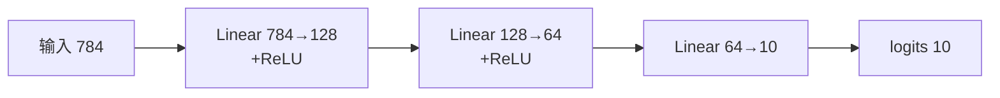

# DL-006 输入层、隐藏层与输出层

## 1. 本节学习目标

1. 分清三类层的**职责与是否含参数**。
2. 会按"输入维度 → 隐藏维度 → 输出维度"画出一张网，并**手算参数量**。
3. 理解输出层维度由**任务类型**决定（回归 1、二分类 1、多分类 $C$）。
4. 会核对每一层的形状，避免 `RuntimeError`。

## 2. 为什么需要这个知识

因为**90% 的 PyTorch 报错来自形状不匹配**。

只要你能说清"这一层的输入是什么形状、输出是什么形状、参数有多少"，网络就不容易写错，也不用看报错猜。

## 3. 直观解释

```text
输入层          隐藏层            输出层
x (784)  →  h1 (128) → h2 (64) →  y (10)
           ↑ 学表示   ↑ 学更抽象   ↑ 给答案
```

| 层 | 是否算"层" | 有参数吗 | 作用 |
|---|---|---|---|
| 输入层 | 通常不计数 | ❌ 无 | 只是数据的形状声明 |
| 隐藏层 | ✅ | ✅ | 学中间表示 |
| 输出层 | ✅ | ✅ | 映射到任务输出 |

**"网络有 3 层"通常指 3 个含参数的层**（不含输入）。

## 4. 正式定义

**第 $\ell$ 层**

$$
\mathbf{h}^{(\ell)}=\sigma_\ell\big(W_\ell\mathbf{h}^{(\ell-1)}+\mathbf{b}_\ell\big),
\qquad W_\ell\in\mathbb{R}^{n_\ell\times n_{\ell-1}}
$$

**本课网络**

| 层 | 类型 | $n_{in}\to n_{out}$ | 参数 |
|---|---|---|---|
| 0 | Linear | 784 → 128 | $784\times128+128=100{,}480$ |
| 1 | ReLU | 128 → 128 | 0 |
| 2 | Linear | 128 → 64 | $128\times64+64=8{,}256$ |
| 3 | ReLU | 64 → 64 | 0 |
| 4 | Linear | 64 → 10 | $64\times10+10=650$ |
| | | **合计** | **109,386** |

## 5. 核心原理

**隐藏层的作用：换坐标**

原始像素空间里"猫"和"狗"的差别分散在几百个像素上；隐藏层把输入投影到新空间，让差别变成**几个方向上的强弱**。

**输出层的作用：给任务答案**

| 任务 | 输出维度 | 激活 | 损失 |
|---|---|---|---|
| 回归（1 个值） | 1 | 无 | MSE |
| 二分类 | 1 | 无（logit）或 Sigmoid | BCEWithLogits |
| 多分类 $C$ 类 | $C$ | 无（logit）或 Softmax | CrossEntropy |
| 多标签 | $C$ | 每维 Sigmoid | BCE（逐维） |

**关键工程习惯**：**输出层不加激活**，直接把 logit 交给带 logits 的损失函数（`BCEWithLogitsLoss` / `CrossEntropyLoss`），数值更稳。

## 6. 数学表达式

**前向**

$$
\mathbf{h}_1=\mathrm{ReLU}(W_1\mathbf{x}+\mathbf{b}_1)\in\mathbb{R}^{128}
$$

$$
\mathbf{h}_2=\mathrm{ReLU}(W_2\mathbf{h}_1+\mathbf{b}_2)\in\mathbb{R}^{64}
$$

$$
\mathbf{z}=W_3\mathbf{h}_2+\mathbf{b}_3\in\mathbb{R}^{10}
$$

**参数量**

$$
\sum_{\ell}(n_{\ell-1}n_\ell+n_\ell)=100480+8256+650=109386
$$

## 7. 数学推导

**批量形状推导**

输入 $X\in\mathbb{R}^{32\times784}$：

$$
XW_1^\top\in\mathbb{R}^{32\times128}\Rightarrow \mathbf{h}_1\in\mathbb{R}^{32\times128}
$$

$$
\mathbf{h}_1W_2^\top\in\mathbb{R}^{32\times64},\qquad
\mathbf{h}_2W_3^\top\in\mathbb{R}^{32\times10}
$$

**结论**：**第一维永远是 batch，只有最后一维在变**。这是排查形状错误的第一原则。

## 8. 结构示意图



## 9. 具体计算示例

```text
第0层后形状: (32, 128)
第1层后形状: (32, 128)   ← ReLU 不改变形状
第2层后形状: (32, 64)
第3层后形状: (32, 64)
第4层后形状: (32, 10)
```

**参数量**：100,480 + 8,256 + 650 = **109,386**。

**如果隐藏层改成 256+128**：$784\times256+256=200{,}960$；$256\times128+128=32{,}896$；$128\times10+10=1{,}290$ ⇒ 合计 235,146（翻倍）。

## 10. Python 实现

```python
import torch
import torch.nn as nn

model = nn.Sequential(
    nn.Linear(784, 128), nn.ReLU(),
    nn.Linear(128, 64), nn.ReLU(),
    nn.Linear(64, 10),
)


def count(m: nn.Module) -> int:
    return sum(p.numel() for p in m.parameters())


for name, layer in (("Linear(784,128)", model[0]),
                    ("Linear(128,64)", model[2]),
                    ("Linear(64,10)", model[4])):
    print(f"{name}: 参数 {count(layer)} W{tuple(layer.weight.shape)} b{tuple(layer.bias.shape)}")
print("总参数:", count(model))
```

## 11. PyTorch 实现（形状追踪）

```python
import torch
import torch.nn as nn

model = nn.Sequential(
    nn.Linear(784, 128), nn.ReLU(),
    nn.Linear(128, 64), nn.ReLU(),
    nn.Linear(64, 10),
)

x = torch.randn(32, 784)
for i, layer in enumerate(model):
    x = layer(x)
    print(f"第{i}层后形状: {tuple(x.shape)}")
```

## 12. 代码逐行解释

| 代码 | 作用 |
|---|---|
| `nn.Linear(784,128)` | 输入 784 维、输出 128 维；权重 `(128,784)` |
| `nn.ReLU()` | **无参数**，不改变形状 |
| `model[0]` | 按索引取层（Sequential 支持下标） |
| `p.numel()` | 元素数；$128\times784+128=100{,}480$ |
| `for i, layer in enumerate(model)` | 逐层前向，打印形状 |

**为什么 `model[2]` 是第二个 Linear**：`Sequential` 里 ReLU 也占一个位置（索引 1）。

## 13. 实际运行结果

```text
Linear(784,128): 参数 100480  W(128, 784) b(128,)
Linear(128,64): 参数   8256  W(64, 128) b(64,)
Linear(64,10): 参数    650  W(10, 64) b(10,)
总参数: 109386
第0层后形状: (32, 128)
第1层后形状: (32, 128)
第2层后形状: (32, 64)
第3层后形状: (32, 64)
第4层后形状: (32, 10)
```

## 14. 应用场景

| 任务 | 输入层 | 输出层 |
|---|---|---|
| MNIST 分类 | 784（28×28） | 10 + CrossEntropy |
| 房价回归 | 特征数 $d$ | 1 + MSE |
| 二分类 | $d$ | 1 + BCEWithLogits |
| 图像分割 | $3\times H\times W$ | $C\times H\times W$ |

## 15. 优点与缺点

| 优点 | 缺点 |
|---|---|
| 结构清晰、易核对 | 层数/宽度靠试 |
| 参数量可精确预估 | 宽度大 ⇒ 显存与过拟合 |
| 输出层可自由换任务 | 换任务需重设输出层 |

## 16. 常见错误

| 错误 | 现象 | 纠正 |
|---|---|---|
| `Linear(784,128)` 后接 `Linear(64,10)` | `mat1 and mat2 shapes cannot be multiplied` | 上一层的 out 必须等于下一层的 in |
| 输出层加 Softmax 又用 `CrossEntropyLoss` | 重复归一化，loss 异常 | 二者只取一个 |
| 把 ReLU 算作"层" | 参数量算错 | ReLU 无参数 |
| 输入少一维 | `RuntimeError: mat1 dim 1 must match` | 单样本要 `.unsqueeze(0)` |
| 输出维度按类别数写错（含背景） | 维度不匹配 | 明确类别数是否为 $C+1$ |

## 17. 本节总结

- 三类层：输入（无参数）、隐藏（学表示）、输出（给答案）。
- **批量形状：`(B, in) → (B, out)`**，只有最后一维变。
- 本课网络参数：100,480 + 8,256 + 650 = **109,386**。

## 18. 前置与后续

- 前置：[[DL-005 人工神经元——权重、偏置与线性组合]]
- 后续：[[DL-007 感知机与感知机学习规则]]、[[DL-008 多层感知机 MLP]]、[[DL-009 激活函数——Sigmoid、Tanh、ReLU]]
- 相关数学：[[MATH-217 矩阵运算与维度]]

---

## 练习与参考答案

**基础 1**：输入层、隐藏层、输出层各自的职责是什么？哪一层通常没有参数？

**基础 2**：本课网络的参数量是多少？请写出三层的计算式。

**进阶 1**：为什么输出层常常**不加** Softmax，而是直接输出 logit？

**综合**：把隐藏层改成 256 和 128（不改变层数），重新计算总参数量，并说明参数量翻倍会带来什么风险。

> [!success]- 参考答案

> **基础 1**
> - 输入层：声明数据形状（不做计算）；隐藏层：学习中间表示；输出层：映射到任务输出（维度由任务定）。
> - **输入层没有参数**；ReLU 这类激活层也没有参数。

> **基础 2**
> **109,386**。
> $784\times128+128=100{,}480$；$128\times64+64=8{,}256$；$64\times10+10=650$；合计 109,386。

> **进阶 1**
> 因为 `CrossEntropyLoss` / `BCEWithLogitsLoss` 内部已经做了 log-softmax / sigmoid，并且用**数值稳定**的方式实现（log-sum-exp 技巧）。
> 若在外面先 Softmax 再传进去，等于做两次归一化：梯度被额外缩放、极小概率可能下溢为 0，导致 loss 异常甚至 NaN。
> **规则：输出层给 logit，损失函数负责归一化。**

> **综合（参考）**
> 结构：784→256→128→10。
> - $784\times256+256=200{,}960$
> - $256\times128+128=32{,}896$
> - $128\times10+10=1{,}290$
> 合计 **235,146**（原 109,386，约 **2.15 倍**）。
> **风险**：
> 1. **过拟合**：参数越多，小数据上越容易记住训练集；
> 2. **显存/时间**：参数与激活都要占显存，训练更慢；
> 3. **收益不确定**：宽度不是越宽越好，要看验证集是否真的提升；
> 4. 需要配套正则（Dropout/Weight Decay，见 DL-034/035）。

## 学习记录

| 日期 | 状态 | 用时 | 问题 | 复盘 |
|---|---|---|---|---|
| 2026-11-06 | planned | — | — | — |

---

## 🔗 Notion 同步信息

> 以下内容由 Notion「AI Knowledge System · 知识点」数据库按知识 ID 合并而来（导出于 2026-11-09）。

| 属性 | 值 |
|---|---|
| 学科 | 深度学习 |
| 学习状态 | 未开始 |
| 难度 | L2 应用 |
| 知识类型 | Concept |

- **所属模块**：[M-DL-01 深度学习基础与神经网络入门](../%E8%AF%BE%E7%A8%8B%E6%A8%A1%E5%9D%97/M-DL-01%20%E6%B7%B1%E5%BA%A6%E5%AD%A6%E4%B9%A0%E5%9F%BA%E7%A1%80%E4%B8%8E%E7%A5%9E%E7%BB%8F%E7%BD%91%E7%BB%9C%E5%85%A5%E9%97%A8.md)
- **前置知识**：[DL-005 人工神经元：权重、偏置与线性组合](DL-005%20%E4%BA%BA%E5%B7%A5%E7%A5%9E%E7%BB%8F%E5%85%83%E2%80%94%E2%80%94%E6%9D%83%E9%87%8D%E3%80%81%E5%81%8F%E7%BD%AE%E4%B8%8E%E7%BA%BF%E6%80%A7%E7%BB%84%E5%90%88.md)
- **后继知识**：[DL-007 感知机与感知机学习规则](DL-007%20%E6%84%9F%E7%9F%A5%E6%9C%BA%E4%B8%8E%E6%84%9F%E7%9F%A5%E6%9C%BA%E5%AD%A6%E4%B9%A0%E8%A7%84%E5%88%99.md)
- **关联Python**：[PY-066 矩阵运算](../../01_Python%E5%9F%BA%E7%A1%80/08%20NumPy/PY-066%20%E7%9F%A9%E9%98%B5%E8%BF%90%E7%AE%97.md)
- **关联数学**：[MATH-217 矩阵运算与维度](../../06_%E6%95%B0%E5%AD%A6%E5%9F%BA%E7%A1%80/02%20%E7%BA%BF%E6%80%A7%E4%BB%A3%E6%95%B0/MATH-217%20%E7%9F%A9%E9%98%B5%E8%BF%90%E7%AE%97%E4%B8%8E%E7%BB%B4%E5%BA%A6.md)
