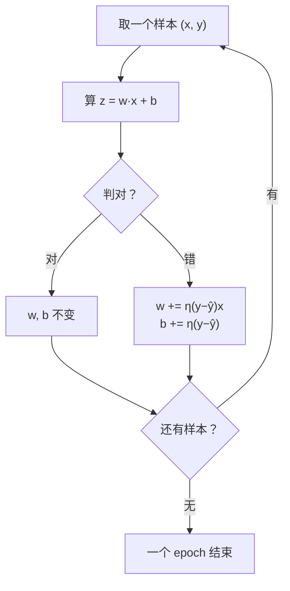

# DL-007 感知机与感知机学习规则

## 1. 本节学习目标

1. 写出感知机的判据与**学习规则**，并手算一次权重更新。
2. 说清"误分类才更新"的含义与几何解释。
3. 亲手验证：**AND/OR 能收敛（acc 1.0），XOR 不收敛（acc 0.5）**。
4. 理解感知机的历史意义与**硬限制**（线性可分）。

## 2. 为什么需要这个知识

因为感知机是**所有神经网络的祖先**，它把"学习"第一次写成了**一个可执行的迭代规则**：

> 错了就朝正确方向挪一点。

这条规则（加上反向传播）就是今天深度学习的核心。同时，它的失败（XOR）也直接推动了多层网络的出现——理解失败比理解成功更重要。

## 3. 直观解释

感知机 = **一个会调整自己的线性分类器**。

```text
看一个样本 → 算 z = w·x + b → 判正/负
   ↓ 判错了？
按错误方向推一下 w 和 b
   ↓ 判对了？
什么也不做
```

**几何直觉**：$w$ 是分界线的法向量，$b$ 是偏移。判错时把线**朝错误样本的反方向推**——推着推着，线就转到能分开两类的位置。

## 4. 正式定义

**判据**

$$
\hat y=\begin{cases}1,& \mathbf{w}^\top\mathbf{x}+b\ge 0\\ 0,&\text{否则}\end{cases}
$$

**学习规则**（Rosenblatt，1958）

$$
\mathbf{w}\leftarrow\mathbf{w}+\eta\,(y-\hat y)\,\mathbf{x},
\qquad
b\leftarrow b+\eta\,(y-\hat y)
$$

$\eta$ 是学习率。由于 $y,\hat y\in\{0,1\}$：

| 情况 | $y-\hat y$ | 更新 |
|---|---|---|
| 判对 | 0 | **不更新** |
| 真 1 判 0 | $+1$ | $\mathbf{w}\mathrel{+}=\eta\mathbf{x}$，$b\mathrel{+}=\eta$ |
| 真 0 判 1 | $-1$ | $\mathbf{w}\mathrel{-}=\eta\mathbf{x}$，$b\mathrel{-}=\eta$ |

**收敛定理**：若数据**线性可分**，感知机在有限步内收敛（Novikoff 定理）。

## 5. 核心原理

**为什么规则长这样**：把 $y-\hat y$ 看作"误差信号"。

- 真 1 判 0：说明 $z$ 太小 ⇒ 把 $\mathbf{w}$ 朝 $\mathbf{x}$ 方向加一点 ⇒ 下次 $z$ 变大。
- 真 0 判 1：说明 $z$ 太大 ⇒ 朝反方向减一点。

**为什么判对不更新**：感知机只关心"分对没分对"，不关心"分得多自信"。这也是它**不输出概率**的原因。

**为什么 XOR 会失败**：数据线性不可分 ⇒ 不存在能让所有样本都判对的 $(\mathbf{w},b)$ ⇒ 更新永远在震荡（错误数在 3–4 之间来回），**永不收敛**。

## 6. 数学表达式

**本次手算**

$\mathbf{x}=[1,1]$，$\mathbf{w}=[1,-1]$，$b=0$，真值 $y=0$：

$$
z=1\times1+(-1)\times1+0=0\ \Rightarrow\ \hat y=1\ (\text{因 }z\ge0)
$$

判错（真 0 判 1），$\eta=1$：

$$
\mathbf{w}\leftarrow[1,-1]+(-1)[1,1]=[0,-2],\qquad b\leftarrow0+(-1)=-1
$$

**验证**：新模型下 $z=0\times1+(-2)\times1-1=-3<0$ ⇒ 判 0，**这次对了**。

## 7. 数学推导

**为什么更新后这个样本一定被判对**

设真值 $y=1$、误判 $\hat y=0$，则 $z=\mathbf{w}^\top\mathbf{x}+b<0$。
更新：$\mathbf{w}'=\mathbf{w}+\eta\mathbf{x}$，$b'=b+\eta$。

$$
z'=\mathbf{w}'^\top\mathbf{x}+b'
=\mathbf{w}^\top\mathbf{x}+\eta\|\mathbf{x}\|^2+b+\eta
=z+\eta\big(\|\mathbf{x}\|^2+1\big)
$$

因为 $\|\mathbf{x}\|^2+1>0$，$z'$ **严格增大**。只要 $\eta$ 足够大，就能把 $z'$ 推过 0。
**这就是"错了就往对的方向推"的数学保证**（对单个样本而言）。

## 8. 结构示意图



## 9. 具体计算示例

**AND / OR / XOR 实测（$\eta=0.1$，50 epoch）**

| 任务 | 学到 $w$ | $b$ | 前 5 轮错误数 | 准确率 |
|---|---|---|---|---|
| AND | `[0.2, 0.1]` | $-0.2$ | `[2, 3, 3, 0, 0]` | **1.0** |
| OR | `[0.1, 0.1]` | $-0.1$ | `[2, 2, 1, 0, 0]` | **1.0** |
| XOR | `[-0.1, 0.0]` | $0.0$ | `[3, 3, 4, 4, 4]` | **0.5** |

**XOR 的全程错误数只出现 `[3, 4]`** —— 从不归零，这就是"不收敛"的直接证据。

## 10. Python 实现

```python
import numpy as np


def train_perceptron(X, Y, lr=0.1, epochs=50):
    w = np.zeros(X.shape[1])
    b = 0.0
    hist = []
    for _ in range(epochs):
        errs = 0
        for xi, yi in zip(X, Y):
            z = float(np.dot(w, xi) + b)
            pred = 1 if z >= 0 else 0
            if pred != yi:
                w = w + lr * (yi - pred) * xi
                b = b + lr * (yi - pred)
                errs += 1
        hist.append(errs)
    return w, b, hist


X = np.array([[0, 0], [0, 1], [1, 0], [1, 1]], float)
for name, Y in (("AND", np.array([0, 0, 0, 1])),
                ("OR", np.array([0, 1, 1, 1])),
                ("XOR", np.array([0, 1, 1, 0]))):
    w, b, hist = train_perceptron(X, Y)
    preds = [(1 if float(np.dot(w, xi) + b) >= 0 else 0) for xi in X]
    acc = float(np.mean(np.array(preds) == Y))
    print(f"{name}: w={np.round(w,2).tolist()} b={round(b,2)} "
          f"前5轮错误={hist[:5]} 准确率={acc}")
```

## 11. PyTorch 实现（等价写法）

```python
import torch
import torch.nn as nn

X = torch.tensor([[0., 0.], [0., 1.], [1., 0.], [1., 1.]])
Y = torch.tensor([0., 0., 0., 1.])

model = nn.Linear(2, 1)
opt = torch.optim.SGD(model.parameters(), lr=0.1)

for _ in range(200):
    opt.zero_grad()
    logits = model(X).squeeze(-1)
    loss = torch.nn.functional.binary_cross_entropy_with_logits(logits, Y)
    loss.backward()
    opt.step()

with torch.no_grad():
    pred = (model(X).squeeze(-1) >= 0).float()
print("torch 版预测:", [int(v) for v in pred])
print("准确率:", float(pred.eq(Y).float().mean()))
```

## 12. 代码逐行解释

| 代码 | 作用 |
|---|---|
| `pred = 1 if z >= 0 else 0` | 硬判据（阶跃函数） |
| `w + lr * (yi - pred) * xi` | 学习规则；判对时 `(yi-pred)=0` ⇒ 不更新 |
| `hist.append(errs)` | 记录每轮错误数，用于看收敛 |
| `binary_cross_entropy_with_logits` | PyTorch 版用**可微**损失替代硬判据（否则无法反传） |
| `opt.step()` | 用梯度更新，等价于感知机规则的平滑版本 |

**关键差异**：原始感知机用**阶跃函数**（不可微）；PyTorch 版用 **logistic 损失**（可微）。所以两者不完全等价——这是从"感知机"走向"逻辑回归/神经网络"的一步。

## 13. 实际运行结果

```text
第一次更新后 w: [0.0, 0.0] b: 0.0  预测: 1
误判为 1 后更新 w: [0.0, -2.0] b: -1.0
AND: w=[0.2, 0.1] b=-0.2 前5轮错误数=[2, 3, 3, 0, 0] 准确率=1.0
OR: w=[0.1, 0.1] b=-0.1 前5轮错误数=[2, 2, 1, 0, 0] 准确率=1.0
XOR: w=[-0.1, 0.0] b=0.0 前5轮错误数=[3, 3, 4, 4, 4] 准确率=0.5
XOR 全程错误数唯一值: [3, 4]
```

**第一条输出值得注意**：$\mathbf{w}=[0,0]$、$z=0\ge0$ ⇒ 判 1，而真值也是 1 ⇒ **判对，所以不更新**。这正好演示了"判对不更新"。

## 14. 应用场景

| 场景 | 是否适用 |
|---|---|
| 线性可分二分类 | ✅（且可证明收敛） |
| 需要概率输出 | ❌（只有硬判） |
| 非线性问题 | ❌（XOR 就不行） |
| 教学/理解梯度 | ✅ 最简可运行模型 |
| 现代实践 | ⚠️ 已被逻辑回归/神经网络取代 |

## 15. 优点与缺点

| 优点 | 缺点 |
|---|---|
| 规则极简、可手算 | 只适用线性可分 |
| 有收敛定理 | 不输出概率 |
| 在线可训练 | 对噪声敏感、不唯一解 |

## 16. 常见错误

| 错误 | 现象 | 纠正 |
|---|---|---|
| 以为感知机能解 XOR | 错误数永远 3–4 | 需多层（DL-008） |
| 用 `>=0.5` 判 PyTorch 输出 | 混淆 logit 与概率 | logit 与 0 比较，概率与 0.5 比较 |
| 学习率太大 | 来回震荡 | 从 0.01–0.1 试 |
| 忘记"判对不更新" | 以为每步都改 | 看 `(y-ŷ)=0` |
| 用硬判据写 PyTorch 模型 | 梯度为 0，训不动 | 用 sigmoid/BCE |
| 认为"不收敛=实现错" | 反复调参 | 先判断数据是否线性可分 |

## 17. 本节总结

- 感知机 = **线性判据 + 误分类驱动更新**，判对不更新。
- **线性可分才收敛**：AND/OR 达 1.0，**XOR 恒 0.5**（错误数只在 3–4 之间）。
- 更新保证"当前样本更可能判对"（$z'=z+\eta(\|x\|^2+1)$）。

## 18. 前置与后续

- 前置：[[DL-006 输入层、隐藏层与输出层]]
- 后续：[[DL-008 多层感知机 MLP]]、`DL-011 神经网络前向传播`（待建）
- 相关数学：[[MATH-803 神经网络前向传播]]
- 相关机器学习：[[ML-025 逻辑回归]]（把硬判据换成 sigmoid）

---

## 练习与参考答案

**基础 1**：写出感知机的学习规则，并说明"判对时会发生什么"。

**基础 2**：本课 AND/OR/XOR 的准确率各是多少？为什么 XOR 是这样？

**进阶 1**：设 $\mathbf{x}=[2,3]$、$\mathbf{w}=[0,0]$、$b=0$、真值 $y=1$、$\eta=0.1$，求一次更新后的 $\mathbf{w},b$，并验证 $z$ 的变化。

**综合**：感知机与逻辑回归的差别是什么？为什么实践中几乎不再直接用感知机？

> [!success]- 参考答案

> **基础 1**
> $$\mathbf{w}\leftarrow\mathbf{w}+\eta(y-\hat y)\mathbf{x},\qquad b\leftarrow b+\eta(y-\hat y)$$
> 判对时 $y-\hat y=0$ ⇒ **参数不变**。感知机只根据"是否分对"更新，不关心置信度。

> **基础 2**
> AND **1.0**、OR **1.0**、XOR **0.5**。
> 因为 AND/OR 线性可分（一条线能分开），XOR **线性不可分**（正类在对角），感知机只能表示一条直线 ⇒ 无论怎么更新都无法全对，错误数在 3–4 间震荡，永不收敛。

> **进阶 1**
> $z=0\times2+0\times3+0=0\ge0$ ⇒ 判 $\hat y=1$，但真值 $y=1$ ⇒ **判对，不更新**。
> 所以 $\mathbf{w}=[0,0]$、$b=0$ 保持不变。
> **这是个陷阱题**：初始全零 + 判据 $z\ge0$ 会把所有样本判成正类。若真值为 0，才会触发更新（如 $\mathbf{w}=[0,-2],b=-1$ 那例）。

> **综合（参考）**
> | 项 | 感知机 | 逻辑回归 |
> |---|---|---|
> | 输出 | 硬标签 {0,1} | 概率 (0,1) |
> | 判据 | 阶跃 $z\ge0$ | sigmoid 后阈值 |
> | 损失 | 无（规则更新） | 交叉熵（可微） |
> | 优化 | 逐样本在线更新 | 梯度下降/拟牛顿 |
> | 收敛 | 仅线性可分 | 一般可收敛到最优 |
> **为何少用感知机**：
> 1. 不输出概率，无法做阈值/代价分析（对比 PROJ-010/013 的经验）；
> 2. 对噪声与不可分数据不收敛；
> 3. 解不唯一，结果依赖样本顺序；
> 4. 逻辑回归同样简单且损失凸、有概率解释 ⇒ 直接取代。

## 学习记录

| 日期 | 状态 | 用时 | 问题 | 复盘 |
|---|---|---|---|---|
| 2026-11-06 | planned | — | — | — |

---

## 🔗 Notion 同步信息

> 以下内容由 Notion「AI Knowledge System · 知识点」数据库按知识 ID 合并而来（导出于 2026-11-09）。

| 属性 | 值 |
|---|---|
| 学科 | 深度学习 |
| 学习状态 | 未开始 |
| 难度 | L2 应用 |
| 知识类型 | Algorithm |

- **所属模块**：[M-DL-01 深度学习基础与神经网络入门](../%E8%AF%BE%E7%A8%8B%E6%A8%A1%E5%9D%97/M-DL-01%20%E6%B7%B1%E5%BA%A6%E5%AD%A6%E4%B9%A0%E5%9F%BA%E7%A1%80%E4%B8%8E%E7%A5%9E%E7%BB%8F%E7%BD%91%E7%BB%9C%E5%85%A5%E9%97%A8.md)
- **前置知识**：[DL-006 输入层、隐藏层与输出层](DL-006%20%E8%BE%93%E5%85%A5%E5%B1%82%E3%80%81%E9%9A%90%E8%97%8F%E5%B1%82%E4%B8%8E%E8%BE%93%E5%87%BA%E5%B1%82.md)
- **后继知识**：[DL-008 多层感知机 MLP](DL-008%20%E5%A4%9A%E5%B1%82%E6%84%9F%E7%9F%A5%E6%9C%BA%20MLP.md)
- **关联Python**：[PY-066 矩阵运算](../../01_Python%E5%9F%BA%E7%A1%80/08%20NumPy/PY-066%20%E7%9F%A9%E9%98%B5%E8%BF%90%E7%AE%97.md)
- **关联数学**：[MATH-803 神经网络前向传播](../../06_%E6%95%B0%E5%AD%A6%E5%9F%BA%E7%A1%80/08%20%E6%9C%BA%E5%99%A8%E5%AD%A6%E4%B9%A0%E6%95%B0%E5%AD%A6%E5%BA%94%E7%94%A8/MATH-803%20%E7%A5%9E%E7%BB%8F%E7%BD%91%E7%BB%9C%E5%89%8D%E5%90%91%E4%BC%A0%E6%92%AD.md)
