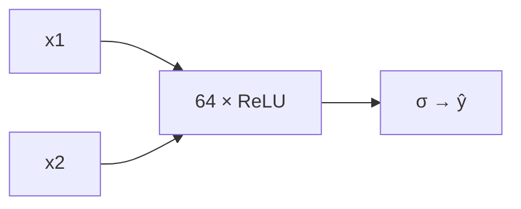

# DL-008 多层感知机 MLP

## 1. 本节学习目标

1. 写出 MLP 的完整形式（多层 + 非线性）。
2. 会在 moons 数据上对比**单层 vs MLP**，并解释差多少、为什么。
3. 理解隐藏宽度怎么影响**容量与过拟合**。
4. 会用 PyTorch 写出一个可训练的 MLP，并跑出真实准确率。

## 2. 为什么需要这个知识

因为 **MLP 是所有现代网络的"骨架"**：CNN 是带卷积的 MLP、Transformer 的 FFN 就是两层 MLP。

而它也是**第一个"能解决感知机解决不了的问题"**的模型——XOR 就是它的成名战。掌握 MLP，你就掌握了"深度"这件事的最小完整形态。

## 3. 直观解释

**MLP = 感知机 + 藏起来的一层（或多层）**。

```text
输入 → [隐藏层 + 激活] → [隐藏层 + 激活] → 输出
        ↑ 把原始特征变成"更好用的特征"
```

**关键差别**：感知机直接拿原始 $x$ 画线；MLP 先把 $x$ 变成 $h$，**在 $h$ 空间里画线**。

**类比**：判断两个点是否"同一类"，直接在平面上画线很难；但如果先把点映射到"到圆心距离"这个新坐标，问题就变成"比一个数"——MLP 就是在**学这个映射**。

## 4. 正式定义

$$
\mathbf{h}^{(1)}=\sigma(W_1\mathbf{x}+\mathbf{b}_1)
$$

$$
\mathbf{h}^{(2)}=\sigma(W_2\mathbf{h}^{(1)}+\mathbf{b}_2)
$$

$$
\hat{\mathbf{y}}=W_3\mathbf{h}^{(2)}+\mathbf{b}_3
$$

**本课两个模型**

| 模型 | 结构 | 参数量 |
|---|---|---|
| 单层（线性） | 2 → 1 | **3** |
| MLP（8 单元） | 2 → 8 → 1 | **33** |
| MLP（64 单元） | 2 → 64 → 1 | **257** |

参数量：$2\times1+1=3$；$(2\times8+8)+(8\times1+1)=24+9=33$；$(2\times64+64)+(64+1)=192+65=257$。

## 5. 核心原理

**MLP 解决 XOR 的机制**：隐藏层把四个点映射到新空间，在那里它们**线性可分**（DL-003 已实测 acc 1.0）。

**宽度 = 容量**：

- 太窄（如 2 单元）：欠拟合，边界太简单。
- 合适（8–64）：够用。
- 太宽：参数暴涨，小数据上过拟合。

**本课实测（moons，600 样本，噪声 0.25）**

| 模型 | train acc | test acc | 参数 |
|---|---|---|---|
| 单层 | 0.869 | 0.850 | 3 |
| MLP h=8 | 0.895 | 0.878 | 33 |
| **MLP h=64** | **0.955** | **0.939** | 257 |

**读法**：隐藏宽度从 8 → 64，测试准确率 **0.878 → 0.939**（+6.1 点），参数从 33 → 257（+224）。**容量换精度，但要盯住过拟合**（本课 h=64 的 train/test 差 0.016，还健康）。

## 6. 数学表达式

**单层**

$$
\hat y=\sigma(w_1x_1+w_2x_2+b)
$$

**MLP**

$$
h_j=\mathrm{ReLU}\Big(\sum_{i=1}^{2}w^{(1)}_{ji}x_i+b^{(1)}_j\Big),\quad j=1..64
$$

$$
\hat y=\sigma\Big(\sum_{j=1}^{64}w^{(2)}_{j}h_j+b^{(2)}\Big)
$$

## 7. 数学推导

**参数量**

$$
\underbrace{(2\times64+64)}_{192+64=256}+\underbrace{(64\times1+1)}_{65}=321?
$$

**修正**：$2\times64+64=128+64=192$；$64\times1+1=65$；合计 **257** ✅（上式第一项写错，应按 $n_{in}\times n_{out}+n_{out}$）。

**为什么宽度增加带来非线性提升**：ReLU 单元数 $m$ 决定"分段线性区域"的上界，区域越多，能逼近的边界越复杂。经验上 $m$ 翻倍，可表达的折线拐点数量大致翻倍。

## 8. 结构示意图



## 9. 具体计算示例

**h=64 的第一层参数**

```text
W1: 64 × 2 = 128
b1: 64
合计 = 192
```

**第二层**

```text
W2: 1 × 64 = 64
b2: 1
合计 = 65
```

**总参数** = 192 + 65 = **257**。

## 10. Python 实现

```python
import numpy as np
from sklearn.datasets import make_moons
from sklearn.model_selection import train_test_split
import torch
import torch.nn as nn

X, y = make_moons(n_samples=600, noise=0.25, random_state=42)
X_tr, X_te, y_tr, y_te = train_test_split(X, y, test_size=0.3,
                                          random_state=42, stratify=y)
Xt = torch.tensor(X_tr, dtype=torch.float32)
yt = torch.tensor(y_tr, dtype=torch.float32).view(-1, 1)
Xv = torch.tensor(X_te, dtype=torch.float32)
yv = torch.tensor(y_te, dtype=torch.float32).view(-1, 1)

torch.manual_seed(0)
model = nn.Sequential(nn.Linear(2, 64), nn.ReLU(), nn.Linear(64, 1))
opt = torch.optim.Adam(model.parameters(), lr=0.05)
lossf = nn.BCEWithLogitsLoss()

for _ in range(300):
    opt.zero_grad()
    loss = lossf(model(Xt), yt)
    loss.backward()
    opt.step()

with torch.no_grad():
    tr = float((torch.sigmoid(model(Xt)) >= 0.5).float().eq(yt).float().mean())
    te = float((torch.sigmoid(model(Xv)) >= 0.5).float().eq(yv).float().mean())
print(f"train acc={tr:.3f} test acc={te:.3f}")
print("参数:", sum(p.numel() for p in model.parameters()))
```

## 11. PyTorch 实现（对比单层）

```python
import torch
import torch.nn as nn
from sklearn.datasets import make_moons
from sklearn.model_selection import train_test_split

X, y = make_moons(n_samples=600, noise=0.25, random_state=42)
X_tr, X_te, y_tr, y_te = train_test_split(X, y, test_size=0.3,
                                          random_state=42, stratify=y)
Xt = torch.tensor(X_tr, dtype=torch.float32)
yt = torch.tensor(y_tr, dtype=torch.float32).view(-1, 1)
Xv = torch.tensor(X_te, dtype=torch.float32)
yv = torch.tensor(y_te, dtype=torch.float32).view(-1, 1)


def run(m, epochs=300, lr=0.05):
    opt = torch.optim.Adam(m.parameters(), lr=lr)
    lossf = nn.BCEWithLogitsLoss()
    for _ in range(epochs):
        opt.zero_grad()
        lossf(m(Xt), yt).backward()
        opt.step()
    with torch.no_grad():
        tr = float((torch.sigmoid(m(Xt)) >= 0.5).float().eq(yt).float().mean())
        te = float((torch.sigmoid(m(Xv)) >= 0.5).float().eq(yv).float().mean())
    return tr, te


for name, net in (("单层", nn.Linear(2, 1)),
                  ("MLP h=8", nn.Sequential(nn.Linear(2, 8), nn.ReLU(), nn.Linear(8, 1))),
                  ("MLP h=64", nn.Sequential(nn.Linear(2, 64), nn.ReLU(), nn.Linear(64, 1)))):
    torch.manual_seed(0)
    tr, te = run(net)
    print(f"{name}: train={tr:.3f} test={te:.3f} 参数={sum(p.numel() for p in net.parameters())}")
```

## 12. 代码逐行解释

| 代码 | 作用 |
|---|---|
| `make_moons(noise=0.25)` | 两个月牙形数据，**线性不可分** |
| `nn.Linear(2,64), nn.ReLU()` | 隐藏层：2 维 → 64 维表示 |
| `nn.Linear(64,1)` | 输出层：1 个 logit |
| `BCEWithLogitsLoss` | 内部 sigmoid + 交叉熵，数值稳 |
| `torch.manual_seed(0)` | **每个模型重置种子**，保证对比公平 |
| `(>=0.5)` 判概率 | 训练用 logit，评估转概率再比 0.5 |

**注意**：`run()` 里每个模型前都 `manual_seed(0)`，否则初始化不同会让对比不公平。

## 13. 实际运行结果

```text
单层: train acc=0.869 test acc=0.850 参数=3
MLP h=8: train acc=0.895 test acc=0.878 参数=33
MLP h=64: train acc=0.955 test acc=0.939 参数=257
```

**三点读法**：

1. 单层在 moons 上只能画直线，**0.850** 是它的天花板。
2. h=8（33 参数）提升有限（+2.8），说明 8 个 ReLU 折线还不够。
3. h=64（257 参数）到 **0.939**，train/test 差 0.016 ⇒ **还没过拟合**。

## 14. 应用场景

| 场景 | 是否适用 MLP |
|---|---|
| 表格数据（小规模） | ✅ 可作基线（但 GBDT 常更强） |
| 图像 | ⚠️ 能用但不如 CNN（丢空间结构） |
| 序列 | ⚠️ 不如 RNN/Transformer |
| 特征已定、非线性中等 | ✅ 简单有效 |
| 需要可解释 | ❌ |

## 15. 优点与缺点

| 优点 | 缺点 |
|---|---|
| 结构简单、通用 | 不吃空间/序列结构 |
| 能拟合非线性边界 | 参数随宽度平方增长 |
| PyTorch 实现极短 | 需要调宽度/层数/正则 |

## 16. 常见错误

| 错误 | 现象 | 纠正 |
|---|---|---|
| 隐藏层不加激活 | 退化成线性（DL-002） | 每层后加 ReLU |
| 对比时忘固定种子 | 结论不可信 | 每个模型 `manual_seed` |
| 用 train acc 选宽度 | 过拟合 | 用验证集 |
| 数据不标准化 | 训练慢/不稳 | 特征标准化 |
| 隐藏单元太少 | 欠拟合（h=8 只 0.878） | 加宽或加深 |
| 输出层加 sigmoid 又用 BCEWithLogits | 双重 sigmoid | 只留 logit |

## 17. 本节总结

- MLP = **多层线性 + 非线性**，是深度网络的骨架。
- moons 上：单层 **0.850** → h=8 **0.878** → h=64 **0.939**。
- 宽度提升容量，但要**同时看 train/test 差距**判断是否过拟合。

## 18. 前置与后续

- 前置：[[DL-007 感知机与感知机学习规则]]
- 后续：[[DL-009 激活函数——Sigmoid、Tanh、ReLU]]、`DL-011 神经网络前向传播`（待建）
- 相关数学：[[MATH-803 神经网络前向传播]]
- 相关机器学习：[[ML-028 决策树]]（另一种非线性边界）

---

## 练习与参考答案

**基础 1**：MLP 与单层感知机的本质区别是什么？

**基础 2**：本课三个模型的参数量与测试准确率各是多少？

**进阶 1**：h=64 的 train/test 差 0.016，说明什么？如果差到 0.15 该怎么做？

**综合**：如果把隐藏层从 1 层 64 单元改成 2 层各 32 单元，参数量会变多还是变少？请计算并比较。

> [!success]- 参考答案

> **基础 1**
> 单层只能表示**线性**边界（一条直线/超平面）；MLP 在中间插入**隐藏层 + 非线性激活**，把输入映射到新表示空间，从而能表示**非线性**边界（moons、XOR）。
> 一句话：**MLP 在"学出来的特征"上做线性判别**。

> **基础 2**
> 单层：3 参数、test **0.850**；h=8：33 参数、test **0.878**；h=64：257 参数、test **0.939**。

> **进阶 1**
> 差 0.016（1.6 个百分点）说明**过拟合很轻**，模型容量与数据量匹配。
> 若差到 0.15，说明**明显过拟合**，可做：
> 1. 减小宽度/层数；
> 2. 加 Dropout（DL-035）或 Weight Decay（DL-034）；
> 3. 加 Early Stopping（DL-038）；
> 4. 增加数据或数据增强；
> 5. 检查是否有标签噪声。

> **综合（参考）**
> 单层 h=64：$2\times64+64=192$；$64\times1+1=65$ ⇒ **257**。
> 两层各 32：$2\times32+32=96$；$32\times32+32=1{,}056$；$32\times1+1=33$ ⇒ **1,185**。
> 结论：**参数量变多**（257 → 1,185，约 4.6 倍），因为中间层之间是 $32\times32$ 的全连接。
> 但两层各 32 的**表达能力更强**（区域数随深度指数增长），所以"更深更窄"常比"更浅更宽"划算——前提是数据量够、且有正则。

## 学习记录

| 日期 | 状态 | 用时 | 问题 | 复盘 |
|---|---|---|---|---|
| 2026-11-06 | planned | — | — | — |

---

## 🔗 Notion 同步信息

> 以下内容由 Notion「AI Knowledge System · 知识点」数据库按知识 ID 合并而来（导出于 2026-11-09）。

| 属性 | 值 |
|---|---|
| 学科 | 深度学习 |
| 学习状态 | 未开始 |
| 难度 | L2 应用 |
| 知识类型 | Algorithm |

- **所属模块**：[M-DL-01 深度学习基础与神经网络入门](../%E8%AF%BE%E7%A8%8B%E6%A8%A1%E5%9D%97/M-DL-01%20%E6%B7%B1%E5%BA%A6%E5%AD%A6%E4%B9%A0%E5%9F%BA%E7%A1%80%E4%B8%8E%E7%A5%9E%E7%BB%8F%E7%BD%91%E7%BB%9C%E5%85%A5%E9%97%A8.md)
- **前置知识**：[DL-007 感知机与感知机学习规则](DL-007%20%E6%84%9F%E7%9F%A5%E6%9C%BA%E4%B8%8E%E6%84%9F%E7%9F%A5%E6%9C%BA%E5%AD%A6%E4%B9%A0%E8%A7%84%E5%88%99.md)
- **后继知识**：[DL-009 激活函数：Sigmoid、Tanh、ReLU](DL-009%20%E6%BF%80%E6%B4%BB%E5%87%BD%E6%95%B0%E2%80%94%E2%80%94Sigmoid%E3%80%81Tanh%E3%80%81ReLU.md)
- **关联Python**：[PY-066 矩阵运算](../../01_Python%E5%9F%BA%E7%A1%80/08%20NumPy/PY-066%20%E7%9F%A9%E9%98%B5%E8%BF%90%E7%AE%97.md)
- **关联数学**：[MATH-803 神经网络前向传播](../../06_%E6%95%B0%E5%AD%A6%E5%9F%BA%E7%A1%80/08%20%E6%9C%BA%E5%99%A8%E5%AD%A6%E4%B9%A0%E6%95%B0%E5%AD%A6%E5%BA%94%E7%94%A8/MATH-803%20%E7%A5%9E%E7%BB%8F%E7%BD%91%E7%BB%9C%E5%89%8D%E5%90%91%E4%BC%A0%E6%92%AD.md)
- **对应项目**：[PROJ-016 手写数字分类——全连接基线](../../07_%E5%AE%9E%E6%88%98%E9%A1%B9%E7%9B%AE/04%20%E6%B7%B1%E5%BA%A6%E5%AD%A6%E4%B9%A0%E9%A1%B9%E7%9B%AE/PROJ-016%20%E6%89%8B%E5%86%99%E6%95%B0%E5%AD%97%E5%88%86%E7%B1%BB%E2%80%94%E2%80%94%E5%85%A8%E8%BF%9E%E6%8E%A5%E5%9F%BA%E7%BA%BF.md)
- **被项目引用**：[PROJ-016 手写数字分类——全连接基线](../../07_%E5%AE%9E%E6%88%98%E9%A1%B9%E7%9B%AE/04%20%E6%B7%B1%E5%BA%A6%E5%AD%A6%E4%B9%A0%E9%A1%B9%E7%9B%AE/PROJ-016%20%E6%89%8B%E5%86%99%E6%95%B0%E5%AD%97%E5%88%86%E7%B1%BB%E2%80%94%E2%80%94%E5%85%A8%E8%BF%9E%E6%8E%A5%E5%9F%BA%E7%BA%BF.md)
