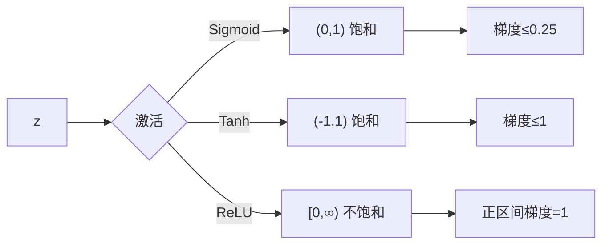

# DL-009 激活函数：Sigmoid、Tanh、ReLU

## 1. 本节学习目标

1. 写出 Sigmoid / Tanh / ReLU 的公式、值与导数。
2. **用数值证明** Sigmoid 的导数最大只有 **0.25**（梯度消失的根源）。
3. 理解 ReLU 为什么成为默认选择（正区间梯度恒为 1）。
4. 知道三者的适用位置：隐藏层 vs 输出层。

## 2. 为什么需要这个知识

因为**激活函数决定了梯度能不能传下去**。

深层网络训练不动，90% 的原因出在这里：选了 Sigmoid，梯度每层最多乘 0.25，10 层后就是 $0.25^{10}\approx10^{-6}$——参数几乎不更新。

## 3. 直观解释

| 激活 | 形状 | 一句话 |
|---|---|---|
| **Sigmoid** | S 形，压到 (0,1) | 像"概率"，但两边压得很扁 |
| **Tanh** | S 形，压到 (−1,1) | 零中心版 Sigmoid |
| **ReLU** | 折线，负半轴为 0 | "要么通过，要么掐断" |

**关键差别在"两端"**：

- Sigmoid/Tanh 在 $|z|$ 大时**几乎水平** ⇒ 导数≈0 ⇒ 梯度消失。
- ReLU 在 $z>0$ 时是**直线** ⇒ 导数恒为 1 ⇒ 梯度能一直传。

## 4. 正式定义

**Sigmoid**

$$
\sigma(z)=\frac{1}{1+e^{-z}},\qquad \sigma'(z)=\sigma(z)\big(1-\sigma(z)\big)
$$

**Tanh**

$$
\tanh(z)=\frac{e^{z}-e^{-z}}{e^{z}+e^{-z}},\qquad \tanh'(z)=1-\tanh^2(z)
$$

**ReLU**

$$
\mathrm{ReLU}(z)=\max(0,z),\qquad
\mathrm{ReLU}'(z)=\begin{cases}1,&z>0\\0,&z<0\end{cases}
$$

## 5. 核心原理

**本课实测（$z=-2,-1,0,1,2$）**

| $z$ | −2 | −1 | 0 | 1 | 2 |
|---|---|---|---|---|---|
| Sigmoid | 0.1192 | 0.2689 | 0.5 | 0.7311 | 0.8808 |
| Tanh | −0.9640 | −0.7616 | 0.0 | 0.7616 | 0.9640 |
| ReLU | 0.0 | 0.0 | 0.0 | 1.0 | 2.0 |
| **Sigmoid'** | 0.1050 | 0.1966 | **0.25** | 0.1966 | 0.1050 |
| **Tanh'** | 0.0707 | 0.42 | **1.0** | 0.42 | 0.0707 |
| **ReLU'** | 0.0 | 0.0 | 0.0 | **1.0** | **1.0** |

**三个结论**：

1. **Sigmoid 导数上界 0.25** ⇒ 每层最多衰减 4 倍 ⇒ 深层必消失。
2. **Tanh 导数上界 1.0**（在 0 处），但两端仍趋于 0 ⇒ 缓解但不解决。
3. **ReLU 正区间导数恒为 1** ⇒ 梯度不衰减（但负区间为 0，会"死"）。

## 6. 数学表达式

**Sigmoid 导数推导**

$$
\sigma'(z)=\frac{d}{dz}(1+e^{-z})^{-1}
=(1+e^{-z})^{-2}e^{-z}
=\sigma(z)\big(1-\sigma(z)\big)
$$

最大值：令 $\sigma=0.5$，得 $0.5\times0.5=\mathbf{0.25}$。

**Tanh 与 Sigmoid 的关系**

$$
\tanh(z)=2\sigma(2z)-1
$$

## 7. 数学推导

**梯度消失的定量估算**

设 $L$ 层，每层都用 Sigmoid。反向传播时梯度要连乘每层导数：

$$
\frac{\partial L}{\partial W_1}\propto\prod_{\ell=1}^{L}\sigma'(z_\ell)\le 0.25^{L}
$$

| 层数 | $0.25^L$ |
|---|---|
| 2 | $6.25\times10^{-2}$ |
| 5 | $9.8\times10^{-4}$ |
| 10 | $9.5\times10^{-7}$ |
| 20 | $9.1\times10^{-13}$ |

**10 层就掉到百万分之一**——这就是"深层 Sigmoid 网络训不动"的原因。

**ReLU 的情况**：正区间每层导数 = 1，乘积 = 1，**不衰减**（代价是负区间直接归零）。

## 8. 结构示意图



## 9. 具体计算示例

**$z=2$ 时**

```text
sigmoid(2) = 0.8808   sigmoid'(2) = 0.8808 × 0.1192 = 0.1050
tanh(2)    = 0.9640   tanh'(2)    = 1 − 0.9640²   = 0.0707
relu(2)    = 2.0000   relu'(2)    = 1
```

**注意**：$z=2$ 处 **ReLU 的梯度是 Sigmoid 的 9.5 倍**——这就是深层网络偏好 ReLU 的直接原因。

## 10. Python 实现

```python
import torch
import torch.nn.functional as F

z = torch.tensor([-2., -1., 0., 1., 2.])
print("z      :", [float(v) for v in z])
print("sigmoid:", [round(float(v), 4) for v in torch.sigmoid(z)])
print("tanh   :", [round(float(v), 4) for v in torch.tanh(z)])
print("relu   :", [round(float(v), 4) for v in F.relu(z)])
print("sigmoid':", [round(float(v), 4) for v in torch.sigmoid(z) * (1 - torch.sigmoid(z))])
print("tanh'  :", [round(float(v), 4) for v in 1 - torch.tanh(z) ** 2])
print("relu'  :", [round(float(v), 4) for v in (z > 0).float()])
print("sigmoid 最大导数:", round(float((torch.sigmoid(z) * (1 - torch.sigmoid(z))).max()), 4))
```

## 11. PyTorch 实现（放进网络）

```python
import torch
import torch.nn as nn

for name, act in (("Sigmoid", nn.Sigmoid()), ("Tanh", nn.Tanh()), ("ReLU", nn.ReLU())):
    net = nn.Sequential(nn.Linear(4, 16), act, nn.Linear(16, 1))
    x = torch.randn(8, 4)
    y = net(x)
    print(f"{name}: 输出形状 {tuple(y.shape)}，参数 {sum(p.numel() for p in net.parameters())}")
```

## 12. 代码逐行解释

| 代码 | 作用 |
|---|---|
| `torch.sigmoid(z)` | 逐元素 sigmoid |
| `torch.tanh(z)` | 逐元素 tanh |
| `F.relu(z)` | 逐元素 ReLU |
| `sigmoid*(1-sigmoid)` | 手算导数，验证公式 |
| `(z>0).float()` | ReLU 导数：正为 1、负为 0 |
| `nn.Sigmoid()` 等 | 作为层放进 `Sequential` |

**为什么手算导数**：框架的 autograd 会自动算，但**你必须知道它的上界**，才能预判梯度是否消失。

## 13. 实际运行结果

```text
z      : [-2.0, -1.0, 0.0, 1.0, 2.0]
sigmoid: [0.1192, 0.2689, 0.5, 0.7311, 0.8808]
tanh   : [-0.964, -0.7616, 0.0, 0.7616, 0.964]
relu   : [0.0, 0.0, 0.0, 1.0, 2.0]
sigmoid': [0.105, 0.1966, 0.25, 0.1966, 0.105]
tanh'  : [0.0707, 0.42, 1.0, 0.42, 0.0707]
relu'  : [0.0, 0.0, 0.0, 1.0, 1.0]
sigmoid 最大导数: 0.25
```

## 14. 应用场景

| 位置 | 推荐 |
|---|---|
| 隐藏层（默认） | **ReLU** |
| 隐藏层（怕死神经元） | Leaky ReLU / GELU（DL-010） |
| 二分类输出 | **Sigmoid** |
| 多分类输出 | 不激活（交给 CrossEntropy） |
| RNN 隐藏层 | Tanh（有界，稳定） |
| 需要零中心的小网络 | Tanh |

## 15. 优点与缺点

| 激活 | 优点 | 缺点 |
|---|---|---|
| Sigmoid | 输出可解释为概率 | **梯度≤0.25**、非零中心、易饱和 |
| Tanh | 零中心、梯度≤1 | 两端仍饱和 |
| ReLU | 梯度不衰减、计算快、稀疏 | 负区间梯度 0（死神经元）、非零中心 |

## 16. 常见错误

| 错误 | 现象 | 纠正 |
|---|---|---|
| 深层网络全用 Sigmoid | loss 不降 | 换 ReLU |
| 输出层 ReLU 做概率 | 输出 >1 | 二分类 Sigmoid |
| 以为 Tanh 就没梯度消失 | 深了还是掉 | 仍会饱和 |
| ReLU 学习率过大 | 大量神经元死亡 | 降 lr 或用 Leaky ReLU |
| 在 ReLU 后不归一化 | 激活值爆炸 | 加 BN（DL-036） |
| 忘记输出层不加激活 | 双重 sigmoid | 用带 logits 的损失 |

## 17. 本节总结

- **Sigmoid 导数上界 0.25**，10 层后梯度掉到 $10^{-6}$ 量级。
- **Tanh** 零中心、上界 1，缓解但不解决饱和。
- **ReLU** 正区间梯度恒 1 ⇒ 深层默认选择；代价是负区间归零。

## 18. 前置与后续

- 前置：[[DL-008 多层感知机 MLP]]
- 后续：[[DL-010 激活函数——Leaky ReLU、GELU 与选型]]、`DL-022 梯度消失与梯度爆炸`（待建）
- 相关数学：[[MATH-122 求导法则与链式法则]]、[[MATH-803 神经网络前向传播]]

---

## 练习与参考答案

**基础 1**：写出 Sigmoid、Tanh、ReLU 的公式与导数。

**基础 2**：本课三者在 $z=2$ 处的值与导数各是多少？

**进阶 1**：为什么"10 层 Sigmoid 网络"几乎训练不动？请用数字说明。

**综合**：一个 20 层的全连接网络，loss 从第 1 轮起几乎不变。请给出 3 个可能原因，并说明如何用"每层梯度范数"定位。

> [!success]- 参考答案

> **基础 1**
> - Sigmoid：$\sigma(z)=\frac{1}{1+e^{-z}}$，$\sigma'=\sigma(1-\sigma)$
> - Tanh：$\tanh(z)=\frac{e^z-e^{-z}}{e^z+e^{-z}}$，$\tanh'=1-\tanh^2$
> - ReLU：$\max(0,z)$，导数 $z>0$ 为 1、$z<0$ 为 0

> **基础 2**
> $z=2$：sigmoid **0.8808**、导数 **0.1050**；tanh **0.9640**、导数 **0.0707**；ReLU **2.0**、导数 **1.0**。
> 注意：ReLU 的导数在这里是 Sigmoid 的 9.5 倍。

> **进阶 1**
> 反向传播要连乘每层激活导数，Sigmoid 的上界是 0.25：
> $$0.25^{10}=9.5\times10^{-7}$$
> 也就是第一层的梯度只有输出层的百万分之一 —— 参数几乎不动。
> 对比：ReLU 正区间导数恒为 1，$1^{10}=1$，梯度**不衰减**。

> **综合（参考）**
> 三个可能原因：
> 1. **梯度消失**：全用 Sigmoid/Tanh，深层梯度≈0；
> 2. **学习率太小**：梯度有但步长不够；
> 3. **初始化不当**：权重过小 ⇒ 激活值全在饱和区（或全为 0）。
> **定位方法**：训练一步后，逐层打印 `p.grad.norm()`：
> ```python
> import torch
> import torch.nn as nn
>
> model = nn.Sequential(nn.Linear(4, 16), nn.Sigmoid(),
>                       nn.Linear(16, 16), nn.Sigmoid(),
>                       nn.Linear(16, 1))
> x = torch.randn(8, 4)
> target = torch.randint(0, 2, (8, 1)).float()
> loss = nn.BCEWithLogitsLoss()(model(x), target)
> loss.backward()
> for name, p in model.named_parameters():
>     if p.grad is not None:
>         print(name, round(p.grad.norm().item(), 8))
> ```
> 判读：
> - 若**后面层梯度正常、前面层接近 0** ⇒ 梯度消失（换 ReLU / 加残差 / 用 BN）；
> - 若**所有层都接近 0** ⇒ 学习率太小或损失尺度问题；
> - 若**梯度爆炸（`inf`/NaN）** ⇒ 学习率太大或需梯度裁剪（DL-031）。

## 学习记录

| 日期 | 状态 | 用时 | 问题 | 复盘 |
|---|---|---|---|---|
| 2026-11-06 | planned | — | — | — |

---

## 🔗 Notion 同步信息

> 以下内容由 Notion「AI Knowledge System · 知识点」数据库按知识 ID 合并而来（导出于 2026-11-09）。

| 属性 | 值 |
|---|---|
| 学科 | 深度学习 |
| 学习状态 | 未开始 |
| 难度 | L2 应用 |
| 知识类型 | Concept |

- **所属模块**：[M-DL-01 深度学习基础与神经网络入门](../%E8%AF%BE%E7%A8%8B%E6%A8%A1%E5%9D%97/M-DL-01%20%E6%B7%B1%E5%BA%A6%E5%AD%A6%E4%B9%A0%E5%9F%BA%E7%A1%80%E4%B8%8E%E7%A5%9E%E7%BB%8F%E7%BD%91%E7%BB%9C%E5%85%A5%E9%97%A8.md)
- **前置知识**：[DL-008 多层感知机 MLP](DL-008%20%E5%A4%9A%E5%B1%82%E6%84%9F%E7%9F%A5%E6%9C%BA%20MLP.md)
- **后继知识**：[DL-010 激活函数：Leaky ReLU、GELU 与选型](DL-010%20%E6%BF%80%E6%B4%BB%E5%87%BD%E6%95%B0%E2%80%94%E2%80%94Leaky%20ReLU%E3%80%81GELU%20%E4%B8%8E%E9%80%89%E5%9E%8B.md)
- **关联Python**：[PY-066 矩阵运算](../../01_Python%E5%9F%BA%E7%A1%80/08%20NumPy/PY-066%20%E7%9F%A9%E9%98%B5%E8%BF%90%E7%AE%97.md)
- **关联数学**：[MATH-122 求导法则与链式法则](../../06_%E6%95%B0%E5%AD%A6%E5%9F%BA%E7%A1%80/01%20%E9%AB%98%E7%AD%89%E6%95%B0%E5%AD%A6/MATH-122%20%E6%B1%82%E5%AF%BC%E6%B3%95%E5%88%99%E4%B8%8E%E9%93%BE%E5%BC%8F%E6%B3%95%E5%88%99.md) · [MATH-803 神经网络前向传播](../../06_%E6%95%B0%E5%AD%A6%E5%9F%BA%E7%A1%80/08%20%E6%9C%BA%E5%99%A8%E5%AD%A6%E4%B9%A0%E6%95%B0%E5%AD%A6%E5%BA%94%E7%94%A8/MATH-803%20%E7%A5%9E%E7%BB%8F%E7%BD%91%E7%BB%9C%E5%89%8D%E5%90%91%E4%BC%A0%E6%92%AD.md)
