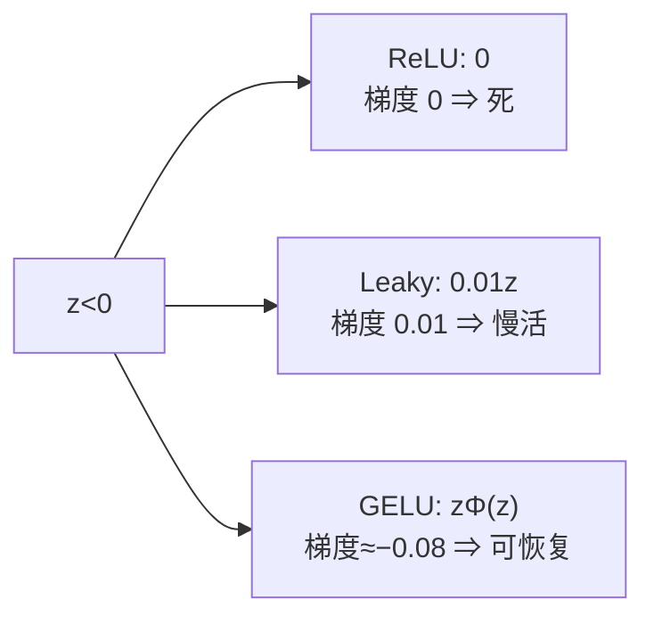

# DL-010 激活函数：Leaky ReLU、GELU 与选型

## 1. 本节学习目标

1. 说清 ReLU 的**死神经元**问题，以及 Leaky ReLU 怎么缓解。
2. 写出 GELU 的形式，理解它为什么是 Transformer 的默认选择。
3. 会用数值对比 ReLU / Leaky ReLU / GELU 在负半轴的行为。
4. 形成**激活函数选型检查表**。

## 2. 为什么需要这个知识

因为 ReLU 虽然好用，但有一个硬伤：**一旦某个神经元在训练中"死了"（对所有样本都输出 0），它就永远不恢复**——因为梯度也是 0，参数再也不会更新。

本课实测：一个 4 单元隐藏层，训练后**有 1 个单元对全部样本输出 0**。这就是死神经元。

## 3. 直观解释

| 激活 | 负半轴行为 | 类比 |
|---|---|---|
| ReLU | 直接 0，梯度 0 | 门焊死 |
| **Leaky ReLU** | 保留 $0.01z$，梯度 0.01 | 门留一条缝 |
| **GELU** | 平滑过渡到 0，仍有小梯度 | 门是弹簧的，慢慢关 |

**GELU 的特别之处**：它不是硬折线，而是用正态分布累积函数"平滑地"决定让多少通过。

## 4. 正式定义

**Leaky ReLU**

$$
\mathrm{LReLU}(z)=\begin{cases}z,&z>0\\ \alpha z,&z\le0\end{cases}
\qquad \alpha=0.01\ (\text{默认})
$$

**GELU**（Gaussian Error Linear Unit）

$$
\mathrm{GELU}(z)=z\cdot\Phi(z)
$$

$\Phi$ 是标准正态分布的累积分布函数；常用近似：

$$
\Phi(z)\approx\frac12\Big(1+\tanh\Big[\sqrt{2/\pi}\,(z+0.044715z^3)\Big]\Big)
$$

**本课实测**（$\alpha=0.01$）

| $z$ | ReLU | Leaky ReLU | GELU |
|---|---|---|---|
| −2 | 0.0 | **−0.02** | **−0.0455** |
| −1 | 0.0 | **−0.01** | **−0.1587** |
| 0 | 0.0 | 0.0 | 0.0 |
| 1 | 1.0 | 1.0 | **0.8413** |
| 2 | 2.0 | 2.0 | **1.9545** |

## 5. 核心原理

**Leaky ReLU 解决什么**：负半轴梯度 $\alpha=0.01$ 而非 0 ⇒ 即使输出为负，参数仍能以极小步长更新 ⇒ **有机会"复活"**。

**GELU 解决什么**：

1. **平滑**：处处可导（ReLU 在 0 处不可导），优化更稳。
2. **非线性但接近恒等**：$z>2$ 时 $\mathrm{GELU}(z)\approx z$，$z<-2$ 时 $\approx0$，中间平滑过渡。
3. **随机正则的期望**：GELU 可看作"按输入大小随机丢弃"的期望效果，与 Dropout 有理论联系。

**代价**：GELU 计算比 ReLU 贵（要算 tanh 或 erf）。

## 6. 数学表达式

**GELU 在 $z=1$ 处**

$$
\mathrm{GELU}(1)=1\times\Phi(1)=0.8413
$$

（$\Phi(1)=0.8413$ 是标准正态在 1 处的累积概率。）

**在 $z=2$ 处**

$$
\mathrm{GELU}(2)=2\times\Phi(2)=2\times0.9772=1.9545
$$

**在 $z=-1$ 处**

$$
\mathrm{GELU}(-1)=(-1)\times\Phi(-1)=(-1)\times0.1587=-0.1587
$$

**注意**：与 ReLU 不同，GELU 在负半轴**不是 0**，而是一个小的负值。

## 7. 数学推导

**GELU 导数（便于理解"为什么能传梯度"）**

$$
\frac{d}{dz}\big[z\Phi(z)\big]=\Phi(z)+z\varphi(z)
$$

$\varphi$ 是标准正态密度。在 $z=-1$：

$$
\Phi(-1)+(-1)\varphi(-1)=0.1587-0.2420=-0.0833
$$

**负梯度但非零** ⇒ 参数仍会被更新，不会像 ReLU 那样彻底卡死。

**Leaky ReLU 导数**

$$
\frac{d}{dz}\mathrm{LReLU}(z)=\begin{cases}1,&z>0\\ \alpha,&z\le0\end{cases}
$$

## 8. 结构示意图



## 9. 具体计算示例

**死神经元实测（4 单元隐藏层，300 步训练）**

```text
隐藏层激活值（行=样本，列=单元）:
[[0.    0.    4.933 0.   ]
 [0.    0.    4.933 0.   ]
 [4.469 0.    0.    1.971]
 [4.469 0.    0.    1.971]]
为 0 的单元数: 1 / 4
```

**第 1 列对全部 4 个样本都输出 0** ⇒ 这个单元已经死了，而且**梯度恒为 0，永远不更新**。

## 10. Python 实现

```python
import torch
import torch.nn.functional as F

for z in (-2.0, -1.0, 0.0, 1.0, 2.0):
    t = torch.tensor(z)
    print(f"z={z:>4}: relu={float(F.relu(t)):>6.4f} "
          f"leaky={float(F.leaky_relu(t, 0.01)):>7.4f} "
          f"gelu={float(F.gelu(t)):>7.4f}")
```

## 11. PyTorch 实现（三种激活的网络对比）

```python
import torch
import torch.nn as nn

acts = {
    "ReLU": nn.ReLU(),
    "LeakyReLU(0.01)": nn.LeakyReLU(0.01),
    "GELU": nn.GELU(),
}
x = torch.randn(64, 4)
for name, act in acts.items():
    net = nn.Sequential(nn.Linear(4, 32), act, nn.Linear(32, 1))
    y = net(x)
    dead = int((net[1](net[0](x)) == 0).all(dim=0).sum())
    print(f"{name:<16} 输出 {tuple(y.shape)} 全零单元 {dead}/32")
```

## 12. 代码逐行解释

| 代码 | 作用 |
|---|---|
| `F.leaky_relu(t, 0.01)` | 负半轴乘 0.01 |
| `F.gelu(t)` | 精确 GELU（用 erf 实现） |
| `nn.LeakyReLU(0.01)` | 可作为层放进 Sequential |
| `nn.GELU()` | 同上 |
| `(...==0).all(dim=0).sum()` | 统计"对所有样本都输出 0"的单元数（死神经元） |

**注意**：`nn.GELU()` 默认用精确版；`approximate="tanh"` 用近似版（更快）。

## 13. 实际运行结果

```text
z=-2.0: relu=0.0000 leaky=-0.0200 gelu=-0.0455
z=-1.0: relu=0.0000 leaky=-0.0100 gelu=-0.1587
z= 0.0: relu=0.0000 leaky= 0.0000 gelu= 0.0000
z= 1.0: relu=1.0000 leaky= 1.0000 gelu= 0.8413
z= 2.0: relu=2.0000 leaky= 2.0000 gelu= 1.9545
```

**死神经元实测**：

```text
隐藏层激活值（后半轴应全 0）:
[[0.    0.    4.933 0.   ]
 [0.    0.    4.933 0.   ]
 [4.469 0.    0.    1.971]
 [4.469 0.    0.    1.971]]
为 0 的单元数: 1 / 4
```

## 14. 应用场景

| 场景 | 推荐 |
|---|---|
| CNN / MLP 隐藏层（默认） | ReLU |
| 出现大量死神经元 | Leaky ReLU(0.01) / PReLU |
| Transformer / BERT / GPT | **GELU** |
| 需要极致速度 | ReLU |
| 输出层 | 不用这些（用 Sigmoid/Softmax 或不激活） |

## 15. 优点与缺点

| 激活 | 优点 | 缺点 |
|---|---|---|
| ReLU | 快、梯度好 | 死神经元、非零中心 |
| Leaky ReLU | 缓解死亡 | 多一个超参 $\alpha$ |
| GELU | 平滑、效果好 | 计算贵、稍慢 |

## 16. 常见错误

| 错误 | 现象 | 纠正 |
|---|---|---|
| 用 ReLU 且学习率过大 | 大量单元死亡 | 降 lr 或换 Leaky |
| 以为 Leaky 一定更好 | 有时无差别 | 用验证集比较 |
| GELU 用在输出层 | 输出不是概率 | 输出层用 Sigmoid/Softmax |
| 混淆 `nn.GELU` 与 `approximate` | 数值略不同 | 训练/推理保持一致 |
| 不做死神经元检查 | 模型容量悄悄减少 | 定期统计全零单元 |

## 17. 本节总结

- **ReLU 的死神经元是真实问题**：本课 4 单元里死了 1 个。
- **Leaky ReLU** 用 $\alpha z$ 保留负半轴梯度；**GELU** 用 $z\Phi(z)$ 平滑过渡。
- 选型：**CNN/MLP 默认 ReLU，Transformer 用 GELU，死亡严重时 Leaky ReLU**。

## 18. 前置与后续

- 前置：[[DL-009 激活函数——Sigmoid、Tanh、ReLU]]
- 后续：`DL-011 神经网络前向传播`（待建）、`DL-031 梯度裁剪与训练稳定性`（待建）
- 相关数学：[[MATH-122 求导法则与链式法则]]

---

## 练习与参考答案

**基础 1**：ReLU 的"死神经元"是什么？为什么死了就不能恢复？

**基础 2**：本课 $z=-1$ 与 $z=1$ 时，ReLU / Leaky ReLU / GELU 的输出各是多少？

**进阶 1**：GELU 在 $z=1$ 时输出 0.8413 而不是 1，这会影响"信息传递"吗？

**综合**：训练一个 20 层 MLP 时发现 loss 不降，且隐藏层有 40% 单元输出恒为 0。请给出诊断与 3 步修复方案。

> [!success]- 参考答案

> **基础 1**
> 死神经元指某个单元对**所有输入**都输出 0。
> 因为 ReLU 在 $z<0$ 时导数恒为 **0**，反向传播时该单元收到的梯度也是 0 ⇒ 参数永不更新 ⇒ 即使数据变化也醒不过来。
> 常见诱因：学习率过大（一步把权重推到全负区）、初始化不当、输入未归一化。

> **基础 2**
> $z=-1$：ReLU **0.0**、Leaky **−0.01**、GELU **−0.1587**；
> $z=1$：ReLU **1.0**、Leaky **1.0**、GELU **0.8413**。

> **进阶 1**
> 会有**轻微的幅度缩放**，但通常不影响信息传递：
> 1. GELU 的输出是"按输入大小加权"的结果——$z=1$ 时保留 84%，$z=2$ 时保留 97.7%，$z$ 越大越接近恒等；
> 2. 后续层有偏置与权重可以补偿这个缩放；
> 3. 这种"软门控"正是它的优势：小信号被抑制、大信号通过，比 ReLU 的硬截断更平滑。
> 关键看**是否处处可导**（是），而不是是否等于 1。

> **综合（参考）**
> **诊断**：40% 单元全零 + loss 不降 ⇒ 典型的 **Dying ReLU**（叠加可能的梯度消失）。
> **三步修复**：
> 1. **换激活**：`nn.ReLU()` → `nn.LeakyReLU(0.01)` 或 `nn.GELU()`，让负半轴有梯度；
> 2. **降学习率 / 加 warmup**：把 lr 降到原来的 1/10，并加 3–5 epoch warmup（DL-029）；
> 3. **改初始化 + 加归一化**：用 `nn.init.kaiming_normal_`（He 初始化，DL-030），并在每个 Linear 后加 `BatchNorm1d`（DL-036）。
> **验证**：修完后再统计全零单元比例，应显著下降；同时打印每层梯度范数，确认不再是"前层≈0"。

## 学习记录

| 日期 | 状态 | 用时 | 问题 | 复盘 |
|---|---|---|---|---|
| 2026-11-06 | planned | — | — | — |

---

## 🔗 Notion 同步信息

> 以下内容由 Notion「AI Knowledge System · 知识点」数据库按知识 ID 合并而来（导出于 2026-11-09）。

| 属性 | 值 |
|---|---|
| 学科 | 深度学习 |
| 学习状态 | 未开始 |
| 难度 | L2 应用 |
| 知识类型 | Concept |

- **所属模块**：[M-DL-01 深度学习基础与神经网络入门](../%E8%AF%BE%E7%A8%8B%E6%A8%A1%E5%9D%97/M-DL-01%20%E6%B7%B1%E5%BA%A6%E5%AD%A6%E4%B9%A0%E5%9F%BA%E7%A1%80%E4%B8%8E%E7%A5%9E%E7%BB%8F%E7%BD%91%E7%BB%9C%E5%85%A5%E9%97%A8.md)
- **前置知识**：[DL-009 激活函数：Sigmoid、Tanh、ReLU](DL-009%20%E6%BF%80%E6%B4%BB%E5%87%BD%E6%95%B0%E2%80%94%E2%80%94Sigmoid%E3%80%81Tanh%E3%80%81ReLU.md)
- **后继知识**：[DL-011 神经网络前向传播](DL-011%20%E7%A5%9E%E7%BB%8F%E7%BD%91%E7%BB%9C%E5%89%8D%E5%90%91%E4%BC%A0%E6%92%AD.md)
- **关联Python**：[PY-066 矩阵运算](../../01_Python%E5%9F%BA%E7%A1%80/08%20NumPy/PY-066%20%E7%9F%A9%E9%98%B5%E8%BF%90%E7%AE%97.md)
- **关联数学**：[MATH-122 求导法则与链式法则](../../06_%E6%95%B0%E5%AD%A6%E5%9F%BA%E7%A1%80/01%20%E9%AB%98%E7%AD%89%E6%95%B0%E5%AD%A6/MATH-122%20%E6%B1%82%E5%AF%BC%E6%B3%95%E5%88%99%E4%B8%8E%E9%93%BE%E5%BC%8F%E6%B3%95%E5%88%99.md)
