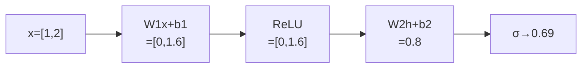

# DL-011 神经网络前向传播

## 1. 本节学习目标

1. 能按"线性变换 → 激活"逐层手算出输出。
2. 理解前向传播**只做计算、不更新参数**。
3. 会用手算结果验证 `nn.Sequential` 的输出（本课两者都是 **0.8**）。
4. 知道前向传播要缓存什么（为反向传播做准备）。

## 2. 为什么需要这个知识

因为**训练的第一步就是前向**：没有预测值，就无法算损失，也就无法求梯度。

同时，前向传播是**推理时的全部内容**——上线做预测，跑的就是前向。所以它既是学习的起点，也是部署的终点。

## 3. 直观解释

前向传播 = **把输入一路"加工"到输出**：

```text
x (2维) → 线性 → z1 → 激活 → h → 线性 → z2 → (激活) → ŷ
```

每一层只做两件事：

1. **线性变换**：$\mathbf{z}=W\mathbf{h}+\mathbf{b}$（换坐标 + 平移）
2. **激活**：$\mathbf{h}=\sigma(\mathbf{z})$（加非线性）

**关键认知**：前向是**单向**的，数据从输入流向输出，没有任何回传。

## 4. 正式定义

**第 $\ell$ 层**

$$
\mathbf{z}^{(\ell)}=W^{(\ell)}\mathbf{h}^{(\ell-1)}+\mathbf{b}^{(\ell)},
\qquad
\mathbf{h}^{(\ell)}=\sigma\big(\mathbf{z}^{(\ell)}\big)
$$

其中 $\mathbf{h}^{(0)}=\mathbf{x}$ 是输入。

**本课的两层网络**

| 层 | 参数 | 形状 |
|---|---|---|
| 1 | $W_1\in\mathbb{R}^{2\times2}$，$\mathbf{b}_1\in\mathbb{R}^{2}$ | 2 → 2 |
| 2 | $W_2\in\mathbb{R}^{1\times2}$，$\mathbf{b}_2\in\mathbb{R}^{1}$ | 2 → 1 |

## 5. 核心原理

**前向传播要"缓存"什么**：反向传播需要每层的输入与激活值。

| 缓存项 | 用途 |
|---|---|
| $\mathbf{h}^{(\ell-1)}$ | 算 $\partial L/\partial W^{(\ell)}=\delta^{(\ell)}(\mathbf{h}^{(\ell-1)})^\top$ |
| $\mathbf{z}^{(\ell)}$ | 算激活导数 $\sigma'(\mathbf{z})$ |
| $W^{(\ell)}$ | 反向传梯度到上一层 |

**PyTorch 的 autograd 自动做这件事**：所以你不用手写缓存，但必须知道**它在缓存**——这就是显存占用的主要来源。

## 6. 数学表达式

**本课全部数值**

给定：

$$
\mathbf{x}=\begin{bmatrix}1\\2\end{bmatrix},\
W_1=\begin{bmatrix}0.5&-0.3\\0.2&0.8\end{bmatrix},\
\mathbf{b}_1=\begin{bmatrix}0.1\\-0.2\end{bmatrix}
$$

$$
W_2=\begin{bmatrix}1.0&0.5\end{bmatrix},\quad \mathbf{b}_2=[0]
$$

**第一层**

$$
\mathbf{z}_1=W_1\mathbf{x}+\mathbf{b}_1=\begin{bmatrix}0.5-0.6+0.1\\0.2+1.6-0.2\end{bmatrix}
=\begin{bmatrix}-0.0\\1.6\end{bmatrix}
$$

**激活（ReLU）**

$$
\mathbf{h}=\mathrm{ReLU}(\mathbf{z}_1)=\begin{bmatrix}0\\1.6\end{bmatrix}
$$

**第二层**

$$
z_2=[1.0,0.5]\begin{bmatrix}0\\1.6\end{bmatrix}+0=0.8
$$

## 7. 数学推导

**逐项展开**

$$
z_{1,1}=0.5\times1+(-0.3)\times2+0.1=0.5-0.6+0.1=0.0
$$

$$
z_{1,2}=0.2\times1+0.8\times2-0.2=0.2+1.6-0.2=1.6
$$

**ReLU**：$\max(0,0)=0$，$\max(0,1.6)=1.6$。

**输出**：

$$
z_2=1.0\times0+0.5\times1.6+0=0.8
$$

**Sigmoid 转概率**：$\sigma(0.8)=0.69$。

## 8. 结构示意图



## 9. 具体计算示例

```text
z1 = [-0.0, 1.6]
h  = [0.0, 1.6]     ← 第一个单元被 ReLU 砍掉了
z2 = 0.8
σ(z2) = 0.69
```

**注意**：第一个隐藏单元输出 0，说明这一路**没有贡献**——ReLU 的稀疏性在这里可见。

## 10. Python 实现

```python
import torch

x = torch.tensor([1.0, 2.0])
W1 = torch.tensor([[0.5, -0.3], [0.2, 0.8]])
b1 = torch.tensor([0.1, -0.2])
W2 = torch.tensor([[1.0, 0.5]])
b2 = torch.tensor([0.0])

z1 = W1 @ x + b1
h = torch.relu(z1)
z2 = W2 @ h + b2

print("z1:", [round(float(v), 4) for v in z1])
print("h=relu(z1):", [round(float(v), 4) for v in h])
print("z2:", [round(float(v), 4) for v in z2])
print("sigmoid(z2):", round(float(torch.sigmoid(z2)), 4))
```

## 11. PyTorch 实现（等价性验证）

```python
import torch
import torch.nn as nn

W1 = torch.tensor([[0.5, -0.3], [0.2, 0.8]])
b1 = torch.tensor([0.1, -0.2])
W2 = torch.tensor([[1.0, 0.5]])
b2 = torch.tensor([0.0])
x = torch.tensor([1.0, 2.0])

net = nn.Sequential(nn.Linear(2, 2), nn.ReLU(), nn.Linear(2, 1))
with torch.no_grad():
    net[0].weight.copy_(W1)
    net[0].bias.copy_(b1)
    net[2].weight.copy_(W2)
    net[2].bias.copy_(b2)
    print("nn.Sequential 输出:", round(float(net(x).detach()), 4))
```

## 12. 代码逐行解释

| 代码 | 作用 |
|---|---|
| `W1 @ x + b1` | 第一层线性变换（矩阵乘向量） |
| `torch.relu(z1)` | 逐元素 ReLU |
| `W2 @ h + b2` | 第二层线性变换 |
| `net[0].weight.copy_(W1)` | 把手算权重塞进层（验证等价） |
| `torch.no_grad()` | 只做前向，不建计算图（省显存） |

**为什么用 `no_grad()`**：验证时不需要梯度，关掉可省内存。

## 13. 实际运行结果

```text
z1: [-0.0, 1.6]
h=relu(z1): [0.0, 1.6]
z2: [0.8]
sigmoid(z2): 0.69
nn.Sequential 输出: 0.8
```

**手算 0.8 = 框架 0.8** ⇒ 前向传播就是"矩阵乘 + 偏置 + 激活"的重复。

## 14. 应用场景

| 场景 | 前向的作用 |
|---|---|
| 训练 | 产生预测 → 算损失 |
| 推理/上线 | **全部计算** |
| 特征提取 | 取中间层输出当作表示 |
| 可视化 | 看每层激活值（如 CAM） |

## 15. 优点与缺点

| 优点 | 缺点 |
|---|---|
| 逻辑简单、可并行 | 层数深时要缓存大量激活 |
| 批量计算高效 | 显存与 batch 成正比 |
| 无状态（同一输入同输出） | 不涉及学习 |

## 16. 常见错误

| 错误 | 现象 | 纠正 |
|---|---|---|
| 用 `W @ x` 但 W 形状错 | 形状不匹配报错 | PyTorch 权重是 `(out,in)`，用 `x @ W.T` |
| 忘记加偏置 | 结果差一个常数 | 检查 `+ b` |
| 输出层也加 ReLU | 概率无法解释 | 输出层不加或换 Sigmoid/Softmax |
| 推理时忘 `no_grad()` | 显存持续增长 | 用 `with torch.no_grad()` |
| 以为前向会更新参数 | 参数不变 | 更新在 `opt.step()` |

## 17. 本节总结

- 前向传播 = **逐层"线性 + 激活"**，从输入算出预测。
- 本课手算 $z_1=[0,1.6]$、$h=[0,1.6]$、$z_2=\mathbf{0.8}$，与 `nn.Sequential` **完全一致**。
- 前向**不更新参数**，但会缓存激活供反向使用。

## 18. 前置与后续

- 前置：[[DL-010 激活函数——Leaky ReLU、GELU 与选型]]
- 后续：[[DL-012 线性变换的矩阵形式]]、[[DL-013 输出层设计与输出维度]]、`DL-020 反向传播：单神经元手算`（待建）
- 相关数学：[[MATH-803 神经网络前向传播]]、[[MATH-217 矩阵运算与维度]]

---

## 练习与参考答案

**基础 1**：前向传播每一层做哪两件事？前向会更新参数吗？

**基础 2**：本课 $z_1$、$h$、$z_2$ 各是多少？

**进阶 1**：如果把隐藏层的 ReLU 换成 Identity（不加激活），$z_2$ 会是多少？为什么这印证了 DL-002？

**综合**：给定一个 3 层网络（2→4→3→1），输入 `x=[1,1]`，请说明"要完整做一次前向，最少需要知道哪些参数"，并写出形状清单。

> [!success]- 参考答案

> **基础 1**
> 每层做：① **线性变换** $\mathbf{z}=W\mathbf{h}+\mathbf{b}$；② **非线性激活** $\mathbf{h}=\sigma(\mathbf{z})$。
> 前向**不更新参数**，它只计算输出；参数更新在反向传播 + 优化器 `step()`。

> **基础 2**
> $z_1=[0.0,\ 1.6]$（第一项 $-0.0$ 是浮点表示）、$h=[0,\ 1.6]$、$z_2=\mathbf{0.8}$；sigmoid 后 0.69。

> **进阶 1**
> 不激活时 $h=z_1=[0,1.6]$（与 ReLU 恰好相同，因为两个值都非负）⇒ $z_2$ 仍是 0.8。
> **这个例子说明单点数值不能证明非线性必要**——要证明必须看**多组输入**下是否可被单层线性等价。
> DL-002 用的是批量对比（$5\times3$ 输入）并算出最大差异 $3.7\times10^{-8}$，而加 ReLU 后差异 0.1573，才是有说服力的证据。

> **综合（参考）**
> 需要知道的参数：
> - 第 1 层：$W_1$ 形状 `(4,2)`、$b_1$ 形状 `(4,)`
> - 第 2 层：$W_2$ 形状 `(3,4)`、$b_2$ 形状 `(3,)`
> - 第 3 层：$W_3$ 形状 `(1,3)`、$b_3$ 形状 `(1,)`
> 计算顺序：
> 1. $z_1=W_1x+b_1$ → `(4,)`，$h_1=\sigma(z_1)$ → `(4,)`
> 2. $z_2=W_2h_1+b_2$ → `(3,)`，$h_2=\sigma(z_2)$ → `(3,)`
> 3. $z_3=W_3h_2+b_3$ → `(1,)`
> 参数量：$(2\times4+4)+(4\times3+3)+(3\times1+1)=12+15+4=\mathbf{31}$。
> 若批量 32 条：把 $x$ 换成 `(32,2)`，输出变 `(32,1)`，其余形状不变。

## 学习记录

| 日期 | 状态 | 用时 | 问题 | 复盘 |
|---|---|---|---|---|
| 2026-11-07 | planned | — | — | — |

---

## 🔗 Notion 同步信息

> 以下内容由 Notion「AI Knowledge System · 知识点」数据库按知识 ID 合并而来（导出于 2026-11-09）。

| 属性 | 值 |
|---|---|
| 学科 | 深度学习 |
| 学习状态 | 未开始 |
| 难度 | L2 应用 |
| 知识类型 | Concept |

- **所属模块**：[M-DL-02 前向传播、损失函数与反向传播](../%E8%AF%BE%E7%A8%8B%E6%A8%A1%E5%9D%97/M-DL-02%20%E5%89%8D%E5%90%91%E4%BC%A0%E6%92%AD%E3%80%81%E6%8D%9F%E5%A4%B1%E5%87%BD%E6%95%B0%E4%B8%8E%E5%8F%8D%E5%90%91%E4%BC%A0%E6%92%AD.md)
- **前置知识**：[DL-010 激活函数：Leaky ReLU、GELU 与选型](DL-010%20%E6%BF%80%E6%B4%BB%E5%87%BD%E6%95%B0%E2%80%94%E2%80%94Leaky%20ReLU%E3%80%81GELU%20%E4%B8%8E%E9%80%89%E5%9E%8B.md)
- **后继知识**：[DL-012 线性变换的矩阵形式](DL-012%20%E7%BA%BF%E6%80%A7%E5%8F%98%E6%8D%A2%E7%9A%84%E7%9F%A9%E9%98%B5%E5%BD%A2%E5%BC%8F.md)
- **关联Python**：[PY-066 矩阵运算](../../01_Python%E5%9F%BA%E7%A1%80/08%20NumPy/PY-066%20%E7%9F%A9%E9%98%B5%E8%BF%90%E7%AE%97.md)
- **关联数学**：[MATH-803 神经网络前向传播](../../06_%E6%95%B0%E5%AD%A6%E5%9F%BA%E7%A1%80/08%20%E6%9C%BA%E5%99%A8%E5%AD%A6%E4%B9%A0%E6%95%B0%E5%AD%A6%E5%BA%94%E7%94%A8/MATH-803%20%E7%A5%9E%E7%BB%8F%E7%BD%91%E7%BB%9C%E5%89%8D%E5%90%91%E4%BC%A0%E6%92%AD.md) · [MATH-217 矩阵运算与维度](../../06_%E6%95%B0%E5%AD%A6%E5%9F%BA%E7%A1%80/02%20%E7%BA%BF%E6%80%A7%E4%BB%A3%E6%95%B0/MATH-217%20%E7%9F%A9%E9%98%B5%E8%BF%90%E7%AE%97%E4%B8%8E%E7%BB%B4%E5%BA%A6.md)
- **对应项目**：[PROJ-016 手写数字分类——全连接基线](../../07_%E5%AE%9E%E6%88%98%E9%A1%B9%E7%9B%AE/04%20%E6%B7%B1%E5%BA%A6%E5%AD%A6%E4%B9%A0%E9%A1%B9%E7%9B%AE/PROJ-016%20%E6%89%8B%E5%86%99%E6%95%B0%E5%AD%97%E5%88%86%E7%B1%BB%E2%80%94%E2%80%94%E5%85%A8%E8%BF%9E%E6%8E%A5%E5%9F%BA%E7%BA%BF.md)
